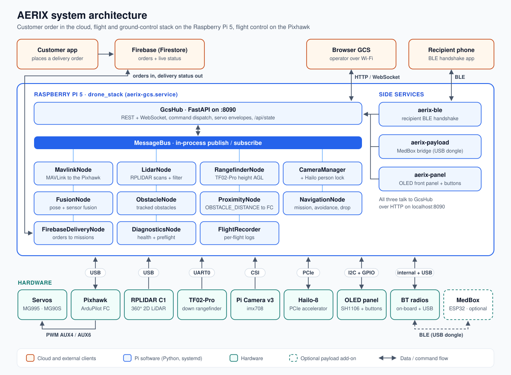
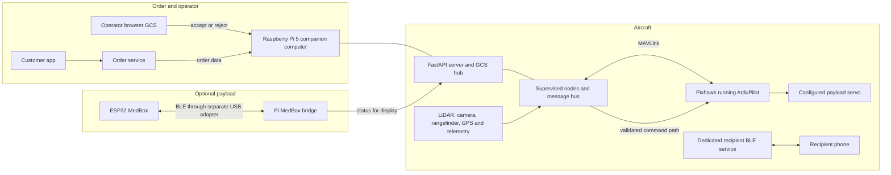
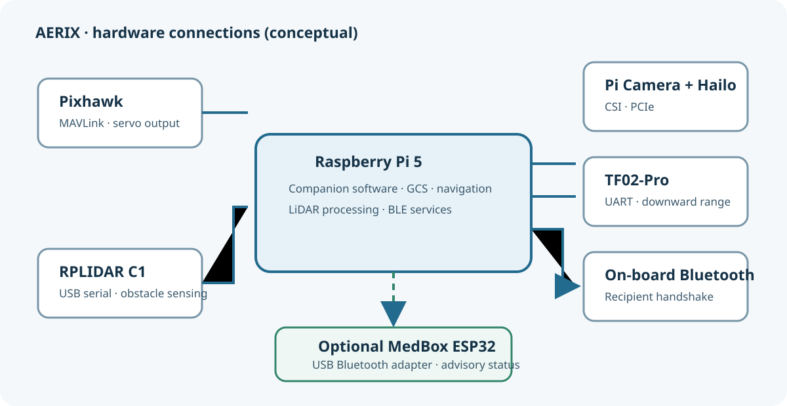
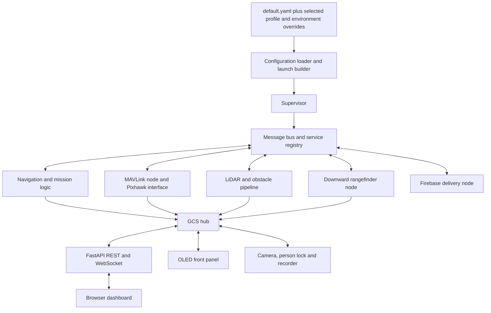
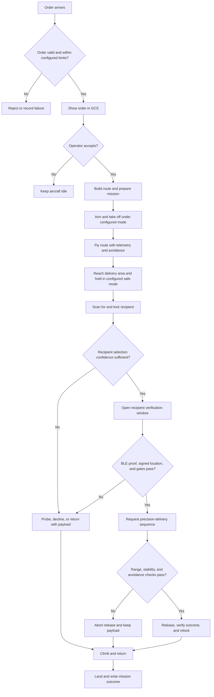
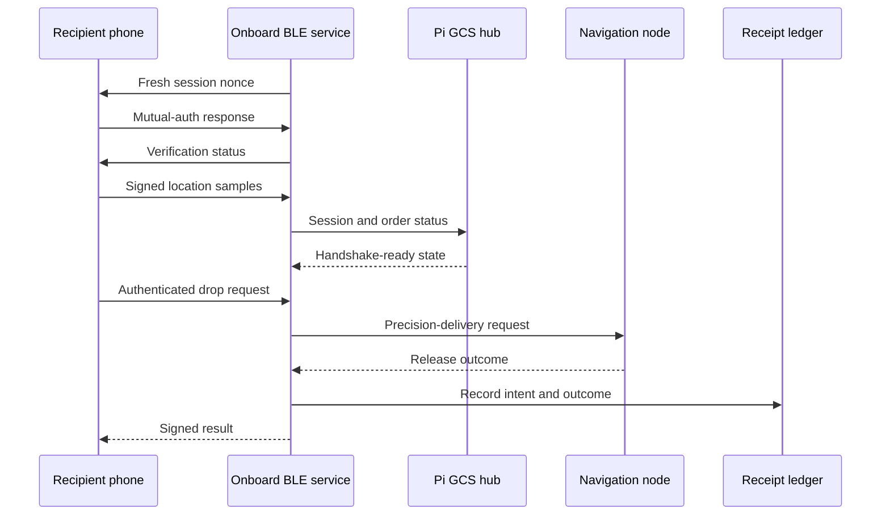
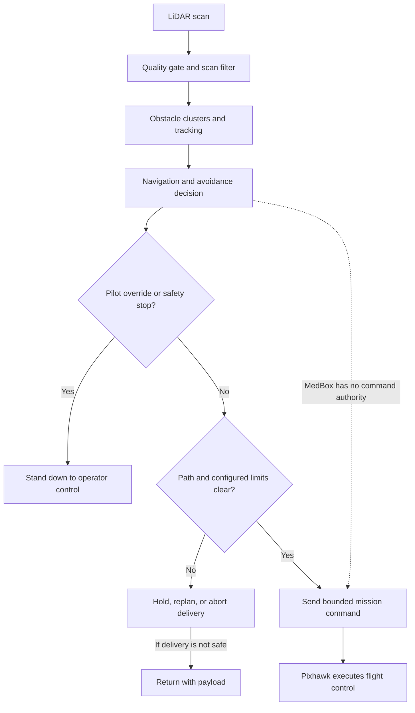
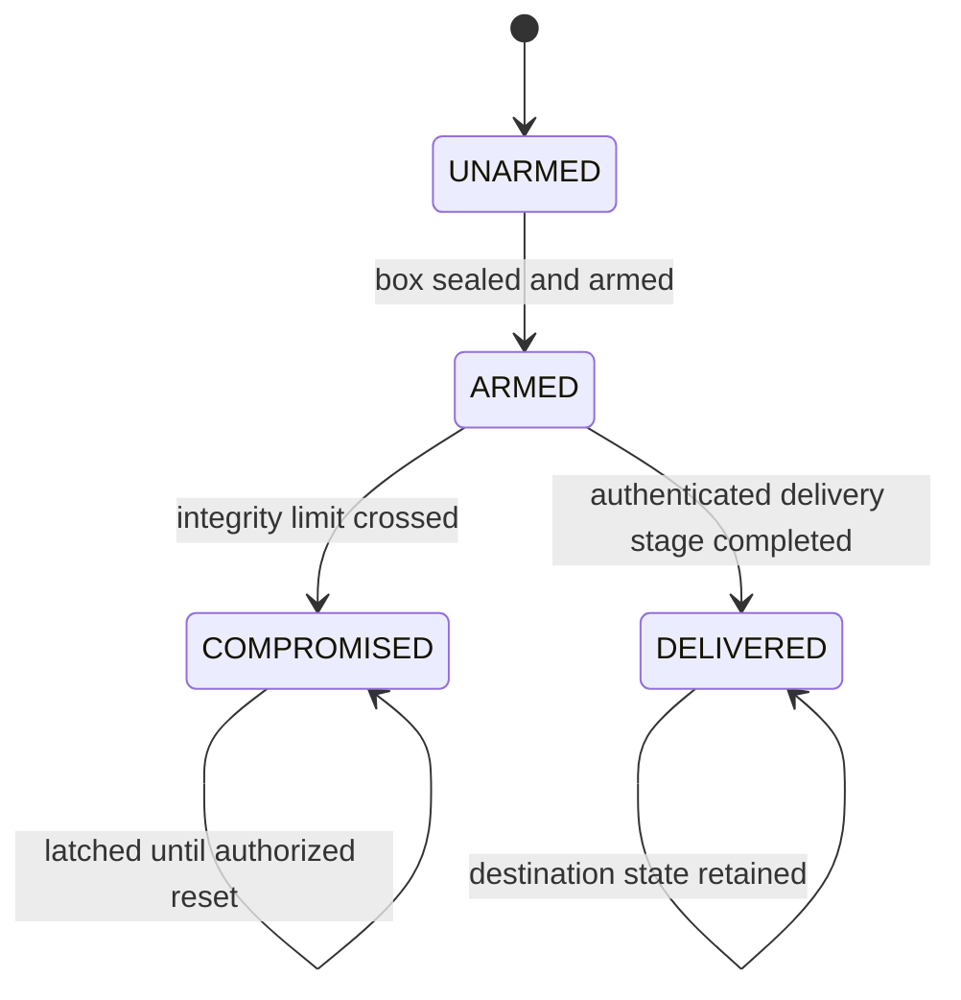
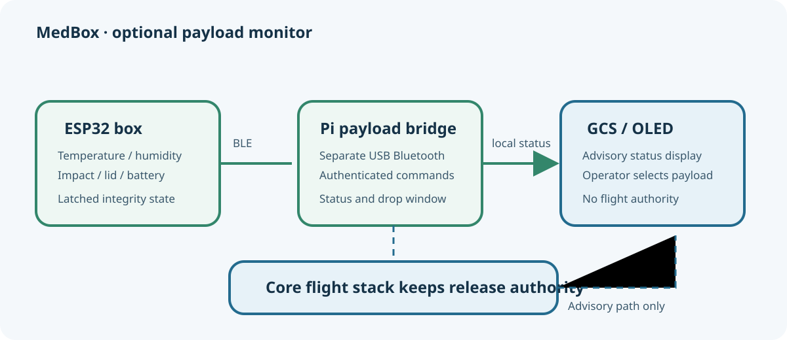
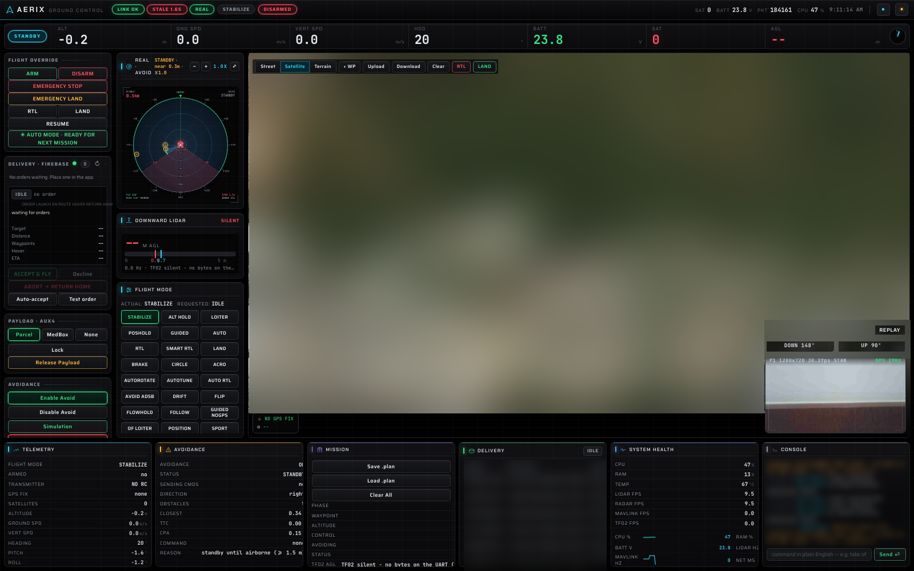

<div align="center">

# AERIX
### Autonomous delivery with a verified handoff

**Capstone Team 21 · Raspberry Pi 5 · Pixhawk / ArduPilot · optional ESP32 MedBox**

AERIX is a research drone-delivery system. An operator reviews each order, the onboard software plans and supervises the delivery, and a cryptographic BLE flow verifies the intended recipient before the precision-delivery sequence can request a release.

[Start here](#project-at-a-glance) · [Architecture](#system-architecture) · [Mission flow](#delivery-mission) · [Safety](#safety-and-evidence) · [Full guide](docs/guide/README.md) · [Optional MedBox](addons/medbox/README.md)



</div>

---

## Project at a glance

AERIX brings together a Python companion-computer stack and a Pixhawk flight controller. The Pi handles the mission workflow, sensor processing, obstacle avoidance, recipient verification, and the browser-based ground control station (GCS). The Pixhawk handles low-level aircraft stabilization and motor control.

The delivery sequence is designed around two checks: the operator must accept the order, and the recipient's phone must prove it holds the one-time credential for that order. LiDAR supports obstacle avoidance; a downward rangefinder supports close-range delivery. The aircraft then returns and records the mission outcome.

**MedBox is an optional add-on.** Its ESP32 monitors the condition of a medical payload and reports status to the GCS. Its status is advisory: it does not authorize or trigger a release, change flight modes, or take over aircraft safety decisions.

> **Project status:** This repository is not a declaration that an aircraft is safe or ready to fly. Simulation, bench, offline, and design evidence are different from a successful flight. Check [evidence tiers](evidence/EVIDENCE_TIERS.md) and [safety guidance](docs/guide/08-safety.md) before interpreting any capability claim.

## Contents

- [System architecture](#system-architecture)
- [Hardware and connections](#hardware-and-connections)
- [Software architecture](#software-architecture)
- [Delivery mission](#delivery-mission)
- [Recipient verification over BLE](#recipient-verification-over-ble)
- [Obstacle avoidance and command authority](#obstacle-avoidance-and-command-authority)
- [Optional MedBox](#optional-medbox)
- [Ground control station and front panel](#ground-control-station-and-front-panel)
- [Repository map](#repository-map)
- [Configuration profiles](#configuration-profiles)
- [Run the software simulation](#run-the-software-simulation)
- [Testing and evidence](#testing-and-evidence)
- [Safety and security](#safety-and-security)
- [Documentation](#documentation)
- [License](#license)

## System architecture

The diagram shows the system boundaries and the main data paths. The flight stack and GCS live on the Raspberry Pi. The Pixhawk controls the aircraft. The recipient phone communicates through the dedicated onboard BLE handshake. When fitted, the MedBox uses a separate Bluetooth adapter and reports box status to the GCS.




**Authority boundary:** the GCS and Pi issue mission-level requests; the Pixhawk performs flight control. A configured release command travels through the flight stack and Pixhawk output. MedBox status does not sit in that release-authority path.

## Hardware and connections

The table describes the current AERIX reference setup. Confirm actual wiring and values in the matching configuration and hardware documentation before connecting or operating equipment.

| Component | Connection / role |
|---|---|
| Raspberry Pi 5 | Companion computer; runs the Python stack, camera pipeline, BLE services, GCS, and OLED-panel service |
| Pixhawk 2.4.8 / ArduPilot | Flight controller; receives MAVLink commands and handles low-level stabilization |
| Slamtec RPLIDAR C1 | USB serial; supplies 2D scans for obstacle detection and avoidance |
| Benewake TF02-Pro | Pi UART; downward range measurement for the precision-delivery sequence |
| Raspberry Pi Camera v3 | CSI camera; live view and person-lock pipeline |
| Hailo-8 AI HAT+ | PCIe accelerator used by the person-detection pipeline when provisioned |
| Payload release servo | Driven by the configured Pixhawk output; channel and pulse limits must come from configuration and hardware commissioning |
| Onboard Bluetooth controller | Dedicated to recipient/order verification |
| Separate USB Bluetooth adapter | Dedicated to the optional MedBox bridge |
| OLED, buttons, and buzzer | Front-panel status and limited operator controls |



See [hardware and connections](docs/guide/02-hardware.md) for the detailed wiring map and [configuration](docs/CONFIGURATION.md) for the settings that select ports and outputs.

## Software architecture

The main runtime is a ROS-free Python application. A configuration loader merges shared defaults with the selected profile. A supervisor starts and watches nodes. Nodes publish typed messages through an in-process message bus and use a service registry for request/response operations.

| Layer | Responsibility | Examples |
|---|---|---|
| Configuration | Shared defaults plus simulation or hardware profile | `config/default.yaml`, `config/sim.yaml`, `config/real.yaml` |
| Runtime | Start nodes, supervise failures, own bus and services | `drone_stack/launch/`, `drone_stack/utils/` |
| Hardware interfaces | Convert device protocols into application messages | MAVLink, LiDAR, rangefinder, Firebase adapters |
| Flight and mission nodes | Navigation, sensor fusion, obstacle tracking, delivery, diagnostics | `drone_stack/nodes/` |
| GCS hub and server | Browser API, commands, state stream, camera and recording endpoints | `drone_stack/gcs/` |
| BLE services | Recipient handshake and optional MedBox status bridge | `drone_stack/ble_handshake/`, `drone_stack/payload/` |
| User interfaces | Browser dashboard and small OLED front panel | `drone_stack/gcs/static/`, `front_panel/` |



The GCS exposes a REST API and a WebSocket state stream. The command route dispatches requests through the GCS hub, where command-specific checks and configured bounds apply. The browser UI and OLED panel are operator interfaces; neither replaces the transmitter or the flight controller's safety mechanisms.

## Delivery mission

AERIX uses an operator-supervised sequence. A database order alone does not start a real-hardware mission. The operator reviews and accepts a valid order before the flight stack starts mission execution.



The exact route geometry, altitudes, speed, acceptance rules, scan behavior, and release timing are configuration-controlled. The [delivery guide](docs/guide/04-delivery-mission.md) explains the stages and gates. The [preflight checklist](docs/PREFLIGHT_CHECKLIST.md) describes checks that must be completed before any hardware operation.

## Recipient verification over BLE

The recipient flow uses a dedicated BLE service and a per-order credential. At a high level, the phone and aircraft exchange a fresh challenge, authenticate, validate signed location samples against the configured micro-geofence, and then submit an authenticated drop request. The delivery result is returned after the aircraft-side flow reports its outcome.



Credential handling is security-sensitive. Real service-account files, order tokens, signing keys, receipt state, and MedBox shared keys belong on provisioned devices or in approved secret storage. Keep them out of Git, issue reports, screenshots, and logs. See the [BLE security guide](docs/guide/06-ble-handshake-security.md) and [threat model](docs/security/THREAT_MODEL.md).

## Obstacle avoidance and command authority

LiDAR scans pass through the configured driver and filtering stages, then feed obstacle tracking and navigation. The stack can also provide proximity data to the flight controller. A pilot override must take priority over autonomous mission requests. Avoidance can prevent a planned motion or delivery attempt; a blocked or uncertain path should result in a safe abort/return decision rather than forcing a release.



Configuration and field wiring are load-bearing. Do not infer that a software value proves an output pin, servo, mode, or failsafe behaves as intended. The [safety guide](docs/guide/08-safety.md) documents the known operating constraints and evidence limits.

## Optional MedBox

MedBox is a removable medical-box monitoring add-on, not a requirement for parcel delivery. The ESP32 watches configured box sensors (such as temperature/humidity, impact, lid state, and battery) and reports a condition state over BLE. The Pi bridge forwards that state to the GCS and OLED.





The bridge uses a separate Bluetooth adapter from the recipient handshake. A missing or compromised MedBox can change the displayed payload condition; it does not command the flight controller or authorize the release servo. Read the [MedBox guide](addons/medbox/README.md), [protocol overview](addons/medbox/docs/protocol.md), and [integration boundary](addons/medbox/docs/integration.md) before working on the add-on.

## Ground control station and front panel

The browser GCS provides live aircraft state, mission/order controls, camera view, diagnostics, and payload status. The WebSocket carries state updates and supported control messages; REST endpoints provide state and other resources. The OLED panel is a compact companion display with a small set of controls and alerts.



For endpoint behavior and UI responsibilities, see [the GCS guide](docs/guide/07-ground-control-station.md). For the physical panel, see [`front_panel/README.md`](front_panel/README.md).

## Repository map

| Path | Contents |
|---|---|
| `drone_stack/` | Python package: bus, typed messages, services, interfaces, navigation nodes, GCS, BLE, payload bridge, simulation |
| `config/` | Shared, simulation, real-hardware, and experimental configuration templates |
| `scripts/` | Run, setup, diagnostics, simulation, evidence, and maintenance helpers |
| `tests/` | Unit and simulation tests; hardware-dependent claims still need separate evidence |
| `front_panel/` | OLED panel, buttons, and buzzer UI |
| `addons/medbox/` | Optional ESP32 firmware and MedBox documentation |
| `parcel_delivery/` | Earlier standalone prototype, separate from the current `drone_stack/` runtime |
| `person_detect/` | Standalone person-detection experiments |
| `docs/` | Guides, setup notes, architecture, configuration, safety, security, and design notes |
| `evidence/` | Evidence tiers, protocol records, and flight-day documentation |

## Configuration profiles

The loader starts with `config/default.yaml` and applies the selected profile (`config/sim.yaml` or `config/real.yaml`) plus supported environment overrides. Review the actual YAML before running a profile.

| Profile | Purpose | Important distinction |
|---|---|---|
| `sim.yaml` | Software simulation without flight hardware | Mock interfaces and simulation-specific delivery behavior; not evidence of flight safety |
| `real.yaml` | Reference hardware profile | Device paths and aircraft-specific values; must be reviewed and validated against the actual airframe |
| `default.yaml` | Shared baseline | Supplies values inherited by profiles; not a flight clearance |

Do not commit real credentials or live delivery state. The repository contains example placeholders only; provision private keys and service credentials separately. See [configuration details](docs/CONFIGURATION.md).

## Run the software simulation

The simulation is the safest way to explore the software workflow. It does not require a connected Pixhawk or sensors and cannot prove that the real aircraft, wiring, or failsafes are safe.

```bash
git clone https://github.com/GVishwasReddy/AERIX-Capstone-Team-21.git
cd AERIX-Capstone-Team-21
python3 -m venv .venv
source .venv/bin/activate
pip install -r requirements-dev.txt
pip install -e .
scripts/run_sim.sh
```

The GCS uses port `8000` by default when launched by the run script; `GCS_PORT` can override it. Open `http://localhost:8000` in a browser. For details on installation, testing, and deployment boundaries, follow [guide 09](docs/guide/09-setup-deployment-testing.md) and [INSTALL.md](docs/INSTALL.md).

## Testing and evidence

Run the software tests from the repository root after installing development requirements:

```bash
python -m pytest -q
```

Tests exercise code paths and simulated behavior. They do not validate physical installation, actual servo output, radio behavior, flight-controller parameters, or flight safety. The [evidence tiers](evidence/EVIDENCE_TIERS.md) distinguish hardware, bench, simulation, offline, and design claims. Do not describe a simulation or design feature as flown.

## Safety and security

AERIX controls real aircraft hardware. At minimum:

- Treat hardware operations and real-profile commands as consequential; review the script and configuration before use.
- Keep the transmitter/operator in control. A pilot override must take precedence over autonomy.
- Use the configured safe hold mode; do not substitute altitude-hold modes that require continuous throttle input for unattended delivery.
- Confirm the altitude ceiling, servo channel and pulse bounds, LiDAR direction, rangefinder signal, and flight-controller parameters on the actual hardware.
- The current reference real profile has failsafes disabled for bench work. The preflight check is expected to report NO-GO until required settings are corrected and verified. The project is not flight-ready by default.
- Never run two processes that compete for the Pixhawk serial port.
- Keep Firebase credentials, order tokens, receipt keys, customer location data, MedBox HMAC material, logs, and recordings private. The `.gitignore` excludes known local-only files; review every new file before publishing.
- Treat novelty modules as design-stage unless evidence says otherwise. Read the evidence file before relying on a feature.

Read the full [safety guide](docs/guide/08-safety.md), [preflight checklist](docs/PREFLIGHT_CHECKLIST.md), and [security threat model](docs/security/THREAT_MODEL.md). Do not deploy to the Pi or operate the aircraft based only on this README.

## Documentation

- [System guide index](docs/guide/README.md)
- [Hardware and connections](docs/guide/02-hardware.md)
- [Software architecture](docs/guide/03-software-architecture.md)
- [Delivery mission](docs/guide/04-delivery-mission.md)
- [Perception and avoidance](docs/guide/05-perception-and-avoidance.md)
- [BLE verification and security](docs/guide/06-ble-handshake-security.md)
- [GCS and front panel](docs/guide/07-ground-control-station.md)
- [Safety](docs/guide/08-safety.md)
- [Setup, deployment, and testing](docs/guide/09-setup-deployment-testing.md)
- [Optional MedBox add-on](addons/medbox/README.md)
- [Configuration reference](docs/CONFIGURATION.md)
- [Installation](docs/INSTALL.md)
- [Preflight checklist](docs/PREFLIGHT_CHECKLIST.md)
- [Evidence tiers](evidence/EVIDENCE_TIERS.md)

## License

To be decided by the team.
