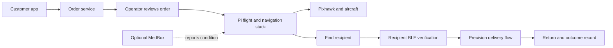

<div align="center">

# AERIX · Autonomous delivery, verified handoff

**A Raspberry Pi 5 and Pixhawk based delivery drone, with an optional MedBox payload for monitored medical deliveries.**

[System guide](docs/guide/README.md) · [Architecture](docs/guide/03-software-architecture.md) · [Delivery flow](docs/guide/04-delivery-mission.md) · [Safety](docs/guide/08-safety.md) · [MedBox add-on](addons/medbox/README.md)


</div>

## What AERIX does

AERIX connects an order workflow to an operator-supervised autonomous flight. The aircraft uses a Raspberry Pi 5 companion computer, a Pixhawk flight controller, LiDAR based obstacle avoidance, a camera, and a downward rangefinder for close delivery work. A BLE handshake verifies the intended recipient before the delivery flow can request a release.



MedBox is an optional payload monitor. It reports box condition to the ground control station; it does not command the aircraft or gate the release.


## Documentation

Start with the [guide index](docs/guide/README.md). It links nine short guides covering the system, hardware, software architecture, delivery mission, perception, BLE security, ground control, safety, and setup/testing. The [MedBox guide](addons/medbox/README.md) covers the optional ESP32 payload.

| Area | What is there |
|---|---|
| `drone_stack/` | ROS-free Python flight, navigation, payload, BLE, and GCS services |
| `config/` | Simulation and hardware configuration templates |
| `front_panel/` | OLED status panel and button controls |
| `addons/medbox/` | Optional ESP32 medical-box monitor and integration notes |
| `scripts/` | Simulation, setup, diagnostics, and maintenance tools |
| `tests/` | Unit and simulation tests |
| `docs/` | System guides, architecture, security, and evidence notes |
| `evidence/` | Evidence tiers and flight-day records |

## Start in simulation

Requirements: Python 3.11 or newer. Simulation does not require a flight controller or sensors.

```bash
git clone https://github.com/GVishwasReddy/AERIX-Capstone-Team-21.git
cd AERIX-Capstone-Team-21
python3 -m venv .venv
source .venv/bin/activate
pip install -r requirements-dev.txt
pip install -e .
scripts/run_sim.sh
```

Open the local dashboard at `http://localhost:8000` (or set `GCS_PORT`). See [setup, deployment, and testing](docs/guide/09-setup-deployment-testing.md) before using any hardware.

## Safety and evidence

This repository describes a research and capstone system. A successful simulation or test is not proof that an aircraft is safe to fly. Follow the [preflight checklist](docs/PREFLIGHT_CHECKLIST.md), review the [evidence tiers](evidence/EVIDENCE_TIERS.md), and verify all hardware and failsafe settings with a qualified operator. The project is not flight-ready by default.

## License

To be decided by the team.
