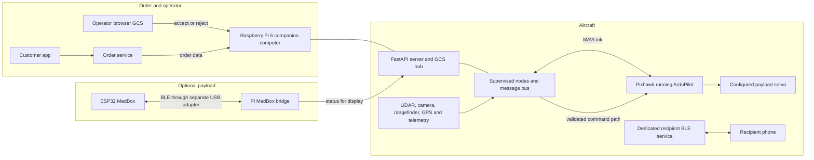
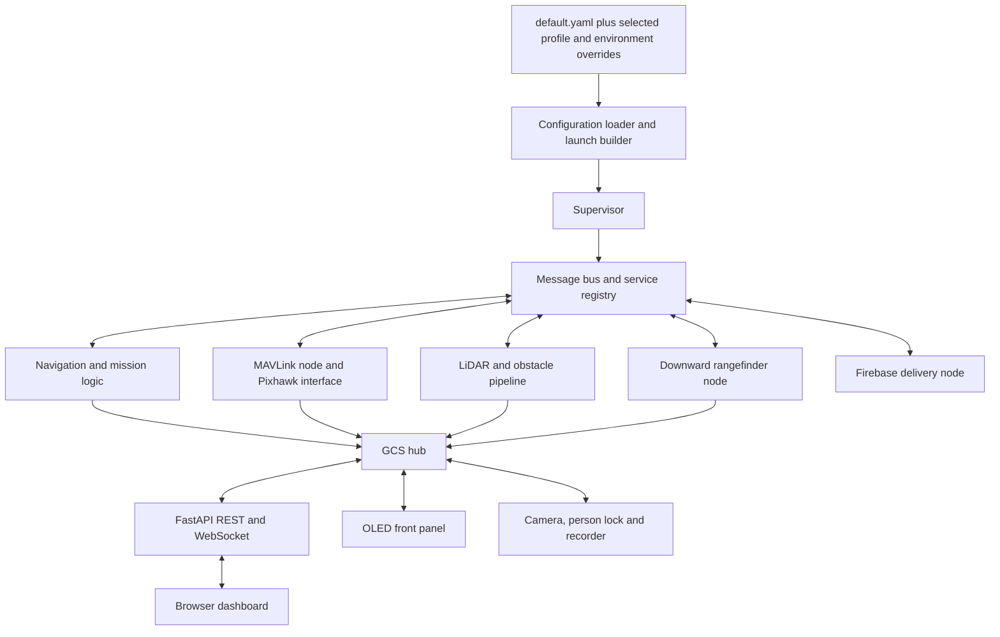
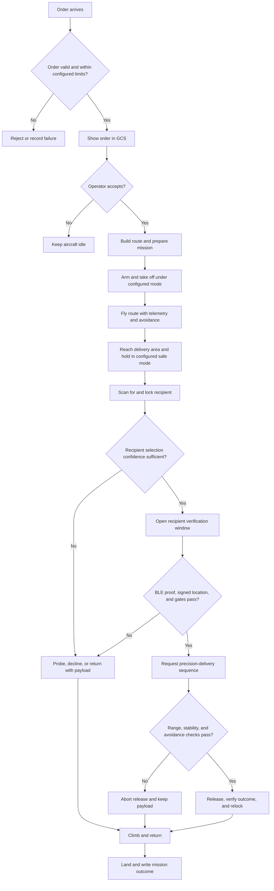
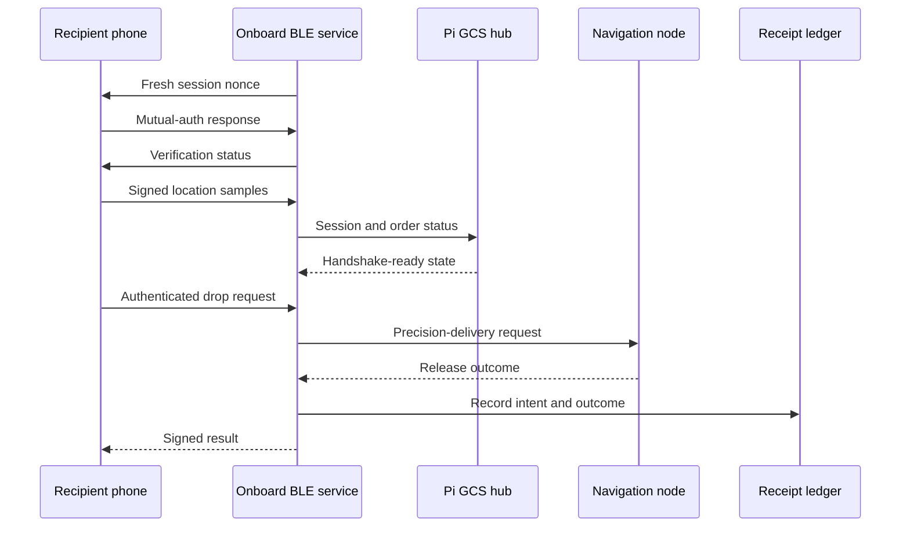
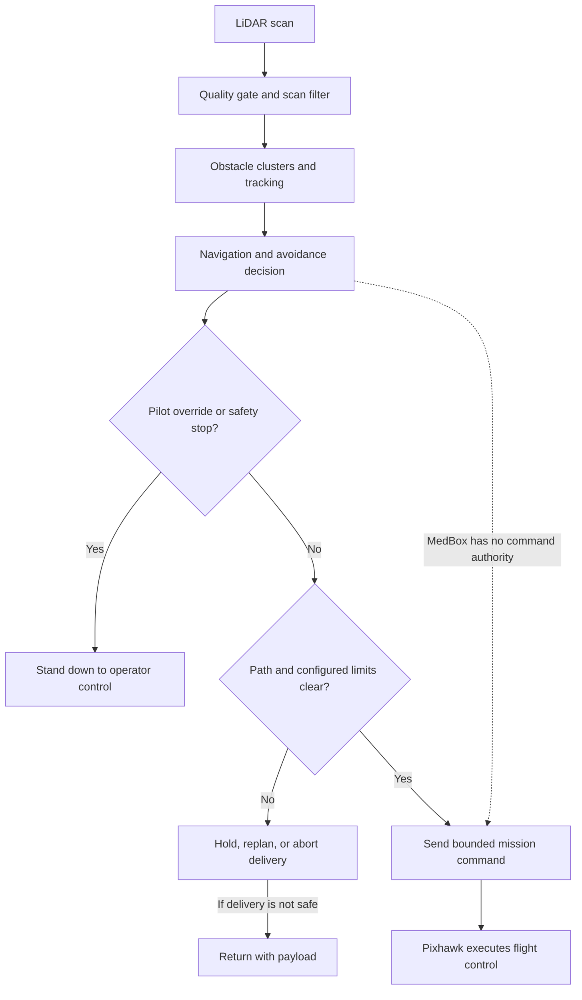
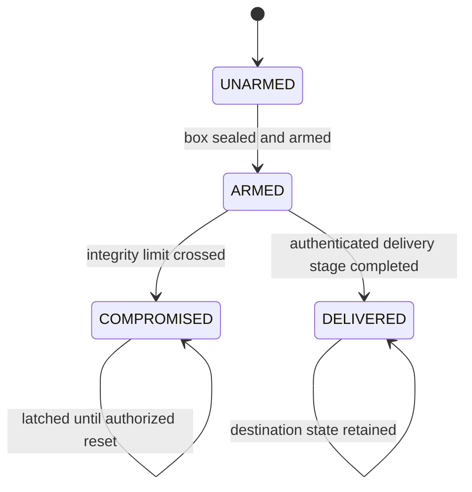

<div align="center">

# AERIX
### Autonomous delivery with a verified handoff

**Capstone Team 21 · Raspberry Pi 5 · Pixhawk / ArduPilot · optional ESP32 MedBox**

AERIX is a research drone-delivery system. An operator reviews each order, the onboard software plans and supervises the delivery, and a cryptographic BLE flow verifies the intended recipient before the precision-delivery sequence can request a release.

[Start here](#project-at-a-glance) · [Quick start](#quick-start) · [How to run](#how-to-run) · [Architecture](#system-architecture) · [Mission flow](#delivery-mission) · [Safety](#safety-and-security) · [Full guide](docs/guide/README.md) · [Optional MedBox](addons/medbox/README.md)


</div>

---

## Project at a glance

AERIX brings together a Python companion-computer stack and a Pixhawk flight controller. The Pi handles the mission workflow, sensor processing, obstacle avoidance, recipient verification, and the browser-based ground control station (GCS). The Pixhawk handles low-level aircraft stabilization and motor control.

The delivery sequence is designed around two checks: the operator must accept the order, and the recipient's phone must prove it holds the one-time credential for that order. LiDAR supports obstacle avoidance; a downward rangefinder supports close-range delivery. The aircraft then returns and records the mission outcome.

**MedBox is an optional add-on.** Its ESP32 monitors the condition of a medical payload and reports status to the GCS. Its status is advisory: it does not authorize or trigger a release, change flight modes, or take over aircraft safety decisions.

> **Project status:** This repository is not a declaration that an aircraft is safe or ready to fly. Simulation, bench, offline, and design evidence are different from a successful flight. Check [evidence tiers](evidence/EVIDENCE_TIERS.md) and [safety guidance](docs/guide/08-safety.md) before interpreting any capability claim.

### What works today (evidence status)

Every capability claim in this project carries an evidence tier from [evidence/EVIDENCE_TIERS.md](evidence/EVIDENCE_TIERS.md): **ON HARDWARE** (ran on the Pi + Pixhawk, recorded in a log or receipt), **BENCH-SW** (real code driven end to end by tests, only hardware edges stubbed), **SIM-TESTED** (simulation through the real code), **OFFLINE** (measured on recorded data) and **DESIGN** (written, unit-tested at most).

| Capability | Tier |
|---|---|
| Phone handshake → release → signed receipt chain | ON HARDWARE (bench and ground releases, not full deliveries) |
| Single-use order token, spent only after release | ON HARDWARE |
| Fail-closed result codes (AUTH_FAIL, SIGNATURE_FAIL, GEOFENCE_FAIL, NOT_READY, PILOT_OVERRIDE) | ON HARDWARE + BENCH-SW (attack table) |
| Session binding / nonce expiry, sealed token storage, hash-chained release ledger, signed RESULT | BENCH-SW |
| Pilot takeover → autonomy stands down | Seen ON HARDWARE; ceiling and stand-down SIM-TESTED |
| Person scan + precision drop on the TF02-Pro | SIM-TESTED (deployed, not yet flown) |
| Picking the phone holder among 2–3 people | SIM-TESTED |
| LiDAR avoidance around the handover | SIM-TESTED + bench noise tests |
| Person detection at the drop point | OFFLINE (64.4 % recall, 57.4 % precision on 40 aerial frames) |
| Novelty layer (`drone_stack/novelty/`) | DESIGN, off by default |

## Quick start

Run the full ground control station against a simulated drone on any Linux or macOS machine with Python 3.11+. No hardware is needed.

```bash
git clone https://github.com/GVishwasReddy/AERIX-Capstone-Team-21.git
cd AERIX-Capstone-Team-21
python3 -m venv .venv
source .venv/bin/activate
pip install -r requirements-dev.txt
pip install -e .
scripts/run_gcs.sh                      # sim profile, http://localhost:8000
```

In a second terminal, send it a test delivery 40 m north of the simulated drone:

```bash
source .venv/bin/activate
scripts/inject_order.py --url http://127.0.0.1:8000 --north 40 --auto
```

Watch the simulated aircraft take off, fly the route, hold at the drop point and return in the browser. The full walkthrough, including the real Raspberry Pi setup, is in [How to run](#how-to-run).

## Contents

- [What works today](#what-works-today-evidence-status)
- [Quick start](#quick-start)
- [System architecture](#system-architecture)
- [Hardware and connections](#hardware-and-connections)
- [Software architecture](#software-architecture)
- [Delivery mission](#delivery-mission)
- [Recipient verification over BLE](#recipient-verification-over-ble)
- [Obstacle avoidance and command authority](#obstacle-avoidance-and-command-authority)
- [Optional MedBox](#optional-medbox)
- [Ground control station and front panel](#ground-control-station-and-front-panel)
- [GCS API](#gcs-api)
- [Repository map](#repository-map)
- [Configuration profiles](#configuration-profiles)
- [Key operating values](#key-operating-values)
- [How to run](#how-to-run)
- [Testing and evidence](#testing-and-evidence)
- [Troubleshooting](#troubleshooting)
- [Safety and security](#safety-and-security)
- [Documentation](#documentation)
- [License](#license)

## System architecture

The diagram shows the system boundaries and the main data paths. The flight stack and GCS live on the Raspberry Pi. The Pixhawk controls the aircraft. The recipient phone communicates through the dedicated onboard BLE handshake. When fitted, the MedBox uses a separate Bluetooth adapter and reports box status to the GCS.




**Authority boundary:** the GCS and Pi issue mission-level requests; the Pixhawk performs flight control. A configured release command travels through the flight stack and Pixhawk output. MedBox status does not sit in that release-authority path.

## Hardware and connections

The table describes the current AERIX reference setup. Confirm actual wiring and values in the matching configuration and hardware documentation before connecting or operating equipment.

| Component | Connection / role |
|---|---|
| Raspberry Pi 5 | Companion computer; runs the Python stack, camera pipeline, BLE services, GCS, and OLED-panel service |
| Pixhawk 2.4.8 / ArduPilot | Flight controller; receives MAVLink commands and handles low-level stabilization |
| Slamtec RPLIDAR C1 | USB serial; supplies 2D scans for obstacle detection and avoidance |
| Benewake TF02-Pro | Pi UART; downward range measurement for the precision-delivery sequence |
| Raspberry Pi Camera v3 | CSI camera; live view and person-lock pipeline |
| Hailo-8 AI HAT+ | PCIe accelerator used by the person-detection pipeline when provisioned |
| Payload release servo | Driven by the configured Pixhawk output; channel and pulse limits must come from configuration and hardware commissioning |
| Onboard Bluetooth controller | Dedicated to recipient/order verification |
| Separate USB Bluetooth adapter | Dedicated to the optional MedBox bridge |
| OLED, buttons, and buzzer | Front-panel status and limited operator controls |


See [hardware and connections](docs/guide/02-hardware.md) for the detailed wiring map and [configuration](docs/CONFIGURATION.md) for the settings that select ports and outputs.

## Software architecture

The main runtime is a ROS-free Python application. A configuration loader merges shared defaults with the selected profile. A supervisor starts and watches nodes. Nodes publish typed messages through an in-process message bus and use a service registry for request/response operations.

| Layer | Responsibility | Examples |
|---|---|---|
| Configuration | Shared defaults plus simulation or hardware profile | `config/default.yaml`, `config/sim.yaml`, `config/real.yaml` |
| Runtime | Start nodes, supervise failures, own bus and services | `drone_stack/launch/`, `drone_stack/utils/` |
| Hardware interfaces | Convert device protocols into application messages | MAVLink, LiDAR, rangefinder, Firebase adapters |
| Flight and mission nodes | Navigation, sensor fusion, obstacle tracking, delivery, diagnostics | `drone_stack/nodes/` |
| GCS hub and server | Browser API, commands, state stream, camera and recording endpoints | `drone_stack/gcs/` |
| BLE services | Recipient handshake and optional MedBox status bridge | `drone_stack/ble_handshake/`, `drone_stack/payload/` |
| User interfaces | Browser dashboard and small OLED front panel | `drone_stack/gcs/static/`, `front_panel/` |



The GCS exposes a REST API and a WebSocket state stream. The command route dispatches requests through the GCS hub, where command-specific checks and configured bounds apply. The browser UI and OLED panel are operator interfaces; neither replaces the transmitter or the flight controller's safety mechanisms.

## Delivery mission

AERIX uses an operator-supervised sequence. A database order alone does not start a real-hardware mission. The operator reviews and accepts a valid order before the flight stack starts mission execution.



The exact route geometry, altitudes, speed, acceptance rules, scan behavior, and release timing are configuration-controlled. The [delivery guide](docs/guide/04-delivery-mission.md) explains the stages and gates. The [preflight checklist](docs/PREFLIGHT_CHECKLIST.md) describes checks that must be completed before any hardware operation.

## Recipient verification over BLE

The recipient flow uses a dedicated BLE service and a per-order credential. At a high level, the phone and aircraft exchange a fresh challenge, authenticate, validate signed location samples against the configured micro-geofence, and then submit an authenticated drop request. The delivery result is returned after the aircraft-side flow reports its outcome.



Credential handling is security-sensitive. Real service-account files, order tokens, signing keys, receipt state, and MedBox shared keys belong on provisioned devices or in approved secret storage. Keep them out of Git, issue reports, screenshots, and logs. See the [BLE security guide](docs/guide/06-ble-handshake-security.md) and [threat model](docs/security/THREAT_MODEL.md).

## Obstacle avoidance and command authority

LiDAR scans pass through the configured driver and filtering stages, then feed obstacle tracking and navigation. The stack can also provide proximity data to the flight controller. A pilot override must take priority over autonomous mission requests. Avoidance can prevent a planned motion or delivery attempt; a blocked or uncertain path should result in a safe abort/return decision rather than forcing a release.



Configuration and field wiring are load-bearing. Do not infer that a software value proves an output pin, servo, mode, or failsafe behaves as intended. The [safety guide](docs/guide/08-safety.md) documents the known operating constraints and evidence limits.

## Optional MedBox

MedBox is a removable medical-box monitoring add-on, not a requirement for parcel delivery. The ESP32 watches configured box sensors (such as temperature/humidity, impact, lid state, and battery) and reports a condition state over BLE. The Pi bridge forwards that state to the GCS and OLED.




The bridge uses a separate Bluetooth adapter from the recipient handshake. A missing or compromised MedBox can change the displayed payload condition; it does not command the flight controller or authorize the release servo. Read the [MedBox guide](addons/medbox/README.md), [protocol overview](addons/medbox/docs/protocol.md), and [integration boundary](addons/medbox/docs/integration.md) before working on the add-on.

## Ground control station and front panel

The browser GCS provides live aircraft state, mission/order controls, camera view, diagnostics, and payload status. The WebSocket carries state updates and supported control messages; REST endpoints provide state and other resources. The OLED panel is a compact companion display with a small set of controls and alerts.


For endpoint behavior and UI responsibilities, see [the GCS guide](docs/guide/07-ground-control-station.md). For the physical panel, see [`front_panel/README.md`](front_panel/README.md).

## GCS API

The GCS server ([`drone_stack/gcs/server.py`](drone_stack/gcs/server.py)) is a FastAPI app. The browser dashboard, the OLED panel, the BLE peripheral and the helper scripts all use the same endpoints.

| Method | Route | Purpose |
|---|---|---|
| `GET` | `/` | Operator dashboard (static files in `drone_stack/gcs/static/`, served from disk with no-cache headers) |
| `GET` | `/api/state` | Full aircraft, mission, delivery, BLE and payload state as JSON; read-only and safe to poll |
| `POST` | `/api/command` | `{"cmd": "<name>", "params": {...}}`; dispatched by the GCS hub with per-command checks and configured bounds |
| `GET` / `POST` | `/api/mission/plan` | Read or set the planned route |
| `GET` | `/api/logs` | Recent log lines |
| `GET` | `/api/recording`, `/api/recording/video`, `/api/recording/poster.jpg` | Flight recording status, replay video and poster frame |
| `GET` | `/api/camera/{id}`, `/api/camera/{id}/stream` | Camera info and live MJPEG stream |
| `WS` | `/ws` | State stream (about 15 Hz, credit-windowed with deltas); also accepts `{cmd, params}` commands, `frame_ack` and `ping` |

Example (read-only):

```bash
curl -s http://localhost:8000/api/state | python3 -m json.tool | less
```

## Repository map

| Path | Contents |
|---|---|
| `drone_stack/` | Python package: bus, typed messages, services, interfaces, navigation nodes, GCS, BLE, payload bridge, simulation |
| `config/` | Shared, simulation, real-hardware, and experimental configuration templates |
| `scripts/` | Run, setup, diagnostics, simulation, evidence, and maintenance helpers |
| `tests/` | Unit and simulation tests; hardware-dependent claims still need separate evidence |
| `front_panel/` | OLED panel, buttons, and buzzer UI |
| `addons/medbox/` | Optional ESP32 firmware and MedBox documentation |
| `parcel_delivery/` | Earlier standalone prototype, separate from the current `drone_stack/` runtime |
| `person_detect/` | Standalone person-detection experiments |
| `docs/` | Guides, setup notes, architecture, configuration, safety, security, and design notes |
| `evidence/` | Evidence tiers, protocol records, and flight-day documentation |

## Configuration profiles

The loader starts with `config/default.yaml` and applies the selected profile (`config/sim.yaml` or `config/real.yaml`) plus supported environment overrides. Review the actual YAML before running a profile.

| Profile | Purpose | Important distinction |
|---|---|---|
| `sim.yaml` | Software simulation without flight hardware | Mock interfaces and simulation-specific delivery behavior; not evidence of flight safety |
| `real.yaml` | Reference hardware profile | Device paths and aircraft-specific values; must be reviewed and validated against the actual airframe |
| `default.yaml` | Shared baseline | Supplies values inherited by profiles; not a flight clearance |

Do not commit real credentials or live delivery state. The repository contains example placeholders only; provision private keys and service credentials separately. See [configuration details](docs/CONFIGURATION.md).

The simulation and hardware profiles differ in ways that matter:

| Setting | `sim.yaml` | `real.yaml` |
|---|---|---|
| `mode` | `sim` (mock Pixhawk, mock LiDAR, simulated world in `drone_stack/sim/`) | real devices |
| MAVLink | mock Pixhawk (the `udp:127.0.0.1:14550` string is unused) | `/dev/ttyACM0` (Pixhawk over USB) |
| `delivery.source` | `file` (`config/pending_order.json`) | `firestore` |
| `delivery.auto_accept` | `true` | `false`: the operator must press ACCEPT |
| `delivery.upload_to_fc` / `write_back` | `false` / `false` | `true` / `true` |
| `delivery.max_delivery_radius_m` | `500` | `60` |
| Precision drop | off (inherited from `default.yaml`) | on |
| GCS port | 8000 (default for a manual launch) | 8090 (`aerix-gcs` service) |

## Key operating values

These are the values in the reference hardware profile (`config/default.yaml` merged with `config/real.yaml`). They are configuration, not constants: read the YAML on the actual aircraft before relying on any of them.

| Area | Setting | Value |
|---|---|---|
| Altitude | `safety.max_altitude_m` (absolute ceiling, clamped on every command) | 5.0 m |
| Altitude | `safety.altitude_margin_m` (hard-lock BRAKE above the ceiling, while armed) | 0.7 m |
| Altitude | `takeoff_altitude_m` | 5.0 m |
| Authority | `safety.pilot_override_grace_s` (unexpected mode change → stand down) | 1.5 s |
| Authority | `safety.failsafes_enabled` | `false` for bench work: preflight reports NO-GO |
| Orders | `delivery.max_delivery_radius_m` | 60 m from home |
| Orders | Route expansion (`leg_length_m`, `max_legs`) | 25 m legs, at most 24 |
| Cruise | `hover_altitude_m` (route legs) | 5.0 m |
| Hover | `delivery.hover_mode` | `GUIDED` (stick-altitude modes are rejected in code) |
| Person scan | `scan_altitude_m` / `handshake_window_s` | 4.0 m / 30 s |
| Recipient check | `delivery.ble_geofence_m` (phone GPS vs drone GPS) | 12 m |
| Precision drop | `drop_target_agl_m` / `drop_max_attempts` (TF02-Pro) | 0.65 m AGL / 2 attempts |
| Return | `delivery.return_mode` | `RTL` |
| Payload | `payload.out_channel` (release servo) | 12 (Pixhawk AUX4) |
| Camera tilt | `aux2_servo.out_channel` | 14 (Pixhawk AUX6) |
| LiDAR | `lidar.quality_min` (measured knee; raising it increases flicker) | 4 |

## How to run

There are three ways to run AERIX. Pick the one that matches what you want to do.

| Mode | Where | Command | Hardware | Port |
|---|---|---|---|---|
| **Simulation GCS** (recommended) | Laptop or Pi | `scripts/run_gcs.sh` | None | 8000 |
| Headless simulation stack | Laptop or Pi | `scripts/run_sim.sh` | None | legacy Flask dashboard on 8090 |
| Real aircraft | Raspberry Pi 5 | `aerix-gcs` systemd service | Pixhawk, RPLIDAR C1, TF02-Pro, camera | 8090 |

The GCS server is the main entry point in every mode. It builds the full node graph through [`drone_stack/launch/bringup.py`](drone_stack/launch/bringup.py) and serves the FastAPI + WebSocket operator UI on top. `scripts/run_sim.sh` and `scripts/run_real.sh` start only the node graph, with the older Flask dashboard instead of the GCS.

### 1. Prerequisites

| Item | Laptop (simulation) | Raspberry Pi 5 (aircraft) |
|---|---|---|
| OS | Linux or macOS | Raspberry Pi OS 64-bit (Debian 12 "bookworm") |
| Python | 3.11 or newer | 3.11 (ships with the OS) |
| System packages | `python3-venv` | `python3-venv`, `python3-pip`, BlueZ, `fonts-quicksand` (front panel) |
| Serial access | not needed | user in the `dialout` group |
| Optional | `rsync` + SSH key access to the Pi, for deploying | Picamera2 and the Hailo-8 runtime, for camera and person lock |
| MedBox firmware | [PlatformIO](https://platformio.org/) | not needed |

Picamera2, OpenCV and the Hailo runtime are imported lazily. On a laptop they are simply absent: the GCS logs a warning and runs without camera features.

### 2. Install the main stack

```bash
git clone https://github.com/GVishwasReddy/AERIX-Capstone-Team-21.git
cd AERIX-Capstone-Team-21
python3 -m venv .venv
source .venv/bin/activate

# Laptop / simulation / development
pip install -r requirements-dev.txt
pip install -e .

# On the Pi with real hardware, also install the RPLIDAR driver
pip install -r requirements-hardware.txt
```

`pip install -e .` installs the `drone_stack` package and two console commands from [`pyproject.toml`](pyproject.toml):

| Command | Same as |
|---|---|
| `drone-gcs` | `python -m drone_stack.gcs.server` |
| `drone-stack` | `python -m drone_stack.launch.bringup` |

`firebase-admin` is installed but optional at runtime. Without a service-account key, the delivery node reports `no-credentials` and the file-based and injected order sources keep working.

### 3. Run the simulation GCS

```bash
source .venv/bin/activate
scripts/run_gcs.sh
# same as: python -m drone_stack.gcs.server --config config/sim.yaml --port 8000
```

Open **http://localhost:8000**. `scripts/run_gcs.sh` takes an optional profile path as its first argument (`scripts/run_gcs.sh config/real.yaml`) and honours `GCS_PORT`. The server picks its port from `--port`, then `GCS_PORT`, then 8000, and listens on all interfaces (`--host 0.0.0.0`), so other devices on your network can open it too.

### 4. Fly a simulated delivery

[`scripts/inject_order.py`](scripts/inject_order.py) creates a test order through the same `delivery_inject` service as the GCS **Test order** button. Its default URL is the aircraft's port 8090, so pass `--url` for a laptop GCS:

```bash
# 40 m north of the simulated drone; waits in the GCS for ACCEPT
scripts/inject_order.py --url http://127.0.0.1:8000 --north 40

# accept and fly immediately (simulation only)
scripts/inject_order.py --url http://127.0.0.1:8000 --north 40 --auto

# other options: --east, --lat/--lon, --hover <s>, --alt <m>, --recipient, --order-id
# write config/pending_order.json for the file-backed order source instead
scripts/inject_order.py --north 40 --to-file
```

Without `--auto` the order shows as PENDING in the GCS until the operator accepts it. The simulated aircraft then arms, takes off, flies the legs with Pi-side avoidance, holds at the drop point, and returns and lands. The outcome appears in the delivery panel.

### 5. Headless stack (optional)

```bash
scripts/run_sim.sh          # python -m drone_stack.launch.bringup --config config/sim.yaml
```

This starts every node plus the legacy Flask dashboard on `web.port` (8090) and stops cleanly on `Ctrl-C`. [`scripts/dronectl.py`](scripts/dronectl.py) is a small CLI for it (`start_mission`, `hold`, `rtl`, `emergency_stop`, `--list`).

### 6. Run the tests

```bash
source .venv/bin/activate
python -m pytest -q                              # whole suite
python -m pytest -q tests/test_precision_drop.py # one file
python -m pytest -q -k avoidance                 # by keyword
python -m pytest -q tests/novelty                # design-tier novelty layer
```

The suite is hardware-free: the simulator, fake detectors and synthetic frames stand in for the Pixhawk, LiDAR, camera and NPU. `pyproject.toml` sets `testpaths = ["tests"]` and a 60 s per-test timeout. Most BLE and camera tests use `importorskip`, so they are skipped on a laptop without BlueZ, Picamera2 or the Hailo runtime. Two recorder/bitrate tests need OpenCV and fail without it, so on a laptop also run `pip install opencv-python-headless`. On a fresh macOS clone with OpenCV installed (Python 3.11, 2026-11-08), the suite gave **1118 passed, 11 skipped**.

### 7. Run on the Raspberry Pi (real hardware)

> **Read first.** This drives a real aircraft. Work through the [safety guide](docs/guide/08-safety.md) and the [preflight checklist](docs/PREFLIGHT_CHECKLIST.md). Bench-test with **propellers removed**. The reference profile has failsafes disabled for bench work, so it is not flight-ready as shipped.

**7.1 System setup**

```bash
sudo apt update
sudo apt install -y python3-venv python3-pip fonts-quicksand
sudo usermod -aG dialout "$USER"     # log out and back in afterwards
```

Enable the Pi's UART0 for the TF02-Pro (`dtparam=uart0=on` in `/boot/firmware/config.txt`). The rangefinder is on `/dev/ttyAMA0`, not `/dev/serial0`.

**7.2 Virtual environments**

The Pi uses four separate virtual environments on purpose, so a broken upgrade in one service cannot take down another.

```bash
cd ~/drone_stack                                   # the repository checkout on the Pi

# main stack (GCS, flight stack, scripts, tests)
python3 -m venv .venv
.venv/bin/pip install -r requirements-hardware.txt -r requirements-dev.txt
.venv/bin/pip install -e .

# BLE recipient handshake (aerix-ble)
python3 -m venv drone_stack/ble_handshake/venv
drone_stack/ble_handshake/venv/bin/pip install -r drone_stack/ble_handshake/requirements.txt

# MedBox bridge (aerix-payload), only if you use the MedBox
python3 -m venv drone_stack/payload/venv
drone_stack/payload/venv/bin/pip install bleak

# OLED front panel (aerix-panel); runs from ~/front_panel
cp -r front_panel ~/front_panel
python3 -m venv ~/front_panel/venv
~/front_panel/venv/bin/pip install luma.oled gpiozero lgpio Pillow numpy PyYAML
```

**7.3 Serial devices**

`config/real.yaml` pins the devices. Prefer `/dev/serial/by-id/...` names: they survive re-plugging.

| Device | Key | Value |
|---|---|---|
| Pixhawk 2.4.8 (USB) | `mavlink.connection` | `/dev/ttyACM0` |
| RPLIDAR C1 (USB, CP2102N) | `lidar.port` | `/dev/serial/by-id/usb-Silicon_Labs_CP2102N_...` |
| TF02-Pro (Pi UART) | `rangefinder.port` | `/dev/ttyAMA0` |
| GCS web UI | `web.port` | `8090` |

```bash
ls -l /dev/serial/by-id/
dmesg | grep -Ei 'ttyACM|ttyUSB'
```

You can also override without editing YAML: `MAVLINK_PORT`, `LIDAR_PORT`, `GCS_PORT`, or any key as `DRONE_<SECTION>_<KEY>=value`.

**7.4 Secrets (provision on the Pi only, never commit)**

| Secret | How to create it |
|---|---|
| Firebase service-account key (`config/firebase-service-account.json`) | Firebase console → Project settings → Service accounts → *Generate new private key*, then `scripts/firebase_setup.py ~/path/to/key.json`. The script validates the file, installs it with `0600` permissions and does a live read. Check later with `scripts/firebase_setup.py --check`. |
| MedBox HMAC key (`config/medbox_key.txt`) | `openssl rand -hex 32`; put the same 64 hex characters in the Pi file and in the firmware's `include/medbox_secret.h` (templates: `config/medbox_key.txt.example`, `addons/medbox/firmware/include/medbox_secret.h.example`). Without it the bridge runs telemetry-only and reports `no_key`. |
| Receipt-signing key and ledger (`drone_stack/ble_handshake/keys/`, `receipts/`) | Created on the aircraft by the BLE service. Back them up; losing them is unrecoverable. |

Per-order delivery tokens are pulled from Firestore at runtime and held only in RAM (`/run/aerix-ble`).

**7.5 Start the GCS by hand (bench)**

```bash
scripts/start_gcs.sh real      # detached, port 8090, output in logs/gcs.out
# or in the foreground:
GCS_PORT=8090 scripts/run_gcs.sh config/real.yaml
```

Open `http://<pi-ip>:8090` from a laptop on the same network. Never run a manual launcher while the `aerix-gcs` service is active: two processes would fight over the Pixhawk serial port, the LiDAR, the camera and port 8090.

**7.6 Run as services**

On the aircraft, four systemd units run the stack:

| Unit | Runs | User | Owns |
|---|---|---|---|
| `aerix-gcs` | `.venv/bin/python -m drone_stack.gcs.server --config config/real.yaml` (waits 10 s at boot for USB devices) | `pi` | Pixhawk, LiDAR, TF02 UART, camera, Hailo, port 8090 |
| `aerix-ble` | [`scripts/ble_handshake_start.sh`](scripts/ble_handshake_start.sh) → BLE peripheral | `root` | on-board Bluetooth controller, `/run/aerix-ble` |
| `aerix-payload` | MedBox bridge ([`scripts/aerix-payload.service`](scripts/aerix-payload.service)) | `pi` | USB Bluetooth dongle only |
| `aerix-panel` | `~/front_panel/venv` → `panel.py` | `pi` | OLED, buttons, buzzer |

Only `aerix-payload.service` ships in this repository; see [guide 09 §8](docs/guide/09-setup-deployment-testing.md#8-systemd-services-and-the-boot-sequence) for the other units. To install the MedBox unit:

```bash
sudo cp scripts/aerix-payload.service /etc/systemd/system/
sudo systemctl daemon-reload
sudo systemctl enable --now aerix-payload
```

Day-to-day commands:

```bash
systemctl status aerix-gcs aerix-ble aerix-payload aerix-panel --no-pager
sudo systemctl restart aerix-gcs            # needed after any Python change
journalctl -u aerix-gcs -f                  # live log (sudo needed for user pi)
journalctl -u aerix-ble -n 40
curl -s localhost:8090/api/state | python3 -m json.tool | less
```

Files under `drone_stack/gcs/static/` are served from disk on each request, so front-end edits show without a restart. Logs are in `logs/gcs.out`, `logs/ble/ble-YYYYMMDD.log` and `logs/rssi/`; recordings in `recordings/`.

**7.7 Flight-controller scripts**

Scripts that talk to the Pixhawk directly (`scripts/set_*.py`, `read_*.py`, `servo_*.py`, `preflight_check.py --fc`) need exclusive use of the serial port:

```bash
sudo systemctl stop aerix-gcs
scripts/read_safety_params.py
sudo systemctl start aerix-gcs
```

**7.8 Preflight check**

```bash
scripts/preflight_check.py               # configuration only, runs anywhere
sudo systemctl stop aerix-gcs
scripts/preflight_check.py --fc          # also reads the Pixhawk parameters
sudo systemctl start aerix-gcs
```

With failsafes disabled in `real.yaml` this reports **NO-GO**. That is intended: do not fly until it says GO and the [preflight checklist](docs/PREFLIGHT_CHECKLIST.md) is complete.

### 8. Deploy from a laptop to the Pi

[`scripts/deploy_to_pi.sh`](scripts/deploy_to_pi.sh) copies source only, never deletes on the Pi, and backs up what it overwrites.

```bash
scripts/deploy_to_pi.sh             # dry run: diff the Pi's real.yaml, list files to copy
scripts/deploy_to_pi.sh --apply     # back up, stop services, copy, pip install, test, restart
PI=pi@192.168.1.50 scripts/deploy_to_pi.sh   # different SSH target (default pi@pi.local)
```

`--apply` backs up the Pi's code to `~/drone_stack_backup_<timestamp>`, stops `aerix-gcs` and `aerix-ble`, rsyncs with a long exclude list (venvs, model weights, Firebase key, receipt key and ledger, order state, logs, recordings), reinstalls dependencies, runs the tests on the Pi and restarts both services. It restarts **only** `aerix-gcs` and `aerix-ble`. After changing `drone_stack/payload/` or the panel, also run `sudo systemctl restart aerix-payload aerix-panel`. Never replace the Pi's folder wholesale.

### 9. MedBox firmware (optional)

```bash
cd addons/medbox/firmware
cp include/medbox_secret.h.example include/medbox_secret.h   # then paste your 64-hex key
# edit upload_port / monitor_port in platformio.ini for your machine
pio run -t upload
pio device monitor
```

The project targets `esp32dev` (Arduino framework, NimBLE-Arduino 1.4.x, `huge_app.csv` partitions). See the [MedBox guide](addons/medbox/README.md) for wiring, states and the protocol.

### 10. Person-detection experiments (optional)

[`person_detect/`](person_detect/README.md) holds standalone detection experiments. The live person lock runs inside the GCS on the Hailo-8 using the HEF model set in `cameras.person_lock` (model weights are not in this repository).

## Testing and evidence

Run the software tests from the repository root after installing development requirements:

```bash
python -m pytest -q
```

Tests exercise code paths and simulated behavior. They do not validate physical installation, actual servo output, radio behavior, flight-controller parameters, or flight safety. The [evidence tiers](evidence/EVIDENCE_TIERS.md) distinguish hardware, bench, simulation, offline, and design claims. Do not describe a simulation or design feature as flown.

Other evidence tools:

| Tool | Purpose |
|---|---|
| [`scripts/sim_phone_pick.py`](scripts/sim_phone_pick.py) | Monte Carlo of picking the right recipient among several people |
| [`scripts/verify_protocol.sh`](scripts/verify_protocol.sh) | Run the Verifpal model of the BLE protocol (`docs/security/`) |
| [`scripts/verify_receipts.py`](scripts/verify_receipts.py) | Verify the signed, hash-chained release ledger on the aircraft |
| [`scripts/trial_log.py`](scripts/trial_log.py) | Log an experiment trial against the pass lines in `evidence/protocol.yaml` |

Every row of the [threat model](docs/security/THREAT_MODEL.md) has a matching test in `tests/test_attack_table.py`.

## Troubleshooting

| Symptom | Fix |
|---|---|
| `address already in use` when starting the GCS | Another instance holds the port. On the Pi it is usually `aerix-gcs` plus a manual launch: `ss -ltn \| grep 8090`, then stop one. |
| No MAVLink heartbeat | Something else holds `/dev/ttyACM0` (often an FC script left running), or your user is not in `dialout`. |
| An FC script hangs at "waiting for heartbeat" | `aerix-gcs` still owns the port: stop it, run the script, start it again. |
| LiDAR not found after re-plugging | Use the `/dev/serial/by-id/...` path in `lidar.port`; check `dmesg \| grep ttyUSB`. |
| Delivery panel empty / link shows `no-credentials` | No Firebase key: `scripts/firebase_setup.py <key.json>`. A `google-services.json` is the app config, not a service-account key. |
| `inject_order.py`: connection refused on a laptop | Its default is port 8090; pass `--url http://127.0.0.1:8000`. |
| BLE peripheral not advertising | `journalctl -u aerix-ble -n 40`; look for the adapter wait and "order token directory" lines. With `AERIX_BLE_STRICT=1` it will not advertise without a real order. |
| MedBox card shows `off` or `no_key` | `off`: payload kind is not `medbox`. `no_key`: `config/medbox_key.txt` is missing. Check the USB Bluetooth dongle. |
| Deployed, but MedBox or panel runs old code | `sudo systemctl restart aerix-payload aerix-panel`. |
| Camera view missing on a laptop | Expected: Picamera2 and Hailo exist only on the Pi. |
| `preflight_check.py` says NO-GO | Expected while failsafes are off. Read each blocker line; do not fly until it says GO. |

More answers are in [guide 09 §15](docs/guide/09-setup-deployment-testing.md#15-troubleshooting-faq).

## Safety and security

AERIX controls real aircraft hardware. At minimum:

- Treat hardware operations and real-profile commands as consequential; review the script and configuration before use.
- Keep the transmitter/operator in control. A pilot override must take precedence over autonomy.
- Use the configured safe hold mode; do not substitute altitude-hold modes that require continuous throttle input for unattended delivery.
- Confirm the altitude ceiling, servo channel and pulse bounds, LiDAR direction, rangefinder signal, and flight-controller parameters on the actual hardware.
- The current reference real profile has failsafes disabled for bench work. The preflight check is expected to report NO-GO until required settings are corrected and verified. The project is not flight-ready by default.
- Never run two processes that compete for the Pixhawk serial port.
- Keep Firebase credentials, order tokens, receipt keys, customer location data, MedBox HMAC material, logs, and recordings private. The `.gitignore` excludes known local-only files; review every new file before publishing.
- Treat novelty modules as design-stage unless evidence says otherwise. Read the evidence file before relying on a feature.

Read the full [safety guide](docs/guide/08-safety.md), [preflight checklist](docs/PREFLIGHT_CHECKLIST.md), and [security threat model](docs/security/THREAT_MODEL.md). Do not deploy to the Pi or operate the aircraft based only on this README.

## Documentation

- [System guide index](docs/guide/README.md)
- [Hardware and connections](docs/guide/02-hardware.md)
- [Software architecture](docs/guide/03-software-architecture.md)
- [Delivery mission](docs/guide/04-delivery-mission.md)
- [Perception and avoidance](docs/guide/05-perception-and-avoidance.md)
- [BLE verification and security](docs/guide/06-ble-handshake-security.md)
- [GCS and front panel](docs/guide/07-ground-control-station.md)
- [Safety](docs/guide/08-safety.md)
- [Setup, deployment, and testing](docs/guide/09-setup-deployment-testing.md)
- [Optional MedBox add-on](addons/medbox/README.md)
- [Configuration reference](docs/CONFIGURATION.md)
- [Installation](docs/INSTALL.md)
- [Preflight checklist](docs/PREFLIGHT_CHECKLIST.md)
- [Evidence tiers](evidence/EVIDENCE_TIERS.md)

## License

To be decided by the team.
