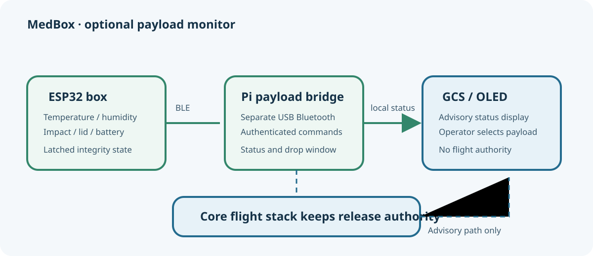
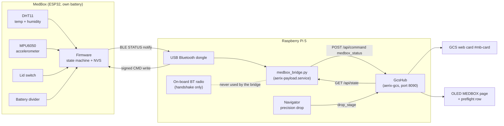
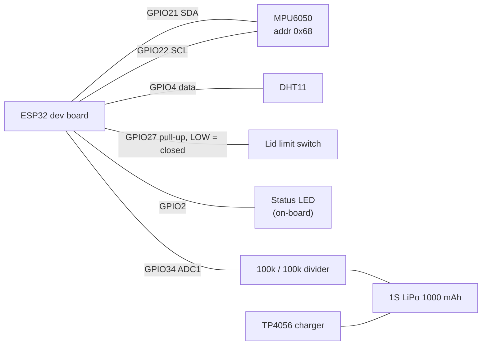
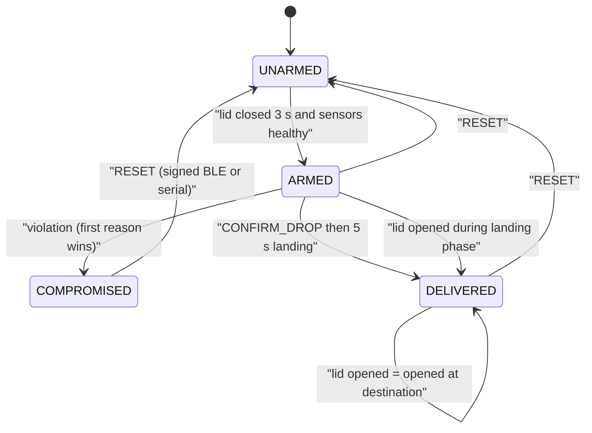
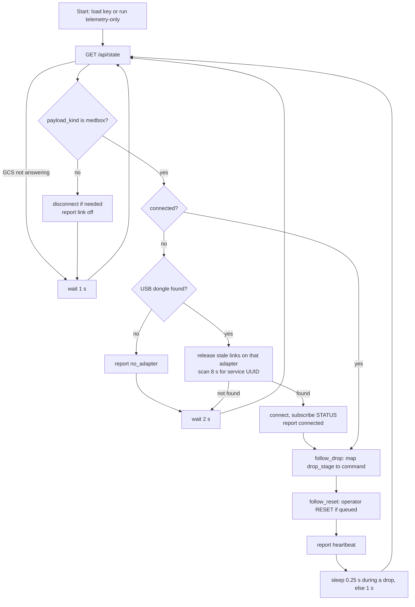

# MedBox: optional medical-delivery payload

> **Optional add-on.** AERIX is a general delivery drone. It flies, delivers and
> releases exactly the same way without a MedBox. The MedBox is one of three
> payload kinds (`parcel`, `medbox`, `none`). It is **advisory only**: nothing it
> reports can block, delay or trigger a release, change a flight mode or abort a
> mission.



## Contents

1. [What and why](#1-what-and-why)
2. [How it fits into AERIX](#2-how-it-fits-into-aerix)
3. [Hardware](#3-hardware)
4. [Firmware state machine](#4-firmware-state-machine)
5. [The drop window](#5-the-drop-window)
6. [BLE protocol](#6-ble-protocol)
7. [Signed commands](#7-signed-commands)
8. [The Pi bridge: aerix-payload.service](#8-the-pi-bridge-aerix-payloadservice)
9. [GCS, OLED and precision-drop integration](#9-gcs-oled-and-precision-drop-integration)
10. [Building and flashing the firmware](#10-building-and-flashing-the-firmware)
11. [Installing the bridge on the Pi](#11-installing-the-bridge-on-the-pi)
12. [Tests](#12-tests)
13. [Evidence status and known open items](#13-evidence-status-and-known-open-items)
14. [File map](#14-file-map)

---

## 1. What and why

Delivering medicine is different from delivering a parcel. A box of insulin can
arrive on time and still be useless if it got too warm, was dropped hard, or
someone opened it on the way. The recipient cannot see any of that from the
outside.

The MedBox is a small ESP32 board that rides **inside** the payload box and
answers one question: **did the medicine stay safe from the moment the box was
sealed until it was handed over?**

| It watches | With | Why it matters |
|---|---|---|
| Temperature and humidity | DHT11 | Cold-chain and storage limits (for example 2-8 °C for insulin and vaccines) |
| Impacts and vigorous shaking | MPU6050 accelerometer | Dropped or mishandled box |
| Lid open or closed | Limit switch | Tampering between sealing and delivery |
| Its own battery | ADC through a resistor divider | A monitor that dies silently proves nothing |

Once sealed, the box **latches** the first problem it sees as `COMPROMISED` and
stores that verdict in flash, so turning it off and on again cannot hide it.
When the drone delivers it through the normal precision drop, the box becomes
`DELIVERED` instead, and the recipient opening the lid is recorded as an
*opening at the destination*, not as tampering.

### What it is not

- It is **not** a safety system for the aircraft. The flight stack never reads
  its verdict when deciding anything.
- It is **not** part of the recipient handshake. The phone handshake that
  authorises a release is a separate radio and a separate protocol (see
  [06 - BLE handshake and security](../../docs/guide/06-ble-handshake-security.md)).
- It is **not** required. With payload kind `parcel` or `none`, the bridge
  service stays off the air and the GCS hides the MedBox card.

### Selecting it

The payload kind can be changed in three places. The runtime choice wins over
the config default.

| Where | How |
|---|---|
| GCS web UI | PAYLOAD selector `#pl-kind` (Parcel / MedBox / None) |
| OLED front panel | PAYLOAD page, then **KIND** cycles `parcel -> medbox -> none` |
| Config (boot default) | `payload.kind` in [config/default.yaml](../../config/default.yaml) (ships as `parcel`) |

The operator's choice is persisted in `var/payload_kind.json` and survives a
reboot. Changing it is refused **while armed** or during the drop stages
`approach`, `descend`, `settle`, `release` and `climb` (the hub's
`_flight_lock()` in [hub.py](../../drone_stack/gcs/hub.py)).

---

## 2. How it fits into AERIX



The data path is one-directional in authority: the box **reports**, the bridge
**relays**, the hub **displays**. The only things the Pi ever tells the box are
"a drop is about to happen", "the drop happened", "the drop was cancelled" and
an operator "reset". None of those flows the other way into a flight decision.

---

## 3. Hardware

The reference build is a generic **ESP32 dev board** (PlatformIO board
`esp32dev`) with the following parts. All pins are taken from
[firmware/src/main.cpp](firmware/src/main.cpp).

### Pin table

| Signal | ESP32 pin | Part / notes |
|---|---|---|
| I2C SDA | GPIO21 | MPU6050 at address `0x68` |
| I2C SCL | GPIO22 | MPU6050 |
| DHT data | GPIO4 | DHT11 (read every 2 s; it cannot go faster than about 1 Hz) |
| Lid switch | GPIO27 | Limit switch output, `INPUT_PULLUP`, **LOW = lid closed** (module VCC left unconnected) |
| Status LED | GPIO2 | On-board LED |
| Battery sense | GPIO34 (ADC1, input only) | Battery + through a 100k / 100k divider (`BATT_DIVIDER = 2.0`) |

### Wiring



### Sensor settings

| Sensor | Setting | Reason (from the firmware comments) |
|---|---|---|
| MPU6050 range | ±8 g (register `0x1C = 0x10`) | The default ±2 g would clip impacts |
| MPU6050 filter | Digital low-pass about 21 Hz (`0x1A = 0x04`) | Passes hand shaking, rejects propeller vibration |
| MPU6050 sample rate | 100 Hz (`IMU_PERIOD_MS = 10`) | |
| MPU6050 health | Config re-checked every 1 s | A power glitch resets it to sleep mode; it still answers I2C but reads all zeros |
| DHT11 | Every 2 s | Sensor limit |
| Battery | Every 5 s, 16 averaged ADC reads | |

### Power

| Item | Value |
|---|---|
| Battery | 1S LiPo, 3.7 V, 1000 mAh, charged through a TP4056 |
| CPU clock | 80 MHz (about half the current of 240 MHz; the radio's minimum) |
| BLE advertising interval | 200-300 ms (favours battery over connect latency) |
| Battery LOW | below 3.50 V (about 10 % left) |
| Battery CRITICAL | below 3.30 V (monitoring about to stop) |
| LOW clears | once charged past 3.65 V (hysteresis) |
| Not connected | below 2.50 V the divider is treated as absent (`n/a`) |

### LED patterns

| Pattern | State |
|---|---|
| Solid on | `ARMED` |
| Slow blink (500 ms) | `UNARMED` |
| Fast blink (100 ms) | `COMPROMISED` |
| Double blink | `DELIVERED` |

---

## 4. Firmware state machine

The box has four states. They are defined as an append-only enum in the
firmware and mirrored in
[medbox_protocol.py](../../drone_stack/payload/medbox_protocol.py).



### Arming

A box arms itself when the lid has been closed continuously for **3 s**
(`ARM_HOLD_MS = 3000`, debounced at 50 ms) **and** the sensors are healthy:
the DHT11 has produced a reading, the IMU has no pending read failures, and the
DHT11 has fewer than 5 consecutive failures. If a sensor is dead the box will
not arm, and the GCS card says so ("WON'T ARM").

Arming clears the previous reason, the power-interruption counter, the motion
maxima and any drop-window state.

### What compromises a sealed box

Only an `ARMED` box can become `COMPROMISED`, and the **first** reason latches.
Thresholds are the firmware's tunables:

| Reason (code) | Trigger | Threshold |
|---|---|---|
| lid opened (1) | Lid opens while `ARMED` and not in the landing phase | any opening |
| temperature out of range (2) | Temperature outside the range for a sustained time | below 2.0 °C or above 30.0 °C for 60 s |
| humidity out of range (3) | Humidity too high for a sustained time | above 70 % for 60 s |
| impact/drop (4) | Instantaneous deviation from gravity | above 3.0 g |
| vigorous shaking (5) | RMS deviation over 2 s windows | above 0.6 g for 2 consecutive windows (4 s) |
| sensor fault (6) | Sensor stops answering or resets | value 1 = MPU6050 5 failed reads, 2 = DHT11 5 failed reads, 3 = MPU6050 reset detected |
| impact in an unconfirmed drop (7) | Reserved for an expired drop window | wired but currently unreachable (see [section 13](#13-evidence-status-and-known-open-items)) |

Notes on the thresholds:

- **Motion limits are bench values.** The firmware comment says to tune them
  from a real flight: fly with the box `ARMED`, read the reported
  `max_shake` / `max_shock`, then set each limit to about twice those values.
- **The 60 s excursion timer** (`EXCURSION_MS`) filters single bad DHT11
  readings. An excursion start is reported immediately (`TEMP_EXCURSION`,
  `HUMIDITY_EXCURSION`) but only condemns the box if it lasts.
- **Temperature limits must match the medicine.** The defaults (2-30 °C) are a
  generic envelope; the source notes 2-8 °C for cold-chain items and 15-25 °C
  for room-temperature storage.
- The gravity baseline is a slow tracker (1 % per sample), so a constant
  offset or tilt is absorbed and only changes count.

### Persistence (NVS)

The verdict is stored in the ESP32's NVS (`Preferences` namespace `medbox`)
every time it changes:

| Key | Meaning |
|---|---|
| `state` | Current state |
| `reason`, `value` | Why it was compromised and the measured value |
| `afterS` | Seconds armed when the violation happened |
| `boots` | Reboots while `ARMED` (power interruptions) |
| `dropConf` | `CONFIRM_DROP` was received |
| `opened` | Lid opened after delivery |
| `landG` | Worst jolt inside the drop window |

On boot, a box that was `ARMED` increments its power-interruption counter.
Then:

- if `CONFIRM_DROP` had been saved, the landing jolt most likely browned it
  out, so it **finishes the delivery** (`DELIVERED`);
- otherwise, if the lid is open now, it latches `COMPROMISED` with reason
  "lid opened".

### Reset

`RESET` returns the box to `UNARMED` from any state and requires a fresh 3 s
lid hold to re-arm. It is accepted from two places:

- a **signed BLE command** (normally sent by the GCS "Reset box" button through
  the bridge), or
- the word `RESET` on the **USB serial port** at 115200 baud. Physical access
  to the board counts as authorisation.

The box forgets the reason on reset. The GCS console line written when the
operator requests the reset is the audit record.

### Serial interface

At 115200 baud the firmware prints a one-line report every 5 s and accepts
`STATUS` and `RESET`. Alerts are printed as `[ALERT] <EVENT>: <detail>` for
`BOX_COMPROMISED`, `BOX_DELIVERED`, `OPENED_AT_DESTINATION`, `TEMP_EXCURSION`,
`HUMIDITY_EXCURSION`, `BATTERY_LOW`, `BATTERY_CRITICAL`, `BATTERY_OK` and
`DROP_WINDOW_EXPIRED`. A small bench logger,
[firmware/tools/medbox_log.py](firmware/tools/medbox_log.py), timestamps these
lines and can send a command or auto-reset after a compromise.

---

## 5. The drop window

AERIX delivers by lowering to about 1 m above the recipient and releasing the
payload (see [04 - Delivery mission](../../docs/guide/04-delivery-mission.md)).
To the accelerometer, a 1 m fall and its landing look exactly like a box being
dropped, which is the very thing it is meant to catch. The drop window tells
the box that the next jolt is the delivery itself.

| Command | Accepted when | Effect |
|---|---|---|
| `ARM_DROP` | Box `ARMED` | Opens the window (`expecting`) for up to **90 s** (`DROP_EXPECT_MAX_MS`). A repeat extends it. Inside the window jolts are recorded as `landingPeakG` and do **not** compromise the box. Returns `ALREADY_RELEASED` if already landing, `BAD_STATE` if not armed. |
| `CONFIRM_DROP` | Box `ARMED` (or already `DELIVERED`) | Enters `landing` for **5 s** (`DROP_LANDING_MS`), saves `dropConfirmed` to flash, then becomes `DELIVERED`. Idempotent once delivered, so a retry after a lost ack still returns `OK`. |
| `CANCEL_DROP` | Any | Closes an `expecting` window and re-learns gravity. Returns `ALREADY_RELEASED` if the box is already landing. |

Why the 90 s figure: it must outlast the navigator's `drop_timeout_s: 45.0`
(approach + descend + settle) in [config/default.yaml](../../config/default.yaml)
plus the approach.

Why `ARM_DROP` is sent **early**: a 1 m fall takes about 0.45 s, faster than one
poll of the GCS state. If the box waited until the navigator reported
`release`, the landing would already have condemned it. So the window opens
during `approach`, `descend` and `settle`, before the servo fires.

If the recipient opens the lid during the 5 s landing phase, the box goes
straight to `DELIVERED` with "opened at destination" set.

### A delivery with the MedBox

```mermaid
sequenceDiagram
    autonumber
    participant NAV as "Navigator"
    participant HUB as "GcsHub"
    participant BR as "medbox_bridge"
    participant BOX as "MedBox ESP32"

    Note over BOX: ARMED, lid sealed, monitoring
    NAV->>HUB: drop_stage = approach
    BR->>HUB: GET /api/state (every 0.25 s during a drop)
    HUB-->>BR: payload_kind medbox, drop_stage approach
    BR->>BOX: read NONCE
    BOX-->>BR: 16 hex chars
    BR->>BOX: write ARM_DROP, nonce, signature
    BOX-->>BR: STATUS notify, ack ARM_DROP:OK, drop expecting
    BR->>HUB: POST medbox_status
    NAV->>HUB: drop_stage = descend, then settle
    Note over BR: already OK for this order, nothing re-sent
    NAV->>HUB: drop_stage = release (servo opens)
    Note over BOX: 1 m fall, landing jolt stored as landing peak, no trip
    BR->>BOX: write CONFIRM_DROP, nonce, signature
    BOX-->>BR: STATUS notify, ack CONFIRM_DROP:OK, drop landing
    Note over BOX: 5 s landing phase, dropConfirmed saved to NVS
    BOX-->>BR: STATUS notify, state DELIVERED
    BR->>HUB: POST medbox_status
    HUB->>HUB: console INFO delivered with landing peak
    Note over BOX: recipient opens lid, opened at destination
```

If the drop is aborted, the navigator reports `aborted`, the bridge sends
`CANCEL_DROP`, and the box returns to normal monitoring.

### Hand releases open no window

Only the navigator's precision drop drives the drop window. A release from the
**GCS RELEASE button**, the **transmitter Button A** (RC channel 7,
`payload.rc_channel` in the config) or a bench release while disarmed sends no
`ARM_DROP`, so a sealed box will record its landing as an impact and latch
`COMPROMISED`. The GCS release confirmation warns about this when the payload
kind is `medbox`.

---

## 6. BLE protocol

The box is a BLE **peripheral**; the drone is its only **central**.

| Property | Value |
|---|---|
| Stack | NimBLE-Arduino 1.4.x |
| Advertised name | `MEDBOX-XXXX` (last two bytes of the Bluetooth MAC), carried in the scan response |
| Advertised service | the service UUID below |
| MTU | 247 |
| Second central | Disconnected immediately, so a curious phone cannot crowd the drone's link or queue commands |

### GATT layout

| Item | UUID | Properties | Content |
|---|---|---|---|
| Service | `aad1880d-ae20-4b48-8f1b-79b6bb371248` | | |
| STATUS | `d3bb4bf2-2c47-4630-82fb-ffe15dd26718` | read, notify | Compact JSON, once a second and on change (at most every 100 ms) |
| NONCE | `67fc87e8-19b3-47fb-90d7-207717604167` | read | 16 hex characters, single use |
| CMD | `a47403e2-3eef-4efa-92fc-d8685a4dd86b` | write | `CMD|nonce|signature` |

### STATUS frame

A notification is capped at MTU minus 3 bytes, so the frame uses one- and
two-letter keys and numeric codes. `decode_status()` in
[medbox_protocol.py](../../drone_stack/payload/medbox_protocol.py) turns it into
the readable dictionary used by the hub, web UI and OLED, and rejects anything
whose `v` is not 2.

| Key | Decoded name | Meaning |
|---|---|---|
| `v` | | Protocol version, always `2` |
| `q` | `seq` | Frame sequence number |
| `s` | `state` | 0 UNARMED, 1 ARMED, 2 COMPROMISED, 3 DELIVERED |
| `r` | `reason` | Reason code (table in [section 4](#what-compromises-a-sealed-box)) |
| `rv` | `reason_value` | Measured value behind the reason (landing peak once delivered) |
| `t` | `temp_c` | °C, `-99` = no reading |
| `h` | `humidity` | %, `-1` = no reading |
| `sh` | `shake_rms_g` | Last 2 s shake RMS |
| `pk` | `peak_g` | Worst jolt since the previous frame |
| `ms` | `max_shake_g` | Worst shake since arming (outside drop windows) |
| `mk` | `max_shock_g` | Worst shock since arming (outside drop windows) |
| `l` | `lid_closed` | 1 = closed |
| `up` | `armed_s` | Seconds armed |
| `bv` | `batt_v` | Battery volts, `0` = not connected |
| `bl` | `batt_level` | 0 n/a, 1 ok, 2 LOW, 3 CRITICAL |
| `pi` | `power_interruptions` | Reboots while armed |
| `d` | `drop_phase` | 0 none, 1 expecting, 2 landing |
| `lg` | `landing_peak_g` | Worst jolt inside the drop window |
| `o` | `opened_at_dest` | 1 = lid opened after delivery |
| `f` | `imu_fault`, `dht_fault` | Bit 0 = IMU, bit 1 = DHT |
| `a` | `ack_cmd`, `ack_result` | Last command result as `CMD:RESULT` |
| `an` | `ack_count` | Increments on every command result |

All the code tables are **append only**: adding a reason or state at the end
keeps old frames decodable. `tests/test_medbox.py` pins the table lengths
against the firmware enums.

---

## 7. Signed commands

Every command is authenticated with a shared 32-byte key and a single-use
nonce.

```mermaid
sequenceDiagram
    participant BR as "Bridge (Pi)"
    participant BOX as "MedBox"
    BR->>BOX: read NONCE characteristic
    BOX-->>BR: nonce (16 hex chars)
    Note over BR: sig = first 16 bytes of HMAC-SHA256(key, nonce + "|" + CMD), as 32 hex
    BR->>BOX: write "CMD|nonce|sig" to CMD
    Note over BOX: loop() verifies nonce and signature, then rotates the nonce
    BOX-->>BR: STATUS notify with a = "CMD:RESULT" and an + 1
```

| Rule | Detail |
|---|---|
| Signature | HMAC-SHA256 over `nonce|CMD`, truncated to 16 bytes, written as 32 lowercase hex characters (`sign()` in Python, `signFor()` in firmware) |
| Comparison | Constant time over all 32 characters |
| Nonce lifetime | Single use. A new nonce is generated after **every** command (valid or not), on connect and on disconnect, so a captured command cannot be replayed and one nonce cannot be brute-forced |
| Allowed commands | `ARM_DROP`, `CONFIRM_DROP`, `CANCEL_DROP`, `RESET`. The Python side refuses to frame anything else |
| Threading | The NimBLE write callback only copies the text into a buffer; the main `loop()` verifies and executes it, so no state is touched from two tasks |

Results reported back in STATUS:

| Result | Meaning |
|---|---|
| `OK` | Done (or already done, for an idempotent retry) |
| `BAD_SIG` | Wrong or stale nonce, or wrong signature. The bridge treats this as a race and retries |
| `BAD_STATE` | Command not valid in the current state (for example `ARM_DROP` on an unarmed box) |
| `ALREADY_RELEASED` | `ARM_DROP` or `CANCEL_DROP` while already landing |
| `MALFORMED` | Not three `|`-separated fields |
| `UNKNOWN` | Correctly signed but not a known command |

The firmware itself does not lock `RESET` during a drop. The two guards are on
the Pi: the hub refuses a reset while armed or mid-drop, and the bridge
refuses again (`REFUSED_DROP_ACTIVE`) if a drop stage is active.

### The shared key

The same 64-hex-character key lives in two git-ignored files:

| Side | Real file (git-ignored) | Template in the repo |
|---|---|---|
| Firmware | `addons/medbox/firmware/include/medbox_secret.h` (`MEDBOX_KEY_HEX`) | [medbox_secret.h.example](firmware/include/medbox_secret.h.example) |
| Pi bridge | `config/medbox_key.txt` | [medbox_key.txt.example](../../config/medbox_key.txt.example) |

Generate a key with `openssl rand -hex 32` and put the **same** string in both.
To rotate it, update both files, reflash the box and restart
`aerix-payload`. Anyone who holds the Pi's SD card holds the key, which is the
same captured-aircraft class of risk discussed in the drone's
[threat model](../../docs/security/THREAT_MODEL.md).

Without a key file the bridge still runs **telemetry only** (`key_ok: false`):
the card shows the box, but no drop window or reset is possible.

---

## 8. The Pi bridge: aerix-payload.service

[medbox_bridge.py](../../drone_stack/payload/medbox_bridge.py) is a small
asyncio program that runs as its own systemd service with its own virtual
environment (it needs `bleak` and `dbus_fast`, which the rest of the stack does
not).

### Radio isolation

The Pi has two Bluetooth controllers. The **on-board** one belongs to the
recipient handshake (`aerix-ble.service`) and shares its antenna with Wi-Fi.
The bridge only ever uses a **USB Bluetooth dongle**:

- The adapter is found by its **sysfs bus path** (`usb_bt_adapter()`), never by
  its `hciN` number, because the kernel numbers controllers in registration
  order and a re-plugged dongle can swap `hci0` and `hci1`.
- With no USB dongle present the bridge reports `no_adapter` and waits. It
  **never falls back** to the on-board radio.
- It never restarts `bluetoothd` and never powers any adapter up or down.
- When it cleans up orphaned BlueZ links left by a crashed previous run, it
  only touches device objects under its own adapter, so the handshake's
  controller is out of reach by construction.
- It holds no connection and runs no scan unless the payload kind is
  `medbox`, so a parcel flight leaves the dongle silent.

### Main loop



| Setting (in the bridge) | Value |
|---|---|
| GCS base URL | `GCS_BASE_URL` env, default the local GCS on port 8090 |
| State poll | 1 s, 0.25 s while `mission.drop_stage` is set |
| Scan timeout | 8 s |
| Heartbeat | every 3 s, from its own task so a scan cannot starve it |
| Command ack wait | 2.5 s per attempt, 3 attempts |

### Commands and reports

- **`send(cmd)`** reads a fresh nonce, writes the signed command, and waits for
  a STATUS frame whose `ack_count` changed and whose `ack_cmd` matches.
  `BAD_SIG` is retried. Final results can also be `NO_KEY`, `NOT_CONNECTED`
  or `NO_ACK`.
- **`follow_drop`** only acts while the box is `ARMED`. Each `(order, command)`
  pair is sent until it returns `OK` or `ALREADY_RELEASED`; any other result is
  retried on the next poll. If the box's drop phase falls back to `none` during
  the descent (it rebooted, or its window lapsed), `ARM_DROP` is sent again.
- **`follow_reset`** carries out a reset the hub has queued, once per request
  id, and refuses during an active drop stage.
- **Reports** go to the hub as `POST /api/command` with
  `{"cmd": "medbox_status", "params": {...}}` containing `link`, `note`,
  `adapter`, `name`, `addr`, `rssi`, `key_ok`, the decoded `status` and
  `reset_ack`. Posts are serialised first-in first-out, so the hub never sees
  link states out of order.

Link values: `starting`, `off`, `no_key`, `no_adapter`, `scanning`,
`connected`, `error`. The hub adds `bridge_down` when no report has arrived for
`payload.medbox.stale_s` (10 s in the config).

---

## 9. GCS, OLED and precision-drop integration

### Precision drop: STAGE_COMMAND

The mapping from the navigator's `drop_stage` to the box command is a single
table in [medbox_protocol.py](../../drone_stack/payload/medbox_protocol.py):

| Navigator `drop_stage` | Command sent to the box |
|---|---|
| `approach` | `ARM_DROP` |
| `descend` | `ARM_DROP` |
| `settle` | `ARM_DROP` |
| `release` | `CONFIRM_DROP` |
| `climb` | `CONFIRM_DROP` |
| `done` | `CONFIRM_DROP` |
| `aborted` | `CANCEL_DROP` |

A test asserts that every stage the navigator can report has an entry, and that
the window opens before the release.

### GCS hub

In [hub.py](../../drone_stack/gcs/hub.py):

| Command | Behaviour |
|---|---|
| `set_payload_kind {kind}` | One of `parcel`, `medbox`, `none`. Persisted to `var/payload_kind.json`. Refused while armed or in drop stages approach to climb. Switching away from `medbox` clears the cached box so no stale data shows on a parcel run |
| `medbox_status` | Report from the bridge. Cached for `/api/state`; only **transitions** reach the console (link changes, state changes, reset results) |
| `medbox_reset` | Ground only: payload kind `medbox`, not armed, not mid-drop, box connected, key present, one at a time. Times out as failed after `payload.medbox.reset_timeout_s` (20 s code default) |

Console examples: an ERROR line when the box goes `COMPROMISED` (with the
reason and "medicine UNSAFE"), an INFO line when it is delivered with its
landing peak, and a WARNING with the previous state whenever an operator
requests a reset.

### Web card

The card `#mb-card` in the GCS web UI is shown **only** when the payload kind
is `medbox`. It contains:

- a state badge (`UNARMED`, `ARMED`, `COMPROMISED`, `DELIVERED` or `NO LINK`),
- link name and RSSI,
- a message line such as "Sealed and monitoring", "UNSAFE: <reason>",
  "Delivered intact" with landing peak, or "WON'T ARM" when a sensor fault
  blocks arming,
- temperature / humidity, lid, motion maxima, drop phase, battery, armed time
  and power interruptions,
- a **Reset box** button with a confirmation dialog that asks the operator to
  inspect the contents first.

See [07 - Ground control station](../../docs/guide/07-ground-control-station.md)
for the rest of the GCS.

### OLED front panel

In [front_panel/panel.py](../../front_panel/panel.py):

| Element | Behaviour |
|---|---|
| **MEDBOX** page | Box state (with drop phase while armed), temperature / humidity, lid, shake / shock maxima, reason or battery, link and adapter. Shows "MedBox not selected" for other kinds |
| **PAYLOAD > KIND** | Cycles `parcel`, `medbox`, `none` through the GCS |
| **Pre-flight row "MedBox"** | PASS with the kind name when the kind is not `medbox`. Otherwise FAIL if not connected or `COMPROMISED`, PASS "sealed" when `ARMED`, WARN "unsealed" when `UNARMED`, WARN with the state otherwise |

The pre-flight row is informational: like everything else here, it does not
gate arming or release. See [08 - Safety](../../docs/guide/08-safety.md) and the
[pre-flight checklist](../../docs/PREFLIGHT_CHECKLIST.md).

---

## 10. Building and flashing the firmware

The firmware is a PlatformIO project in [firmware/](firmware/).

| [platformio.ini](firmware/platformio.ini) setting | Value |
|---|---|
| Environment | `esp32dev`, `espressif32`, Arduino framework |
| Libraries | `adafruit/DHT sensor library@^1.4.6`, `h2zero/NimBLE-Arduino@~1.4.3` (pinned: 2.x renamed every callback signature) |
| Partitions | `huge_app.csv` (NimBLE plus the Arduino core overflow the default 1.2 MB app partition) |
| Build flags | `-DCORE_DEBUG_LEVEL=0` (the firmware's own fault counters replace the core's error output) |
| Serial | 115200 baud; `upload_port` / `monitor_port` are set to a macOS USB-serial device and need changing for your machine |

Steps:

```bash
cd addons/medbox/firmware

# 1. Create the key header from the template (the real file is git-ignored)
cp include/medbox_secret.h.example include/medbox_secret.h
openssl rand -hex 32          # paste this into MEDBOX_KEY_HEX

# 2. Build, flash and watch the serial output
pio run -t upload
pio device monitor
```

Then put the **same** hex string in the Pi's key file:

```bash
cp config/medbox_key.txt.example config/medbox_key.txt
# replace the contents with the same 64 hex characters, nothing else
```

`load_key()` rejects a key shorter than 16 bytes. Never commit either real
file; `.gitignore` already excludes them and the PlatformIO `.pio/` build
folder.

On first boot the serial monitor shows `===== MEDBOX MONITOR 2.0-ble =====`
and `[BLE] advertising as MEDBOX-XXXX`. Close the lid for 3 s and the LED goes
solid (`ARMED`).

---

## 11. Installing the bridge on the Pi

The unit file is [scripts/aerix-payload.service](../../scripts/aerix-payload.service).

```bash
# separate venv for the bridge (bleak is not part of the main stack)
python3 -m venv drone_stack/payload/venv
drone_stack/payload/venv/bin/pip install bleak

sudo cp scripts/aerix-payload.service /etc/systemd/system/
sudo systemctl daemon-reload
sudo systemctl enable --now aerix-payload
systemctl status aerix-payload --no-pager
```

| Unit setting | Why |
|---|---|
| `User=pi` | BlueZ's D-Bus policy lets an ordinary user act as a central; nothing else is needed |
| `WorkingDirectory=/home/pi/drone_stack` | The bridge's `--key` default is the relative path `config/medbox_key.txt` |
| `After=bluetooth.service aerix-gcs.service` | It talks to both |
| `Restart=always`, `RestartSec=5`, `StartLimitIntervalSec=0` | Keeps retrying forever |
| `Nice=5` | Below the handshake and the GCS for CPU: this service is advisory |

The bridge disconnects cleanly on `SIGTERM`, so a service stop does not leave
BlueZ holding an orphaned link. After changing the bridge code, restart the
service by hand. General deployment is covered in
[09 - Setup, deployment and testing](../../docs/guide/09-setup-deployment-testing.md).

---

## 12. Tests

[tests/test_medbox.py](../../tests/test_medbox.py) covers everything the bridge
decides with, without needing a radio:

| Area | Tests |
|---|---|
| Protocol | Signature equals truncated HMAC-SHA256 over `nonce|CMD`; unknown commands are never framed; a firmware-format frame decodes to the right names; non-v2 frames are rejected; tables match the firmware enum lengths |
| Drop mapping | Every navigator drop stage has a box command; approach, descend and settle all open the window |
| Adapter isolation | The USB dongle is chosen whatever its `hciN` number; with only the on-board radio, no adapter is returned |
| Hub | Payload kind defaults from config and persists; unknown kinds rejected; a `COMPROMISED` transition is logged once; a silent bridge reads as down; switching away drops the stale box; kind is locked while armed or dropping |
| Reset | Round trip through the bridge; refused in the air or without a box; times out with no answer; the bridge sends a reset once per request |

```bash
python -m pytest tests/test_medbox.py -q
```

---

## 13. Evidence status and known open items

Following [evidence/EVIDENCE_TIERS.md](../../evidence/EVIDENCE_TIERS.md), the
honest status is:

| Part | Status |
|---|---|
| Firmware state machine and sensors | Bench-tested on the ESP32 (serial logs) |
| BLE protocol, signing, adapter isolation, hub integration | Unit-tested (`tests/test_medbox.py`); bridge exercised on the bench |
| Drop window during a real precision drop | **Not flown.** The precision drop itself is simulation-tested only |
| Motion and environment thresholds | Bench guesses, not tuned from flight data |

Known open items:

1. **`resolveExpiredDropWindow()` policy is a TODO.** If `ARM_DROP` opened the
   window but neither `CONFIRM_DROP` nor `CANCEL_DROP` arrived within 90 s
   (typically because the BLE link dropped mid-delivery), impact and shake
   detection were suppressed the whole time. The function that decides what
   those seconds meant currently always returns `VERDICT_REARM` (resume
   monitoring, no verdict). `VERDICT_DELIVERED` and `VERDICT_COMPROMISED`
   (reason 7, "impact in an unconfirmed drop") are wired but unreachable. This
   is a deliberate policy decision left open, not an oversight.
2. **Thresholds need a real flight.** Fly with the box `ARMED`, read
   `max_shake_g` / `max_shock_g`, and set the limits to about twice those
   values. Set the temperature range for the medicine actually carried.
3. **The box verdict is not part of the delivery receipt.** It lives in the GCS
   console and card only.
4. **Reset forgets the reason** on the box; the GCS console line is the only
   record.
5. **Symmetric key on the SD card.** Anyone with the Pi's card can sign box
   commands.

---

## 14. File map

| Path | Role |
|---|---|
| [firmware/src/main.cpp](firmware/src/main.cpp) | ESP32 firmware (`FW_VERSION "2.0-ble"`) |
| [firmware/platformio.ini](firmware/platformio.ini) | Build configuration |
| [firmware/include/medbox_secret.h.example](firmware/include/medbox_secret.h.example) | Key header template |
| [firmware/tools/medbox_log.py](firmware/tools/medbox_log.py) | Serial bench logger |
| [drone_stack/payload/medbox_protocol.py](../../drone_stack/payload/medbox_protocol.py) | Pi-side protocol mirror (stdlib only) |
| [drone_stack/payload/medbox_bridge.py](../../drone_stack/payload/medbox_bridge.py) | BLE bridge |
| [scripts/aerix-payload.service](../../scripts/aerix-payload.service) | systemd unit |
| [config/medbox_key.txt.example](../../config/medbox_key.txt.example) | Pi key file template |
| [drone_stack/gcs/hub.py](../../drone_stack/gcs/hub.py) | Payload kind, `medbox_status`, `medbox_reset` |
| [drone_stack/gcs/static/app.js](../../drone_stack/gcs/static/app.js) | Web card and payload selector |
| [front_panel/panel.py](../../front_panel/panel.py) | OLED MEDBOX page and pre-flight row |
| [tests/test_medbox.py](../../tests/test_medbox.py) | Tests |

---

<sub>[Home](../../README.md) | [01 Overview](../../docs/guide/01-overview.md) | [02 Hardware](../../docs/guide/02-hardware.md) | [04 Delivery mission](../../docs/guide/04-delivery-mission.md) | [07 Ground control](../../docs/guide/07-ground-control-station.md) | [08 Safety](../../docs/guide/08-safety.md) | [09 Setup and testing](../../docs/guide/09-setup-deployment-testing.md)</sub>

**← Previous: [09 - Setup, deployment and testing](../../docs/guide/09-setup-deployment-testing.md) | [Index](../../README.md) | Next: [01 - Overview](../../docs/guide/01-overview.md) →**
