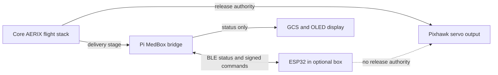

# MedBox integration boundary

MedBox is an optional status-monitoring payload. The flight stack remains the authority for navigation and release. The bridge reports the box state to the GCS and coordinates a delivery-stage signal; a MedBox fault or missing BLE link must not command a flight mode or servo action.

The payload choice defaults to `parcel`. Operators can select `medbox` when the box is installed and provisioned. The selected payload kind is locked during armed flight and active drop stages. Check the [system safety guide](../../../docs/guide/08-safety.md) and [MedBox guide](../README.md) before integration work.
