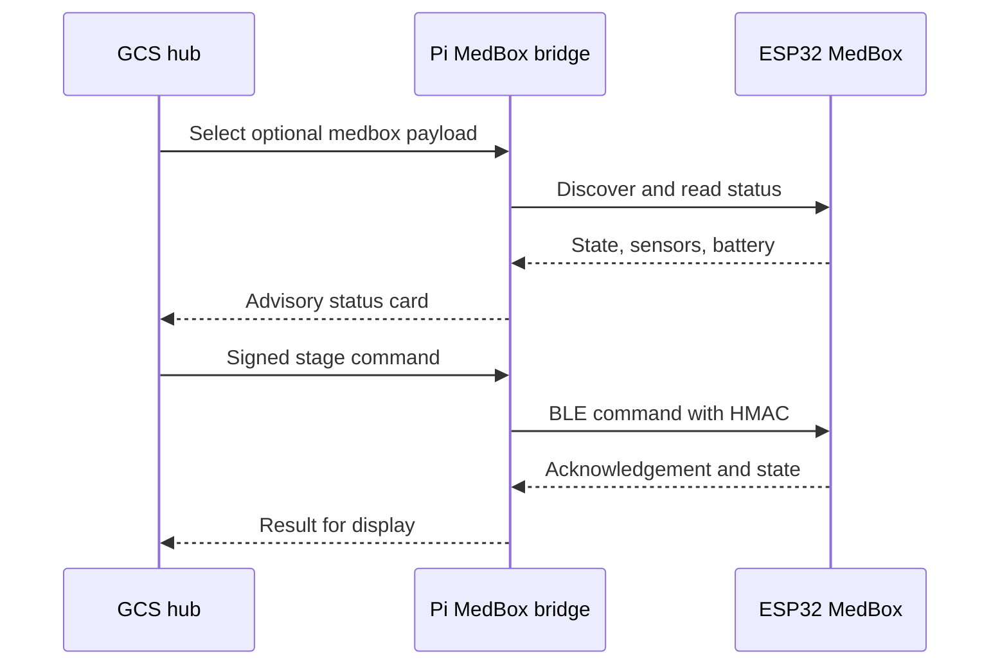

# MedBox protocol overview

The ESP32 and Pi bridge exchange BLE status and authenticated commands. The protocol mirror is implemented in [`medbox_protocol.py`](../../../drone_stack/payload/medbox_protocol.py); the bridge is in [`medbox_bridge.py`](../../../drone_stack/payload/medbox_bridge.py).

The shared HMAC key is provided out of band on each device. Keep the real key outside Git and never paste it into an issue, log, or documentation. The example header is a template only. See the [MedBox guide](../README.md) for the full state machine, command behavior, and integration boundaries.
