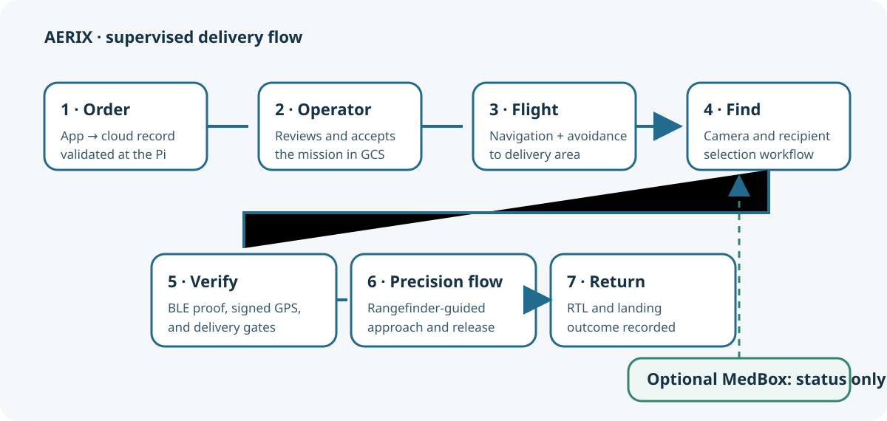
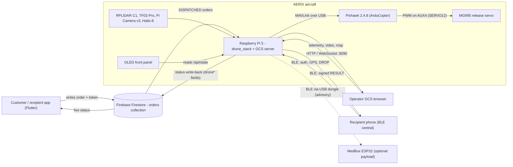
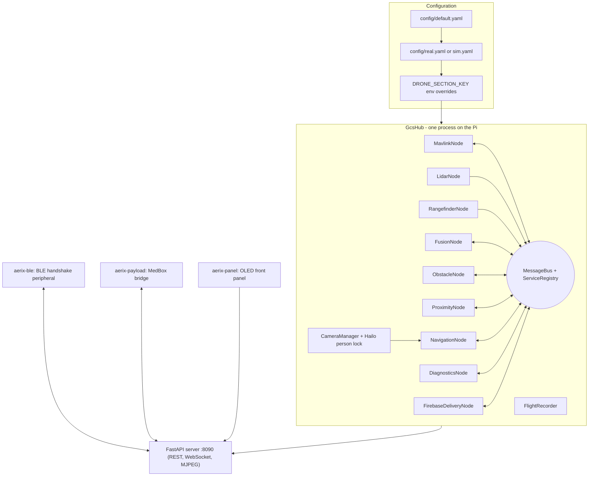
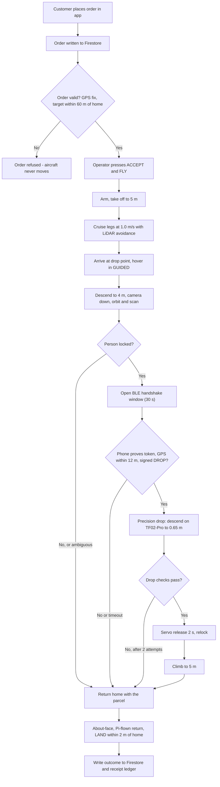
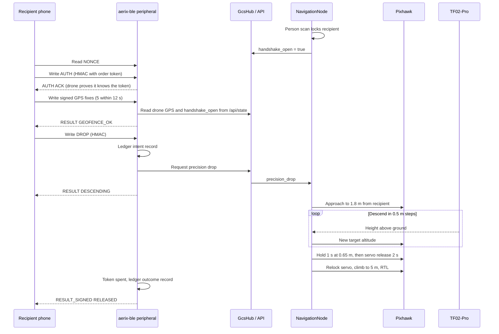
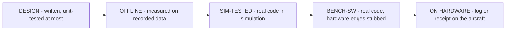

# 01 - System Overview

> **AERIX** - an autonomous last-mile delivery quadcopter for parcels and medicine.
> University capstone project, Team 21.

This page explains what AERIX is, why it exists, how the parts fit together,
and how much of it has actually been proven on the aircraft. Read it first;
every later page in the guide goes deeper into one subsystem.

---

## Contents

1. [What and why, in plain language](#1-what-and-why-in-plain-language)
2. [What AERIX does, end to end](#2-what-aerix-does-end-to-end)
3. [System context](#3-system-context)
4. [Main subsystems](#4-main-subsystems)
5. [The delivery, step by step](#5-the-delivery-step-by-step)
6. [Key features](#6-key-features)
7. [Technology stack](#7-technology-stack)
8. [Repository map](#8-repository-map)
9. [What is proven, and how (evidence tiers)](#9-what-is-proven-and-how-evidence-tiers)
10. [Where to go next](#10-where-to-go-next)

---

## 1. What and why, in plain language

**The problem.** The last kilometre of a delivery is the slowest and most
expensive part. For urgent items such as medicine, the delay matters more than
the cost: a courier stuck in traffic is a courier who is late. Small drones can
cover that distance quickly, but two hard questions come with them:

- **How does the drone know it is handing the package to the right person**,
  and not to whoever happens to be standing nearby?
- **How does it release the package safely**, without dropping it from a
  height that breaks it, and without landing on (or near) people?

**What AERIX is.** AERIX is a quadcopter that answers both questions with
onboard hardware and software:

1. A customer places an order from a phone app. The order lands in a cloud
   database (Firebase Firestore).
2. An operator on the ground station accepts it. The drone flies itself to the
   customer while avoiding obstacles with a 2-D LiDAR.
3. At the drop point it looks down with a camera, finds a person, and then
   **proves cryptographically, over Bluetooth Low Energy (BLE), that the
   person's phone holds the one-time token for this order**.
4. Only after that proof does it descend to about **0.65 m above the ground**
   (measured by a downward laser rangefinder), open the release servo, climb
   back up and fly home. This scan-and-drop sequence is so far proven in
   simulation only (see section 9).

**Why it is interesting.** The whole flight brain and the ground control
station run on **one Raspberry Pi 5** carried on the aircraft, in **pure
Python, without ROS**. The Pi talks MAVLink to a **Pixhawk 2.4.8** running
ArduCopter, which does the low-level stabilisation. The Pi decides *where* to
go and *when* to release; the Pixhawk keeps the aircraft in the air.

> **Honesty note.** Not every feature described here has flown. Section
> [9](#9-what-is-proven-and-how-evidence-tiers) lists every claim with its
> evidence tier (on hardware, bench, simulation, offline, or design only).
> The person scan and precision drop are **simulation-tested**; the
> "novelty" layer is **design stage and disabled**.

---

## 2. What AERIX does, end to end

| Step | Who / what | What happens |
|---:|---|---|
| 1 | Customer app (Flutter) | Recipient drops a pin; an order document is written to the Firestore `orders` collection with `targetLat` / `targetLng` and a per-order delivery token |
| 2 | `FirebaseDeliveryNode` on the Pi | Picks up the `DISPATCHED` order, validates it (3-D GPS fix, target within `max_delivery_radius_m` 60 m of home) |
| 3 | Operator at the GCS browser | Presses **ACCEPT & FLY** (`auto_accept: false` on the real aircraft: a database row never arms the drone by itself) |
| 4 | `NavigationNode` + Pixhawk | Splits the route into legs (25 m each, at most 24), arms, takes off to 5 m, cruises at 1.0 m/s with Pi-side LiDAR avoidance |
| 5 | Camera + Hailo-8 | At the drop point: descends to the scan altitude (4 m), tilts the camera down, orbits to look for a person and locks onto them |
| 6 | Recipient's phone over BLE | Mutual HMAC authentication, signed GPS fixes, a 12 m micro-geofence check, then a signed DROP request |
| 7 | TF02-Pro rangefinder + servo | Approaches to 1.8 m from the recipient, descends in 0.5 m steps to 0.65 m above ground, settles 1 s, opens the servo for 2 s |
| 8 | Navigation | Climbs back to 5 m, turns so the LiDAR faces the way home, returns (RTL) and lands within 2 m of home |
| 9 | Pi to Firestore and ledger | Writes the outcome back to the order and appends a signed, hash-chained receipt to the release ledger |

All the numbers above are taken from [config/real.yaml](../../config/real.yaml)
and [config/default.yaml](../../config/default.yaml); they are the values the
aircraft boots with.

---

## 3. System context

The diagram below shows every actor outside the Pi and what crosses each link.

| Actor | Role | Link |
|---|---|---|
| Customer app | Places the order, holds the delivery token, later acts as the BLE key at the door | Firestore (internet), BLE (at the drop point) |
| Firebase Firestore | Order queue and status channel between app and aircraft | Read and written by [firebase_delivery_node.py](../../drone_stack/nodes/firebase_delivery_node.py) through [firebase_interface.py](../../drone_stack/interfaces/firebase_interface.py) |
| Operator GCS browser | Accepts orders, watches live video and telemetry, issues commands | FastAPI server [server.py](../../drone_stack/gcs/server.py) on port 8090 |
| Raspberry Pi 5 | Runs every node, the GCS server, the BLE peripheral and the MedBox bridge | - |
| Pixhawk 2.4.8 | Attitude and position control, flight modes, servo outputs | MAVLink over USB (`/dev/ttyACM0`) |
| Recipient phone | Proves it holds the order token, then asks for the drop | BLE peripheral [drone_ble_peripheral.py](../../drone_stack/ble_handshake/drone_ble_peripheral.py) |
| MedBox (optional) | ESP32 box that reports whether medicine stayed within temperature, shock and lid limits | [medbox_bridge.py](../../drone_stack/payload/medbox_bridge.py), see [MedBox add-on](../../addons/medbox/README.md) |

The MedBox is **advisory only**: nothing it reports can block, delay or
trigger a release.

---

## 4. Main subsystems

AERIX replaces ROS with a small in-process framework: a **MessageBus** with
named topics, typed dataclass messages, services, YAML parameters and a launch
module. Each node runs in its own supervised thread and is restarted
automatically if it fails.

| Subsystem | What it does | Main source | Guide page |
|---|---|---|---|
| Message bus and framework | Latched pub/sub, typed messages, services, supervised node threads | [bus/](../../drone_stack/bus/), [msg/](../../drone_stack/msg/), [srv/](../../drone_stack/srv/), [utils/node.py](../../drone_stack/utils/node.py) | [03](03-software-architecture.md) |
| MAVLink link | Telemetry in, commands out, reconnects, altitude ceiling on uploaded missions | [mavlink_node.py](../../drone_stack/nodes/mavlink_node.py), [mavlink_interface.py](../../drone_stack/interfaces/mavlink_interface.py) | [03](03-software-architecture.md) |
| Mission and navigation | Mission state machine, legs, hover, person scan, precision drop, RTL and landing, failsafes, pilot override | [navigation_node.py](../../drone_stack/nodes/navigation_node.py) | [04](04-delivery-mission.md) |
| Order intake | Firestore orders to a flight plan, outcome write-back | [firebase_delivery_node.py](../../drone_stack/nodes/firebase_delivery_node.py) | [04](04-delivery-mission.md) |
| Perception and avoidance | LiDAR scan filtering, obstacle tracking, VFH+ steering and dodge, FC proximity feed, TF02-Pro ranging, camera person lock | [lidar_node.py](../../drone_stack/nodes/lidar_node.py), [obstacle_node.py](../../drone_stack/nodes/obstacle_node.py), [proximity_node.py](../../drone_stack/nodes/proximity_node.py), [rangefinder_node.py](../../drone_stack/nodes/rangefinder_node.py), [person_lock.py](../../drone_stack/gcs/person_lock.py) | [05](05-perception-and-avoidance.md) |
| Recipient proof | BLE peripheral, sealed order token, signed receipt ledger | [ble_handshake/](../../drone_stack/ble_handshake/) | [06](06-ble-handshake-security.md) |
| Ground control station | Web UI, REST and WebSocket API, live video, recordings and replays | [gcs/](../../drone_stack/gcs/) | [07](07-ground-control-station.md) |
| Safety | Altitude ceiling, transmitter authority, GUIDED-only hover, preflight GO/NO-GO | [navigation_node.py](../../drone_stack/nodes/navigation_node.py), [preflight_check.py](../../scripts/preflight_check.py) | [08](08-safety.md) |
| Simulation | Mock Pixhawk, LiDAR and rangefinder in a simulated world, one switch from real | [sim/](../../drone_stack/sim/) | [09](09-setup-deployment-testing.md) |
| Front panel | OLED status viewer with preflight and a guarded servo menu | [front_panel/panel.py](../../front_panel/panel.py) | [07](07-ground-control-station.md) |
| MedBox payload | ESP32 integrity monitor for medicine deliveries | [payload/](../../drone_stack/payload/), [addons/medbox/firmware/](../../addons/medbox/firmware/) | [MedBox add-on](../../addons/medbox/README.md) |

### Four services on one Pi

The software on the aircraft runs as four systemd services. Separating them
means a crash in the BLE stack or the OLED cannot take down flight control.

| Service | Owns | Notes |
|---|---|---|
| `aerix-gcs` | Pixhawk serial port, LiDAR, TF02-Pro UART, camera, Hailo, port 8090 | The only process allowed to talk to the Pixhawk |
| `aerix-ble` | The Pi's on-board Bluetooth controller | Delivery handshake only |
| `aerix-payload` | A separate USB Bluetooth dongle | MedBox bridge only, unit file in [scripts/aerix-payload.service](../../scripts/aerix-payload.service) |
| `aerix-panel` | OLED, three buttons, buzzer | Read-only viewer of the GCS, plus a few guarded commands |

---

## 5. The delivery, step by step

### 5.1 High-level flow

Every failure path ends the same way: **the aircraft goes home and keeps the
parcel**. Releasing to the wrong person is treated as worse than not
delivering at all.

### 5.2 Who talks to whom during the drop

### 5.3 Two independent outcomes

The ground station reports a delivery as two separate stories, because a
successful drop followed by a landing in a field is not a clean flight:

| Parcel story | Aircraft story |
|---|---|
| DELIVERED, FAILED, ABORTED, NEVER_FLEW | RETURNED, NOT_RETURNED, ON_PAD, UNKNOWN |

"Returned" means the aircraft is down and disarmed within `home_radius_m`
(15 m) of home;
the landing itself is commanded once it is inside `land_radius_m` (2 m).

---

## 6. Key features

- **One computer, no ROS.** The full stack (nodes, ground station, BLE
  peripheral, MedBox bridge) runs on a Raspberry Pi 5 with Python 3.11, using a
  small ROS-like framework written for the project.
- **Firestore order intake with a human in the loop.** Real orders need an
  operator to press ACCEPT & FLY; orders already in the database at boot are
  never auto-accepted.
- **Pi-side LiDAR avoidance in every phase.** RPLIDAR C1 scans are filtered
  once at the source (quality gate plus 2-of-3 persistence), then used for a
  cruise-band steer, VFH+ heading choice, a sidestep "dodge" and a hard brake.
  The return home is flown by the Pi too, so avoidance stays active.
- **Camera person lock on a Hailo-8.** The Pi Camera v3 feeds a person
  detector on the Hailo-8 AI accelerator; the drop-point scan orbits until it
  locks a person.
- **Cryptographic proof of recipient.** Session-bound nonces, HMAC mutual
  authentication with a per-order token, signed GPS fixes, a micro-geofence,
  and a signed RESULT back to the phone. The token is kept in RAM, sealed to
  the device, and spent only after the servo has fired.
- **Signed, hash-chained release ledger.** An Ed25519-signed write-ahead record
  is made before the release and another after it
  ([receipt_ledger.py](../../drone_stack/ble_handshake/receipt_ledger.py)).
- **Precision drop at about 0.65 m.** Stepped descent on a downward TF02-Pro,
  with aborts on sensor gaps, unexpected objects underneath or sensor
  disagreement; two attempts at most.
- **Choosing between several people.** If more than one person is in view, a
  phone locator combining BLE signal strength and the phone's signed GPS must
  be very confident (posterior at least 0.95, still at least 0.9 when any one
  input is removed, plus a confirming look) or the drone declines.
- **The transmitter always wins.** Any mode change the Pi did not command, or
  stick movement, makes the navigator stand down until the operator resumes.
- **Hard altitude ceiling** of 5.0 m on the real aircraft, enforced in the
  navigator and again on missions uploaded to the Pixhawk.
- **Web ground control station** with live telemetry over WebSocket, MJPEG
  video, flight recording and replay, and a matching OLED front panel.
- **Simulation from the same code.** Mock Pixhawk, LiDAR and rangefinder plus
  a simulated world; the switch between sim and real is a YAML profile.
- **Threat model with tests for the drone-side attacks.**
  [THREAT_MODEL.md](../security/THREAT_MODEL.md) lists each attack with its
  status; the drone-side mitigations are pinned by
  [tests/test_attack_table.py](../../tests/test_attack_table.py), some rows are
  still open (they need the phone app), and the protocol was model-checked
  with Verifpal (bounded, 2 sessions).

---

## 7. Technology stack

| Layer | Technology | Used for |
|---|---|---|
| Companion computer | Raspberry Pi 5, Raspberry Pi OS (Debian 12 bookworm), Python 3.11+ | Everything above the flight controller |
| Flight controller | Pixhawk 2.4.8 running ArduCopter | Stabilisation, flight modes, servo PWM |
| Autopilot protocol | MAVLink via `pymavlink`, `pyserial` | Telemetry and commands over USB |
| Avoidance sensor | Slamtec RPLIDAR C1 via `rplidar-roboticia` | 2-D scans for obstacle avoidance |
| Drop sensor | Benewake TF02-Pro on the Pi UART (`/dev/ttyAMA0`) | Height above ground during the precision drop |
| Vision | Pi Camera v3 (Picamera2), OpenCV, NumPy | Live video, recording, frame filtering and stabilisation |
| AI accelerator | Hailo-8 AI HAT+ (`hailo_platform`) | On-board person detection |
| Ground station server | FastAPI, Uvicorn, WebSockets | REST, WebSocket telemetry, MJPEG video |
| Ground station UI | HTML, CSS and plain JavaScript in [gcs/static/](../../drone_stack/gcs/static/) | Operator dashboard |
| Cloud | Firebase Firestore via `firebase-admin` | Order queue and status write-back |
| Customer app | Flutter (separate repository) | Ordering and acting as the BLE key |
| BLE (delivery) | BlueZ via `bluez-peripheral` | GATT peripheral for the recipient handshake |
| Cryptography | `cryptography` (Ed25519, AES-GCM), HMAC | Receipts, sealed token, message authentication |
| BLE (MedBox) | `bleak` on a USB Bluetooth dongle | Link to the MedBox |
| MedBox firmware | ESP32, PlatformIO, Arduino core, NimBLE-Arduino, DHT sensor library | Medicine integrity monitor |
| Front panel | `luma.oled` (SH1106), Pillow, `gpiozero` | OLED status display, buttons, buzzer |
| Config | YAML (`PyYAML`), deep-merged profiles plus environment overrides | Single source of truth for every tunable |
| Testing | `pytest`, simulation world, Verifpal model | Unit, integration, attack-table and protocol checks |
| Service management | systemd | The four `aerix-*` services |

Dependency lists: [requirements.txt](../../requirements.txt),
[requirements-hardware.txt](../../requirements-hardware.txt),
[requirements-dev.txt](../../requirements-dev.txt) and
[ble_handshake/requirements.txt](../../drone_stack/ble_handshake/requirements.txt).

---

## 8. Repository map

| Path | Purpose |
|---|---|
| [drone_stack/](../../drone_stack/) | The importable Python package: everything that runs on the Pi |
| [drone_stack/bus/](../../drone_stack/bus/) | MessageBus (latched pub/sub) and topic names; command topics are never latched |
| [drone_stack/msg/](../../drone_stack/msg/) | Typed dataclass messages (the ROS `msg/` equivalent) |
| [drone_stack/srv/](../../drone_stack/srv/) | Request/response services and the service registry |
| [drone_stack/utils/](../../drone_stack/utils/) | Config loader, geometry, logging, `NodeBase` and supervisor |
| [drone_stack/launch/](../../drone_stack/launch/) | Bring-up: builds the supervisor and nodes from config |
| [drone_stack/interfaces/](../../drone_stack/interfaces/) | Hardware and cloud interfaces: MAVLink, LiDAR, rangefinder, Firebase |
| [drone_stack/nodes/](../../drone_stack/nodes/) | The nodes: MAVLink, LiDAR, rangefinder, fusion, obstacle, proximity, navigation, diagnostics, Firebase delivery, phone locator, RSSI probe planner |
| [drone_stack/gcs/](../../drone_stack/gcs/) | Ground control station: hub, FastAPI server, cameras, Hailo person lock, recorder and replay, web UI |
| [drone_stack/ble_handshake/](../../drone_stack/ble_handshake/) | BLE recipient-proof peripheral, Firestore token sync, sealed order store, receipt ledger |
| [drone_stack/payload/](../../drone_stack/payload/) | MedBox BLE bridge and protocol mirror |
| [drone_stack/sim/](../../drone_stack/sim/) | Mock Pixhawk, LiDAR and rangefinder in a simulated world |
| [drone_stack/web/](../../drone_stack/web/) | Earlier Flask dashboard (visualisation only) |
| [drone_stack/novelty/](../../drone_stack/novelty/) | Design-stage markerless landing zone, dual-factor auth and motion monitor; **disabled** (`novelty.enabled: false`) |
| [config/](../../config/) | `default.yaml` plus `real.yaml` and `sim.yaml` profiles; example files for secrets |
| [scripts/](../../scripts/) | Run, deploy, preflight, order injection, flight-controller parameter tools, simulations, trial logging |
| [tests/](../../tests/) | pytest suite: navigation, avoidance, precision drop, BLE session, attack table, ledger, MedBox and more |
| [docs/](../) | Design notes, architecture, configuration, preflight checklist, security model, this guide |
| [evidence/](../../evidence/) | Evidence tiers, flight-day run sheet |
| [front_panel/](../../front_panel/) | OLED front panel program (`panel.py`) |
| [addons/medbox/](../../addons/medbox/) | MedBox ESP32 firmware and its documentation |
| [parcel_delivery/](../../parcel_delivery/) | Earlier prototype (Firebase Realtime Database, MAVSDK); kept for history |
| [person_detect/](../../person_detect/) | Earlier stand-alone Hailo person-detector experiments |

Secrets are never in the repository. Files such as
`config/firebase-service-account.json` and `config/medbox_key.txt` are
git-ignored; the repo ships only examples such as
[config/medbox_key.txt.example](../../config/medbox_key.txt.example) and
[medbox_secret.h.example](../../addons/medbox/firmware/include/medbox_secret.h.example).

---

## 9. What is proven, and how (evidence tiers)

The project keeps a strict ledger of what has been demonstrated, in
[evidence/EVIDENCE_TIERS.md](../../evidence/EVIDENCE_TIERS.md). The rule is:
**nothing moves from SIM-TESTED to ON HARDWARE until a log says so.**

| Tier | Meaning |
|---|---|
| ON HARDWARE | Ran on the Pi and Pixhawk (and phone); a log or receipt on the aircraft records it |
| BENCH-SW | The real code, driven end to end by tests with only hardware edges stubbed |
| SIM-TESTED | Simulation through the real code; a model, not a flight |
| OFFLINE | Measured on recorded data, not live |
| DESIGN | Written and unit-tested at most; not a finished feature |

### Claims and their tier

| Claim | Tier | Notes |
|---|---|---|
| Phone handshake, release and receipt chain | **ON HARDWARE** | 19 valid receipts (27 Aug - 23 Sep 2026) and 364 logged BLE operations (4-5 Oct). These include bench releases, so they prove the chain, **not 19 deliveries** |
| Single-use token spent only after release | **ON HARDWARE** | Spent markers on the Pi |
| Fails closed with a named reason (AUTH_FAIL, SIGNATURE_FAIL, GEOFENCE_FAIL, NOT_READY, PILOT_OVERRIDE) | ON HARDWARE (codes seen in logs) and BENCH-SW | 17-row attack table; 11 code mutations all caught |
| Session binding and nonce expiry (anti-replay) | BENCH-SW | Real-phone experiment still to do |
| Token not recoverable from a captured SD card | BENCH-SW | Test on a real disk image still to do |
| Signed, hash-chained, write-ahead release ledger | BENCH-SW | Not yet flown with this format deployed |
| Signed RESULT to the phone | BENCH-SW (drone side) | The app must verify it |
| Formal protocol model | Machine-checked, bounded (Verifpal, 2 sessions) | Current app fails 4 of 6 queries because of attack T29; with the 16-byte nonce fix every parcel-releasing query passes |
| T29 signing-oracle attack | BENCH-SW, attack confirmed | Fix belongs in the phone app |
| Person detection at the drop point | OFFLINE | 64.4 % recall, 57.4 % precision on 40 aerial frames |
| Person scan and precision drop | **SIM-TESTED** | Deployed on the aircraft but not yet flown (as of 26 Sep 2026, when the release height was 1 m; it was lowered to 0.65 m on 10 Oct) |
| Picking the phone holder among 2-3 people | **SIM-TESTED** | 0.17-1.33 % wrong picks, 42-77 % identified, in simulation |
| LiDAR avoidance around the handover | SIM-TESTED, plus a bench noise A/B | Flight experiment still to do |
| 5 m ceiling and stand-down on pilot takeover | SIM-TESTED; takeover seen ON HARDWARE (27 Sep) | - |
| Novelty layer (markerless landing zone, dual-factor auth, motion abort) | **DESIGN** | Disabled by default, never deployed, thresholds are guesses |
| MedBox integrity monitor | Bench only (firmware on the ESP32, bridge unit-tested) | Not flown; advisory payload; see the [MedBox add-on](../../addons/medbox/README.md) |

**Test suite.** On 2026-10-08 the pytest suite reported 1149 passed and
1 skipped (the skip needs `libcamera`), on Python 3.11 and 3.13 off the
aircraft; it has not yet been re-run on the Pi. Test counts in this project are always
quoted with a date, because the suite keeps growing.

**Bench state.** The real profile ships with GCS-side failsafes switched off
for bench work (`safety.failsafes_enabled: false`), so
[scripts/preflight_check.py](../../scripts/preflight_check.py) deliberately
reports **NO-GO** until they are re-enabled. AERIX is a research prototype,
not a certified aircraft. See [08 - Safety](08-safety.md) and the
[preflight checklist](../PREFLIGHT_CHECKLIST.md).

---

## 10. Where to go next

| If you want to... | Read |
|---|---|
| Know what is bolted to the airframe and how it is wired | [02 - Hardware](02-hardware.md) |
| Understand the bus, nodes and how they start | [03 - Software architecture](03-software-architecture.md) |
| Follow a delivery from order to landing in detail | [04 - Delivery mission](04-delivery-mission.md) |
| See how the LiDAR, rangefinder and camera are used | [05 - Perception and avoidance](05-perception-and-avoidance.md) |
| Review the recipient-proof protocol and threat model | [06 - BLE handshake security](06-ble-handshake-security.md) |
| Use or extend the operator web UI | [07 - Ground control station](07-ground-control-station.md) |
| Learn the safety rules and the incidents behind them | [08 - Safety](08-safety.md) |
| Install, run in simulation, deploy and test | [09 - Setup, deployment and testing](09-setup-deployment-testing.md) |
| Add the medical box payload | [MedBox add-on](../../addons/medbox/README.md) |
| Read the full engineering notebook | [docs/PROJECT_NOTES.md](../PROJECT_NOTES.md) |

---

  &larr; Previous: <a href="../../README.md">Home</a> |
  <a href="../../README.md">Index</a> |
  Next: <a href="02-hardware.md">02 - Hardware</a> &rarr;

