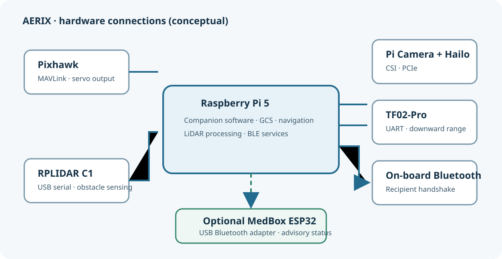
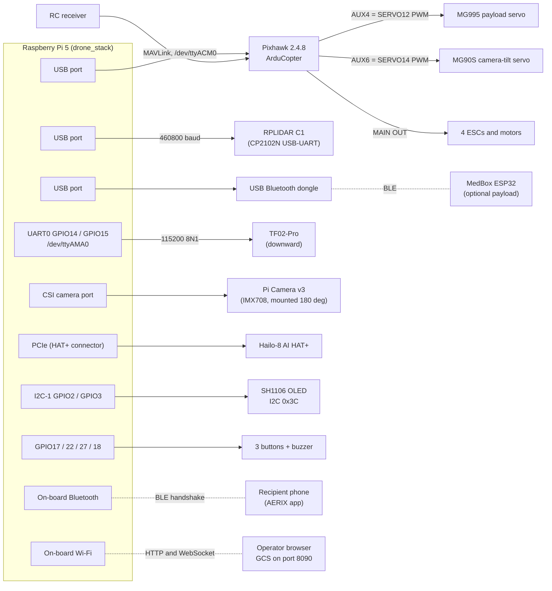
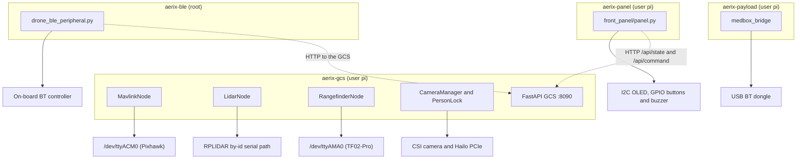
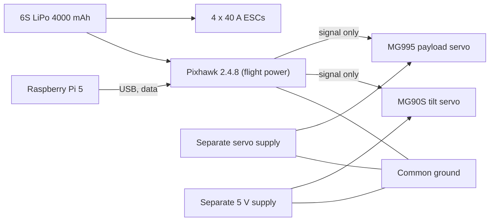
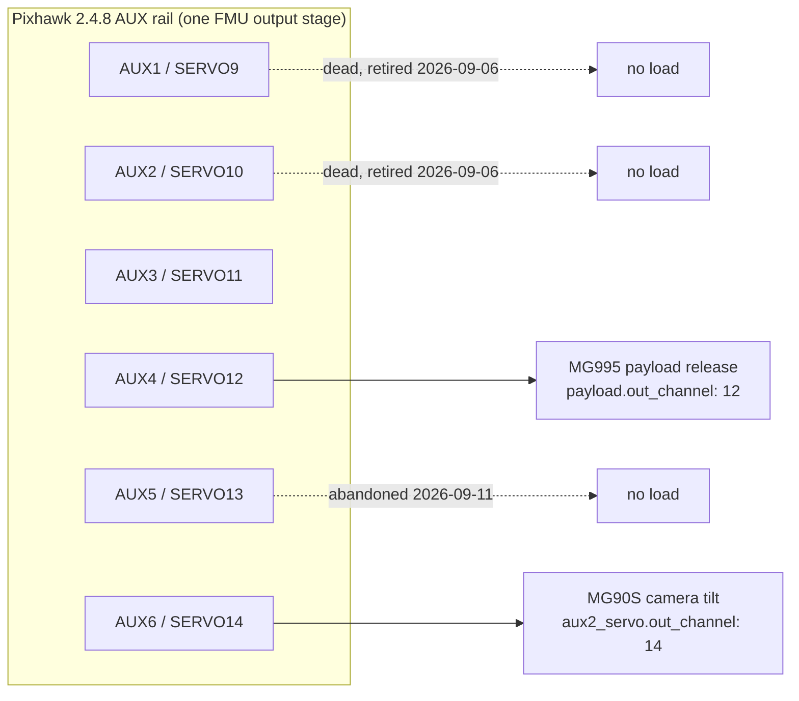
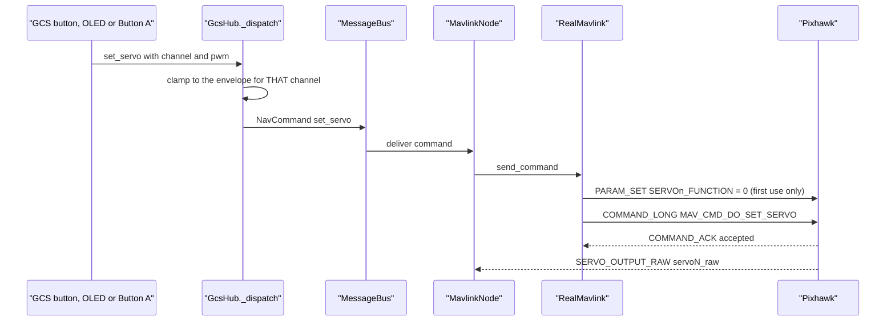
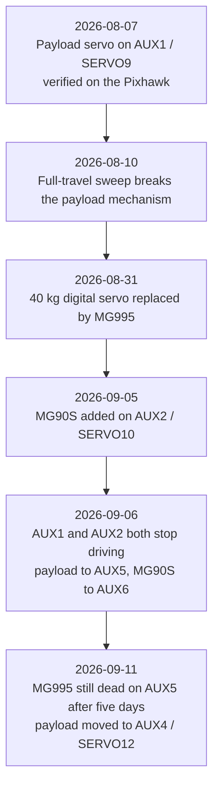
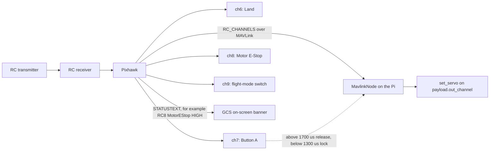
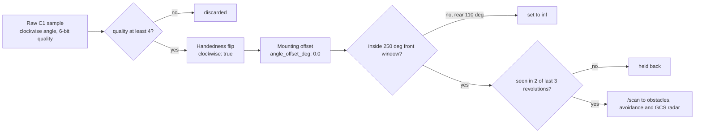
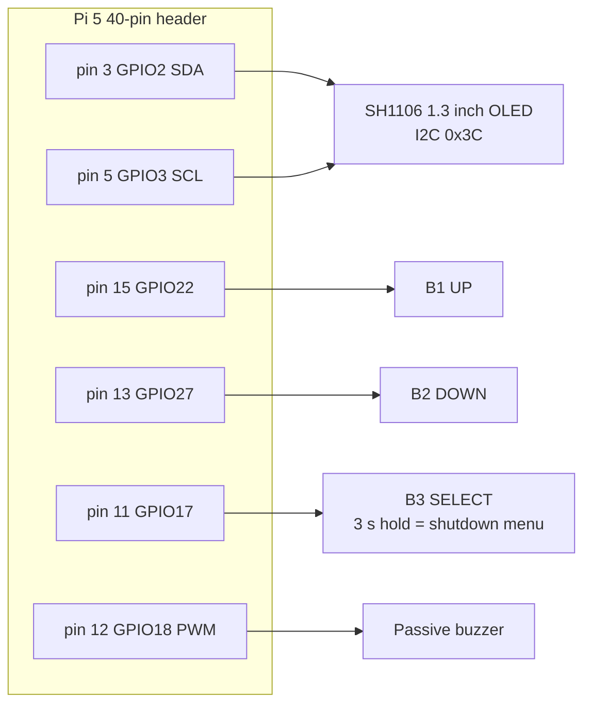

# 02 · Hardware

> **In one sentence:** AERIX is a Tarot 650-class quadcopter with a Pixhawk 2.4.8 flight controller and a Raspberry Pi 5 companion computer. The Pi carries every sensor that the delivery needs (LiDAR, downward rangefinder, camera, AI accelerator, two Bluetooth radios) and drives two servos through the Pixhawk.

This page covers what is on the aircraft, how each part is connected, which Pixhawk pin drives which servo (and why those pins changed three times), and how the sensors have to be mounted for the software to read them correctly.

---

## Contents

1. [What and why](#1-what-and-why)
2. [Bill of materials](#2-bill-of-materials)
3. [Connection map](#3-connection-map)
4. [Interface and port table](#4-interface-and-port-table)
5. [Power and grounding](#5-power-and-grounding)
6. [Pixhawk AUX / servo channel map](#6-pixhawk-aux--servo-channel-map)
7. [Why the servo channels moved (dead AUX pins)](#7-why-the-servo-channels-moved-dead-aux-pins)
8. [RC transmitter and aux-switch map](#8-rc-transmitter-and-aux-switch-map)
9. [Sensor mounting notes](#9-sensor-mounting-notes)
10. [Front panel (OLED, buttons, buzzer)](#10-front-panel-oled-buttons-buzzer)
11. [Bluetooth: two radios, two jobs](#11-bluetooth-two-radios-two-jobs)
12. [Hardware diagnostic scripts](#12-hardware-diagnostic-scripts)
13. [Hardware status and evidence tiers](#13-hardware-status-and-evidence-tiers)

---

## 1. What and why

A delivery drone has two very different jobs: **flying stably** and **making delivery decisions**. AERIX splits them across two computers:

| Computer | Job | Why it is separate |
|---|---|---|
| **Pixhawk 2.4.8** running ArduCopter | Attitude control, motor mixing, GPS position hold, RC input, servo PWM output, its own failsafes | Hard real-time. It keeps the aircraft in the air even if the Pi crashes or reboots. |
| **Raspberry Pi 5** running `drone_stack` (pure Python, no ROS) | Missions, obstacle avoidance, camera and person lock, Bluetooth recipient handshake, precision drop, web ground station | Needs Linux, Python, a camera pipeline and an AI accelerator. It *asks* the Pixhawk to fly somewhere over MAVLink and never touches the motors directly. |

The guiding rule for the wiring is **one owner per device**. Each serial port, radio and servo has exactly one process that may talk to it. The [interface table](#4-interface-and-port-table) records who owns what.

---

## 2. Bill of materials

The table lists what the flight software expects. Specifications come from the config files and source comments linked in the last column.

| # | Part | Role | Key specs used by the software | Source of truth |
|---|---|---|---|---|
| 1 | **Airframe:** Tarot 650-class quad, 5010 360 KV motors, 40 A ESCs, ~4 kg | Carries everything | Frame radius ~0.33 m (used to size avoidance margins) | [pidtune.py](../../scripts/pidtune.py), [real.yaml](../../config/real.yaml) |
| 2 | **Raspberry Pi 5** (Debian 12 bookworm, aarch64) | Companion computer, hosts the whole stack and the web GCS on port 8090 | 4 CPU cores. No hardware video encoder, so recording appends JPEG frames and encodes after landing. | [default.yaml](../../config/default.yaml) `recording:` |
| 3 | **Pixhawk 2.4.8** running ArduCopter | Flight controller | MAVLink system id 1. The Pi uses source system 255, component 190 (`MAV_COMP_ID_ONBOARD_COMPUTER`). | [default.yaml](../../config/default.yaml) `mavlink:` |
| 4 | **Slamtec RPLIDAR C1** | 2D 360° obstacle sensing (horizontal) | 460800 baud, ~10 Hz revolutions, range 0.15–12 m, 250° field of view used | [lidar_interface.py](../../drone_stack/interfaces/lidar_interface.py) |
| 5 | **Benewake TF02-Pro** | Downward height above ground, used **only** for the precision drop | 115200 8N1, streams at 100 Hz (polled at 20 Hz), 0.1–22 m, `4500` cm = "no target" | [rangefinder_interface.py](../../drone_stack/interfaces/rangefinder_interface.py) |
| 6 | **Raspberry Pi Camera Module 3** (Sony IMX708) | Live video, recording, person detection | Live 1280×720 at 30 fps, record stream 2304×1296, horizontal FOV ~66°, fixed focus `lens_position: 0.45` | [real.yaml](../../config/real.yaml) `cameras.picam` |
| 7 | **Hailo-8 AI HAT+** (26 TOPS) | Neural-network accelerator for the person lock | PCIe; runs `models/visdronebest.hef`, about 16–18 inferences/s | [person_lock.py](../../drone_stack/gcs/person_lock.py) |
| 8 | **MG995 servo** | Payload release (parcel hook) | Pixhawk **AUX4 = SERVO12**; lock 1100 µs / release 1410 µs (flagged *re-measure*) | [default.yaml](../../config/default.yaml) `payload:` |
| 9 | **MG90S servo** | Camera tilt (points the camera down at the drop point) | Pixhawk **AUX6 = SERVO14**; DOWN 148°, UP 90° | [default.yaml](../../config/default.yaml) `aux2_servo:` |
| 10 | **On-board Bluetooth** (Pi 5 built-in, UART-attached) | Recipient handshake with the customer's phone | Picked by sysfs bus path (non-USB) | [drone_ble_peripheral.py](../../drone_stack/ble_handshake/drone_ble_peripheral.py) |
| 11 | **USB Bluetooth dongle** (TP-Link UB500 class) | Link to the optional MedBox payload | Picked by sysfs bus path (USB) | [medbox_protocol.py](../../drone_stack/payload/medbox_protocol.py) |
| 12 | **SH1106 1.3" OLED** + **3 push buttons** + **passive buzzer** | Front panel: pre-flight checks and status at the aircraft | I2C address `0x3C`; buttons on GPIO22/27/17; buzzer on GPIO18 | [panel.py](../../front_panel/panel.py) |
| 13 | **6S LiPo, 4000 mAh** (CNHL) | Flight battery | Pi-side thresholds: low 21.6 V (3.6 V/cell), critical 20.4 V (3.4 V/cell) | [real.yaml](../../config/real.yaml) `safety:` |
| 14 | Separate servo supplies (the MG90S has its own 5 V supply) | Power the servos; the Pixhawk sends only the signal | Each supply's GND is common with the Pixhawk | [PROJECT_NOTES.md §6, §6b](../PROJECT_NOTES.md) |
| 15 | RC transmitter + receiver | Manual override, Land switch, motor emergency stop, payload Button A | See [section 8](#8-rc-transmitter-and-aux-switch-map) | [set_rc_aux.py](../../scripts/set_rc_aux.py) |
| 16 | GPS on the Pixhawk | Position, home latch, geofence | Needs at least 6 satellites and a 3D fix (`min_gps_fix_type: 3`) | [default.yaml](../../config/default.yaml) `safety:` |

> **Note on defaults:** [default.yaml](../../config/default.yaml) still carries 4S battery thresholds (14.0 V / 13.2 V) because it is the simulation baseline. [real.yaml](../../config/real.yaml) is deep-merged on top of it and overrides them for the 6S pack. Always read `real.yaml` for the aircraft.

**Removed hardware.** A Logitech C270 USB webcam was used early on and was removed on 2026-09-11. The Pi Camera on CSI does not compete with the LiDAR for USB bandwidth. The optional **MedBox** (an ESP32 medical box with its own battery and sensors) is a payload rather than part of the airframe. It is documented separately under [addons/medbox](../../addons/medbox/).

---

## 3. Connection map

The diagram below shows every data link. Solid arrows carry data. The servos receive PWM from the Pixhawk, never from the Pi.

### Who owns which device

Only one process may hold a serial port. If a second process opens it, both lose frames. The stack enforces this with systemd services.

Pixhawk parameter scripts in [scripts/](../../scripts/) (`set_*.py`, `servo_diagnose.py`, `aux_pin_check.py`, `read_mode_params.py`, `rc_monitor.py`, `preflight_check.py --fc`) open `/dev/ttyACM0` themselves. Stop `aerix-gcs` before running them and start it again afterwards. The exception is `servo_calibrate.py`, which goes through the GCS HTTP API and needs `aerix-gcs` running.

---

## 4. Interface and port table

| Device | Physical link | Linux device / address | Speed | Config key | Owner |
|---|---|---|---|---|---|
| Pixhawk 2.4.8 | USB (CDC ACM) | `/dev/ttyACM0` | 115200 in config (ignored by USB CDC) | `mavlink.connection`, `mavlink.baud` | `MavlinkNode` |
| RPLIDAR C1 | USB, CP2102N USB-UART bridge | `/dev/serial/by-id/usb-Silicon_Labs_CP2102N_..._port0` | 460800 | `lidar.port`, `lidar.baud` | `LidarNode` |
| TF02-Pro | Pi UART0: TF02 TX to **GPIO15 (RXD0)**, TF02 RX to **GPIO14 (TXD0)**, 5 V, GND | `/dev/ttyAMA0` (`dtparam=uart0=on`) | 115200 8N1 | `rangefinder.port`, `rangefinder.baud` | `RangefinderNode` |
| Pi Camera v3 | CSI ribbon | libcamera / Picamera2 | 720p30 live | `cameras.picam` | `CameraManager` |
| Hailo-8 | PCIe (AI HAT+) | HailoRT | about 16–18 inferences/s | `cameras.person_lock` | `PersonLockPipeline` |
| On-board Bluetooth | UART-attached controller | `hciN`, chosen by **non-USB** sysfs path | BLE | none (code rule) | `aerix-ble` |
| USB BT dongle | USB | `hciN`, chosen by **USB** sysfs path | BLE | none (code rule) | `aerix-payload` |
| SH1106 OLED | I2C bus 1: SDA pin 3 (GPIO2), SCK pin 5 (GPIO3) | address `0x3C` | 100 kHz | constants in `panel.py` | `aerix-panel` |
| Button B1 UP | pin 15 | GPIO22, pull-up | n/a | `PIN_UP` | `aerix-panel` |
| Button B2 DOWN | pin 13 | GPIO27, pull-up | n/a | `PIN_DOWN` | `aerix-panel` |
| Button B3 SELECT | pin 11 | GPIO17, pull-up (3 s hold = shutdown menu) | n/a | `PIN_SELECT` | `aerix-panel` |
| Passive buzzer | pin 12 | GPIO18 (PWM) | n/a | `PIN_BUZZER` | `aerix-panel` |
| MG995 payload servo | Pixhawk AUX4 | `SERVO12` | 50 Hz analog PWM (`SERVO_RATE = 50`) | `payload.out_channel: 12` | FC, commanded by the Pi |
| MG90S tilt servo | Pixhawk AUX6 | `SERVO14` | 50 Hz analog PWM | `aux2_servo.out_channel: 14` | FC, commanded by the Pi |
| Web GCS | Wi-Fi | TCP port 8090 | adaptive MJPEG plus 15 Hz telemetry | `web.port` | `aerix-gcs` |

**Three port traps that each cost time:**

- **Use the LiDAR's `by-id` path, never `/dev/ttyUSB0`.** Any USB bus reset re-enumerates the CP2102N (`ttyUSB0` to `ttyUSB1` to `ttyUSB2`), and a hard-coded number then fails to open for good ([real.yaml](../../config/real.yaml)).
- **The TF02-Pro is on `/dev/ttyAMA0`, not `/dev/serial0`.** On the Pi 5, `/dev/serial0` is the debug header (`ttyAMA10`). Nothing else may open UART0 ([rangefinder_interface.py](../../drone_stack/interfaces/rangefinder_interface.py)).
- **Bluetooth `hci0`/`hci1` numbers swap between boots.** Registration order decides the number, so both Bluetooth services pick their controller by sysfs bus path. See [section 11](#11-bluetooth-two-radios-two-jobs).

---

## 5. Power and grounding

- Both servos are powered from **their own supply**. The Pixhawk sends only the signal. Each servo supply's **GND is common with the Pixhawk**. Without a shared ground the PWM signal has no reference and the servo jitters or ignores it ([PROJECT_NOTES.md §6, §6b](../PROJECT_NOTES.md)).
- The Pixhawk reports its servo-rail voltage as `POWER_STATUS.Vservo`. During the dead-pin investigation it read 4934 mV, which ruled out a missing rail ([section 7](#7-why-the-servo-channels-moved-dead-aux-pins)).
- Battery thresholds on the Pi side are 21.6 V (low) and 20.4 V (critical, land) for the 6S pack. The GCS auto-failsafes that act on these numbers are switched **off** for bench work in `real.yaml` (`safety.failsafes_enabled: false`). See [08 · Safety](08-safety.md).

---

## 6. Pixhawk AUX / servo channel map

On a Pixhawk 2.4.8 the six AUX pins are ArduPilot outputs SERVO9 to SERVO14. The same pins can also be used as GPIO (pins 50 to 55), which matters for the diagnosis in [section 7](#7-why-the-servo-channels-moved-dead-aux-pins).

| AUX pin | ArduPilot output | GPIO number | Current use | Status |
|---|---|---|---|---|
| AUX1 | SERVO9 | 50 | none (was the payload servo until 2026-09-06) | **Dead.** The FC computes and ACKs, but the pin emits no PWM. |
| AUX2 | SERVO10 | 51 | none (was the MG90S, 2026-09-05 to 09-06) | **Dead**, same symptom |
| AUX3 | SERVO11 | 52 | unused | not tested |
| **AUX4** | **SERVO12** | 53 | **MG995 payload release** (since 2026-09-11) | in use |
| AUX5 | SERVO13 | 54 | none (payload servo 2026-09-06 to 09-11) | servo stayed dead here with `servo13_raw` tracking |
| **AUX6** | **SERVO14** | 55 | **MG90S camera tilt** (since 2026-09-06) | in use |

### Servo settings

Both blocks live in [default.yaml](../../config/default.yaml). They are the **single source of truth**: the GCS buttons, the OLED, the transmitter's Button A and the BLE peripheral all read them, and nothing hard-codes a channel or a pulse width.

| Key | `payload:` (MG995) | `aux2_servo:` (MG90S) | Meaning |
|---|---|---|---|
| `out_channel` | `12` (AUX4) | `14` (AUX6) | FC servo output that gets driven |
| `rc_channel` | `7` | n/a | Transmitter channel that toggles the payload (Button A) |
| `lock_us` / `release_us` | `1100` / `1410` | n/a | Payload hold and drop positions. **Flagged "re-measure"**: they were calibrated on the 40 kg servo that the MG995 replaced on 2026-08-31. |
| `down_deg` / `up_deg` | n/a | `148.0` / `90.0` | Camera tilt positions. DOWN was 165° until 2026-10-05. |
| `min_us` / `max_us` | `500` / `2500` | `500` / `2500` | Travel envelope that clamps every `set_servo` on that channel |
| `deg_span` | n/a | `180.0` | Degrees between `min_us` and `max_us` (about 11.1 µs per degree) |
| `auto_tilt`, `down_before_drop_m` | n/a | `true`, `3.0` | Tilt DOWN within 3 m of the drop waypoint and back UP for the return |

> **The envelopes are deliberately wide (500–2500 µs) for commissioning, and that is a known risk.** Running a servo over its full travel bottomed the horn on its mechanical stop and **broke the payload mechanism on 2026-08-10**. Once the real working positions are measured, `min_us`/`max_us` must be narrowed to just outside them. [preflight_check.py](../../scripts/preflight_check.py) lists the full-travel envelope as an open item.

**Two envelopes, and both must agree.** ArduPilot clamps `MAV_CMD_DO_SET_SERVO` to `SERVO<n>_MIN..MAX` (factory 1100–1900) whatever the Pi asks for, so the narrower of the FC envelope and the YAML envelope wins silently. For AUX4 the factory 1100–1900 already covers `lock_us..release_us`, so no FC-side widening was needed there ([default.yaml](../../config/default.yaml) pin-history comment).

### How a servo command travels

- **Per-channel clamping.** `GcsHub` builds a channel-to-envelope map from the `payload:` and `aux2_servo:` blocks. An unknown channel falls back to the payload envelope, the conservative choice ([hub.py](../../drone_stack/gcs/hub.py)).
- **`SERVOn_FUNCTION = 0`** (Disabled) is set on first use so that ArduPilot lets `DO_SET_SERVO` drive that pin. The setting persists on the FC ([mavlink_interface.py](../../drone_stack/interfaces/mavlink_interface.py)).
- **Button A** on the transmitter is edge-triggered: above 1700 µs means release, below 1300 µs means lock, and anything in between is a dead band, so switch chatter cannot oscillate the drop ([mavlink_node.py](../../drone_stack/nodes/mavlink_node.py)).

---

## 7. Why the servo channels moved (dead AUX pins)

The servo pins were moved three times (both servos on 2026-09-06, the payload again on 2026-09-11), five weeks after the first servo was fitted. The history is worth knowing because the failure looked like a software bug and was not one.

### The symptom: every software layer measured perfect

On 2026-09-06 both servos went dead at once. Before anything was moved, the real Pixhawk was checked ([PROJECT_NOTES.md §6c](../PROJECT_NOTES.md)):

| Check | Reading | What it rules out |
|---|---|---|
| `SERVO9/10_FUNCTION` | `0` | ArduPilot refusing `DO_SET_SERVO` |
| `SERVO_GPIO_MASK`, `RELAY_PIN*` | `0` / absent | Pin claimed as GPIO or relay |
| `SERVO_BLH_*`, `SERVO_DSHOT_*`, `SERVO_FTW_*`, `SERVO_VOLZ_MASK`, `BRD_IO_DSHOT` | all `0` | A digital protocol claiming the pins |
| `SERVO_RATE` | `50` Hz | Wrong frame rate for an analog servo |
| Safety switch (`MOTOR_OUTPUTS` health) | `True` | Outputs disabled by the safety switch |
| `servo9_raw` / `servo10_raw` | tracked every command, 500–2500 | The FC not computing the output |
| `POWER_STATUS.Vservo` | `4934 mV` | Unpowered servo rail |
| `DO_SET_SERVO` ACK | accepted, every time | Command rejected |

So the FC computed the output, acknowledged the command, and the pin drove nothing.

**The lesson: `servoN_raw` tracking does not prove that a pin emits PWM.** It only shows what the FC intended. All six AUX pins come off the same FMU output stage (`BRD_TYPE = 2`), which explains why two died together and why other pins on the same rail were worth trying before suspecting the servos.

### The fix was configuration, apart from one literal

Because the port lives only in `payload.out_channel` and `aux2_servo.out_channel`, each move was a config change. The exception was a hard-coded `gcs_set_servo(9, …)` in the BLE peripheral, with its own copies of `1410`/`1100`. That literal would have kept commanding the dead AUX1 pin, written a delivery receipt and spent the single-use token while the parcel stayed on the hook. The peripheral now reads the channel and both pulse widths from the GCS `/api/state` `payload` block ([drone_ble_peripheral.py](../../drone_stack/ble_handshake/drone_ble_peripheral.py)).

> **Naming trap:** the MG90S config block is still called `aux2_servo` for historical reasons, even though the servo is on AUX6. The port is `out_channel` and nothing else. Do not infer it from the block name.

### Diagnostic order that narrowed it down

1. [servo_diagnose.py](../../scripts/servo_diagnose.py) `<ch>` checks the parameters and whether `servoN_raw` tracks.
2. [aux_pin_check.py](../../scripts/aux_pin_check.py) checks whether a relay or GPIO function claims the pin (AUX1..AUX6 = GPIO 50..55).
3. Read `POWER_STATUS.Vservo` to confirm the servo rail is powered.
4. If all three pass, move the signal wire to another AUX pin and change `out_channel`.

**Unit trap:** an analog servo's "20" means a 20 ms pulse cycle, which is **50 Hz**. `SERVO_RATE = 50` is correct. Setting it to 20 would give a 50 ms frame and make things worse.

---

## 8. RC transmitter and aux-switch map

The transmitter is the manual override and **always outranks the Pi**. Any channel that moves more than `rc_override_deadband_us` (60 µs) from its baseline hands the aircraft to the pilot. The four stick channels are debounced: a stick counts as a takeover after 150 µs held for 0.5 s, or a 400 µs slam. The navigator then stands down ([default.yaml](../../config/default.yaml) `safety:`, [08 · Safety](08-safety.md)).

| TX channel | FC parameter / Pi config | Value | Function | Set by |
|---|---|---|---|---|
| 1–4 | sticks | n/a | Roll, pitch, throttle, yaw (`rc_stick_channels: 4`) | ArduPilot default |
| 6 | `RC6_OPTION` | **18** | **Land** (flight mode; also works on the ground) | [set_rc_aux.py](../../scripts/set_rc_aux.py) |
| 7 | `RC7_OPTION` | **0** (was 17 = AutoTune) | Freed for **Button A**, the payload toggle (`payload.rc_channel: 7`) | [clear_rc7_autotune.py](../../scripts/clear_rc7_autotune.py) |
| 8 | `RC8_OPTION` | **31** | **Motor Emergency Stop** (cuts motors, not a mode change) | [set_rc_aux.py](../../scripts/set_rc_aux.py) |
| 9 | `FLTMODE_CH` | 9 (target) | 3-position flight-mode switch: LOW Stabilize, MID PosHold, HIGH SmartRTL | [set_mode_switch_ch9.py](../../scripts/set_mode_switch_ch9.py) |

Notes:

- **AutoTune** only initialises when armed and flying in AltHold or Loiter. On the bench, flipping the old ch7 produced `Mode change to AUTOTUNE failed: init failed`. That message was expected and not a bug. Channel 7 has since been given to the payload.
- **Land** and **Motor E-Stop** act immediately. Every FC `STATUSTEXT` is forwarded to the GCS console and the on-screen mode banner, so switch actions are visible even when they are not mode changes.
- **Open transmitter issue.** [PROJECT_NOTES.md §11](../PROJECT_NOTES.md) records `FLTMODE_CH=6` with several positions set to STABILIZE. In STABILIZE the throttle stick maps directly to motor output, so a mid-delivery flick onto one of those detents with the throttle down is a free fall. `set_mode_switch_ch9.py` moves the mode switch to ch9 (LOW Stabilize, MID PosHold, HIGH SmartRTL), so its LOW position is still STABILIZE. Confirm the live values with [read_mode_params.py](../../scripts/read_mode_params.py) before every flight day, and keep the throttle stick at mid during autonomous flight.
- The `RCx_OPTION` scripts write FC parameters with read-back. Run them only while `aerix-gcs` is stopped.
- **`set_rc_aux.py` still writes `RC7_OPTION = 17` (AutoTune).** Running it takes channel 7 back from Button A. Run [clear_rc7_autotune.py](../../scripts/clear_rc7_autotune.py) afterwards.

---

## 9. Sensor mounting notes

The software makes assumptions about how each sensor faces. If a sensor is mounted differently, the config must change with it.

### RPLIDAR C1: clockwise beams, front offset, rear mask

| Setting ([real.yaml](../../config/real.yaml)) | Value | Why |
|---|---|---|
| `clockwise` | `true` | Slamtec numbers its beams **clockwise** looking down on the unit. The stack is counter-clockwise (x forward, y left). Without the flip the scan is mirrored left to right and **avoidance dodges into the obstacle**. Fixed 2026-08-29. |
| `angle_offset_deg` | `0.0` | Defines the front: the device's raw clockwise angle that points at the nose. Re-measure it if the unit is ever remounted. |
| `invert` | `false` | Set `true` only if the unit is mounted upside down. |
| `fov_enabled`, `fov_deg` | `true`, `250.0` | 125° left plus 125° right of the nose. The **110° directly behind** always contains the airframe and whatever the drone is parked next to, so it is blanked inside the driver and never reaches avoidance or the radar. Narrowed from 270° on 2026-08-29 after the first manual flight. The `default.yaml` comment still describes the older 270°/90° split, but the value is 250. |
| `quality_min` | `4` | A measured knee: solid bins have a median quality of 25, flickering bins 2. **Raising it makes things worse.** |
| `filter_depth`, `filter_min_support` | `3`, `2` | Persistence gate in `ScanFilter`. A return must be corroborated within ±3 bins and ±0.30 m. |
| `min_range_m`, `max_range_m` | `0.15`, `12.0` | Sensor limits used by every consumer |

How to verify on the real aircraft: [lidar_orientation_check.py](../../scripts/lidar_orientation_check.py) reads the live GCS feed. Stand a box about 2 m off to the **right** of the nose, and the nearest return must land in a right-hand sector. Unit tests cannot prove this, so it is a physical check. Related tests: [test_lidar_handedness.py](../../tests/test_lidar_handedness.py), [test_lidar_fov.py](../../tests/test_lidar_fov.py), [test_scan_filter.py](../../tests/test_scan_filter.py).

Mount the LiDAR so the scan plane is level and clear of props and landing gear across the whole 250° window. The pre-flight checklist requires both the LiDAR and the TF02-Pro to be unobstructed ([PREFLIGHT_CHECKLIST.md](../PREFLIGHT_CHECKLIST.md)).

### TF02-Pro: pointing straight down

- Mounted facing **down**. It measures height above ground for the precision drop **only** and is not an avoidance sensor.
- A reading with signal strength below `min_strength: 100` is treated as noise. `4500` cm is the sensor's "no target" code and is rejected.
- Drop logic trusts it only when fresh: `drop_rangefinder_stale_s: 0.5`. A jump that is too short (`drop_under_jump_m: 0.7`) or too long (`drop_over_jump_m: 1.5`) aborts the drop. See [04 · Delivery mission](04-delivery-mission.md).
- Bench test: [test_tf02_pro.py](../../scripts/test_tf02_pro.py) `--port /dev/ttyAMA0`, with `aerix-gcs` stopped because `RangefinderNode` owns the port.

### Pi Camera v3: mounted upside down, on a tilt servo

- The camera is **mounted upside down**, so `cameras.picam.rotate_180: true`. The rotation is done for free in the ISP through a libcamera `Transform`, with a CPU fallback only on old libcamera builds.
- It sits on the **MG90S tilt servo**: UP (90°) for cruise and the return, DOWN (148°) from 3 m before the drop point, and DOWN during LAND ([test_camera_tilt.py](../../tests/test_camera_tilt.py)).
- **The CSI ribbon runs past the ESCs.** ESC interference couples into it in flight as horizontal lines drifting through the frame. The CPU frame filter ([frame_filter.py](../../drone_stack/gcs/frame_filter.py)) removes them by destriping, row repair and temporal denoise. When routing the ribbon, keep it as far from the ESC wiring as the frame allows.
- Vibration at 6–15 Hz smears long exposures, so `ae_mode: custom` holds the shutter at 3 ms or less up to 4x gain. Focus is fixed at `lens_position: 0.45` (about 1.1 m to infinity), because autofocus hunting in flight makes the picture "breathe".
- The horizontal FOV of the raw frame is taken as 66° (`person_lock.hfov_deg`). The navigator uses it to project the person lock onto the ground.

### Hailo-8 AI HAT+

The Hailo-8 sits on the Pi 5's PCIe HAT connector. It runs the person-detection model `models/visdronebest.hef`, and a Kalman tracker carries the box at the full 30 fps between detections. Detection quality is **OFFLINE-tier** evidence (64.4% recall and 57.4% precision on 40 aerial frames). See [05 · Perception and avoidance](05-perception-and-avoidance.md).

---

## 10. Front panel (OLED, buttons, buzzer)

A small panel lets the crew check the aircraft at the pad without a laptop. [panel.py](../../front_panel/panel.py) is a read-only viewer of the GCS (`/api/state`) that can also send a few commands (`/api/command`).

- Buttons use internal pull-ups with 30 ms debounce. Pressed means pulled to GND.
- Holding B3 for 3 s opens a shutdown menu: B3 confirms, B1 or B2 cancels, and it is refused while armed.
- The I2C bus runs at 100 kHz, so a full 1024-byte frame takes about 95 ms. The panel sends only the pages that changed.
- The buzzer is passive and driven by PWM. A 2026-10-04 frequency sweep found it loudest near 2.0 kHz and 3.5 kHz.
- On the Pi 5 the GPIOs sit behind the RP1 chip, so the panel looks up the RP1 `gpiochip` by its label rather than assuming a fixed number.
- Pages include PRE-FLIGHT, FLIGHT, GPS, BATTERY, SENSORS, AVOIDANCE, CAMERA, MISSION, PAYLOAD, MEDBOX and others. The pre-flight page flags a payload configured on the dead channel 9 as a failure.

---

## 11. Bluetooth: two radios, two jobs

| Radio | Job | Service | How it is selected |
|---|---|---|---|
| Pi 5 **on-board** controller (UART-attached) | Recipient handshake with the customer's phone (HMAC mutual auth, RSSI, single-use token) | `aerix-ble` | First `hci*` whose sysfs path does **not** contain `/usb` (`_onboard_adapter`) |
| **USB dongle** | Link to the MedBox payload | `aerix-payload` | First `hci*` whose sysfs path **does** contain `/usb` (`usb_bt_adapter`) |

The two jobs were split so that the MedBox link can never compete with, or take over, the radio that decides who receives the parcel. Selecting by bus path rather than by `hci0`/`hci1` matters because the numbers follow registration order and **swap between boots**. If the on-board controller cannot be resolved, the handshake falls back to the BLE library's own first-adapter choice. If there is no USB dongle, the MedBox bridge waits and reports `no_adapter` instead of borrowing the handshake radio. Full protocol: [06 · BLE handshake and security](06-ble-handshake-security.md).

---

## 12. Hardware diagnostic scripts

All scripts are in [scripts/](../../scripts/). Those marked **FC** open the Pixhawk port, so stop `aerix-gcs` first. Scripts that **write** FC parameters change persistent settings on the flight controller and should be run deliberately.

| Script | Reads / writes | Use it for |
|---|---|---|
| [preflight_check.py](../../scripts/preflight_check.py) `[--fc]` | read-only | GO / NO-GO summary. It reports NO-GO while failsafes are off for bench work, which is intended. |
| [servo_diagnose.py](../../scripts/servo_diagnose.py) `<ch>` | FC, read | Servo params and whether `servoN_raw` tracks |
| [aux_pin_check.py](../../scripts/aux_pin_check.py) | FC, read | Is a relay or GPIO claiming an AUX pin? |
| [set_servo_travel.py](../../scripts/set_servo_travel.py) `--ch N` | FC, **write** | Set `SERVO<n>_MIN/MAX` |
| [servo_calibrate.py](../../scripts/servo_calibrate.py) | GCS `/api/command` (keep `aerix-gcs` running) | Step a servo from a known-good position to find its real working limits |
| [set_rc_aux.py](../../scripts/set_rc_aux.py) | FC, **write** | `RC6/7/8_OPTION` with read-back (note: sets `RC7_OPTION = 17`, so run `clear_rc7_autotune.py` after it) |
| [clear_rc7_autotune.py](../../scripts/clear_rc7_autotune.py) | FC, **write** | `RC7_OPTION = 0` to free Button A |
| [set_mode_switch_ch9.py](../../scripts/set_mode_switch_ch9.py) | FC, **write** | Flight-mode switch on ch9 |
| [read_mode_params.py](../../scripts/read_mode_params.py) | FC, read | Current flight-mode switch setup |
| [rc_monitor.py](../../scripts/rc_monitor.py) | FC, read | Live RC values for ch7 (Button A) and ch9 |
| [lidar_orientation_check.py](../../scripts/lidar_orientation_check.py) | GCS `/ws`, read | Physical left/right check of the LiDAR |
| [test_tf02_pro.py](../../scripts/test_tf02_pro.py) `--port /dev/ttyAMA0` | UART, read (stop `aerix-gcs`) | TF02-Pro frames, strength and range. Always pass `--port`: the auto-detect tries `ttyUSB*`, `ttyACM*` and `/dev/serial0`, none of which is the TF02. |
| [camera_latency.py](../../scripts/camera_latency.py) | GCS HTTP, read | Where camera lag comes from, stage by stage |

---

## 13. Hardware status and evidence tiers

Following [evidence/EVIDENCE_TIERS.md](../../evidence/EVIDENCE_TIERS.md), here is what has and has not been shown on the real aircraft:

| Item | Tier | Notes |
|---|---|---|
| Pi to Pixhawk MAVLink, servo commanding via `DO_SET_SERVO` | **ON HARDWARE** | First verified 2026-08-07, with ACKs and `SERVO_OUTPUT_RAW` tracking |
| Phone handshake, servo release and signed receipt chain | **ON HARDWARE** | Receipts 27 Aug to 23 Sep 2026. This proves the chain, **not** a count of deliveries. |
| RC Land and Motor E-Stop switches | Verified on the FC | Bench STATUSTEXT and flight dataflash logs ([PROJECT_NOTES.md §6a, §11](../PROJECT_NOTES.md)) |
| LiDAR noise rejection (quality and persistence gates) | **SIM-TESTED + bench A/B** | 202 bench revolutions measured on 2026-09-21 |
| TF02-Pro precision drop | **SIM-TESTED** | Deployed but not yet flown as of 26 Sep 2026 |
| Person detection on the Hailo-8 | **OFFLINE** | Recorded aerial frames, not a live flight trial |
| Payload `lock_us` / `release_us` for the MG995 | **Open** | Must be re-measured on the fitted mechanism, then the envelopes narrowed |
| Flight-ready configuration | **No** | `safety.failsafes_enabled: false` for bench work, so `preflight_check.py` reports NO-GO |

Before any flight, work through [PREFLIGHT_CHECKLIST.md](../PREFLIGHT_CHECKLIST.md) and [08 · Safety](08-safety.md).

---

<a href="01-overview.md">← Previous: Overview</a> |
<a href="../../README.md">Index</a> |
<a href="03-software-architecture.md">Next: Software architecture →</a>

