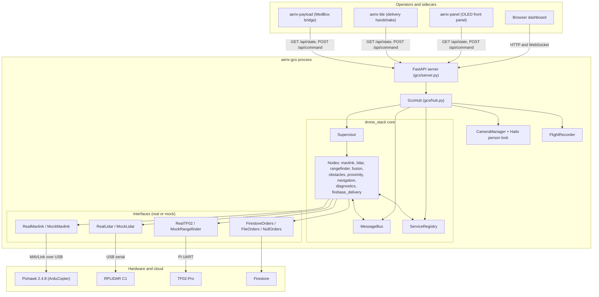
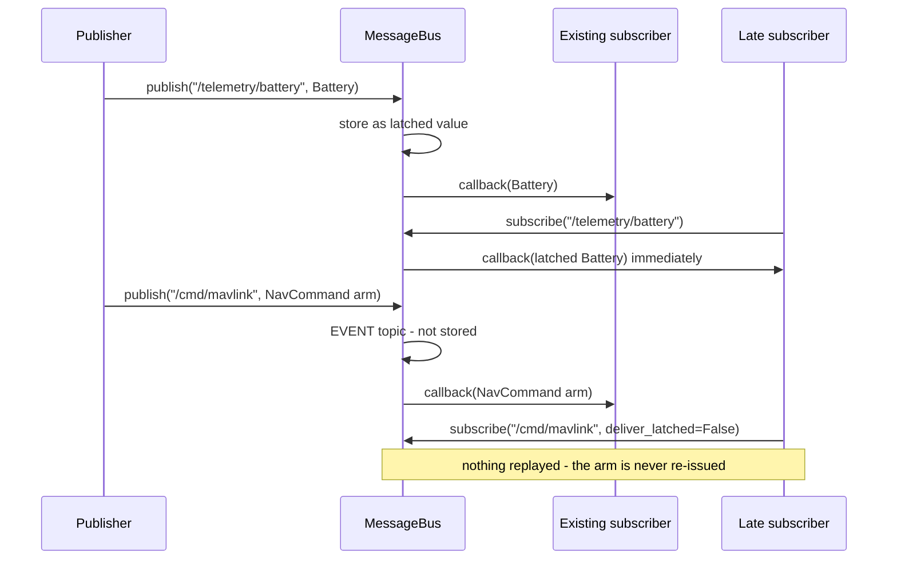
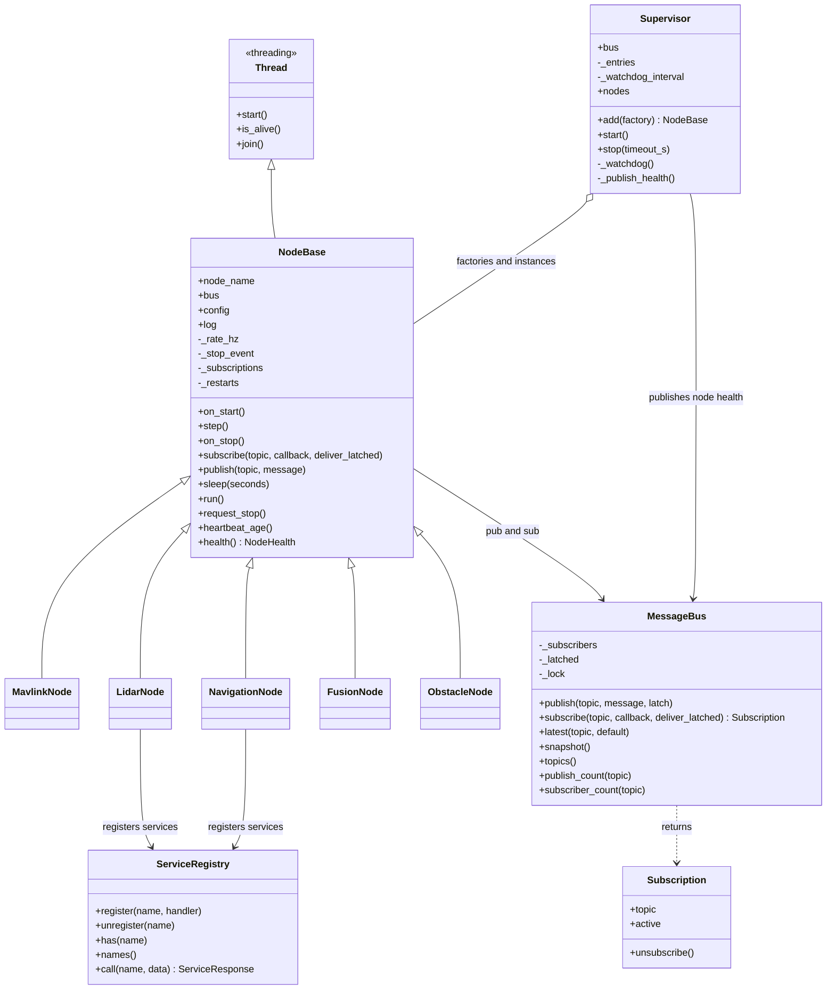
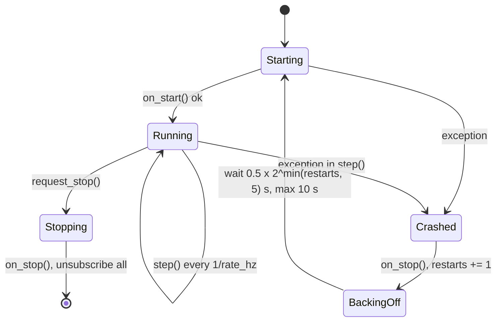
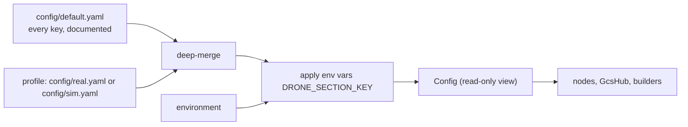
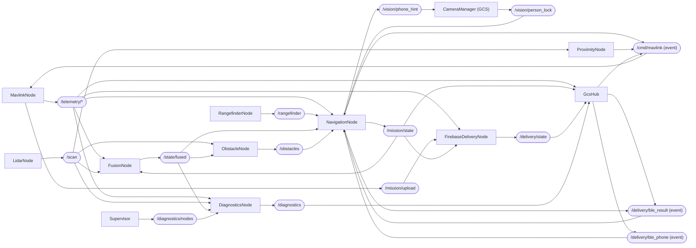
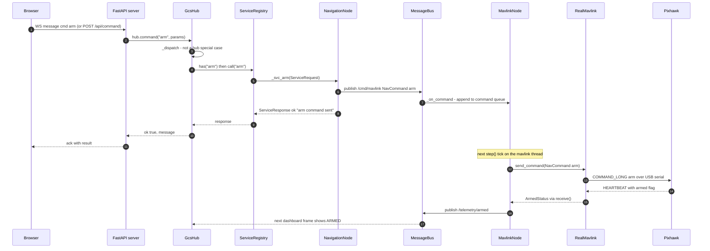
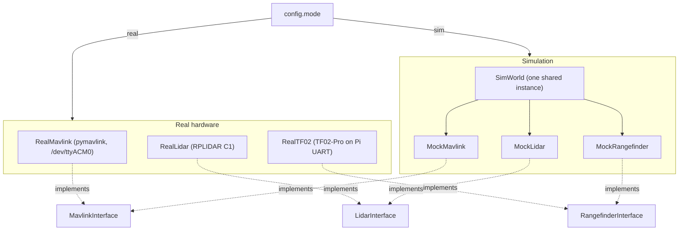
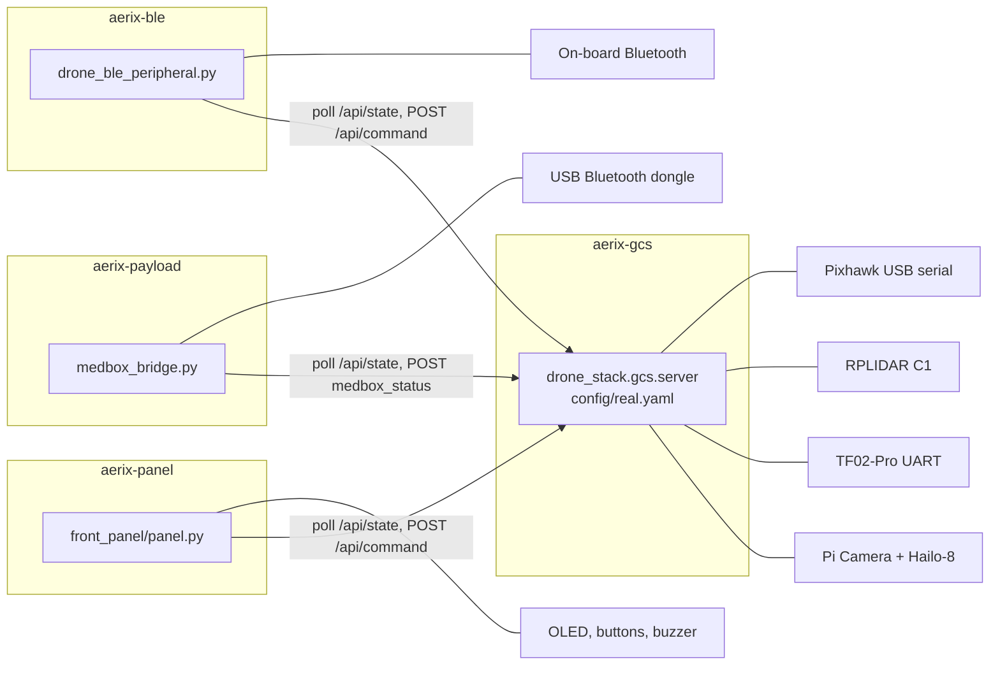

# 3. Software architecture

> **In one sentence:** the whole flight and ground-control stack is one Python
> process on the Raspberry Pi 5, built from small threaded "nodes" that talk
> only through an in-process publish/subscribe bus, plus three small sidecar
> processes for Bluetooth and the front panel.


## Contents

1. [What and why](#1-what-and-why)
2. [Why no ROS](#2-why-no-ros)
3. [The layers at a glance](#3-the-layers-at-a-glance)
4. [MessageBus: latched pub/sub](#4-messagebus-latched-pubsub)
5. [Typed messages](#5-typed-messages)
6. [ServiceRegistry: request/response](#6-serviceregistry-requestresponse)
7. [NodeBase and the Supervisor: self-healing threads](#7-nodebase-and-the-supervisor-self-healing-threads)
8. [Configuration: deep-merge and env overrides](#8-configuration-deep-merge-and-env-overrides)
9. [Launch and bringup](#9-launch-and-bringup)
10. [The nodes](#10-the-nodes)
11. [Topic table and data flow](#11-topic-table-and-data-flow)
12. [GcsHub and the FastAPI server](#12-gcshub-and-the-fastapi-server)
13. [Life of a UI command](#13-life-of-a-ui-command)
14. [Simulation vs real hardware](#14-simulation-vs-real-hardware)
15. [Background processes (systemd units)](#15-background-processes-systemd-units)
16. [Where to read next in the code](#16-where-to-read-next-in-the-code)

---

## 1. What and why

AERIX has to do a lot at once: read the Pixhawk's telemetry at tens of hertz,
turn a spinning 2D LiDAR into obstacles, run a mission state machine with
avoidance and failsafes, serve a live web dashboard with camera video, pull
delivery orders from Firestore, and stay correct when any one of those parts
crashes. All of it runs on **one Raspberry Pi 5**.

The design answer is the classic robotics pattern - independent nodes,
named topics, services - but implemented in a few hundred lines of plain
Python instead of a robotics middleware:

| Idea | Where it lives | Size |
|---|---|---|
| Publish/subscribe bus | [message_bus.py](../../drone_stack/bus/message_bus.py), [topics.py](../../drone_stack/bus/topics.py) | ~250 lines |
| Typed messages | [messages.py](../../drone_stack/msg/messages.py) | dataclasses |
| Request/response services | [services.py](../../drone_stack/srv/services.py) | ~80 lines |
| Node base class + supervisor | [node.py](../../drone_stack/utils/node.py) | ~230 lines |
| Layered YAML config | [config.py](../../drone_stack/utils/config.py) | ~150 lines |
| Launch (picks nodes from config) | [bringup.py](../../drone_stack/launch/bringup.py), [builders.py](../../drone_stack/launch/builders.py) | ~230 lines |

Everything else - the navigator, the LiDAR pipeline, the GCS - is ordinary
application code built on those six pieces.

## 2. Why no ROS

The README maps every ROS concept to its replacement:

| ROS concept | AERIX replacement |
|---|---|
| Topic | `MessageBus` topic (a string constant in `Topics`) |
| Message | `@dataclass` in `drone_stack/msg` |
| Service | `ServiceRegistry` request/response in `drone_stack/srv` |
| `roslaunch` | `drone_stack/launch/bringup.py`, driven by YAML `enabled` flags |
| `rosparam` / YAML | `config/*.yaml` with deep-merge |
| RViz | the web dashboard / GCS |

Reasons the team went this way:

- **One process, one language.** No DDS, no build workspace, no `colcon`, no
  ROS distribution pinned to an OS release. A `pip install` on Debian on the
  Pi is the whole install (see [requirements.txt](../../requirements.txt)).
- **Zero-copy, in-process messaging.** A message is a Python object handed to
  each subscriber's callback; there is no serialisation between nodes.
- **Testability.** Because the bus, services and nodes are plain objects, the
  test suite builds the full stack in-process against a simulated world
  (see [test_bringup.py](../../tests/test_bringup.py),
  [test_integration_sim.py](../../tests/test_integration_sim.py)).
- **The safety rules are visible in our own code.** Behaviour such as "command
  topics are never latched" (section 4) is a few lines the team owns and has
  tests for, rather than a middleware QoS setting.

The cost is that AERIX does not get ROS tooling (bag files, `rqt`, the
package ecosystem). The GCS provides the equivalents the project needed: a
JSONL record/replay of the dashboard payload, a flight video recorder, and a
diagnostics panel.

## 3. The layers at a glance



Reading it top to bottom:

- **Sidecars and browsers** never touch the flight hardware. They only speak
  HTTP to the GCS.
- **The GCS process** owns everything physical: the Pixhawk serial port, the
  LiDAR, the downward rangefinder, the camera and the Hailo accelerator.
- **The core** (bus, services, supervisor, nodes) is identical whether the GCS
  or the standalone launcher started it.
- **Interfaces** are the only code that differs between simulation and real
  hardware (section 14).

## 4. MessageBus: latched pub/sub

Source: [message_bus.py](../../drone_stack/bus/message_bus.py),
topic names in [topics.py](../../drone_stack/bus/topics.py).

The bus is a dictionary of topic name to subscriber callbacks, protected by a
re-entrant lock. Three properties matter:

| Property | What it means | Why |
|---|---|---|
| **Thread-safe** | Any node thread may publish or subscribe | Every node is its own thread |
| **Latched** | The last message on each topic is kept and handed to a new subscriber immediately | A node that starts late (or restarts) gets the current battery, GPS, mode... without waiting |
| **Fault-isolated** | An exception in one subscriber is logged and swallowed | A buggy consumer cannot break the publisher or other consumers |

Callbacks run **in the publisher's thread**, and they are dispatched *outside*
the lock so a slow or re-entrant subscriber cannot deadlock the bus. The
project convention is therefore that a callback only *stores* the message;
the node's own loop does the work on its own thread.

The bus also offers introspection used by the GCS and diagnostics:
`latest(topic)`, `snapshot()`, `topics()`, `publish_count(topic)` and
`subscriber_count(topic)`. The GCS builds its whole dashboard payload by
reading `latest()` on each topic rather than subscribing to all of them.

### EVENT_TOPICS are never latched

Latching is right for **state** ("the battery is at 23.1 V") and dangerous for
**commands** ("arm"). The bus therefore refuses to latch any topic listed in
`Topics.EVENT_TOPICS`, whatever the publisher asks:

```python
# drone_stack/bus/topics.py
EVENT_TOPICS = frozenset({MISSION_CMD, MAVLINK_CMD, DELIVERY_BLE_RESULT, BLE_PHONE})

# drone_stack/bus/message_bus.py - MessageBus.publish
if latch and topic not in Topics.EVENT_TOPICS:
    self._latched[topic] = message
```

The reason is written into the source. When the Supervisor recreates a dead
node it calls that node's constructor again, and the constructor
re-subscribes. With latching left on, a recreated `MavlinkNode` was handed the
last command it had ever seen and replayed it - an `arm` or `takeoff` that
nobody had asked for. The rule now has two layers:

1. The bus never stores event topics (`/mission/cmd`, `/cmd/mavlink`,
   `/delivery/ble_result`, `/delivery/ble_phone`).
2. Subscribers to those topics also pass `deliver_latched=False`
   (`MavlinkNode` for `/cmd/mavlink`; `NavigationNode` for `/mission/cmd`,
   `/delivery/ble_result` and `/delivery/ble_phone`).

The same reasoning covers the delivery events: a recreated navigator must not
be handed a previous order's "delivered" result or a previous recipient's
phone samples. Both behaviours are pinned by tests in
[test_delivery.py](../../tests/test_delivery.py)
(`test_the_bus_refuses_to_latch_command_topics`,
`test_a_recreated_mavlink_node_does_not_replay_the_last_command`).

> **Rule for contributors:** any new topic that carries an *instruction*
> belongs in `EVENT_TOPICS`, and its subscribers use `deliver_latched=False`.



## 5. Typed messages

Source: [messages.py](../../drone_stack/msg/messages.py).

Every message is a Python `@dataclass` that inherits from `Message`, which
adds a keyword-only wall-clock `stamp` and an `age()` helper. Keeping `stamp`
keyword-only means positional construction reads naturally:
`NavCommand("arm")` sets `command`, not the timestamp. Consumers judge
freshness from the message's own stamp (for example the navigator treats a
stale rangefinder reading as absent).

| Group | Message classes |
|---|---|
| MAVLink telemetry | `Heartbeat`, `GpsFix`, `Attitude`, `Imu`, `Battery`, `Altitude`, `Velocity`, `FlightMode`, `ArmedStatus`, `SystemStatus`, `RcChannels`, `LinkQuality`, `FcMessage` |
| Sensors | `LaserScan`, `PointCloud`, `RangeReading` |
| Perception / state | `FusedState`, `Obstacle`, `ObstacleArray`, `AvoidanceStatus` |
| Navigation | `Waypoint`, `Mission`, `MissionState`, `NavCommand`, `MissionUploadResult` |
| Delivery | `DeliveryOrder`, `DeliveryState`, `DeliveryBleResult`, `BlePhoneSignal` |
| Vision | `PersonLockState`, `PhoneHint` |
| Diagnostics | `Diagnostic`, `NodeHealth`, `SystemDiagnostics` |
| Enums | `DiagLevel`, `ObstacleClass`, `ScanState`, `MissionPhase`, `DeliveryPhase`, `DeliveryOutcome`, `ReturnOutcome` |

`to_dict()` at the bottom of the module turns any message tree into
JSON-safe dicts; the GCS uses it to build the WebSocket payload.

`NavCommand` deserves a mention: it is the single envelope for anything the
autopilot should do. Its `command` string (`arm`, `disarm`, `set_mode`,
`takeoff`, `goto`, `velocity`, `rtl`, `land`, `brake`, `set_servo`,
`upload_mission`, `obstacle_distance`, ...) is interpreted by
`RealMavlink._dispatch` in
[mavlink_interface.py](../../drone_stack/interfaces/mavlink_interface.py).

## 6. ServiceRegistry: request/response

Source: [services.py](../../drone_stack/srv/services.py).

Topics are fire-and-forget; some actions need an answer ("did the mission
load?"). Nodes register named handlers that take a `ServiceRequest` and return
a `ServiceResponse(success, message, data)`.

Two design choices:

- **`call()` never raises.** A missing service returns
  `ServiceResponse(False, "no such service: ...")`; a handler exception is
  logged and returned as a failed response. The GCS can forward any UI command
  without wrapping it in try/except.
- **`name` is positional-only:** `call(self, name, /, **data)`. The GCS passes
  arbitrary command payloads straight through as keyword arguments, and a
  payload that happens to contain a `name` key (a mission name, an order name)
  must land in `data` instead of colliding with the service name.

Services registered by the core nodes:

| Node | Services |
|---|---|
| `NavigationNode` | `load_mission`, `start_mission`, `hold`, `resume`, `rtl`, `land`, `emergency_stop`, `clear_emergency`, `arm`, `disarm`, `mission_status`, `nl_command`, `avoid_enable`, `avoid_disable`, `set_stop_distance`, `set_flight_altitude`, `set_delivery_target`, `abort_delivery`, `goto_gps`, `precision_drop` |
| `LidarNode` | `scan_start`, `scan_stop`, `scan_pause`, `scan_resume` |
| `FirebaseDeliveryNode` | `delivery_accept`, `delivery_reject`, `delivery_abort`, `delivery_set_auto`, `delivery_set_altitude`, `delivery_status`, `delivery_inject`, `delivery_select`, `delivery_refresh`, `delivery_reset` |

An important consequence: `FirebaseDeliveryNode` flies an order **only through
the navigator's services** (`set_delivery_target`, `start_mission`, ...). A
Firestore order therefore passes through exactly the same altitude clamp,
pilot-override and failsafe logic as a mission started by hand. The
`/mission/cmd` topic is a bridge into the same services: `NavigationNode`
turns each `NavCommand` it receives there into `services.call(command, **params)`.

## 7. NodeBase and the Supervisor: self-healing threads

Source: [node.py](../../drone_stack/utils/node.py).



### NodeBase: two levels of recovery

Each node is a daemon `threading.Thread` with three hooks a subclass overrides:
`on_start()` (acquire resources), `step()` (one tick of work, called at the
node's `rate_hz`) and `on_stop()` (release, must be safe to call twice).

`run()` wraps those hooks in a loop:



- **Level 1, inside the thread:** any exception in `on_start`, `step` or
  `on_stop` is logged, `on_stop()` is called, and the node waits an
  exponential backoff (`0.5 s x 2^min(restarts, 5)`, capped at 10 s) before
  calling `on_start()` again. The thread itself survives, so its
  subscriptions survive too.
- **Level 2, the Supervisor watchdog:** every 2 s (`watchdog_interval_s`
  default) it checks each node. A thread that has died outright and was not
  asked to stop is **rebuilt from its factory** (a fresh constructor call) and
  started. This is the path that re-subscribes, and the reason event topics
  are never latched (section 4).

The `step()` loop sleeps on the node's stop event, so `request_stop()`
interrupts a sleeping node immediately rather than waiting out its period.

On every watchdog tick the Supervisor also publishes a list of `NodeHealth`
(`name`, `alive`, `running`, `restarts`, `heartbeat_age_s`) on
`/diagnostics/nodes`, which `DiagnosticsNode` folds into `/diagnostics` and the
GCS shows on its health panel.

Note that factories in `bringup.py` close over hardware interfaces built
**once**, outside the lambda (for example
`supervisor.add(lambda: MavlinkNode(bus, config, mav_iface))`). A recreated
node therefore reuses the same interface object rather than opening the
serial port a second time.

## 8. Configuration: deep-merge and env overrides

Source: [config.py](../../drone_stack/utils/config.py). Files:
[default.yaml](../../config/default.yaml),
[real.yaml](../../config/real.yaml), [sim.yaml](../../config/sim.yaml).



Resolution order, later wins:

1. `config/default.yaml` - every tunable with a default. Its own default is
   `mode: sim`.
2. The profile passed with `--config` - only the keys that differ.
   `_deep_merge` merges nested dicts key by key, so a profile can override
   `lidar.rate_hz` without restating the rest of the `lidar` section. Lists and
   scalars are replaced whole.
3. Environment variables `DRONE_<SECTION>_<KEY>=value`. The name is split at
   the **first** underscore after the prefix, the variable only applies if that
   section and key already exist, and the string is coerced to the type of the
   existing value (bool, int, float or string). This means it reaches only
   two-level keys in sections whose names contain no underscore.

The GCS server adds three operational overrides of its own in
[server.py](../../drone_stack/gcs/server.py): `MAVLINK_PORT` sets
`mavlink.connection`, `LIDAR_PORT` sets `lidar.port`, and `GCS_PORT` sets the
HTTP port.

Access is by section (`config.section("lidar")`, never `None`) or dotted path
(`config.get("safety.max_altitude_m", default)`). Nodes read their own section
in the constructor, so changing a value means restarting the GCS. The project
rule is that **config is the single source of truth**: channels, PWM limits,
thresholds and ports are never hardcoded in Python or JavaScript. For example,
`GcsHub` reads the payload and camera-tilt servo envelopes from
`payload` and `aux2_servo` and ships them to the browser, so the UI buttons
use the same numbers as the server-side clamp.

The full key reference is in [CONFIGURATION.md](../CONFIGURATION.md).

## 9. Launch and bringup

Source: [bringup.py](../../drone_stack/launch/bringup.py),
[builders.py](../../drone_stack/launch/builders.py).

`build_supervisor(config, bus=None, services=None, include_web=True)` is the
one function that assembles the stack. It is called two ways:

| Entry point | Command | Who provides bus/services | Web UI |
|---|---|---|---|
| Standalone stack | `python -m drone_stack.launch.bringup --config config/sim.yaml` | bringup creates them | built-in `WebDashboard` node (`web.port`) |
| GCS (normal use) | `python -m drone_stack.gcs.server --config config/real.yaml` | `GcsHub` creates them and passes them in | `include_web=False`; the FastAPI GCS is the UI |

Nodes are added in a deliberate order, each behind its config flag:

| Order | Node | Flag (default) | Note |
|---|---|---|---|
| 1 | `MavlinkNode` | `mavlink.enabled` (true) | gets `RealMavlink` or `MockMavlink` |
| 2 | `LidarNode` | `lidar.enabled` (true) | gets `RealLidar` or `MockLidar` |
| 3 | `RangefinderNode` | `rangefinder.enabled` (false; true in real.yaml and sim.yaml) | downward TF02-Pro, precision drop only |
| 4 | `FusionNode` | `fusion.enabled` (true) | |
| 5 | `ObstacleNode` | `obstacles.enabled` (true) | |
| 6 | `ProximityNode` | `proximity.enabled` (false; true in real.yaml) | started before the navigator: it is the avoidance that keeps working when the pilot has the sticks |
| 7 | `NavigationNode` | `navigation.enabled` (true) | |
| 8 | `DiagnosticsNode` | `diagnostics.enabled` (true) | |
| 9 | `FirebaseDeliveryNode` | `delivery.enabled` (true) | after the navigator, because it drives the aircraft through the navigator's services |
| 10 | novelty `DeliveryNode` | `novelty.enabled` (false) | **design tier, disabled**; imported lazily so its extra dependencies cost nothing when off |
| 11 | `WebDashboard` | `web.enabled` and `include_web` | standalone mode only |

In simulation one shared `SimWorld` is built first and handed to the mock
Pixhawk, mock LiDAR and mock rangefinder, so all three sensors observe the
same simulated vehicle and obstacles.

## 10. The nodes

All live in [drone_stack/nodes/](../../drone_stack/nodes/). Default rates come
from `default.yaml`; `real.yaml` raises some of them.

| Node (thread name) | Rate | Role |
|---|---|---|
| [MavlinkNode](../../drone_stack/nodes/mavlink_node.py) (`mavlink`) | 50 Hz | Connects with retry, maps each telemetry dataclass to its topic, queues `/cmd/mavlink` commands and flushes them to the interface on its own thread. Also watches transmitter channel `payload.rc_channel` (9) and drives the payload servo on `payload.out_channel` (12) on a switch edge: above 1700 us release, below 1300 us lock, dead-band between. |
| [LidarNode](../../drone_stack/nodes/lidar_node.py) (`lidar`) | 10 Hz default, 25 Hz in real.yaml | Reads completed revolutions from the LiDAR interface, publishes `/scan` and `/cloud`, scan state and LiDAR diagnostics. Filtering lives upstream (driver and node) so every consumer sees one view. |
| [RangefinderNode](../../drone_stack/nodes/rangefinder_node.py) (`rangefinder`) | 20 Hz | Downward TF02-Pro height above ground, used only by the precision drop. |
| [FusionNode](../../drone_stack/nodes/fusion_node.py) (`fusion`) | 30 Hz | Complementary estimator; publishes `/state/fused` in a local ENU frame. |
| [ObstacleNode](../../drone_stack/nodes/obstacle_node.py) (`obstacles`) | 10 Hz default, 25 Hz in real.yaml | Clusters and classifies scan points; [ObstacleTracker](../../drone_stack/nodes/obstacle_tracker.py) gives obstacles identity across revolutions so closing speed can be estimated. |
| [ProximityNode](../../drone_stack/nodes/proximity_node.py) (`proximity`) | 10 Hz | Turns `/scan` into an `obstacle_distance` stream for the flight controller's own proximity library (pilot-mode avoidance). Issues no flight commands, never changes mode. |
| [NavigationNode](../../drone_stack/nodes/navigation_node.py) (`navigation`) | 10 Hz | The mission state machine: legs, avoidance, failsafes, pilot-override stand-down, altitude clamp, drop-point person scan, phone locator, precision drop, RTL and land. Described in [04](04-delivery-mission.md), [05](05-perception-and-avoidance.md) and [08](08-safety.md). |
| [DiagnosticsNode](../../drone_stack/nodes/diagnostics_node.py) (`diagnostics`) | 1 Hz | Host CPU/memory/temperature, sensor staleness (heartbeat, GPS, scan, fused state), node health, link quality. |
| [FirebaseDeliveryNode](../../drone_stack/nodes/firebase_delivery_node.py) (`firebase_delivery`) | 2 Hz | Polls the order source, validates orders, drives the navigator's services, writes status back. |
| [DeliveryNode](../../drone_stack/novelty/delivery_node.py) (`delivery`) | 5 Hz | Novelty layer. **Design tier, disabled by default, never deployed.** |

Two GCS components are not `NodeBase` nodes but still use the bus:
`CameraManager` in [cameras.py](../../drone_stack/gcs/cameras.py) publishes
`/vision/person_lock` and subscribes to `/vision/phone_hint`, and `GcsHub`
itself publishes bridged commands and events (section 12).

## 11. Topic table and data flow

Built from [topics.py](../../drone_stack/bus/topics.py) and the
`publish`/`subscribe` calls in each node. "Event" means the topic is in
`EVENT_TOPICS` and is never latched. `GcsHub` reads most state topics with
`bus.latest()` when it builds each dashboard frame; that is listed as "GcsHub
(read)".

### Telemetry (from MavlinkNode)

| Topic | Message | Consumers |
|---|---|---|
| `/telemetry/heartbeat` | `Heartbeat` | DiagnosticsNode (staleness), GcsHub (read; flight-end detection) |
| `/telemetry/gps` | `GpsFix` | FusionNode, NavigationNode, FirebaseDeliveryNode, DiagnosticsNode, GcsHub (GPS trail) |
| `/telemetry/attitude` | `Attitude` | FusionNode, GcsHub (read) |
| `/telemetry/imu` | `Imu` | FusionNode |
| `/telemetry/battery` | `Battery` | NavigationNode, GcsHub (read) |
| `/telemetry/altitude` | `Altitude` | FusionNode, GcsHub (recorder "did it fly" test) |
| `/telemetry/velocity` | `Velocity` | FusionNode, GcsHub (read) |
| `/telemetry/mode` | `FlightMode` | NavigationNode (pilot-override detection), GcsHub (read) |
| `/telemetry/armed` | `ArmedStatus` | NavigationNode, GcsHub (arm edge starts the flight recording) |
| `/telemetry/sys_status` | `SystemStatus` | GcsHub (read) |
| `/telemetry/rc` | `RcChannels` | NavigationNode (transmitter override), GcsHub (read) |
| `/telemetry/link` | `LinkQuality` | NavigationNode, DiagnosticsNode, GcsHub (read) |
| `/telemetry/fc_message` | `FcMessage` (STATUSTEXT) | NavigationNode, GcsHub |
| `/mission/upload` | `MissionUploadResult` | FirebaseDeliveryNode |

### Sensors and perception

| Topic | Message | Publisher | Consumers |
|---|---|---|---|
| `/scan` | `LaserScan` | LidarNode | FusionNode, ObstacleNode, ProximityNode, DiagnosticsNode, GcsHub (read) |
| `/cloud` | `PointCloud` | LidarNode | WebDashboard (standalone mode) |
| `/scan/state` | `ScanState` | LidarNode | GcsHub (read) |
| `/diagnostics/lidar` | `Diagnostic` | LidarNode | (diagnostic record) |
| `/rangefinder` | `RangeReading` | RangefinderNode | NavigationNode, GcsHub (read) |
| `/diagnostics/rangefinder` | `Diagnostic` | RangefinderNode | GcsHub (read) |
| `/state/fused` | `FusedState` | FusionNode | ObstacleNode, NavigationNode, DiagnosticsNode, novelty DeliveryNode |
| `/obstacles` | `ObstacleArray` | ObstacleNode | NavigationNode, GcsHub (read) |
| `/vision/person_lock` | `PersonLockState` | CameraManager (GCS) | NavigationNode |
| `/vision/phone_hint` | `PhoneHint` | NavigationNode | CameraManager (GCS) |

### Navigation, delivery and diagnostics

| Topic | Message | Publisher(s) | Consumers | Event? |
|---|---|---|---|---|
| `/mission/state` | `MissionState` | NavigationNode | FusionNode, FirebaseDeliveryNode, GcsHub | |
| `/mission/plan` | `Mission` | NavigationNode | GcsHub (read; plan export) | |
| `/avoidance` | `AvoidanceStatus` | NavigationNode | GcsHub (read) | |
| `/mission/cmd` | `NavCommand` | novelty DeliveryNode (when enabled) | NavigationNode (calls the named service) | **yes** |
| `/cmd/mavlink` | `NavCommand` | NavigationNode, ProximityNode (`obstacle_distance`), GcsHub (`set_mode`, e-stop `disarm`, `set_servo`, camera tilt), novelty DeliveryNode | MavlinkNode | **yes** |
| `/delivery/order` | `DeliveryOrder` | FirebaseDeliveryNode | (no core subscriber; informational) | |
| `/delivery/state` | `DeliveryState` | FirebaseDeliveryNode | GcsHub (delivery panel) | |
| `/delivery/ble_result` | `DeliveryBleResult` | GcsHub (bridged from aerix-ble), NavigationNode (precision-drop release) | NavigationNode | **yes** |
| `/delivery/ble_phone` | `BlePhoneSignal` | GcsHub (bridged RSSI samples and phone GPS fixes from aerix-ble) | NavigationNode | **yes** |
| `/diagnostics` | `SystemDiagnostics` | DiagnosticsNode | GcsHub (read) | |
| `/diagnostics/nodes` | `list[NodeHealth]` | Supervisor | DiagnosticsNode | |

`/diagnostics/mavlink` is declared in `Topics` but nothing publishes it today.
The novelty layer declares its own topics under `/novelty/...` in
[novelty/topics.py](../../drone_stack/novelty/topics.py); they are only live
when `novelty.enabled` is true.

### Data-flow graph



The shape is a pipeline with one loop: sensors flow left to right into the
navigator, and the navigator's decisions flow back to the Pixhawk through a
single command topic owned by `MavlinkNode`. Only one thread ever writes to
the serial link.

## 12. GcsHub and the FastAPI server

Sources: [hub.py](../../drone_stack/gcs/hub.py),
[server.py](../../drone_stack/gcs/server.py),
[ws_flow.py](../../drone_stack/gcs/ws_flow.py).

The split is deliberate:

| | `GcsHub` (plain Python) | FastAPI app (`create_app`) |
|---|---|---|
| Owns | `MessageBus`, `ServiceRegistry`, `Supervisor` (via `build_supervisor(..., include_web=False)`), `CameraManager`, `FlightRecorder`, `FlightEndDetector` | HTTP routes, the WebSocket, MJPEG streaming, cache headers |
| Main methods | `build_payload()` (one JSON-safe dict for every panel), `command(cmd, params)`, `set_source()`, `record()`/`replay()`, `export_plan()`/`import_plan()` | thin wrappers that call those methods |
| Lifecycle | `start()` starts the supervisor and cameras; `stop()` closes the recording, cameras, then nodes | FastAPI `lifespan` calls `hub.start()` / `hub.stop()` |

Keeping the hub free of web code means the tests drive it directly
([test_gcs.py](../../tests/test_gcs.py)) without a server.

### Routes

| Route | Purpose |
|---|---|
| `GET /` | dashboard page (`gcs/static/index.html`) |
| `GET /api/state` | one snapshot of exactly what the WebSocket streams; used by the sidecars, scripts and health checks |
| `POST /api/command` | body `{"cmd": ..., "params": {...}}` goes to `hub.command()` |
| `WS /ws` | dashboard stream at up to 15 frames per second, plus commands in the other direction |
| `GET /api/logs` | recorded JSONL payload logs |
| `GET` / `POST /api/mission/plan` | QGC WPL mission export and import |
| `GET /api/recording`, `/api/recording/video`, `/api/recording/poster.jpg` | flight-recorder status, the kept clip and its poster frame |
| `GET /api/camera/{cam_id}`, `/api/camera/{cam_id}/stream` | camera info and MJPEG live stream |
| `/static/...` | front-end files, served from disk per request with `Cache-Control: no-cache` (edits need no restart) |

The WebSocket is flow-controlled per connection: a `FrameGate` keeps a credit
window of un-acknowledged frames (the page answers each with `frame_ack`), and
a `PayloadDelta` stops re-sending fields the page already has. A slow browser
therefore receives fewer, fresher frames instead of a growing queue, and the
measured telemetry queueing delay is fed back to the camera so video backs off
before telemetry does. The listening socket also caps unsent kernel buffer per
connection (`_NOTSENT_LOWAT`, 16 KB) for the same reason.

### What `_dispatch` does with a command

`GcsHub._dispatch` handles a small set of commands itself and forwards
everything else to the `ServiceRegistry` by name:

| Command | Handled by the hub because... |
|---|---|
| `set_mode` | publishes `NavCommand("set_mode")` straight to `/cmd/mavlink` |
| `emergency_stop` | publishes `disarm` on `/cmd/mavlink` **and** calls the navigator's `emergency_stop` service |
| `emergency_land`, `nl`, `clear_mission` | thin wrappers over `land`, `nl_command`, `load_mission` |
| `add_waypoint`, `upload_mission` | build waypoints from the UI's map clicks |
| `set_servo` | clamps the PWM to the **configured envelope for that channel** before publishing; an unknown channel falls back to the payload envelope |
| `set_flight_altitude` | the navigator answers first (it owns the ceiling clamp), then the delivery node adopts the height the navigator applied |
| `person_lock` | toggles the camera's person-lock pipeline and tilts the camera servo using `aux2_servo` angles |
| `record`, `replay`, `record_start`, `record_stop`, `set_source` | GCS-local features; an arm-started recording cannot be stopped from the UI |
| `ble_auth_event`, `ble_delivery_result`, `ble_phone_signal`, `ble_phone_fix` | bridges from the BLE handshake process onto the bus |
| `set_payload_kind`, `medbox_status`, `medbox_reset` | MedBox bridge state |
| anything else | `services.call(cmd, **params)` if a service by that name exists, else `unknown command` |

## 13. Life of a UI command

The browser's **ARM** button, end to end. The same path is used by
`POST /api/command` (front panel, BLE peripheral, scripts) and by a command
message on `/ws` (the dashboard).



Things worth noticing:

- The reply to the browser means **"queued"**, not "armed". The Pixhawk may
  still refuse (pre-arm checks); the truth arrives later as `/telemetry/armed`
  and any `STATUSTEXT` on `/telemetry/fc_message`.
- The serial port is only ever written by the `mavlink` thread
  (`_flush_commands`), so commands from the hub, navigator and proximity node
  can never interleave mid-message.
- Because `/cmd/mavlink` is an event topic, if `MavlinkNode` dies between
  steps 7 and 12 its replacement starts with an empty queue: the `arm` is
  lost, never replayed later.

## 14. Simulation vs real hardware

`config.mode` (`sim` or `real`) is turned into concrete objects in exactly one
place, [builders.py](../../drone_stack/launch/builders.py). Nodes only ever see
the abstract interface, so the navigator, fusion and obstacle code are the
same in both modes.



| Interface | Abstract methods | Real | Mock |
|---|---|---|---|
| [MavlinkInterface](../../drone_stack/interfaces/mavlink_interface.py) | `connected`, `connect`, `close`, `receive`, `send_command`, `link_quality` | `RealMavlink` | [MockMavlink](../../drone_stack/sim/mock_pixhawk.py) |
| [LidarInterface](../../drone_stack/interfaces/lidar_interface.py) | `connected`, `connect`, `close`, `read_scan` | `RealLidar` | [MockLidar](../../drone_stack/sim/mock_lidar.py) |
| [RangefinderInterface](../../drone_stack/interfaces/rangefinder_interface.py) | `connected`, `connect`, `close`, `read` | `RealTF02` | [MockRangefinder](../../drone_stack/sim/mock_rangefinder.py) |
| [FirebaseInterface](../../drone_stack/interfaces/firebase_interface.py) | order source | `FirestoreOrders` | `FileOrders` (sim uses `delivery.source: file`), `NullOrders` when no credentials |

Two details:

- **The altitude ceiling is enforced in the link too.** `_with_ceiling` copies
  `safety.max_altitude_m` into the `mavlink` section handed to `RealMavlink`,
  so a mission uploaded to the flight controller is clamped on its way in,
  even though AUTO then flies it with the navigator out of the loop.
- **Live source switching.** The GCS `set_source` command stops the
  supervisor, reloads the whole `real.yaml` or `sim.yaml` profile (not just
  `mode`, so the connection strings change too) and builds a new supervisor on
  the **same** bus and service registry, so open dashboards keep working.

[sim.yaml](../../config/sim.yaml) also auto-accepts orders from a local file,
never uploads to a flight controller and never writes back to Firestore, so the
whole order-to-RTL path can run with no hardware and no cloud.

> **Evidence note.** Passing in simulation is a model, not a flight. Following
> [EVIDENCE_TIERS.md](../../evidence/EVIDENCE_TIERS.md), features such as the
> person scan, precision drop and LiDAR avoidance around the handover are
> **simulation-tested**, and the novelty layer is **design stage**. A green sim
> run is never taken as proof a hover mode is safe on the real aircraft
> ([08-safety.md](08-safety.md)).

## 15. Background processes (systemd units)

The GCS process is the only one allowed to open flight hardware. Everything
that needs a different radio or a different Python environment runs as its own
systemd unit and talks to the GCS over local HTTP. A crash in a sidecar
therefore cannot reach the serial link.



| Unit | Runs | Owns | Talks to the GCS by |
|---|---|---|---|
| `aerix-gcs` | `python -m drone_stack.gcs.server --config config/real.yaml` from the project `.venv`, `GCS_PORT=8090`, with a 10 s start delay so the USB devices enumerate | Pixhawk serial port, LiDAR, TF02-Pro UART, camera, Hailo accelerator, HTTP port 8090 | (it is the GCS) |
| `aerix-ble` | [ble_handshake_start.sh](../../scripts/ble_handshake_start.sh), which waits for the **on-board** Bluetooth adapter, prepares the RAM-only order directory `/run/aerix-ble`, then starts [drone_ble_peripheral.py](../../drone_stack/ble_handshake/drone_ble_peripheral.py) from its own venv | on-board Bluetooth controller, the live order token directory | a background thread polls `/api/state`; it POSTs `ble_delivery_result`, `ble_phone_signal`, `ble_phone_fix`, `precision_drop` and `set_servo` |
| `aerix-payload` | [medbox_bridge.py](../../drone_stack/payload/medbox_bridge.py) from its own venv; unit file [aerix-payload.service](../../scripts/aerix-payload.service), `User=pi`, `Nice=5`, `Restart=always` | the USB Bluetooth dongle only; stays off the air unless the payload kind is `medbox` | polls `/api/state`, POSTs `medbox_status` |
| `aerix-panel` | [panel.py](../../front_panel/panel.py) | SH1106 OLED, three buttons, buzzer | polls `/api/state`; sends payload LOCK/RELEASE via `set_servo` and height changes via `set_flight_altitude` (both refused while armed), so the GCS clamp and console log still apply |

Rules that follow from this split:

- **Only one process may hold the Pixhawk serial port.** Flight-controller
  parameter scripts in [scripts/](../../scripts/) need
  `sudo systemctl stop aerix-gcs` first. Do not run
  [start_gcs.sh](../../scripts/start_gcs.sh) while the service is up.
- **Each Bluetooth job has its own adapter**, chosen by sysfs bus path rather
  than `hciN` number, because those numbers can swap between boots. See
  [06-ble-handshake-security.md](06-ble-handshake-security.md) and the
  [MedBox add-on](../../addons/medbox/README.md).
- **Configuration reaches sidecars through `/api/state`.** For example the BLE
  micro-geofence radius (`delivery.ble_geofence_m`) and the payload servo
  numbers live in config and are read from the GCS snapshot, not duplicated in
  the sidecar.
- Front-end static files are served from disk, so UI edits need no restart;
  any Python change needs `sudo systemctl restart aerix-gcs`.

Secrets used by these processes (Firebase service account, MedBox key, receipt
signing key) are git-ignored and live only on the aircraft; see
[medbox_key.txt.example](../../config/medbox_key.txt.example) for the shape of
one and [THREAT_MODEL.md](../security/THREAT_MODEL.md) for how they are
protected.

## 16. Where to read next in the code

| If you want to... | Start at |
|---|---|
| Add a topic | [topics.py](../../drone_stack/bus/topics.py) - and decide: state or event? |
| Add a node | subclass `NodeBase` in [node.py](../../drone_stack/utils/node.py), add a flag to [default.yaml](../../config/default.yaml), register it in [bringup.py](../../drone_stack/launch/bringup.py) |
| Add a UI button | a service on the owning node, then a button in [gcs/static/app.js](../../drone_stack/gcs/static/app.js); `_dispatch` forwards it by name |
| Add an autopilot command | a branch in `RealMavlink._dispatch` ([mavlink_interface.py](../../drone_stack/interfaces/mavlink_interface.py)) and the matching mock in [mock_pixhawk.py](../../drone_stack/sim/mock_pixhawk.py) |
| See the bus contract in tests | [test_bus.py](../../tests/test_bus.py), [test_delivery.py](../../tests/test_delivery.py) |
| Read the older design summary | [ARCHITECTURE.md](../ARCHITECTURE.md), and the engineering notebook [PROJECT_NOTES.md](../PROJECT_NOTES.md) |

---

[← Previous: Hardware](02-hardware.md) | [Index](../../README.md) | [Next: Delivery mission →](04-delivery-mission.md)
