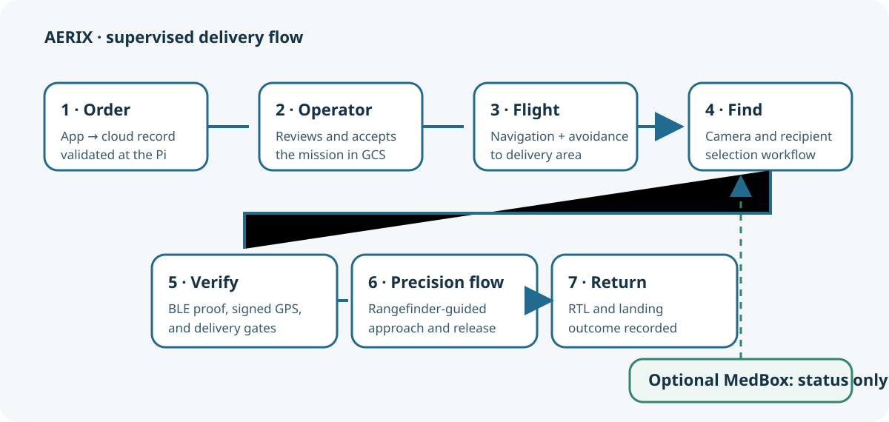
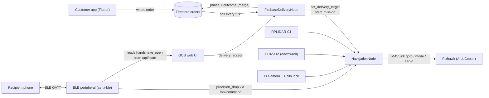
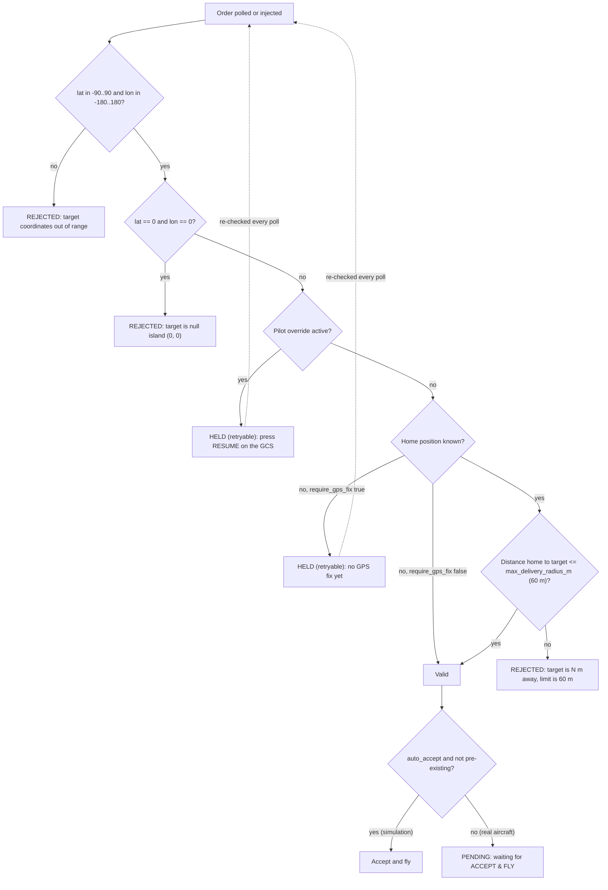
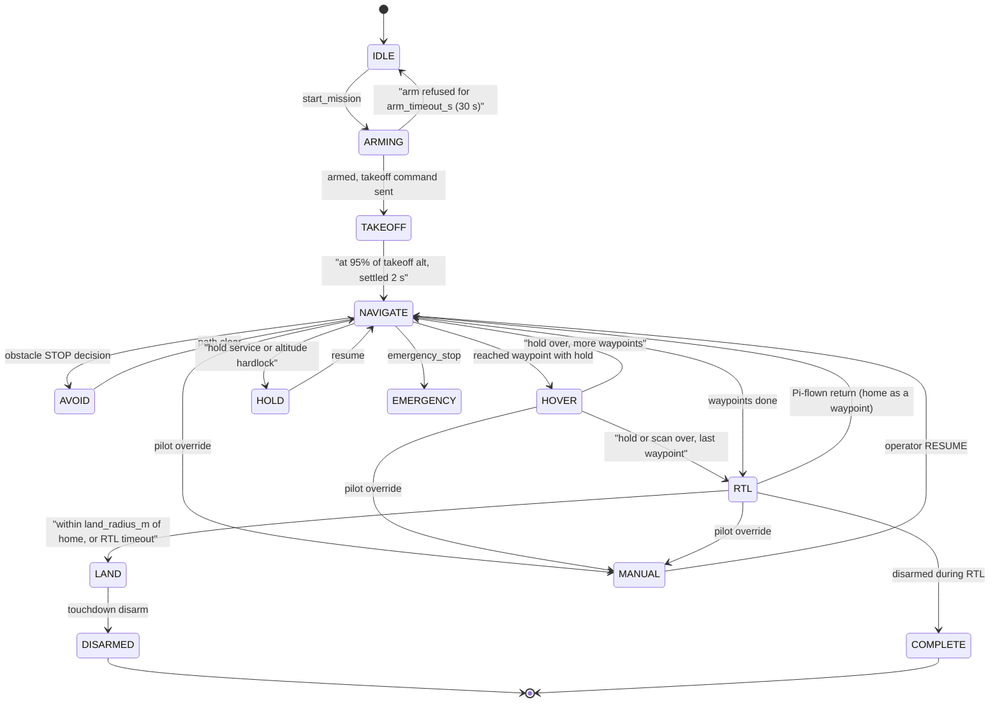
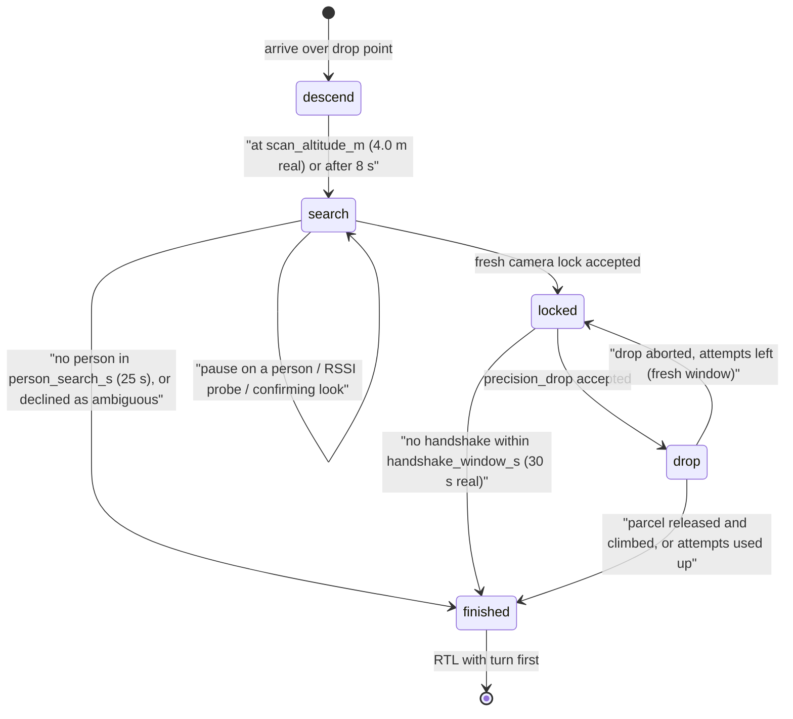
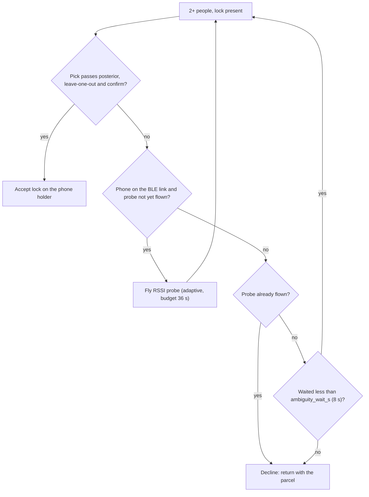
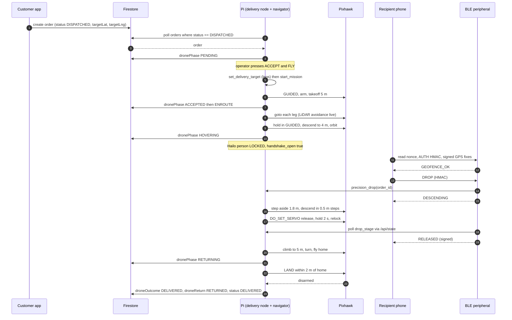
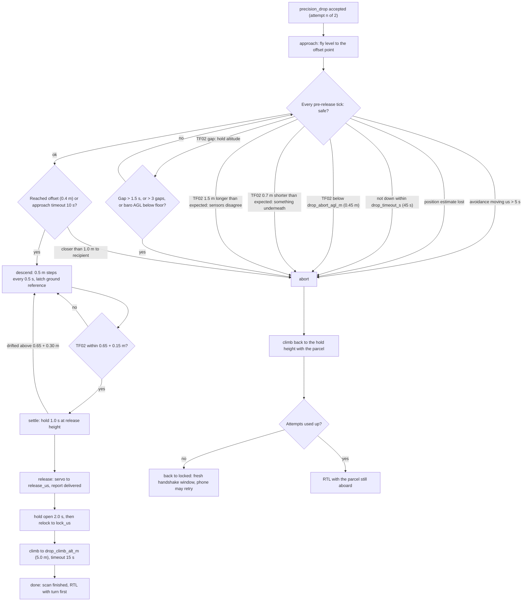
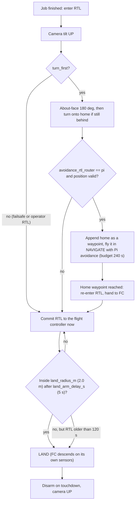

# 4. The Delivery Mission, End to End

> **What this page covers.** A customer drops a pin in the AERIX app. A few
> minutes later a quadcopter arrives overhead, finds the recipient with its
> camera, proves who they are over Bluetooth, lowers itself to knee height, lets
> go of the parcel, and flies home. This page follows one order through every
> step of that journey, from the database row to the verdict written back
> afterwards, and links each step to the code that does it.



## Contents

1. [The short version](#1-the-short-version)
2. [Who does what](#2-who-does-what)
3. [Order intake and validation](#3-order-intake-and-validation)
4. [Operator ACCEPT & FLY](#4-operator-accept--fly)
5. [Leg expansion: one pin becomes a route](#5-leg-expansion-one-pin-becomes-a-route)
6. [The mission state machine](#6-the-mission-state-machine)
7. [Arming, takeoff and cruise](#7-arming-takeoff-and-cruise)
8. [The drop-point hold: GUIDED only](#8-the-drop-point-hold-guided-only)
9. [Person scan: orbit and camera lock](#9-person-scan-orbit-and-camera-lock)
10. [More than one person: picking the phone holder](#10-more-than-one-person-picking-the-phone-holder)
11. [The BLE handshake window](#11-the-ble-handshake-window)
12. [Precision drop on the TF02-Pro](#12-precision-drop-on-the-tf02-pro)
13. [Return home and landing](#13-return-home-and-landing)
14. [The verdict: parcel story x aircraft story](#14-the-verdict-parcel-story-x-aircraft-story)
15. [Abort paths](#15-abort-paths)
16. [Key configuration values](#16-key-configuration-values)
17. [Testing without a phone](#17-testing-without-a-phone)
18. [Evidence status](#18-evidence-status)

---

## 1. The short version

| Step | What happens | Where in the code |
|---|---|---|
| 1 | The app writes an order (`status: DISPATCHED`, `targetLat`, `targetLng`) to the Firestore `orders` collection | [firebase_interface.py](../../drone_stack/interfaces/firebase_interface.py) |
| 2 | The Pi polls Firestore, validates the target and offers it to the operator as **PENDING** | [firebase_delivery_node.py](../../drone_stack/nodes/firebase_delivery_node.py) |
| 3 | A human presses **ACCEPT & FLY** on the ground control station (GCS) | [app.js](../../drone_stack/gcs/static/app.js) |
| 4 | The navigator splits home to target into legs, arms, takes off and flies them with LiDAR avoidance | [navigation_node.py](../../drone_stack/nodes/navigation_node.py) |
| 5 | Over the drop point it holds in **GUIDED**, descends to scan height and orbits looking for a person | `NavigationNode._enter_scan`, `_do_scan` |
| 6 | Once a person is locked, the BLE handshake window opens; the recipient's phone authenticates | [drone_ble_peripheral.py](../../drone_stack/ble_handshake/drone_ble_peripheral.py) |
| 7 | The navigator flies a precision drop: steps aside, descends on the downward TF02-Pro, opens the servo | `NavigationNode._svc_precision_drop`, `_drop_step` |
| 8 | Climb, turn, fly home under the Pi's own avoidance, LAND inside 2 m of home | `_enter_rtl`, `_pi_return_wanted`, `_rtl_arrived_home` |
| 9 | The outcome (what happened to the parcel x what happened to the aircraft) is written back onto the order | `FirebaseDeliveryNode._finish_delivery` |

The design idea running through all of it: **the customer supplies a point on a
map and nothing else.** Altitude, hold time, route and release height are
decided by the aircraft's own configuration, so a buggy or hostile client cannot
talk the aircraft into a height or a hold it did not choose
(`_order_from_doc` deliberately ignores any hover fields in the document).

---

## 2. Who does what



Two separation-of-concerns rules matter here:

- **The delivery node commands nothing directly.** It calls NavigationNode
  services (`set_delivery_target`, `start_mission`, `abort_delivery`), so the
  altitude ceiling, failsafes and pilot-override handling apply to a
  Firebase-sourced flight exactly as they do to a hand-flown one.
- **The I/O layer never decides whether to fly.** `FirebaseInterface`
  implementations only report the orders they can see and accept write-backs;
  validation and acceptance live in the node.

The order source is chosen by `delivery.source`:

| `source` | Class | Used by |
|---|---|---|
| `firestore` | `FirestoreOrders` (via `firebase-admin`) | Real aircraft ([real.yaml](../../config/real.yaml)) |
| `file` | `FileOrders` (watches `config/pending_order.json`) | Simulation ([sim.yaml](../../config/sim.yaml)) and `inject_order.py --to-file` |
| `none` | `NullOrders` | Feature wired in but idle |

The Firestore service-account key lives at the git-ignored path
`config/firebase-service-account.json`; it is never committed.

---

## 3. Order intake and validation

### 3.1 Polling

`FirestoreOrders.poll()` queries the `orders` collection for
`status == "DISPATCHED"` every `poll_interval_s` (3.0 s) and sorts client-side,
oldest first. It filters on `status` only, because adding a server-side
`order_by("createdAt")` would turn it into a composite query that Firestore
refuses until an index is created by hand.

Field mapping (`_order_from_doc`) follows the app's `OrderModel`:

| Order field | Read from | Notes |
|---|---|---|
| order id | `orderId`, else `order_id`, else the document id | |
| recipient | `recipientId` / `recipient_id` | |
| target latitude | `targetLat` / `target_lat` | required |
| target longitude | `targetLng` / `targetLon` / `target_lon` | the app uses the Google-Maps `lng` spelling |
| hover altitude, hover seconds | **config only** | never taken from the document |

A document with no coordinates, or coordinates that do not parse, is skipped.

### 3.2 One delivery at a time, and the stale-order rule

- If a delivery is active, new orders are listed but nothing else happens.
- The operator can pick a specific order from the GCS inbox
  (`delivery_select`); otherwise the oldest order not yet handled is offered.
- **Orders already in the database when the node starts are never
  auto-accepted.** A `DISPATCHED` row left over from yesterday must not arm an
  aircraft just because someone rebooted the Pi. Such orders are shown as
  PENDING with the note "pre-existing order - confirm before flying".
- An order that disappears from the query while pending (cancelled in the app)
  is withdrawn and the node returns to IDLE.

### 3.3 The validation gates

`FirebaseDeliveryNode._validate` returns `(ok, reason, retryable)`. The
**retryable** flag separates "this order is wrong" from "we are not ready yet":
a retryable block keeps the order on offer and re-checks it on every poll, while
a permanent one rejects it (and remembers the id so it is not offered again).



Why the "no GPS fix" case is retryable: a Pi that has just cold-booted has no
fix, but nothing about the order changes when the satellites lock. Rejecting it
would strand a perfectly good delivery until the service restarted.

Why the radius check is a *gate, not a fence*: it runs only before the aircraft
moves. `max_delivery_radius_m` (60 m) must stay below the in-flight
`safety.geofence_radius_m` (75 m), which is a separate failsafe.

A rejection is written back to Firestore with `status: CANCELED` and the reason
in `droneMessage`, so the customer sees why.

---

## 4. Operator ACCEPT & FLY

On the real aircraft `delivery.auto_accept` is `false`. The GCS delivery panel
shows the pending order, its distance from home and any block reason; the
**ACCEPT & FLY** button is enabled only while an order is pending. Enabling
auto-accept from the GCS goes through a confirmation dialog ("Every new order
will be flown WITHOUT asking").

Pressing it calls the `delivery_accept` service, which runs `_accept`:

1. Re-validates the order (state may have changed since it was offered).
2. Calls `set_delivery_target(lat, lon, alt_m, hover_s, mission_name="delivery-<order id>")`
   on the navigator. This **loads** the mission but does not launch it, so
   "accept the order" and "commit the aircraft to the air" stay two separate
   decisions.
3. If `upload_to_fc` is true, queues an `upload_mission` command so MavlinkNode
   writes the plan into the Pixhawk's own mission slot. This is best-effort: the
   flight is flown in GUIDED either way, and a refused upload is only shown on
   the GCS.
4. Calls `start_mission`. If the navigator refuses, the phase stays ACCEPTED
   with "route ready but launch refused".

Other operator services registered by the node: `delivery_reject`,
`delivery_abort`, `delivery_set_auto`, `delivery_set_altitude`,
`delivery_status`, `delivery_inject`, `delivery_select`, `delivery_refresh`,
`delivery_reset`.

---

## 5. Leg expansion: one pin becomes a route

The customer gives a single point; the autopilot wants a route.
`NavigationNode._expand_delivery_mission` splits the straight line from home to
the target into legs of `leg_length_m` (25 m), capped at `max_legs` (24):

```
legs = clamp(ceil(distance / leg_length_m), 1, max_legs)
```

- Intermediate waypoints fly at the cruise altitude and have no hold
  (`kind: "nav"`).
- The final waypoint is the customer's pin, at the hover altitude, with
  `hold_s = hover_seconds` (`kind: "hover"`).
- Every altitude passes through `_clamp_alt`, so nothing can exceed
  `safety.max_altitude_m` (5.0 m on the real profile).

Splitting matters for two reasons: the navigator issues one `goto` per
waypoint, so a single long hop would fly the whole leg before re-evaluating the
LiDAR obstacle field; and the GCS map draws the waypoint list, so the operator
sees the intended track before committing to it.

Example: a target 60 m away gives `ceil(60 / 25) = 3` waypoints (25 m, 50 m,
60 m).

---

## 6. The mission state machine

Two state machines describe a delivery, on purpose:

- **`MissionPhase`** (in [messages.py](../../drone_stack/msg/messages.py)) is the
  *aircraft's* story, owned by NavigationNode.
- **`DeliveryPhase`** is the *order's* story (what the customer and operator
  care about). FirebaseDeliveryNode derives it from the navigator's
  `mission_status` every tick.

### 6.1 Aircraft: `MissionPhase`



Notes:

- A failsafe (`_apply_failsafe`) sends battery-critical to **LAND**, an altitude
  hardlock to **HOLD** with a BRAKE, and anything else to **RTL**.
- The Pi-flown return re-uses the NAVIGATE machinery with home appended as an
  ordinary waypoint; running out of waypoints re-enters `_enter_rtl`, which then
  hands the descent and landing to the flight controller.
- The person scan and precision drop are **sub-stages inside HOVER**, not phases
  of their own (see sections 9 and 12).

### 6.2 Order: `DeliveryPhase`

| DeliveryPhase | Derived from | GCS message example |
|---|---|---|
| IDLE | no order in hand | "waiting for orders" |
| PENDING | order offered, or held for a retryable reason | "order X awaiting acceptance" |
| REJECTED | validation failed permanently | "rejected: target is 80 m away, limit is 60 m" |
| ACCEPTED | mission loaded; MissionPhase ARMING | "waiting for the autopilot to arm - <FC reason>" |
| ENROUTE | TAKEOFF / NAVIGATE / AVOID | "en route to drop point" |
| HOVERING | MissionPhase HOVER | "holding over drop point, Ns left" |
| RETURNING | RTL, LAND or EMERGENCY | "returning to base" |
| LANDED | DISARMED / COMPLETE after having armed | "delivery complete - drone home and disarmed" |
| ABORTED | pilot override, operator abort, never got off the pad | "pilot took control (STABILIZE) - delivery halted" |

**An abort is sticky.** The aircraft usually keeps flying home after an abort;
the RETURNING phase used to overwrite it and the panel lost the fact that a human
had stopped the delivery. Now, once `_abort_reason` is set, the phase stays
ABORTED and the RTL status is appended to it.

---

## 7. Arming, takeoff and cruise

| Phase | Behaviour (`NavigationNode`) |
|---|---|
| ARMING | Waits for a home position, then one GUIDED + arm attempt every `safety.arm_retry_interval_s` (1.0 s). The FC's own prearm refusal text is shown on the GCS. Gives up after `safety.arm_timeout_s` (30 s) and returns to IDLE, which the delivery node reports as ABORTED / NEVER_FLEW. |
| TAKEOFF | Climbs to `navigation.takeoff_altitude_m` (5.0 m real). Once at 95 % of it, settles for `takeoff_settle_s` (2.0 s) before the first waypoint. |
| NAVIGATE | One `goto` per waypoint at `cruise_altitude_m` (5.0 m real) and `cruise_speed_ms` (1.0 m/s real). The Pi's RPLIDAR avoidance (steer / dodge / brake) runs every tick; a STOP decision brakes and enters AVOID. |
| Camera | Within `aux2_servo.down_before_drop_m` (3.0 m) of the drop waypoint the camera tilt servo goes DOWN (`down_deg` 148). It goes UP again on every return. |

Avoidance itself is covered in
[05-perception-and-avoidance.md](05-perception-and-avoidance.md).

---

## 8. The drop-point hold: GUIDED only

When the aircraft reaches the waypoint with a hold, `_enter_hover` starts the
drop-point hold. **It is always flown in GUIDED.**

### Why never POSHOLD or LOITER

POSHOLD, LOITER and ALT_HOLD (and STABILIZE, ACRO, SPORT, DRIFT) all take
their altitude from the pilot's throttle stick. They hold altitude only for a
pilot holding the throttle at centre. During an autonomous delivery nobody is:
the transmitter sits untouched with the throttle at minimum, and ArduPilot reads
that as "descend at the full pilot rate" the instant the mode is entered.

This is not theoretical. `hover_mode` used to be POSHOLD. On both logged
delivery flights (dataflash logs 453 and 454) the aircraft held 3.4-3.7 m steady
in GUIDED, began falling within 0.35 s of switching into POSHOLD, reached
2.3-2.5 m/s, and hit the ground at that rate, breaking the landing gear. The
simulator hid it for months because the sim parks the aircraft in POSHOLD
instead of modelling the throttle stick.

So the fix is enforced in code, not just config:

```python
_STICK_ALTITUDE_MODES = frozenset({
    "STABILIZE", "ACRO", "SPORT", "DRIFT", "ALT_HOLD", "LOITER", "POSHOLD",
})
```

`_safe_hover_mode` replaces any of these with GUIDED (and logs an error), so
setting `delivery.hover_mode: POSHOLD` produces only an error log.

### The sag guard

`_guard_hover_altitude` is a backstop. If the aircraft sinks more than
`hover_alt_tolerance_m` (1.0 m) below the hold altitude, it re-asserts GUIDED and
the position target, **once per breach**, so it can never become a 10 Hz
setpoint spray fighting the autopilot.

### Hold without the person scan

With `person_scan_enabled: false` (the default profile and simulation), the
hold simply lasts `hover_seconds`. If the BLE handshake reports success first,
the hold is cut short `ble_early_rtl_wait_s` after it
(`ble_early_rtl_enabled: true`). Otherwise `hover_seconds` is the hard ceiling
and the aircraft returns with the parcel.

---

## 9. Person scan: orbit and camera lock

On the real profile `person_scan_enabled: true`. The scan runs as a set of
sub-stages (`_scan_stage`) **inside** MissionPhase HOVER:



Any stage also ends if the whole scan exceeds `scan_max_total_s` (90 s real).

### Descend

The aircraft goes to the drop point at `scan_altitude_m` (4.0 m on the real
profile; the leg itself flies at 5.0 m). The camera is already pointing down.

### Search: the orbit

If no lock arrives, the aircraft flies a slow orbit around the drop point,
`scan_orbit_points` (8) points on a `scan_orbit_radius_m` (2.0 m) circle, one
every `scan_orbit_step_s` (3.0 s), starting dead ahead so the first leg needs no
turn. The point being: the recipient may be standing just outside the camera's
footprint.

Details that came from flight testing:

- **Pause on a person** (`scan_pause_on_person: true`): if someone appears with
  a detection score of at least `scan_pause_conf` (0.30), the orbit stops
  *there* and holds for the lock, rather than flying on and carrying them out of
  frame. `scan_pause_max_s: 0` means it stays stopped as long as the person is in
  view; it resumes after they have been out of view for `scan_resume_s` (1.5 s).
- If the aircraft is stopped on someone when the search time runs out, it gets
  `scan_found_grace_s` (3.0 s) extra for the lock.
- Orbit points within `scan_obstacle_hold_m` (3.0 m) of a LiDAR obstacle, or
  whose leg is blocked, are skipped. Hover avoidance runs on every tick and
  always wins.

### Lock

The camera pipeline (Pi Camera v3 + Hailo-8 person detector, `TargetLock`)
publishes a `PersonLockState`. `_scan_lock_accepted` takes a fresh lock as
follows:

- **One person in view:** take the camera's lock. The lock only decides *where
  to wait*; the BLE handshake is what actually authenticates the recipient.
- **Two or more people:** never take the camera's pick (section 10).

On the lock, `_scan_begin_locked` holds **where the aircraft is** rather than
centring over the person (a hovering aircraft directly over someone's head is
where a released parcel lands) and opens the handshake window.

---

## 10. More than one person: picking the phone holder

> **Evidence tier: SIM-TESTED.** This logic runs in the deployed code, but the
> numbers below come from Monte Carlo simulation with literature radio values,
> not from flights.

With two or more people below, the camera cannot know which one ordered the
parcel, and the 12 m BLE micro-geofence cannot tell people a few metres apart.
This is the one place a wrong guess hands a parcel to the wrong person, so the
rule is: **identify the phone holder, or decline and return with the parcel.**

### The PhoneLocator posterior

[phone_locator.py](../../drone_stack/nodes/phone_locator.py) fuses two noisy
sources into a Bayesian grid posterior over ground positions around the drop
point:

| Source | Strength | Weakness |
|---|---|---|
| Phone GPS (HMAC-signed, written by the app over BLE) | roughly unbiased | coarse (3-5 m), errors correlated fix to fix |
| RSSI of the live BLE link | fine-grained *change* as the aircraft moves | +/-6 dB from body shadowing, grip and yaw; absolute level depends on the phone |

The robust radio model uses Student-t RSSI residuals (`locator_robust_nu` 4.0)
so one body-blocked dwell cannot swing the result, and a GPS outlier mixture
(`locator_gps_outlier_frac` 0.2, `locator_gps_outlier_sigma_m` 15.0) so one
multipath-thrown phone fix cannot outvote the radio evidence. Samples are binned
by where the aircraft was, because 40 readings from one spot are not 40
independent measurements.

### Acceptance takes all three

| Test | Config | Real value |
|---|---|---|
| Posterior on the chosen person | `ambiguity_pick_prob` | 0.95 |
| Worst leave-one-out posterior (survives losing any one RSSI bin, or the phone's GPS) | `ambiguity_loo_prob` | 0.9 |
| One more look from a fresh vantage still picks the same person (within 1.5 m) | `ambiguity_confirm` | true |

If the RSSI pick and the camera's lock disagree, the navigator publishes a
**re-lock hint** asking the camera to lock the person RSSI favours (at most every
2 s). Below the bar, `_resolve_ambiguity` returns only "wait" or "decline",
never a guess:



The **RSSI probe** ([probe_planner.py](../../drone_stack/nodes/probe_planner.py))
flies vantage points chosen so the candidates' expected RSSI differs most
(`ambiguity_probe_mode: adaptive`), dwelling `ambiguity_probe_dwell_s` (2.0 s,
about 8 samples at 4 Hz) at each, and stops once the pick passes or no vantage is
worth flying to. Hovering in place adds no geometry: in simulation, waiting
separated two people 0-9 % of the time against 86-92 % with the probe.

Simulated results from `scripts/sim_phone_pick.py` (600 trials per row, seed 11,
people 3 m apart, recorded in [default.yaml](../../config/default.yaml)), where
"wrong" means the parcel would have gone to the wrong person:

| Scenario | Hover only | Fixed ring | Adaptive (configured) | Identified (adaptive) |
|---|---|---|---|---|
| nominal, 2 people | 1.50 % | 1.00 % | 0.50 % | 76.5 % |
| nominal, 3 people | 1.17 % | 2.33 % | 0.17 % | 47.3 % |
| harsh, 2 people | 6.50 % | 5.83 % | 0.50 % | 63.7 % |
| harsh, 3 people | 4.83 % | 7.00 % | 1.33 % | 42.3 % |

The remainder decline and return with the parcel. Every RSSI sample and the
aircraft pose are logged to `logs/rssi` (`locator_log_dir`) so the radio model can
be fitted to this aircraft later.

---

## 11. The BLE handshake window

The release is gated by **two independent processes**:

1. The BLE peripheral ([drone_ble_peripheral.py](../../drone_stack/ble_handshake/drone_ble_peripheral.py),
   service `aerix-ble`) checks the recipient's identity: session nonce, HMAC
   mutual authentication, consistent signed GPS fixes, and the micro-geofence
   (phone within `ble_geofence_m`, 12.0 m, of the drone's GPS). Details in
   [06-ble-handshake-security.md](06-ble-handshake-security.md).
2. The navigator decides **whether a release may happen now**, via
   `handshake_open` in `MissionState`, which the peripheral reads from
   `/api/state`. Until it is true, a DROP write is answered `NOT_READY` and the
   token is kept.

`_handshake_open()` is true when:

| Situation | handshake_open |
|---|---|
| Disarmed (bench) | true |
| A precision drop is already running | false (one release per descent) |
| Person scan disabled | true |
| Scan enabled | only in HOVER, stage `locked`, before the handshake deadline |

The deadline is computed, not stored, so the gate and the stage can never
disagree for a tick: it is the end of `handshake_window_s` (30 s real) from the
lock, slid forward while an authenticated phone keeps streaming
(`handshake_phone_grace_s`, 0.0 on the real profile), and never past the
`scan_max_total_s` cap.

Identity and the phone's GPS are accepted *before* the lock; only the release
is gated by it.



---

## 12. Precision drop on the TF02-Pro

> **Evidence tier: SIM-TESTED** (deployed on the aircraft, covered by
> `tests/test_precision_drop.py`, not yet flown end to end). See
> [EVIDENCE_TIERS.md](../../evidence/EVIDENCE_TIERS.md).

Once its gates pass, the BLE peripheral does not fire the servo itself. It
writes a signed release *intent* to its ledger and asks the navigator for a
drop (`precision_drop` over `/api/command`). The navigator flies the release
with the downward **Benewake TF02-Pro** as its height reference.

### 12.1 Pre-flight checks in `_svc_precision_drop`

The request is refused (and no attempt is spent where noted) if any of these
fail:

| Check | Refusal |
|---|---|
| `precision_drop_enabled` false | `mode: legacy` (the peripheral's old direct release) |
| Aircraft disarmed | `mode: legacy, on_ground: true`; the peripheral refuses a real order's release on the ground |
| Pilot has control | "pilot has control - no drop" |
| Not in HOVER | "not holding over the drop point" |
| `handshake_open` false | "handshake window not open" |
| `drop_max_attempts` (2) used | "precision drop attempts used up" |
| No position estimate | "no position estimate" |
| No valid TF02 reading | "will not descend blind" |
| TF02 not fresh without a gap for `drop_rf_ready_s` (1.0 s) | refused **before** the attempt is counted |
| No clear spot beside the recipient | "no clear spot beside the recipient" |

The drop target is chosen by `_drop_pick_target`: a point `drop_offset_m`
(1.8 m) from the locked recipient, on the side away from them. If the aircraft is
directly overhead it steps sideways toward the clearer side, **never
backwards** into the rear arc the LiDAR cannot see. If the offset point is next
to an obstacle it descends where it is, or refuses if that would be closer than
`drop_min_person_m` (1.0 m).

### 12.2 Stages

`_drop_step` runs the stages `approach -> descend -> settle -> release -> climb -> done`,
with `abort -> aborted` as the way out. Hover avoidance runs first on every
tick and always wins.



Key points:

- **Before the release, any doubt aborts and keeps the parcel.** After the
  release, the drop never aborts: it climbs and goes home.
- **TF02 dropouts hold, they do not abort at once.** On 27 Sep a flaky TF02
  burned both attempts in 1.4 s because one fresh frame passed the gate and the
  next gap aborted. Now a gap freezes the altitude and is ridden out, bounded by
  `drop_rf_gap_max_s` (1.5 s), `drop_rf_max_gaps` (3) and a barometer estimate
  of height.
- **The ground reference** is latched when the descent starts
  (`baro altitude - TF02 AGL`), which is how "something underneath" and
  "sensors disagree" are detected.
- `drop_target_agl_m` is **0.65 m** (it was 1.0 m until 2026-10-10), and the
  abort floor `drop_abort_agl_m` 0.45 m sits about 0.2 m under it so normal
  hover bob does not abort.
- **Servo channel and PWM come only from config**: `payload.out_channel` 12
  (AUX4 = SERVO12), `release_us` 1410, `lock_us` 1100, clamped to the payload
  envelope.
- At the release the navigator publishes `DeliveryBleResult(success=True)` for
  the order. That is the evidence the delivery node uses to mark the parcel
  **DELIVERED**. The peripheral watches `drop_stage` in `/api/state` and only
  spends the token and writes the signed receipt once the stage reaches
  `release`, `climb` or `done`.
- **Interrupted mid-drop** (pilot takeover, failsafe, operator RTL, disarm):
  `_drop_reconcile` records it and issues no flight commands. If the servo was
  open it is relocked.

---

## 13. Return home and landing

When the hold or scan finishes on the last waypoint, `_enter_rtl(turn_first=True)`
runs. `turn_first` marks the three "job finished" exits (hover complete,
waypoints exhausted, BLE confirmation outside the hold).



- **Why turn first?** The RPLIDAR's rear arc is masked, so the aircraft turns to
  face the way home before moving, letting the LiDAR see the route.
- **Why a Pi-flown return?** The flight controller's own obstacle avoidance
  (BendyRuler) has never run on this airframe, while the Pi's steerer is the
  same measured code that flew the outbound legs. It is offered **only** on the
  job-finished paths. A low-battery or geofence failsafe, and any
  operator-pressed RTL, still go straight to the flight controller with no
  delay, and the Pi's ownership of the return is budgeted
  (`avoidance_rtl_pi_budget_s`, 240 s real).
- `return_mode: RTL` (direct). If SMART_RTL were configured and the FC refused
  it for 3 s, the navigator falls back to plain RTL.
- **LAND is commanded by the Pi**, not left to the FC's `RTL_ALT_FINAL`, and is
  re-asserted every 2 s until the FC actually reports LAND. `land_radius_m` (2 m)
  decides where the aircraft physically puts down; it is deliberately much
  tighter than `home_radius_m` (15 m), which is only a *reporting* threshold.
- `land_arm_delay_s` (5 s) stops a short bench flight from satisfying the radius
  test while still parked over the drop point and landing on the customer.

---

## 14. The verdict: parcel story x aircraft story

A single word cannot describe a delivery. The panel once reported "DELIVERY
COMPLETE" for a flight that failed the handshake and came home with the parcel
still aboard: the aircraft's story was fine, the order's was not. So
`_classify_outcome` reaches two independent verdicts when the mission ends.

**Parcel (`DeliveryOutcome`)**, first match wins:

| Outcome | Condition |
|---|---|
| DELIVERED | a successful `DeliveryBleResult` was recorded for this order id |
| NEVER_FLEW | the aircraft never armed |
| ABORTED | an abort reason is set (operator abort, pilot takeover) |
| FAILED | flew the leg, came back without a valid handshake |

**Aircraft (`ReturnOutcome`)**:

| Outcome | Condition |
|---|---|
| ON_PAD | never armed |
| NOT_RETURNED | saw EMERGENCY, or LAND without RTL (put itself down rather than flying home), or disarmed more than `home_radius_m` (15 m) from home |
| RETURNED | disarmed within `home_radius_m`, or no position but the RTL leg was flown |
| UNKNOWN | armed, but nothing left to judge it by |

The pair becomes one headline from a shared table in
[messages.py](../../drone_stack/msg/messages.py), so the node, Firestore and the
OLED panel cannot describe the same flight three different ways:

| | RETURNED | NOT_RETURNED | ON_PAD |
|---|---|---|---|
| **DELIVERED** | DELIVERED · RETURNED HOME | DELIVERED · DID NOT RETURN | - |
| **FAILED** | NOT DELIVERED · RETURNED WITH PARCEL | NOT DELIVERED · DID NOT RETURN | - |
| **ABORTED** | ABORTED · RETURNED HOME | ABORTED · DID NOT RETURN | ABORTED ON THE PAD |
| **NEVER_FLEW** | - | - | NEVER LAUNCHED |

### Firestore write-back

All write-backs **merge** into the order document (`set(..., merge=True)`) when
`write_back` is true (real profile; false in simulation).

| When | Fields written |
|---|---|
| Every phase change | `dronePhase`, `droneMessage`, `droneUpdatedAt` |
| Phase REJECTED or ABORTED | also `status: CANCELED`, `droneOutcome` |
| Mission finished | `droneOutcome`, `droneReturn`, `droneOutcomeLabel`, `droneOutcomeReason`, `droneDelivered`, `droneReturned`, `droneUpdatedAt`, and `status` set to `DELIVERED` or `CANCELED` |

Separate `droneOutcome` and `droneReturn` fields let the app branch on them:
"we could not deliver" and "your drone is in a field" are different
notifications.

An order that never armed is **not** burned: a refused arm or missing fix is not
the order's fault, so its id is left un-handled and it can be offered again.

---

## 15. Abort paths

| Trigger | What the aircraft does | Parcel | Typical outcome |
|---|---|---|---|
| Validation fails (range, null island, > 60 m) | nothing, never arms | aboard | REJECTED, `status: CANCELED` |
| No GPS fix / pilot override at offer time | nothing; order held and re-checked | aboard | stays PENDING |
| Autopilot refuses to arm for 30 s | stays on the pad | aboard | NEVER LAUNCHED |
| Operator **abort** (`delivery_abort` -> `abort_delivery`) | clears the mission; RTL if armed, IDLE if not | aboard | ABORTED · RETURNED HOME |
| Pilot moves a switch or stick, or changes mode | navigator stands down to MANUAL and commands nothing until RESUME | aboard unless already released | ABORTED |
| No person found within `person_search_s` | scan finishes, RTL | aboard | NOT DELIVERED · RETURNED WITH PARCEL |
| 2+ people and the phone holder cannot be identified | declines, RTL | aboard | NOT DELIVERED · RETURNED WITH PARCEL |
| Locked but no handshake within the window | RTL | aboard | NOT DELIVERED · RETURNED WITH PARCEL |
| Precision drop unsafe before release | climb back to the hold, retry once with a fresh window | aboard | after 2 attempts: RTL with the parcel |
| Battery critical failsafe | LAND where it is | aboard | usually DID NOT RETURN |
| Altitude hardlock | HOLD with BRAKE; take manual control | aboard | depends on the pilot |
| Other failsafe (e.g. geofence) | immediate RTL, no turn, FC-flown | aboard | ABORTED or NOT DELIVERED |
| `emergency_stop` | EMERGENCY | - | NOT_RETURNED |

The transmitter always wins: see [08-safety.md](08-safety.md) for the
pilot-override thresholds and the failsafe settings.

---

## 16. Key configuration values

Values from [default.yaml](../../config/default.yaml), with the
[real.yaml](../../config/real.yaml) override where one exists. Simulation
([sim.yaml](../../config/sim.yaml)) overrides only the order source and gates.

| Key | default.yaml | real.yaml | Meaning |
|---|---|---|---|
| `delivery.source` | firestore | firestore | sim: `file` |
| `delivery.collection` | orders | - | Firestore collection |
| `delivery.poll_interval_s` | 3.0 | - | order poll period |
| `delivery.auto_accept` | false | false | sim: `true` |
| `delivery.max_delivery_radius_m` | 60.0 | - | pre-flight gate (sim: 500) |
| `delivery.require_gps_fix` | true | - | hold orders until home is known |
| `delivery.upload_to_fc` | true | true | sim: `false` |
| `delivery.write_back` | true | true | sim: `false` |
| `delivery.leg_length_m` / `max_legs` | 25.0 / 24 | - | leg expansion |
| `delivery.hover_altitude_m` | 2.0 | 5.0 | drop-point waypoint altitude |
| `delivery.hover_seconds` | 15.0 | 20.0 | hold length without the scan |
| `delivery.hover_mode` | GUIDED | GUIDED | stick-altitude modes are rejected in code |
| `delivery.hover_alt_tolerance_m` | 1.0 | 1.0 | sag that re-asserts the hold |
| `delivery.ble_early_rtl_enabled` / `ble_early_rtl_wait_s` | true / 3.0 | - / 2.0 | leave soon after a confirmed handshake |
| `delivery.ble_geofence_m` | 12.0 | - | phone-to-drone GPS distance |
| `delivery.return_mode` | RTL | RTL | |
| `delivery.person_scan_enabled` | false | true | |
| `delivery.scan_altitude_m` | 3.0 | 4.0 | |
| `delivery.person_search_s` | 25.0 | 25.0 | |
| `delivery.handshake_window_s` | 25.0 | 30.0 | |
| `delivery.scan_orbit_radius_m` / `points` / `step_s` | 2.0 / 8 / 3.0 | same | |
| `delivery.scan_max_total_s` | - | 90.0 | hard cap on the whole scan |
| `delivery.ambiguity_pick_prob` / `loo_prob` | 0.95 / 0.9 | same | 2+ people acceptance |
| `delivery.ambiguity_probe_budget_s` | 36.0 | 36.0 | RSSI probe flight time |
| `delivery.precision_drop_enabled` | false | true | |
| `delivery.drop_offset_m` | 1.8 | - | distance from the recipient |
| `delivery.drop_target_agl_m` / `drop_agl_tol_m` | 0.65 / 0.15 | - | release height (TF02-Pro) |
| `delivery.drop_abort_agl_m` | 0.45 | - | pre-release floor |
| `delivery.drop_descent_step_m` / `drop_command_interval_s` | 0.5 / 0.5 | - | descent stepping |
| `delivery.drop_release_hold_s` | 2.0 | - | servo held open |
| `delivery.drop_climb_alt_m` | 5.0 | 5.0 | climb after release |
| `delivery.drop_timeout_s` | 45.0 | - | approach + descend + settle |
| `delivery.drop_max_attempts` | 2 | - | |
| `delivery.land_radius_m` / `land_arm_delay_s` / `land_rtl_timeout_s` | 2.0 / 5.0 / 120.0 | same | arrival and LAND |
| `delivery.home_radius_m` | 15.0 | 15.0 | "returned" reporting threshold |
| `navigation.takeoff_altitude_m` / `cruise_altitude_m` | 2.0 / 2.0 | 5.0 / 5.0 | |
| `navigation.cruise_speed_ms` | 3.0 | 1.0 | |
| `safety.max_altitude_m` | 2.0 | 5.0 | every commanded altitude is clamped to this |
| `safety.geofence_radius_m` | 75.0 | - | in-flight failsafe |
| `payload.out_channel` / `lock_us` / `release_us` | 12 / 1100 / 1410 | - | release servo (AUX4) |

---

## 17. Testing without a phone

The whole chain can be exercised with no app, no network and no service-account
key. Both test paths call the same `delivery_inject` service as production, so
they exercise the real code rather than a parallel one.

### From the command line: `scripts/inject_order.py`

[inject_order.py](../../scripts/inject_order.py) posts to the GCS HTTP API
(`/api/command`, default `http://127.0.0.1:8090` on the Pi itself):

```bash
# 40 m north of the drone's current position; waits for ACCEPT & FLY
scripts/inject_order.py --north 40

# explicit destination, accepted immediately (simulation only)
scripts/inject_order.py --lat <lat> --lon <lon> --auto

# write config/pending_order.json for the file-backed source instead
scripts/inject_order.py --lat <lat> --lon <lon> --to-file
```

Options: `--north` / `--east` (metres from the live position), `--lat` / `--lon`,
`--hover`, `--alt`, `--order-id`, `--recipient`, `--auto`, `--to-file`, `--url`.
Without `--auto` nothing arms: the order lands on the GCS as PENDING. An
injected order still passes the same validation gates (including the 60 m
radius on the real profile).

### From the GCS: the "Test order" button

Hover the cursor over the GCS map and press **Test order**; it injects an order
at that point (`order_id: test-<timestamp>`). Finished orders in the order book
also have a **repeat** action that re-injects the same drop point. Both still
require **ACCEPT & FLY**.

### In simulation

`scripts/run_sim.sh` uses [sim.yaml](../../config/sim.yaml): `source: file`,
`auto_accept: true`, no FC upload, no write-back. Note that the person scan and
precision drop stay **off** in simulation (they are enabled only in
`real.yaml`), so the sim delivery is the simple hold-then-RTL path; the scan and
drop are exercised by the test suite.

### Unit and integration tests

| Test file | Covers |
|---|---|
| [test_delivery.py](../../tests/test_delivery.py) | order intake, validation, accept, phase mapping |
| [test_delivery_outcome.py](../../tests/test_delivery_outcome.py) | parcel x aircraft verdicts |
| [test_person_scan.py](../../tests/test_person_scan.py) | scan stages, orbit, lock, handshake window |
| [test_phone_pick_config.py](../../tests/test_phone_pick_config.py) | ambiguity configuration |
| [test_probe_planner.py](../../tests/test_probe_planner.py) | RSSI probe vantage planning |
| [test_precision_drop.py](../../tests/test_precision_drop.py) | drop stages and aborts |
| [test_rtl_about_face.py](../../tests/test_rtl_about_face.py), [test_rtl_pi_return.py](../../tests/test_rtl_pi_return.py), [test_rtl_landing.py](../../tests/test_rtl_landing.py) | the return and landing |

How to run them is in [09-setup-deployment-testing.md](09-setup-deployment-testing.md).

---

## 18. Evidence status

Honesty about what has actually flown, from
[EVIDENCE_TIERS.md](../../evidence/EVIDENCE_TIERS.md):

| Part of the mission | Tier |
|---|---|
| Phone handshake -> release -> receipt chain | ON HARDWARE (receipts and BLE logs; includes bench releases, so not a count of deliveries) |
| Pilot takeover stand-down | seen ON HARDWARE; the rest of the ceiling logic SIM-TESTED |
| Person scan + precision drop | SIM-TESTED; deployed but not yet flown end to end |
| Picking the phone holder among 2-3 people | SIM-TESTED (literature radio values, not yet fitted to this aircraft) |
| Person detection at the drop point | OFFLINE (64.4 % recall, 57.4 % precision on 40 aerial frames) |
| LiDAR avoidance around the handover | SIM-TESTED + bench noise A/B |
| Novelty layer (landing zone, dual-factor auth, motion abort) | DESIGN, disabled, not part of the mission |

---

[← Previous: Software architecture](03-software-architecture.md) | [Index](../../README.md) | [Next: Perception and avoidance →](05-perception-and-avoidance.md)
