# 5. Perception and obstacle avoidance

> **In one sentence:** a spinning 2D LiDAR on top of the aircraft sees the world around it, the Raspberry Pi turns those raw returns into tracked, classified obstacles, and the navigator bends its course around them (or brakes) while a filtered copy of the same picture goes to the flight controller so ArduPilot can protect a pilot flying by hand.

**Why it matters.** AERIX flies low (a 5 m ceiling on the real-hardware profile) through yards, past poles, people and walls. At that height nothing can be climbed over, so the aircraft has to see obstacles early and steer around them. Two other sensors support the job: a **downward TF02-Pro rangefinder** that gives true height above ground for the precision drop, and the **Pi camera + Hailo-8 NPU** that finds and locks onto the recipient at the drop point.

> **Evidence tier (be precise about this).** Per [evidence/EVIDENCE_TIERS.md](../../evidence/EVIDENCE_TIERS.md), *LiDAR avoidance around the handover* is **simulation-tested plus a bench noise A/B (21 Sep 2026)**: it has not yet been proven in a logged flight experiment. Person detection at the drop point is **OFFLINE** (64.4% recall, 57.4% precision on 40 aerial frames). Person scan and precision drop are **simulation-tested**. The novelty perception layer in `drone_stack/novelty/` is **design stage and disabled**, and is not part of anything described below.

---

## Contents

1. [The sensors at a glance](#1-the-sensors-at-a-glance)
2. [Data flow: who reads what](#2-data-flow-who-reads-what)
3. [The RPLIDAR C1 driver](#3-the-rplidar-c1-driver)
4. [Noise rejection: quality gate and ScanFilter](#4-noise-rejection-quality-gate-and-scanfilter)
5. [LidarNode](#5-lidarnode)
6. [ObstacleNode: clustering and classification](#6-obstaclenode-clustering-and-classification)
7. [ObstacleTracker: identity, closing speed, dynamic objects](#7-obstacletracker-identity-closing-speed-dynamic-objects)
8. [ProximityNode: OBSTACLE_DISTANCE to the flight controller](#8-proximitynode-obstacle_distance-to-the-flight-controller)
9. [NavigationNode avoidance](#9-navigationnode-avoidance)
10. [FusionNode](#10-fusionnode)
11. [TF02-Pro downward rangefinder](#11-tf02-pro-downward-rangefinder)
12. [Camera pipeline and person lock](#12-camera-pipeline-and-person-lock)
13. [Flight recorder and replay (brief)](#13-flight-recorder-and-replay-brief)
14. [Lessons from the LiDAR noise investigation](#14-lessons-from-the-lidar-noise-investigation)
15. [Tests that pin this behaviour](#15-tests-that-pin-this-behaviour)

---

## 1. The sensors at a glance

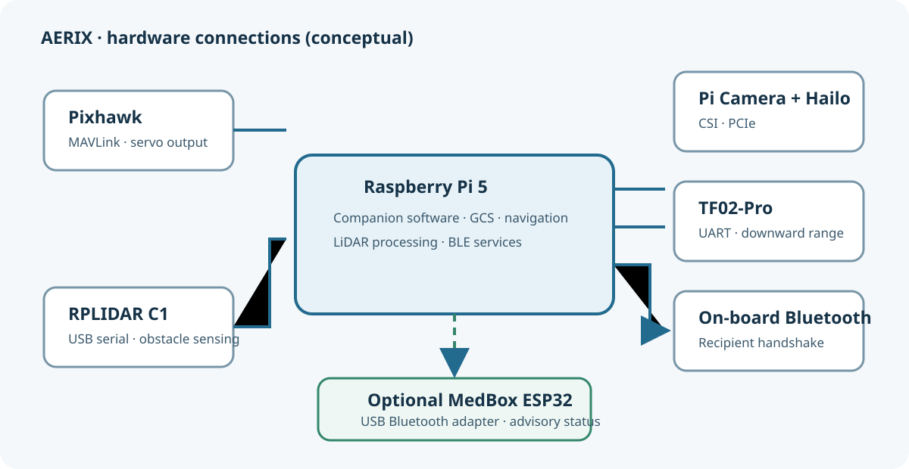

| Sensor | Link | Job | Code |
|---|---|---|---|
| **Slamtec RPLIDAR C1** (2D, 360 deg, 12 m) | USB serial (CP2102N bridge), 460800 baud, stable `/dev/serial/by-id/...` path | The **only** obstacle sensor: avoidance, radar, FC proximity | [lidar_interface.py](../../drone_stack/interfaces/lidar_interface.py), [lidar_node.py](../../drone_stack/nodes/lidar_node.py) |
| **Benewake TF02-Pro** (single-point, downward) | Pi UART0 (GPIO14/15) on `/dev/ttyAMA0`, 115200 baud | Height above ground for the precision drop only | [rangefinder_interface.py](../../drone_stack/interfaces/rangefinder_interface.py), [rangefinder_node.py](../../drone_stack/nodes/rangefinder_node.py) |
| **Pi Camera (imx708)** + **Hailo-8 NPU** | CSI ribbon; NPU on the AI HAT+ | Live video, stabilisation, recipient person lock | [cameras.py](../../drone_stack/gcs/cameras.py), [person_lock.py](../../drone_stack/gcs/person_lock.py) |
| Pixhawk IMU / GPS / baro | MAVLink | Ego-motion for the tracker, home-relative position | [fusion_node.py](../../drone_stack/nodes/fusion_node.py) |

The rule written into several module docstrings: **the TF02-Pro is not an obstacle sensor**, and the camera does not steer avoidance. Everything in sections 3 to 9 runs off the C1 alone.

---

## 2. Data flow: who reads what


All nodes talk over the in-process `MessageBus` (see [03-software-architecture.md](03-software-architecture.md)). Topic names come from [topics.py](../../drone_stack/bus/topics.py).

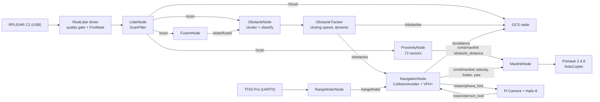

**The single most important design choice on this page:** every LiDAR consumer reads **one filtered view**. Noise rejection happens upstream (in the driver and in `LidarNode`), never in a consumer. Section 14 explains the bug that taught this.

---

## 3. The RPLIDAR C1 driver

Source: [`RealLidar` in lidar_interface.py](../../drone_stack/interfaces/lidar_interface.py).

### 3.1 Why a raw-protocol driver

The legacy `rplidar` PyPI package cannot drive the C1: the C1 free-runs its scan on power-up and floods the serial buffer, so the library's health handshake fails with a descriptor-length mismatch. The driver therefore speaks the Slamtec serial protocol directly:

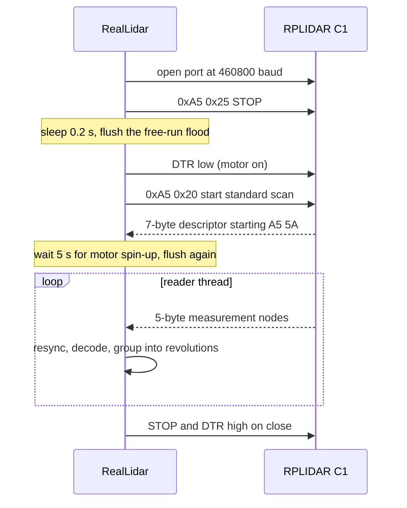

Each 5-byte node is decoded as:

| Field | Expression |
|---|---|
| start-of-revolution flag | `b0 & 1` (must be the complement of `(b0 >> 1) & 1`, and the check bit `b1 & 1` must be 1, otherwise the parser slides one byte to resync) |
| quality (6 bit) | `b0 >> 2` |
| angle (deg) | `((b1 >> 1) | (b2 << 7)) / 64` |
| distance (mm) | `(b3 | (b4 << 8)) / 4` |

A start flag commits the current revolution to a 3-deep deque; `read_scan()` returns only the **freshest** completed revolution and drops any backlog so the radar never lags the sensor. More than 2500 nodes without a start flag (a stalled motor) discards the buffer.

**Robustness details worth knowing:**

- `connect()` always calls `close()` first. A reconnect that reopened the port while the old handle was alive produced two openers on the device and a permanent "multiple access on port" flap.
- Under heavy CPU/IRQ load the CP210x link sometimes reports "readable but returned no data". The reader absorbs up to **20** such failures 50 ms apart (about 1 s) by flushing and retrying before declaring the link dead.

### 3.2 From raw samples to a `LaserScan`

`_to_laserscan()` turns one revolution into a fixed 360-bin, 1 deg-per-bin `LaserScan` (beam 0 = nose, counter-clockwise positive, x forward / y left):

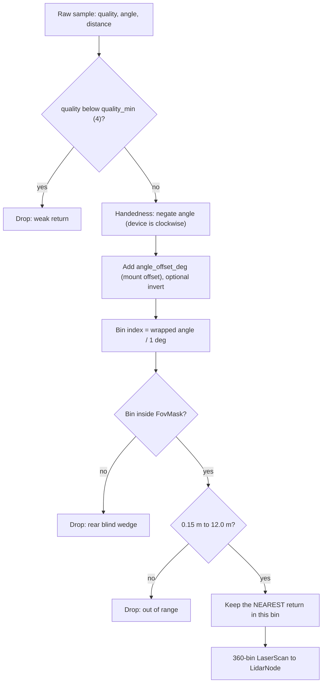

The order is deliberate: the quality gate runs **at the sample**, before samples compete for a bin, so a weak return can never win a bin from a good one. Handedness is applied **before** the mounting offset because the offset is defined in the device's own (clockwise) frame. Getting `clockwise` wrong mirrors the radar left/right and makes avoidance dodge the wrong way (pinned by [test_lidar_handedness.py](../../tests/test_lidar_handedness.py)).

### 3.3 FovMask: the front-referenced window

The rear of the LiDAR's view is permanently occupied by the airframe's own tail and whatever the aircraft is parked next to. Those returns never move, so feeding them to avoidance makes it brake for obstacles bolted to the aircraft. `FovMask` keeps only a window centred on the nose.

The shipped value is **`fov_deg: 250`** in both [default.yaml](../../config/default.yaml) and [real.yaml](../../config/real.yaml): 125 deg left, 125 deg right, and a **110 deg blind wedge behind**. (Some older comments in the code still describe the earlier 270 / 90 deg split; the config and `DEFAULT_FOV_DEG` are 250.)

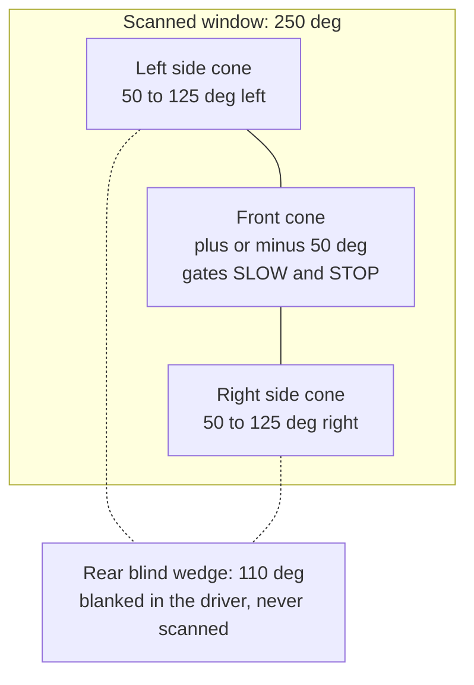

Blanking happens in the driver, so the point cloud, ObstacleNode, NavigationNode, the GCS radar and the FC proximity stream all see the same window and no path can re-admit the rear. `ProximityNode` applies the mask a second time as defence in depth. The simulator's [mock_lidar.py](../../drone_stack/sim/mock_lidar.py) uses the same `FovMask`, so the rear is just as blind in simulation.

The blind rear has consequences that recur throughout the avoidance logic: **there is no reverse escape**, VFH+ cannot pick a gap behind, and the aircraft turns its nose onto any path that lies behind it before flying it (section 9.6).

---

## 4. Noise rejection: quality gate and ScanFilter

The C1's ranges are excellent; its *occupancy* flickers. Two stages, deliberately different in kind, deal with that.

### 4.1 Stage 1: quality gate (`quality_min: 4`)

Measured on the bench (2026-09-21, 202 revolutions, 64,314 valid samples): samples in bins a real surface occupies have a **median quality of 25**; samples in flickering bins have a **median of 2**. The survival curve recorded in the driver:

| `quality_min` | solid signal kept | flicker kept | flickering bins left |
|---|---|---|---|
| 2 | 100.0% | 83.2% | 28 |
| 3 | 99.9% | 60.7% | 16 |
| **4 (shipped)** | **99.8%** | **54.2%** | **11** |
| 6 | 95.1% | 43.4% | 17 |
| 8 | 86.2% | 38.4% | 18 |
| 10 | 72.1% | 37.8% | 33 |

**Raising it is not safer.** Past the knee the gate starts deleting weak-but-real returns off dark, matte or steeply angled surfaces; those bins stop being solid and the flicker count climbs back to where it started.

### 4.2 Stage 2: `ScanFilter` persistence

`ScanFilter` (in [lidar_interface.py](../../drone_stack/interfaces/lidar_interface.py), applied by `LidarNode`) publishes a return only if recent revolutions **corroborate** it:

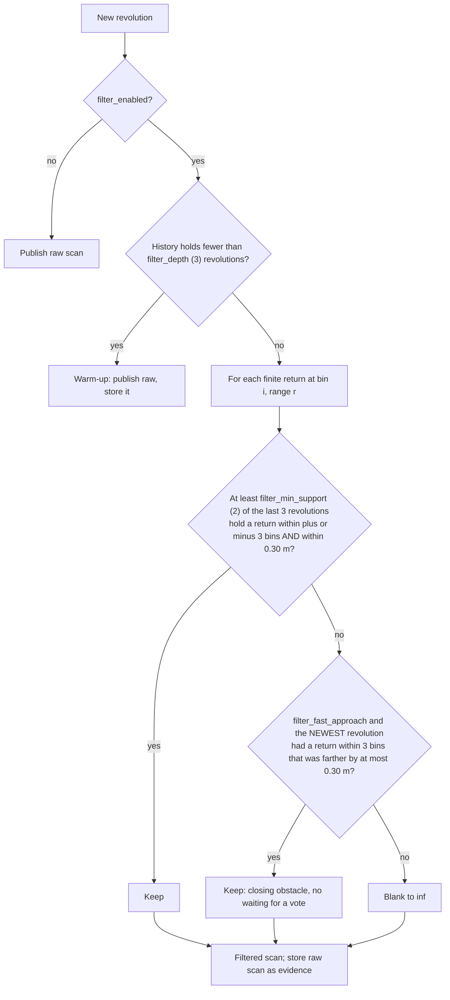

| Key | Value | Why |
|---|---|---|
| `filter_depth` | 3 | Revolutions retained as evidence |
| `filter_min_support` | 2 | 2-of-3 vote |
| `filter_angular_tol_bins` | 3 | **Load-bearing.** At a 10 deg/s steer slew and 10 Hz, the airframe rotates about 3 bins across the window, while a 0.3 m pole at 8 m is only about 2 bins wide. A strict per-bin test would erase a real pole exactly while the aircraft turns to avoid it. |
| `filter_range_tol_m` | 0.30 | Keeps the angular grace honest: a wall several metres behind a speckle cannot vouch for it. Matches `obstacles.cluster_gap_m`. |
| `filter_fast_approach` | true | Asymmetric like `SectorFilter`: something closing, seen twice, publishes now. One frame alone still never passes. |

Properties that hold by construction: the filter **only ever suppresses**, it never invents a return or moves one nearer, so its failure mode is *late*, not *blind*. Worst-case lateness is `min_support` revolutions, about 200 ms at 10 Hz, or 0.20 m at the 1.0 m/s cruise speed, against an avoidance band that opens at 11.5 m on the real profile. `filter_enabled: false` restores raw behaviour without a code change.

---

## 5. LidarNode

Source: [lidar_node.py](../../drone_stack/nodes/lidar_node.py).

| Publishes | Type | Notes |
|---|---|---|
| `/scan` | `LaserScan` | Filtered by `ScanFilter` |
| `/cloud` | `PointCloud` | Cartesian points in the sensor frame, for the GCS |
| `/scan/state` | `ScanState` | `SCANNING` / `PAUSED` / `STOPPED` |
| `/diagnostics/lidar` | `Diagnostic` | beams, `valid_returns`, scan count, `fov_deg`, `blind_deg`, `filtered_out` |

- **Services** `scan_start`, `scan_stop`, `scan_pause`, `scan_resume` back the GCS buttons. When not scanning, the device stays connected but nothing is published.
- **Polling rate.** `lidar.rate_hz` is 10 in `default.yaml` and **25** in `real.yaml`: the node polls faster than the C1 revolves (about 10 Hz) so a revolution is picked up as soon as it completes. Most polls find nothing new; only a gap longer than `empty_warn_s` (0.5 s) raises a warning.
- **Reconnect.** If the device disappears, the node publishes an ERROR diagnostic and retries every `reconnect_interval_s` (2.0 s).
- **Observability.** At startup it logs the active filter policy; every revolution it reports `filtered_out`, so a thin radar picture can be explained as the filter working rather than mistaken for a sensor fault.

---

## 6. ObstacleNode: clustering and classification

Source: [obstacle_node.py](../../drone_stack/nodes/obstacle_node.py). Bearing convention on `/obstacles`: **0 deg = nose, positive to the right**, range -180 to 180.

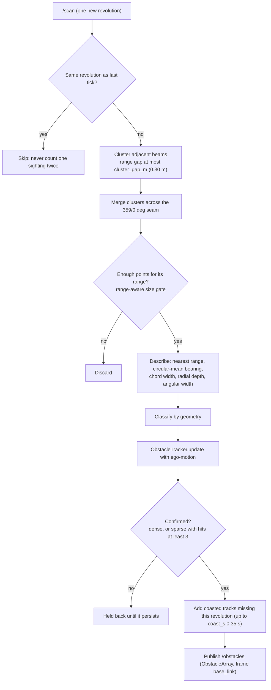

### 6.1 Range-aware size gate

A fixed "3 points per cluster" rule is an angular threshold in disguise: at 1 deg per bin a 0.3 m pole only fills 3 bins inside about 5.7 m. Flight logs showed poles in the scan at 4 to 5 m that were rejected and first published at about 2.2 m. The node now requires

```
required = clamp( floor( 2·atan(min_object_width_m / (2·distance)) / bin_width ), 1, min_points )
```

so a 0.10 m object is accepted at the point count it can physically produce at that range. A cluster below `min_points` is **sparse** and must then persist for `sparse_min_hits` (3) tracked revolutions before it is published, so one speckle cannot swerve the aircraft.

### 6.2 Seam handling

Beam 0 is the nose, so anything straight ahead straddles the 359/0 seam. The node merges the first and last clusters when they touch, uses a **circular mean** for bearing, and sums angular width step by step. Before that fix (2026-09-23), a seam-straddling cluster read as 358 deg wide, VFH+ blocked its whole histogram, and the aircraft flew into the brake instead of steering.

### 6.3 Classification (heuristic, geometry only)

`linear` means radial depth below 0.5 m (a flat surface). Rules are checked in this order:

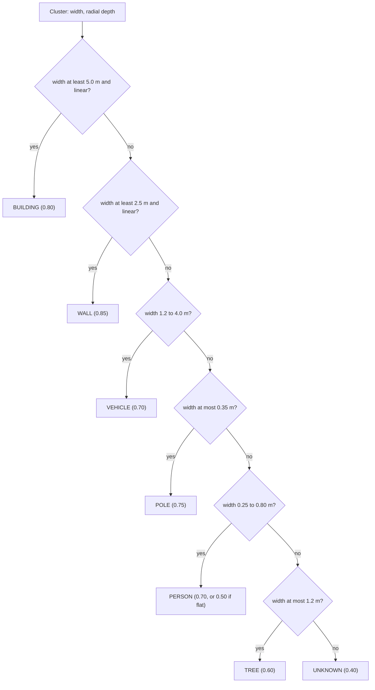

The class is informational (radar labels, logs). **Avoidance decisions do not depend on the class**: they use distance, bearing, angular width, closing speed and the `is_dynamic` flag. Obstacles within `danger_distance_m` (2.0 m) are flagged `danger`.

### 6.4 Obstacle config

| Key | default.yaml | real.yaml |
|---|---|---|
| `rate_hz` | 10 | 25 (matches the LiDAR poll; each revolution is processed once) |
| `cluster_gap_m` | 0.30 | 0.30 |
| `min_points` | 3 | 3 |
| `min_object_width_m` | 0.10 | 0.10 |
| `sparse_min_hits` | 3 | 3 |
| `coast_s` | 0.35 | 0.35 |
| `danger_distance_m` | 2.0 | 2.0 |
| `person_width_range_m` | [0.25, 0.80] | same |
| `pole_width_max_m` | 0.35 | same |
| `vehicle_width_range_m` | [1.20, 4.00] | same |
| `wall_min_length_m` | 2.50 | same |

---

## 7. ObstacleTracker: identity, closing speed, dynamic objects

Source: [obstacle_tracker.py](../../drone_stack/nodes/obstacle_tracker.py).

Without tracking, an obstacle's identity was its index in a distance-sorted list, so a moving object was a brand-new obstacle every scan and never acquired a velocity. The tracker associates clusters between revolutions (greedy nearest-neighbour, closest pair first, each track predicted forward by its velocity before gating) and differentiates position.

It produces **two different velocities** that answer different questions:

| Output | Frame | Meaning | Used for |
|---|---|---|---|
| `closing_ms` | body | How fast the gap is shrinking (includes our own motion) | Direction of approach |
| `vx_m_s`, `vy_m_s`, `speed_m_s` | world ENU | The object's own motion over the ground, after removing our translation **and yaw rate** | Is it moving under its own power? |
| `is_dynamic` | - | `speed` above `dynamic_speed_ms` for `dynamic_min_hits` consecutive revolutions | Brake-distance padding |

Yaw matters: at 0.8 m/s, an obstacle 5 m off the nose moves through the body frame faster from a gentle yaw than from forward flight. Ignoring yaw rate would report a fence post as a 2 m/s crossing target every time the aircraft turns.

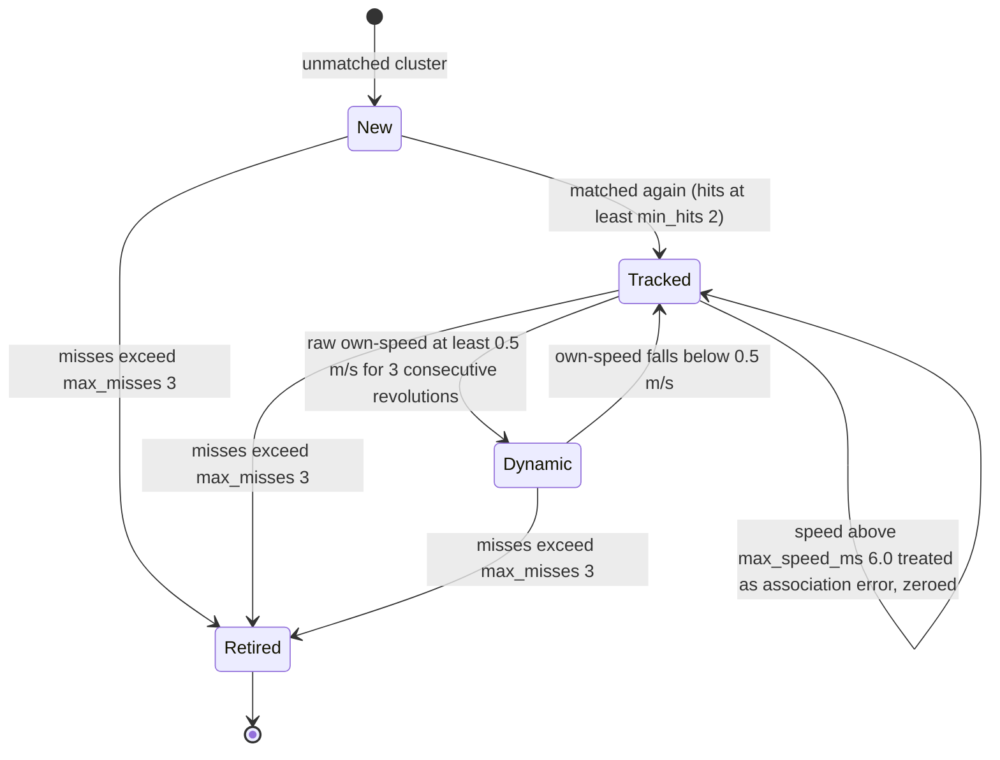

Design points from the code:

- The **first** differentiation is adopted outright (no blending toward zero), otherwise ego-motion removal would subtract the full ego term from half the measured velocity and a static post would appear to move.
- The dynamic counter is judged on the **raw** per-frame motion, not the smoothed one, so a one-frame cluster split scores one hit and decays, while a pedestrian scores every frame.
- Without a valid `FusedState` the object is reported static rather than guessed at.

| Tracking key | code default | real.yaml |
|---|---|---|
| `gate_m` | 1.2 | **0.7** (tightened after stationary clutter read as 4.7 to 5.4 m/s) |
| `max_misses` | 3 | 3 |
| `min_hits` | 2 | 2 |
| `alpha` | 0.5 | 0.5 |
| `dynamic_speed_ms` | 0.5 | 0.5 |
| `dynamic_min_hits` | 3 | 3 |
| `max_speed_ms` | 6.0 | 6.0 |

---

## 8. ProximityNode: OBSTACLE_DISTANCE to the flight controller

Source: [proximity_node.py](../../drone_stack/nodes/proximity_node.py).

The Pi's navigator stands down the instant the pilot takes the sticks (see [08-safety.md](08-safety.md)). For avoidance to survive a **manual** flight it has to run on the flight controller. `ProximityNode` feeds ArduPilot's proximity library with a MAVLink `OBSTACLE_DISTANCE` stream; it makes no decisions and sends no flight commands. It is off in `default.yaml` and **on in `real.yaml`**.

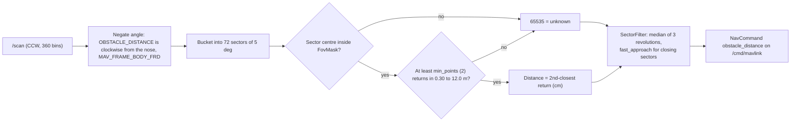

- With the 250 deg window, **50 sectors are live** (0 to 24 and 47 to 71) and the 22 rear sectors are always 65535.
- **Spatial gate:** the `min_points`-th closest return sets the sector, so one stray beam cannot fake a wall.
- **Temporal gate:** per-sector median over `filter_depth` (3) revolutions; with `fast_approach`, a sector that two consecutive revolutions agree has closed in is published at once, at the farther of the pair.
- `min_distance_m` was raised to 0.30 m because below that the returns are the airframe and prop wash.

These gates were added after the first manual flight with the stream (2026-08-29), which the pilot described as awful: the first version sent the single closest beam per sector straight off each revolution.

**FC parameters** the module docstring lists as required before ArduPilot acts on the stream:

| Parameter | Value | Meaning |
|---|---|---|
| `PRX1_TYPE` | 2 | Proximity source = MAVLink (needs an FC reboot) |
| `AVOID_ENABLE` | 3 | Use fence + proximity |
| `AVOID_MARGIN` | mirrored from `avoidance_stop_m` by NavigationNode at link-up | Stand-off |
| `AVOID_BEHAVE` | 1 | Stop rather than slide |
| `OA_TYPE` | 0 while the Pi routes (pushed by NavigationNode) | No FC path planner |

FC-side avoidance applies in LOITER, POSHOLD, ALT_HOLD, AUTO and GUIDED, not in STABILIZE or ACRO.

---

## 9. NavigationNode avoidance

Source: `CollisionAvoider` and the avoidance steps in [navigation_node.py](../../drone_stack/nodes/navigation_node.py). The mission phases themselves are covered in [04-delivery-mission.md](04-delivery-mission.md).

### 9.1 Layers, outermost first

| Layer | Where | Range (real.yaml) | Action |
|---|---|---|---|
| Cruise-band steering | Pi | from **11.5 m** in to the brake distance | Bend the course with VFH+, **hold cruise speed** |
| Dodge / emergency steer | Pi | inside the brake distance | VFH+ heading at `avoidance_dodge_speed_ms` (0.5 m/s), timeout 5 s, max 4 m off track |
| Hard brake | Pi | `avoidance_stop_m` = **1.5 m** (padded for movers) | `brake`, hold until clear by +0.4 m |
| FC proximity | Pixhawk | `AVOID_MARGIN` | Limits the pilot's stick demand in manual flight |

The 1.5 m stop is a **critical distance, a last resort**: the config comment says that if it fires regularly, the steering is what needs fixing.

### 9.2 The decision: CLEAR, SLOW or STOP

`CollisionAvoider.evaluate()` considers every obstacle that is "in path", meaning within `avoidance_front_half_deg` (50 deg) of the **nose**, or (above `avoidance_travel_cone_min_ms` 0.3 m/s of ground speed) within 50 deg of the **direction of travel**. Setpoints go out body-frame with yaw masked, so the aircraft can strafe up to about 90 deg off its nose; on 2026-10-04 it moved at 1 m/s sideways while the brake was looking the other way, which is why the travel cone exists.

Each obstacle is judged against **its own** brake distance and the worst verdict wins:

```
stop_m = avoidance_stop_m                                         if not is_dynamic or closing_ms <= 0
stop_m = avoidance_stop_m + min( min(speed_m_s, closing_ms) * avoidance_reaction_s,
                                 avoidance_reaction_max_m )       otherwise
```

A static wall brakes at exactly 1.5 m. A person walking in at 1.5 m/s buys 1.5 m of reaction margin (capped at 2.0 m). Before 2026-09-21 the pad used `closing_ms` alone, which includes our own forward motion, so flying at a fence post at 1.0 m/s fired the brake at 2.70 m against a configured 1.70 m.

Avoidance is forced CLEAR while disabled or in **STANDBY**: with `avoidance_min_alt_m: 1.5` it stays in standby until the aircraft has climbed past 1.5 m (outside ARMING/TAKEOFF), then latches ACTIVE until disarm, so the LiDAR does not brake against the operator and launch clutter during the climb.

### 9.3 Avoidance decision flowchart (NAVIGATE phase)

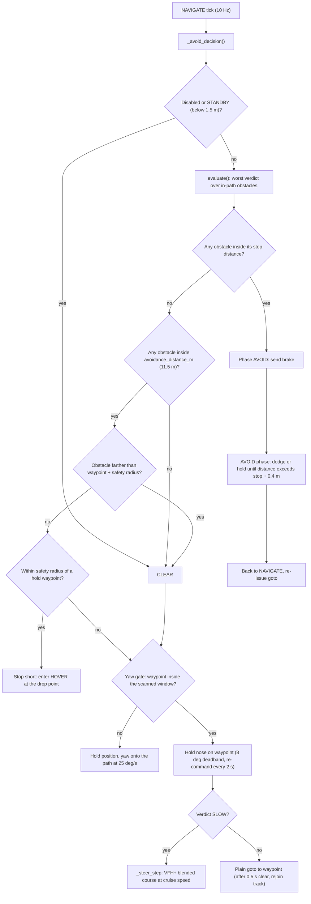

### 9.4 VFH+ steering

The three-cone "left or right?" dodge collapses the scan into three numbers, so a doorway and a dented wall look the same. VFH+ (Ulrich and Borenstein) keeps angular detail:

1. **Histogram.** The scanned window (plus or minus 125 deg) is split into 5 deg bins (50 bins). The masked rear has no bins at all, so it can never be chosen.
2. **Enlargement.** Each obstacle within `avoidance_vfh_range_m` (12 m) blocks its own angular half-width **plus** `asin(min(1, safety_radius / distance))`. The same object blocks a wider arc the closer it gets; closer than the safety radius, it blocks plus or minus 90 deg.
3. **Valleys.** Contiguous free runs, not wrapped around (the window has two hard ends). Gaps narrower than `avoidance_vfh_min_valley_deg` (18 deg) are discarded.
4. **Choice.** In each valley, the point closest to the goal while keeping 9 deg from either edge. Cost = `goal_weight` x |candidate - goal| + `hysteresis_weight` x |candidate - previous|. No valley means **TRAPPED**, and the caller brakes, never reverses.

**Safety radius is the subtle knob.** It must comfortably exceed the brake distance, or VFH+ aims to miss inside the zone the brake calls an emergency. The real.yaml comment records a closed-loop sweep against a 0.3 m pole at 1.0 m/s:

| radius (m) | miss (m) | braked | max lateral (m) |
|---|---|---|---|
| 1.0 | 1.70 | yes | 1.31 |
| 1.5 | 1.49 | yes | 1.57 |
| 2.0 | 1.86 | no | 1.97 |
| **2.5 (flown setting)** | **2.10** | **no** | **2.25** |
| 3.0 | 2.36 | no | 2.54 |
| 3.5 | 2.63 | no | 2.86 |

This sweep is a simulation measurement. Bigger is not free: a larger radius blocks more of the histogram, fewer valleys clear 18 deg, and the planner reports TRAPPED in gaps that are actually flyable.

### 9.5 Cruise-band steering: start early, turn slowly

`_steer_step` flies `goal + authority x (vfh_gap - goal)`, rate-limited by `avoidance_steer_rate_deg_s` (10 deg/s), at cruise speed. Forward velocity is clamped to `vx >= 0`. Authority ramps across the band with an ease-out curve and a floor:

```
frac      = clamp( (avoidance_distance_m - d) / (avoidance_distance_m - stop_m), 0, 1 )
authority = floor + (1 - floor) * (1 - (1 - frac)^3)          floor = 0.25
```

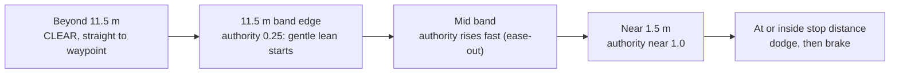

History recorded in the code: the curve was `frac^2` (ease-in) until 2026-09-19, which under-deflected all the way in and ended a closed-loop approach parked in the brake band at 1.69 m. Then ease-out without a floor, which still commanded 0 deg at the band edge. The floor (2026-09-21) lets the lean begin where the LiDAR first sees the obstacle. If no gap exists, the aircraft decelerates at `avoidance_trapped_decel_ms2` (0.4 m/s²) so it reaches the brake distance nearly stopped.

### 9.6 Yaw-before-move and nose tracking

Because the rear 110 deg is never scanned, and the FC reads unknown sectors as **clear**:

- **Yaw gate** (`avoidance_yaw_before_move`): a waypoint more than 125 deg off the nose is not flown at. The aircraft re-anchors with a goto on its current position, yaws at 25 deg/s, and proceeds once the waypoint is within `avoidance_yaw_release_deg` (60 deg). The wide hysteresis stops oscillation. After `avoidance_yaw_timeout_s` (20 s) it **holds and logs an error** rather than flying blind.
- **Nose tracking** (`avoidance_nose_track`): the nose is re-pointed at the waypoint whenever it drifts more than 8 deg, at most every 2 s (`CONDITION_YAW` is discrete; re-sending it at 10 Hz restarts the turn). Combined with `vx >= 0`, every commanded translation stays within plus or minus 90 deg of the nose, inside the scanned window by a 35 deg margin.

### 9.7 Hover avoidance

While holding over the drop point there is no flight path, so `_hover_avoid_step` checks **every** scanned bearing, each against its own stop distance, and moves away at dodge speed: straight away if that is inside the window, sideways toward the clearer side if "away" would be the blind rear.

### 9.8 The return leg: about-face and who routes

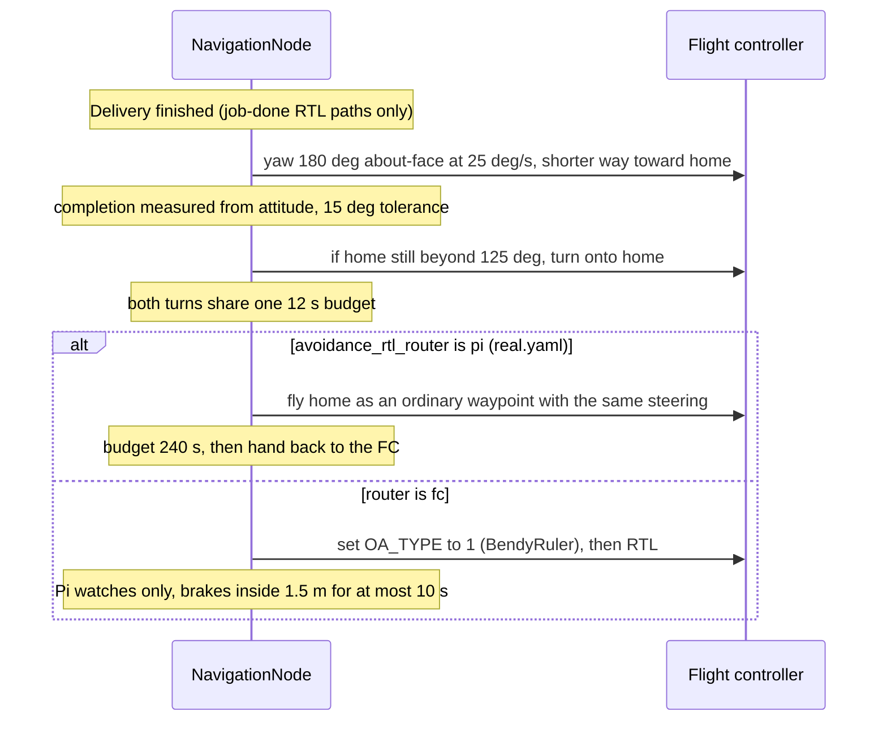

- The **about-face** is unconditional on job-finished returns: the aircraft flew in forwards, so turning around both points it home and sweeps the LiDAR across the airspace the return will use. Battery or geofence failsafe RTLs and operator-pressed RTLs go home immediately.
- **One router at a time.** ArduPilot has no per-mode object-avoidance switch, so NavigationNode pushes `OA_TYPE=0` at link-up (the Pi routes) and only hands BendyRuler the job on an FC-flown return. `OA_TYPE` instantiates its backend at FC boot, so enabling BendyRuler needs a one-time operator step and reboot. Dijkstra (`OA_TYPE=2`) is not used: it plans against fence polygons only and cannot see a LiDAR return.
- In an FC-flown RTL the Pi **does not steer** (the FC discards position setpoints there). It brakes inside the stop distance for at most `avoidance_rtl_brake_max_s` (10 s), shows a "clear +X deg" hint for the pilot, then hands the return back.
- `AVOID_MARGIN` and `OA_MARGIN_MAX` are mirrored to the FC at link-up; the route margin is clamped to at least `avoidance_stop_m + 0.5`.

### 9.9 Navigation avoidance config

| Key | default.yaml | real.yaml |
|---|---|---|
| `cruise_speed_ms` | 3.0 | **1.0** (about 10 cm per LiDAR revolution) |
| `avoidance_distance_m` | 2.5 | **11.5** |
| `avoidance_stop_m` | 1.2 | **1.5** |
| `avoidance_release_m` | (0.4 code default) | 0.4 |
| `avoidance_min_alt_m` | 0.0 (gate off) | 1.5 |
| `avoidance_front_half_deg` / `side_half_deg` | 50 / 125 | 50 / 125 |
| `avoidance_dodge_speed_ms` / `forward_ms` / `timeout_s` | 1.0 / (0.4) / 5.0 | 0.5 / 0.4 / 5.0 |
| `avoidance_dodge_clear_m` | 2.5 | 2.5 |
| `avoidance_max_offtrack_m` | (4.0) | 4.0 |
| `avoidance_vfh_sector_deg` | 5.0 | 5.0 |
| `avoidance_vfh_safety_radius_m` | 1.6 | **2.5** |
| `avoidance_vfh_min_valley_deg` | 18.0 | 18.0 |
| `avoidance_vfh_goal_weight` / `hysteresis_weight` | 1.0 / 0.8 | 1.0 / 0.8 |
| `avoidance_vfh_max_heading_rate_deg_s` | 45.0 | 25.0 |
| `avoidance_vfh_range_m` | 10.0 | 12.0 |
| `avoidance_steer_rate_deg_s` | 15.0 | 10.0 |
| `avoidance_steer_authority_floor` | (0.25) | 0.25 |
| `avoidance_trapped_decel_ms2` | 0.4 | 0.4 |
| `avoidance_reaction_s` / `reaction_max_m` | (1.0 / 2.0) | 1.0 / 2.0 |
| `avoidance_yaw_rate_deg_s` / `yaw_release_deg` / `yaw_timeout_s` | (25 / 60 / 20) | 25 / 60 / 20 |
| `avoidance_rtl_about_face` / tolerance / total budget | (true / 15 / 12 s) | true / 15 deg / 12 s |
| `avoidance_rtl_router` / `rtl_pi_budget_s` | (pi / 240) | pi / 240 |
| `avoidance_rtl_brake_max_s` | (10) | 10 |
| `avoidance_route_margin_m` | (3.0) | 3.0 |

Values in parentheses are code defaults where `default.yaml` does not set the key. A test (`test_every_shipped_profile_satisfies_the_clearance_invariant`) pins that the VFH range never exceeds `lidar.max_range_m`.

---

## 10. FusionNode

Source: [fusion_node.py](../../drone_stack/nodes/fusion_node.py). Publishes `/state/fused` at 30 Hz.

- Attitude: a **complementary filter** (`attitude_alpha` 0.98) that integrates IMU gyro rates and blends toward the autopilot's attitude on the shortest angular path.
- Position: GPS converted to local **ENU** about the navigator's **home** (pushed in from `/mission/state`, so there is one origin, the same point ArduPilot latches at arming). Covariance comes from GPS `eph`/`epv`. Velocity is converted NED to ENU.
- `valid` requires attitude plus GPS or altitude.

For perception, `/state/fused` is the **ego-motion** the tracker subtracts and the source of the travel direction. The node subscribes to `/scan` and the config has `use_lidar`, but the shipped `ComplementaryEstimator` does not use the scan; the `StateEstimator` interface is there so an EKF can be dropped in later.

---

## 11. TF02-Pro downward rangefinder

Sources: [rangefinder_interface.py](../../drone_stack/interfaces/rangefinder_interface.py), [rangefinder_node.py](../../drone_stack/nodes/rangefinder_node.py).

The barometer reads altitude relative to **home**, not to the ground under the drop point, and drifts about a metre over a flight. The TF02-Pro gives true height above ground for **one job**: the precision drop (see [04-delivery-mission.md](04-delivery-mission.md)).

| Item | Value |
|---|---|
| Wiring | TF02 TX to GPIO15 (RXD0), TF02 RX to GPIO14 (TXD0), 5 V, GND; `dtparam=uart0=on` gives `/dev/ttyAMA0` (not `/dev/serial0`) |
| Frame | 9 bytes: `0x59 0x59`, distance (cm), strength, temperature, checksum = low byte of the sum of bytes 0 to 7 |
| Stream / poll | about 100 frames/s; node polls at 20 Hz |
| Validity | `min_strength` 100, range 0.1 to 22.0 m; 4500 cm is the sensor's "no target" code, not 45 m |
| Health | `stale_s` 0.5; reopen the port if silent for `reopen_after_s` 3.0 s; reconnect every 2.0 s |
| Topic | `/rangefinder` (`RangeReading`); a dead sensor reads as stale, never as a frozen value |

`precision_drop_enabled` is false in `default.yaml` and true in `real.yaml`; the release height is `drop_target_agl_m` (0.65 m, was 1.0 m until 2026-10-10). The drop aborts before release if the TF02 reads below `drop_abort_agl_m` (0.45 m), if it jumps shorter than expected by `drop_under_jump_m` (0.7 m, "something underneath"), or if it drops out too often. The precision drop is **simulation-tested and not yet flown**.

---

## 12. Camera pipeline and person lock

Sources: [cameras.py](../../drone_stack/gcs/cameras.py), [frame_filter.py](../../drone_stack/gcs/frame_filter.py), [stabilizer.py](../../drone_stack/gcs/stabilizer.py), [person_lock.py](../../drone_stack/gcs/person_lock.py), [hailo_infer.py](../../drone_stack/gcs/hailo_infer.py).

`CameraManager` owns the Pi camera (id 1); the USB webcam was removed on 2026-09-11. The order of stages matters, and is written into the capture loop:

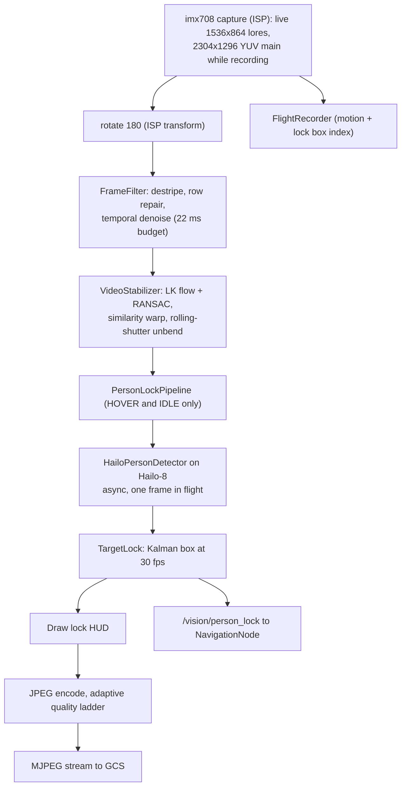

### 12.1 FrameFilter (destripe)

In flight the CSI ribbon runs centimetres from four ESCs; the interference lands on the sensor's **row** readout as horizontal lines drifting through the frame. A patch-similarity denoiser preserves exactly this kind of repeated structure (and cost about a second per 720p frame on a Pi 5), so the filter attacks rows as rows:

| Stage | What it does | Key values (real.yaml) |
|---|---|---|
| destripe | Compare each row mean to a rolling median of neighbours; soft-threshold the excess | `destripe_window` 21, `destripe_floor` 0.6 DN, `destripe_ceiling` 10 DN, `column_step` 4 |
| row repair | Redraw rows displaced beyond the floor from neighbours | `row_repair_floor` 14 DN |
| temporal | Motion-gated IIR blend with the previous frame | `temporal_alpha` 0.6, deadband 6 DN, motion 20 DN |
| budget | Drop the temporal stage if the smoothed cost stays above budget | `budget_ms` 22 |

Destripe runs **before** stabilisation because it works on sensor rows, which the stabiliser would rotate.

### 12.2 VideoStabilizer

Measured on a 2026-09-14 flight clip, the picture moved 24/33 px (x/y at 1280 wide) and rolled about 1 deg between consecutive frames, mostly at 3 to 15 Hz. The stabiliser tracks corners with pyramidal Lucas-Kanade on a quarter-scale grey copy, fits x/y/roll with RANSAC (rejecting independently moving things like people or prop blades), smooths the camera path with a critically damped filter (`smooth_hz` 2.0), soft-limits the correction to the crop margin (`max_angle_deg` 2.5), and renders a `similarity` warp. With `rs_bands` 12 it also fits a smooth per-row translation and high-passes it (`rs_hp_hz` 0.5) to straighten rolling-shutter "jello".

### 12.3 PersonLockPipeline and TargetLock

The detector model (`models/visdronebest.hef` in real.yaml) runs about 16 to 18 inferences per second, so it cannot label every frame of a 30 fps stream. The pipeline therefore:

- runs detection **asynchronously** on the NPU (newest frame wins, nothing queues);
- lets a **Kalman** `TargetLock` (state: centre x, y and velocity, in raw pixels) own the box and advance it every frame;
- removes **camera motion** (from the stabiliser) from the target state first, so a vibrating airframe does not look like a sprinting person; a late detection is carried forward through the frames of camera motion it missed.

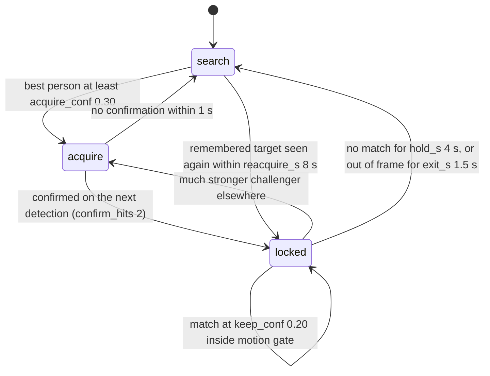

The published snapshot reports `lock` while detections are fresh (under 0.35 s) and `hold` while coasting. The lock is enabled only in the **HOVER** (over the target) and **IDLE** (ground testing) phases. `CameraManager` publishes `PersonLockState` on `/vision/person_lock` on any change, and at least every 0.25 s while running; the navigator treats a lock older than about 1 s as gone. Each message carries the locked box centre on the normalised image plane (`nx`, `ny` = tan of the angle off axis, using `hfov_deg` 66) plus every person in view, so the navigator can project to the ground and, with several people present, use the phone's BLE signal to pick the right one (`/vision/phone_hint` goes the other way).

| person_lock key (real.yaml) | Value | Note |
|---|---|---|
| `acquire_conf` | 0.30 | Lowered from 0.40 on 2026-09-24 after an A/B on 394 labelled aerial people (model median true-person score 0.42) |
| `keep_conf` | 0.20 | Keeps an occluded lock |
| `confirm_hits` | 2 | No one-frame false positives drawn |
| `hold_s` / `exit_s` | 4.0 / 1.5 | Deliberately sticky |
| `reacquire_s` / `reacquire_dist` | 8.0 / 3.0 box heights | Same person re-locked first |
| `nms_iou` | 0.5 | Host NMS |

Accuracy, honestly: person detection is **OFFLINE** tier (64.4% recall, 57.4% precision on 40 aerial frames); the in-flight target in the evidence file is at least 90% recall.

---

## 13. Flight recorder and replay (brief)

Sources: [recorder.py](../../drone_stack/gcs/recorder.py), [replay_render.py](../../drone_stack/gcs/replay_render.py).

The Pi 5 has no hardware video encoder, so in flight the recorder stores only what is cheap: full-resolution 2304x1296 frames as JPEG plus one JSON line per frame holding the stabiliser's measured motion and the lock box. It arms with the aircraft, never blocks capture (bounded queue, dropped frames fold their motion into the next), and keeps **exactly one clip**. After disarm a quick unstabilised clip is promoted first, then a separate, CPU-paced process renders a 1920x1080 replay with **zero-phase** Gaussian smoothing (`smooth_sigma` 5 frames), which is steadier than any live causal filter, with the lock box burned in. Routes `/api/recording`, `/api/recording/video` and `/api/recording/poster.jpg` serve it (see [07-ground-control-station.md](07-ground-control-station.md)).

---

## 14. Lessons from the LiDAR noise investigation

From [docs/PROJECT_NOTES.md](../PROJECT_NOTES.md) section 13 (2026-09-21):

1. **The bug was a fan-out asymmetry, not a missing filter.** `/scan` has two consumers. After the 2026-08-29 manual flight, filtering was added only to the FC-facing branch (`ProximityNode`). Once the Pi took over the cruise band and the return leg, **the unfiltered branch was the one moving the aircraft**. The fix moved both mechanisms upstream, so every consumer inherits one filtered view. *Do not re-add a filter in a consumer.*
2. **Measure the noise before choosing an instrument.** Two assumptions died on the bench:

   | Assumed | Measured |
   |---|---|
   | A per-bin "need N points" gate would work | 0.71 samples per 1 deg bin: arithmetically impossible (why ProximityNode filters 5 deg sectors) |
   | The noise is range jitter, so smooth it | It is **occupancy flicker**: solid bins have 2.4 cm median spread; only 0.1% of consecutive frames jump more than 0.30 m |

   Flicker calls for **persistence**, not smoothing.
3. **Thresholds are non-monotonic.** Both `quality_min` and the VFH safety radius get *worse* past their knee. Re-measure before moving them; do not tune by eye.
4. **What was measured vs reasoned.** Measured: an A/B replaying identical captured samples through both pipelines removed **0 of 165 solid bins**, **25 of 34 flickering bins (73.5%)**, at a cost of 2.0% of returns; 22 tests in [test_scan_filter.py](../../tests/test_scan_filter.py) pass and go red when any mechanism is patched out. Reasoned only: persistence's real value is dust, wet-ground glint and rain in flight; a static bench barely produces those transients (isolated returns 0.9% to 0.8%).
5. **A live before/after in a room with people moving will look worse**, and that does not mean the filter failed: scene drift dominates. Only an A/B over identical captured samples separates the filter from the scene.

---

## 15. Tests that pin this behaviour

| Area | Tests |
|---|---|
| Scan filter | [test_scan_filter.py](../../tests/test_scan_filter.py) (e.g. `test_a_pole_drifting_under_a_turning_airframe_is_not_erased`, `test_a_distant_wall_does_not_vouch_for_a_near_speckle`, `test_the_filter_only_ever_suppresses_never_invents`) |
| Driver geometry | [test_lidar_fov.py](../../tests/test_lidar_fov.py), [test_lidar_handedness.py](../../tests/test_lidar_handedness.py) |
| Obstacles and tracking | [test_obstacles.py](../../tests/test_obstacles.py), [test_dynamic_avoidance.py](../../tests/test_dynamic_avoidance.py) |
| FC proximity | [test_proximity.py](../../tests/test_proximity.py) |
| Avoidance | [test_vfh_avoidance.py](../../tests/test_vfh_avoidance.py), [test_smooth_avoidance.py](../../tests/test_smooth_avoidance.py), [test_long_range_avoidance.py](../../tests/test_long_range_avoidance.py), [test_sector_avoidance.py](../../tests/test_sector_avoidance.py), [test_waypoint_avoidance.py](../../tests/test_waypoint_avoidance.py), [test_avoidance_every_phase.py](../../tests/test_avoidance_every_phase.py), [test_avoidance_recovery.py](../../tests/test_avoidance_recovery.py) |
| Rangefinder | [test_rangefinder.py](../../tests/test_rangefinder.py) |
| Camera | [test_camera_filter.py](../../tests/test_camera_filter.py), [test_rs_stabilizer.py](../../tests/test_rs_stabilizer.py), [test_person_lock_stab.py](../../tests/test_person_lock_stab.py), [test_person_scan.py](../../tests/test_person_scan.py) |

These are bench-software and simulation tests. Next step per the evidence file: **experiment 7**, LiDAR avoidance around the handover in a logged flight.

---

<p align="center">
<a href="04-delivery-mission.md">← Previous: Delivery mission</a> |
<a href="../../README.md">Index</a> |
<a href="06-ble-handshake-security.md">Next: BLE handshake security →</a>
</p>
