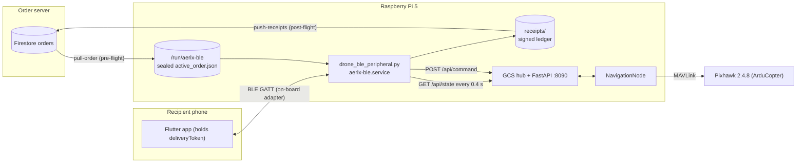
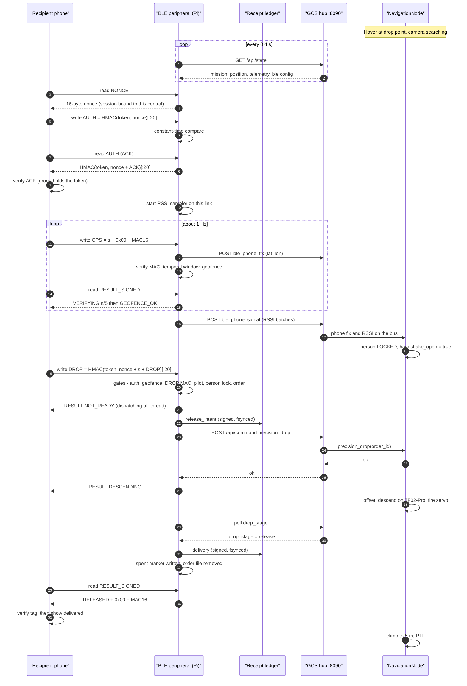
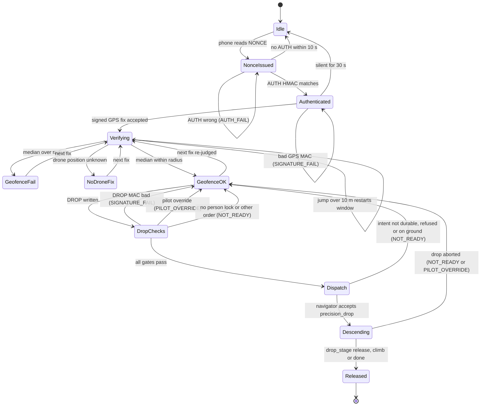
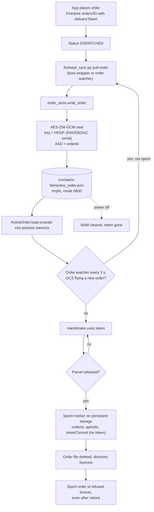
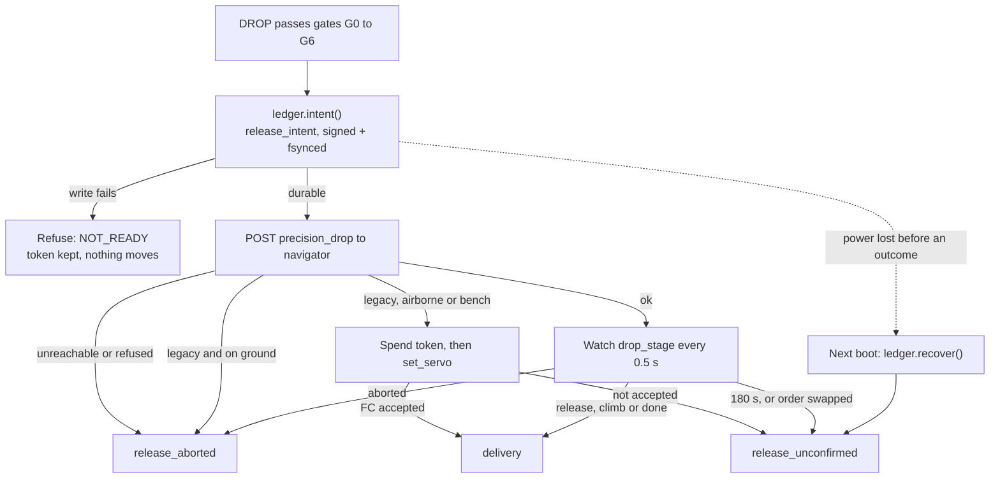
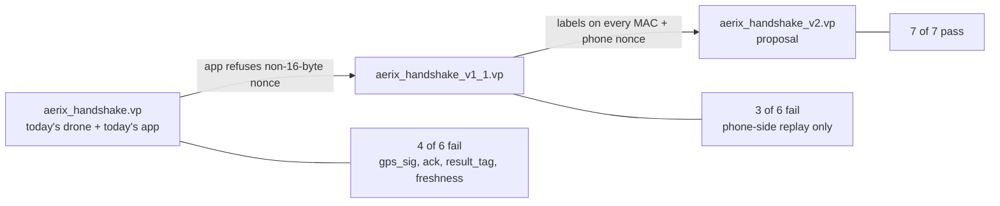

# 6. Recipient BLE Handshake and Security

> **In one sentence:** before AERIX lets go of a parcel, the recipient's phone and the drone prove to each other over Bluetooth Low Energy (BLE) that they both hold the same one-time order secret. The phone also proves it is standing next to the aircraft, and the drone checks that it is in the right flight state. Every release is written to a signed, tamper-evident ledger *before* the servo moves.

This page covers the last metre of a delivery: the moment the drone hovers over the drop point until the moment the payload servo fires. It is the security core of the project, and it has its own [threat model](../security/THREAT_MODEL.md), an [attack-table test suite](../../tests/test_attack_table.py) and [machine-checked protocol models](../security/).

## Contents

1. [What and why](#1-what-and-why)
2. [Where it runs](#2-where-it-runs)
3. [GATT service and characteristics](#3-gatt-service-and-characteristics)
4. [Message formats](#4-message-formats)
5. [End-to-end sequence](#5-end-to-end-sequence)
6. [The gates, in order](#6-the-gates-in-order)
7. [Sessions: binding and expiry](#7-sessions-binding-and-expiry)
8. [Signed GPS, anti-spoofing and the micro-geofence](#8-signed-gps-anti-spoofing-and-the-micro-geofence)
9. [RESULT and RESULT_SIGNED codes](#9-result-and-result_signed-codes)
10. [Order token lifecycle](#10-order-token-lifecycle)
11. [The receipt ledger](#11-the-receipt-ledger)
12. [Threat model summary](#12-threat-model-summary)
13. [Formal verification with Verifpal](#13-formal-verification-with-verifpal)
14. [Known open items](#14-known-open-items)
15. [Evidence tiers for this page](#15-evidence-tiers-for-this-page)
16. [Running the security tests](#16-running-the-security-tests)

---

## 1. What and why

A delivery drone that drops a parcel when it reaches a GPS coordinate makes no check on who is below it. AERIX adds a short cryptographic conversation with the recipient's phone app before the release:

| Question the drone must answer | How AERIX answers it |
|---|---|
| Is this phone holding the secret for *this* order? | HMAC-SHA256 challenge-response over a fresh random nonce |
| Is this really the AERIX drone, not an impostor? | Mutual-auth ACK the phone can check |
| Is the phone actually here, under the aircraft? | Signed GPS fixes, five consistent readings, compared with the drone's own GPS |
| Did the recipient really ask for the release, for this position? | A DROP MAC bound to the nonce and to the verified coordinates |
| Is the aircraft in a state where releasing is safe and expected? | Person locked below, no pilot takeover, airborne, same order as the flight |
| Can we prove afterwards what happened? | Ed25519-signed, hash-chained, write-ahead release ledger |

Design principles that run through the code:

- **Fail closed.** Missing data, stale data, or an unreachable ground station all read as "no".
- **Never spend the token unless the parcel has gone.** Every refusal names its reason and leaves the one-time token usable for a retry.
- **The BLE link is untrusted.** It is unpaired and unencrypted by design, so every message carries its own MAC.
- **Say what is not protected.** The [threat model](../security/THREAT_MODEL.md) lists the open and accepted risks next to the mitigated ones.

## 2. Where it runs

The handshake runs as its own process, `aerix-ble.service`, started by [scripts/ble_handshake_start.sh](../../scripts/ble_handshake_start.sh). It is separate from the flight stack. It does not talk MAVLink and never opens a serial port. It reads the aircraft's state from the ground-control station's HTTP API and asks the navigator to fly the drop.




Key source files:

| File | Role |
|---|---|
| [drone_ble_peripheral.py](../../drone_stack/ble_handshake/drone_ble_peripheral.py) | BlueZ GATT peripheral: sessions, gates, RESULT codes, drop hand-off |
| [order_store.py](../../drone_stack/ble_handshake/order_store.py) | Where the live order token lives (RAM) and how it is sealed (AES-256-GCM) |
| [receipt_ledger.py](../../drone_stack/ble_handshake/receipt_ledger.py) | Write-ahead, Ed25519-signed, hash-chained release ledger |
| [firebase_sync.py](../../drone_stack/ble_handshake/firebase_sync.py) | `pull-order` before take-off, `push-receipts` after landing |
| [rssi_probe.py](../../drone_stack/ble_handshake/rssi_probe.py) | Reads live-connection RSSI from the controller (HCI_Read_RSSI) for the phone locator |
| [scripts/ble_handshake_start.sh](../../scripts/ble_handshake_start.sh) | Boot wrapper: RAM order directory, wait for the on-board adapter, pull an order, start |

Two implementation details matter for reliability:

- **No blocking HTTP on the BLE event loop.** Every characteristic handler runs on the asyncio/D-Bus loop. A background `GcsStateCache` thread polls `GET /api/state` every **0.4 s** (`GCS_STATE_POLL_S`), and the handlers read its snapshot. A snapshot older than **3.0 s** (`GCS_STATE_MAX_AGE_S`) counts as no data, so every gate that depends on it fails closed. The DROP request to the navigator also runs on a worker thread.
- **Pinned to the on-board Bluetooth controller.** The MedBox bridge (`aerix-payload.service`) owns the USB dongle. The handshake selects the adapter whose sysfs path is not on USB, so the two never fight over the same radio. See the [MedBox add-on](../../addons/medbox/README.md).

## 3. GATT service and characteristics

The peripheral advertises the local name `Target Drone Detected` and one primary service.

**Service UUID:** `12345678-1234-5678-1234-567812345678`

| Characteristic | UUID | Ops | Purpose |
|---|---|---|---|
| NONCE | `12345678-1234-5678-1234-567812345679` | read | 16 random bytes. A read starts a **new session** for the reader. |
| AUTH | `12345678-1234-5678-1234-56781234567a` | write | Phone's HMAC over the nonce |
| AUTH (ACK) | `12345678-1234-5678-1234-56781234567a` | read | Drone's mutual-auth ACK. 20 zero bytes unless this central is authenticated. |
| DROP | `12345678-1234-5678-1234-56781234567b` | write | Release request, MAC'd over nonce, position and `"DROP"` |
| GPS | `12345678-1234-5678-1234-56781234567c` | write | Signed position fix, about 1 Hz |
| RESULT | `12345678-1234-5678-1234-56781234567d` | read | Plain ASCII outcome code. Not authenticated. |
| RESULT_SIGNED | `12345678-1234-5678-1234-56781234567e` | read | Outcome code + 16-byte MAC over this session's nonce (added 2026-10-08) |

The constants are at the top of [drone_ble_peripheral.py](../../drone_stack/ble_handshake/drone_ble_peripheral.py) and must match the Flutter app. The app-side contract is written up in [docs/app/APP_CHANGES_PROMPT.md](../app/APP_CHANGES_PROMPT.md).

## 4. Message formats

All MACs are HMAC-SHA256 keyed with the order's `deliveryToken`, which is 16 bytes taken from the hex string in the Firestore order. `+` means plain byte concatenation. `"ACK"`, `"DROP"` and `"RESULT"` are ASCII.

| Message | Direction | Bytes |
|---|---|---|
| Nonce | drone to phone | `os.urandom(16)` |
| AUTH | phone to drone | `HMAC(token, nonce)[:20]` |
| ACK | drone to phone | `HMAC(token, nonce + "ACK")[:20]` |
| GPS | phone to drone | `s + 0x00 + HMAC(token, nonce + s)[:16]`, where `s = "%.8f,%.8f" % (lat, lng)` |
| DROP | phone to drone | `HMAC(token, nonce + s + "DROP")[:20]`. The drone rebuilds `s` from the coordinates it parsed, always with 8 decimals. |
| RESULT | drone to phone | ASCII code, for example `GEOFENCE_OK` |
| RESULT_SIGNED | drone to phone | `code + 0x00 + HMAC(token, nonce + "RESULT" + code)[:16]` |

All comparisons use `hmac.compare_digest` (constant time). Byte-exact test vectors that the app must reproduce are pinned on the drone side by [tests/test_protocol_vectors.py](../../tests/test_protocol_vectors.py). They use a dummy token, never a real one.

> **Logging rule:** the peripheral never logs the token, an expected MAC, or the ACK. `logs/ble` lives on the SD card. Received bytes appear only as an 8-hex-digit SHA-256 fingerprint (`_fp`), so a stolen card holds nothing that authenticates.

## 5. End-to-end sequence

The diagram follows one successful delivery with the precision drop enabled (as in `config/real.yaml`). The navigator, not the BLE process, flies the descent and fires the servo.



If the precision drop is disabled, or the navigator answers `mode=legacy`, the peripheral falls back to a **direct release**. It posts `ble_delivery_result` so the navigator can end its hold early, then commands the servo through the GCS (`set_servo`, using the channel and pulse widths from the `payload` block of `/api/state`). A real order is never released this way while the aircraft is on the ground (see gate G7 below).

## 6. The gates, in order

Each characteristic handler checks its gates in a fixed order and stops at the first failure. A failure sets a named RESULT code and **never spends the token**.



### DROP gate table

These are the checks inside `on_drop_write`, in code order:

| # | Gate | Source of truth | Refusal |
|---|---|---|---|
| G0 | Writer is the central that holds the session | session binding | silently ignored, session untouched |
| G0b | Not already delivered, no descent in progress, no request in flight | `_delivered`, `_descent_in_progress`, `_drop_request_pending` | ignored (idempotent) |
| G1 | Live, authenticated session | nonce TTL / idle timer + AUTH | `AUTH_FAIL` |
| G2 | Micro-geofence passed | `gps_verified` | `GEOFENCE_FAIL` |
| G3 | DROP MAC over `nonce + s + "DROP"` | token | `SIGNATURE_FAIL` |
| G4 | Pilot has not taken over | `mission.pilot_override` | `PILOT_OVERRIDE` |
| G5 | Person locked, `handshake_open` | `mission.handshake_open` from the navigator | `NOT_READY` |
| G6 | Token's order is the order being flown (when armed) | `delivery.order_id` vs this order | `NOT_READY` |
| G7 | Release intent made durable in the ledger | `ledger_intent()` | `NOT_READY` |
| G8 | Navigator accepts, and a real order is never released on the ground | navigator answer, `on_ground` flag *or* disarmed telemetry | `NOT_READY` |

G7 and G8 run on the `drop-request` worker thread. The handler returns `NOT_READY` at once and the phone keeps polling, so the BLE link never stalls waiting for HTTP.

`handshake_open` is computed by `NavigationNode._handshake_open()` in [navigation_node.py](../../drone_stack/nodes/navigation_node.py). When armed with the person scan enabled, it is true only in the HOVER phase, in the `locked` scan stage, inside the handshake window (`handshake_window_s`, 30.0 s in `config/real.yaml`). It is false while a drop is already running. Perception is covered in [chapter 5](05-perception-and-avoidance.md).

## 7. Sessions: binding and expiry

Added 2026-10-08 after the review found that a sniffed session stayed replayable until someone happened to read a new nonce.

| Rule | Value | Why |
|---|---|---|
| A NONCE read starts a new session bound to the reading central (BlueZ device path) | — | Only the phone that got the challenge may answer it |
| Writes from any other central | dropped, session untouched | A stranger cannot stamp `AUTH_FAIL` into the real phone's RESULT or reset its GPS window |
| Nonce unanswered | **10 s** (`NONCE_TTL_S`) | Measured worst case nonce-to-AUTH on real phones was 0.32 s |
| Authenticated session silent | **30 s** (`SESSION_IDLE_S`) | Longest gap in a live session in the 4–5 Oct logs was 2.9 s |
| RESULT / ACK read without a live authenticated session | `AUTH_FAIL` / 20 zero bytes | A bystander learns nothing about the outcome |
| Reconnect mid-descent or after release | new NONCE reports `DESCENDING` or `RELEASED` | The phone can always learn the true outcome after re-authenticating |
| Order hot-swap | all sessions dropped | The old token must not authenticate the new order |

Accepted residual: anyone can read NONCE and so reset the recipient's session (T23). That is a denial of service on a par with jamming. The stranger cannot use the new nonce.

## 8. Signed GPS, anti-spoofing and the micro-geofence

Each GPS write is verified in this order:

1. Session owner, live and authenticated, else `AUTH_FAIL`.
2. MAC over `nonce + s`, else `SIGNATURE_FAIL`.
3. The fix is forwarded to the GCS as `ble_phone_fix` for the phone locator (it is MAC-verified, so it really is the recipient's phone).
4. If a drop is running or done, the geofence is **not** re-judged, so `DESCENDING`/`RELEASED` are never overwritten.
5. If the pilot has taken over, `PILOT_OVERRIDE` is returned and the geofence is not evaluated.
6. **Temporal consistency:** the fix joins a rolling window. Readings older than **12 s** fall out, and a jump of more than **10 m** from the previous reading restarts the window. Until **5** consistent readings are in hand, the answer is `VERIFYING:n/5`. That is not a failure: the recipient must hold still.
7. **Micro-geofence:** the *median* lat/lng of the window is compared, by haversine distance, with the **drone's own live GPS** from `/api/state`.

| Parameter | Value | Where |
|---|---|---|
| Readings required | 5 | `TEMPORAL_READINGS_REQUIRED` |
| Window | 12.0 s | `TEMPORAL_WINDOW_S` |
| Max jump between readings | 10.0 m | `TEMPORAL_MAX_JUMP_M` |
| Geofence radius | 12.0 m | `delivery.ble_geofence_m` in [config/default.yaml](../../config/default.yaml), served as `ble.geofence_m` in `/api/state`. Code fallback is also 12.0 m. |

Why 12 m and not tighter: the check compares two independent receivers, a phone (3–8 m error) and the flight controller. At 5 m it never passed. On 2026-10-04 the recipient stood under a locked camera and read 5.3–6.7 m every time. The camera lock, HMAC and RSSI decide *who* gets the parcel. The geofence only rejects a phone that is plainly somewhere else.

If the drone cannot report its own position (GCS unreachable, stale snapshot, or no 3D fix), the answer is `NO_DRONE_FIX`, not `GEOFENCE_FAIL`. Moving would not help the recipient, so the code does not tell them to.

The drone **never flies toward the phone**. The old "follow-me" relocation was removed on 2026-09-27. A geofence gap only closes when the recipient walks closer.

## 9. RESULT and RESULT_SIGNED codes

Both characteristics carry the same code. RESULT_SIGNED appends `0x00` and a 16-byte MAC bound to this session's nonce.

| Code | Meaning | Token spent? | Phone should |
|---|---|---|---|
| `PENDING` | Nothing decided yet (fresh session) | no | continue |
| `VERIFYING:n/m` | GPS fix *n* of *m* collected | no | show "hold still"; match by prefix |
| `GEOFENCE_OK` | Geofence passed; DROP allowed. Says nothing about the parcel. | no | enable release |
| `GEOFENCE_FAIL` | Phone too far from the drone, or GPS parse error | no | ask recipient to walk closer |
| `NO_DRONE_FIX` | Drone cannot tell where it is | no | wait; not the user's fault |
| `SIGNATURE_FAIL` | A GPS or DROP MAC did not verify | no | re-handshake once, then error |
| `AUTH_FAIL` | Not authenticated or session gone (also what any bystander reads) | no | re-handshake once |
| `NOT_READY` | No person locked, other order, request in flight, or drop aborted | no | retry the same DROP about every 2 s |
| `DESCENDING` | Precision drop accepted, aircraft descending | no | keep polling |
| `RELEASED` | Parcel released | **yes** | success, **only if the signed tag verifies** |
| `PILOT_OVERRIDE` | Pilot took control; delivery halted until the operator resumes | no | stop retrying |
| `OK` | Legacy code from older peripherals (retired 2026-09-27) | — | treat as `GEOFENCE_OK`, never as released |

`OK` used to mean both "geofence passed" and "parcel released". An app could read a stale geofence `OK` during its DROP loop and mark a parcel delivered that was still aboard. That is why there are now two distinct codes.

## 10. Order token lifecycle

Each order carries a `deliveryToken`, 16 random bytes issued by the order server (Firestore). Holding it lets you play the phone's side of the handshake, so the drone keeps it only where it is needed, for as short a time as possible.



Details, all from [order_store.py](../../drone_stack/ble_handshake/order_store.py), [firebase_sync.py](../../drone_stack/ble_handshake/firebase_sync.py) and [drone_ble_peripheral.py](../../drone_stack/ble_handshake/drone_ble_peripheral.py):

- **Pull.** `pull-order` reads `orders/<id>` (or the newest `DISPATCHED` order) and needs `orderId`, `deliveryToken`, `targetLat` and `targetLng`. It authenticates with a Firebase service-account key at the git-ignored path `config/firebase-service-account.json`. That key is never committed.
- **RAM first.** The order directory defaults to `/run/aerix-ble` (tmpfs), then `$XDG_RUNTIME_DIR/aerix-ble`, and only then the legacy SD-card directory, with a warning. `AERIX_ORDER_DIR` overrides it.
- **Sealed second.** Wherever the file lands, the token is stored as `deliveryTokenSealed` (format `v1:` + base64 of nonce and ciphertext). The key is derived from the SoC serial number, which is burned into the chip and not on the card. The order id is the associated data, so a sealed token cannot be pasted into another order's file.
- **Hot-swap.** `_order_watch` polls the GCS every **3 s** (`ORDER_WATCH_S`). When the GCS takes on a new order, it pulls that token and swaps it in without a restart. A failed pull is retried after 30 s.
- **Stale refusal.** An order file older than **6 h** (`--max-order-age-s`) is refused, because a token is single-use and issued per flight.
- **Single use.** After a release, a token-free spent marker is written *durably first*, then the order file is removed. A crash in between leaves both, and the marker alone already blocks reuse.
- **Bench mode.** `--dev` uses a hardcoded bench token that no real app can match. It is the only token allowed to release on the ground, and it must never be used for a real delivery. `AERIX_BLE_STRICT=1` removes this fallback.

What the seal does **not** do: the SoC serial is a binding, not a secret. Anyone holding the whole board can read it, which is why the file is also kept in RAM. Root access on the *running* aircraft can read the token from process memory (T21, open).

## 11. The receipt ledger

Two receipts found on the aircraft's SD card were torn by power loss: a 0-byte file (19 Sep) and a 299-zero-byte file (21 Sep). Both were written just before the servo fired, and in both cases the order's token had been spent. The servo inrush had browned out the Pi after an unsynced write. The ledger in [receipt_ledger.py](../../drone_stack/ble_handshake/receipt_ledger.py) was rebuilt so this cannot go silent again.

### Properties

| Property | How |
|---|---|
| **Signed** | Each record body is signed with the drone's own **Ed25519** key. Anyone with the public key can verify; nobody without the private key can forge. |
| **Chained** | Each body carries `prev` = SHA-256 of the previous record (canonical body + signature), starting from a genesis of 64 zeros. Deleting, re-ordering or editing a record breaks verification from that point on. |
| **Durable** | `durable_write`: temp file, write, `fsync(file)`, atomic rename, `fsync(dir)`, all before the call returns. |
| **Write-ahead** | A `release_intent` is committed *before* the actuator may move. The outcome comes after. |
| **Token-free** | Records carry `tokenCommit = SHA-256(domain + token)`, never the token. The order server can bind a record to its order; the record reveals nothing that authenticates. |

The private key lives at the git-ignored path `drone_stack/ble_handshake/keys/` (created on first use, mode 600, directory 700). The public key is written beside it as a `.pub` file for verifiers. Records live in the git-ignored `drone_stack/ble_handshake/receipts/` (`pending/`, then `synced/` after upload), with the chain head in `receipts/chain_head.json`.

### Record kinds

| Kind | Written when |
|---|---|
| `release_intent` | All gates passed, before the navigator is asked or the servo moves |
| `delivery` | Navigator reached `drop_stage` `release`/`climb`/`done`, or the direct release's servo command was accepted by the flight controller |
| `release_aborted` | Nothing moved: GCS unreachable, navigator refused, aircraft on the ground, or navigator aborted the descent |
| `release_unconfirmed` | The drone does not know: watch timed out (180 s), order swapped mid-drop, servo command not accepted, or an intent with no outcome found at the next boot |

### Write-ahead flow



Each append writes the record first and then the chain head. If the process crashes between the two, `_reconcile_head()` adopts the orphan record at start-up so the chain never forks. `recover()` then closes every open intent as a signed `release_unconfirmed`: the audit trail may be pessimistic, but it can no longer be silent.

### Verifying a ledger

[scripts/verify_receipts.py](../../scripts/verify_receipts.py) is read-only. It checks every v2 signature against a *trusted* public key (`--pub`, never the key a record claims), sequence gaps, chain breaks, open intents, legacy v1 receipts, torn files, and reconciles spent tokens against receipts. It exits 0 only when the chain is whole and nothing is corrupt. [scripts/scrub_receipt_tokens.py](../../scripts/scrub_receipt_tokens.py) removes raw tokens from legacy v1 receipts.

After landing, `firebase_sync.py push-receipts` uploads every file in `receipts/pending/` to the Firestore `receipts` collection and moves it to `synced/`. This is the drone's half of a dual audit. The phone writes its own receipt.

## 12. Threat model summary

The attacker is the standard Dolev-Yao network attacker on BLE (reads, writes and replays everything), plus physical attacks: a stolen SD card, a captured aircraft, a relay, and a second phone in range. "Mitigated" means a test drives the real peripheral code through the attack and checks three things: the named refusal code, a servo that never moved, and a token still unspent. It does **not** mean flight-tested. Full table: [docs/security/THREAT_MODEL.md](../security/THREAT_MODEL.md).

| ID | Threat | Mitigation | Test | Status |
|---|---|---|---|---|
| T1 | Replay a sniffed session later | Session bound to the central that read the nonce; 10 s / 30 s expiry | `test_T1`, [test_ble_session.py](../../tests/test_ble_session.py) | Mitigated, bench |
| T2 | Replay DROP after delivery | Idempotent `_delivered`; token spent once | `test_T2` | Mitigated, bench |
| T4 | Wrong or guessed token | HMAC-SHA256, constant-time compare | `test_T4` | Mitigated, bench |
| T5 | Second phone writes into the live session | Device binding; foreign writes dropped | `test_T5` | Mitigated, bench |
| T6 / T7 | Tamper with coordinates, or DROP for other coordinates | GPS MAC over nonce + fix; DROP MAC over nonce + fix + `"DROP"` | `test_T6`, `test_T7` | Mitigated, bench |
| T8 | Relay a genuine but distant phone | Phone signs its own position, so the geofence fails | `test_T8` | Bounded, not prevented; depends on T29 fix |
| T9 | GPS jump or spliced fake fix | 5 consistent fixes in 12 s; >10 m jump restarts | `test_T9` | Mitigated, bench |
| T10 | DROP while on the ground (27 Sep bug) | Navigator `on_ground` *or* disarmed telemetry refuses real orders | `test_T10`, [test_ble_ground_release.py](../../tests/test_ble_ground_release.py) | Mitigated, bench; root cause seen on hardware |
| T11 / T12 / T13 | DROP during pilot takeover, before person lock, or for another order | `PILOT_OVERRIDE`, `NOT_READY`, order-match gate | `test_T11`–`test_T13` | Mitigated, bench |
| T14 | Release while the audit record cannot be written | Write-ahead intent must be fsynced first | `test_T14`, [test_ble_release_ledger.py](../../tests/test_ble_release_ledger.py) | Mitigated, bench |
| T15 / T16 | Bystander reads RESULT; fake drone harvests GPS and DROP | Outcome withheld without session; mutual-auth ACK | `test_T15`, `test_T16` | Mitigated, bench |
| T17 | Reuse one message's MAC as another | Coordinate parser rejects it (an AUTH MAC verifies as GPS over the empty string; `float("")` fails) | `test_T17` | Mitigated by parsing; v2 adds labels |
| T18 | Fake drone or relay says `RELEASED` | `RESULT_SIGNED` | `test_T18` | Drone side shipped; app must verify |
| T19 / T20 | Image the SD card; capture the powered-off aircraft | Token in RAM, sealed to SoC serial; spent markers and receipts hold only commitments | [test_order_store.py](../../tests/test_order_store.py) | Mitigated in software; real-card experiment pending |
| T21 | Root on the running aircraft | None: token is in process memory | — | **Open** (needs secure element / TPM) |
| T22 | Fake drone replays an old (nonce, ACK) to the phone | None yet: the phone adds no nonce of its own | Verifpal model | **Open**, app change |
| T29 | Phone used as a signing oracle by a fake drone | Nothing on the drone can tell; app must refuse non-16-byte nonces | `test_T29` (strict xfail) | **Open, critical** |

Accepted or out of scope: BLE jamming (fails closed, drone returns with the parcel), a stolen recipient phone (T25: the token is a bearer credential, and the camera confirms *a person*, not *the recipient*; AERIX stores no faces), spoofing the drone's own GPS (T26, owned by ArduPilot's EKF), compromise of Firestore (T27, the root of trust), and the recipient spoofing their own GPS (T28, low impact).

**Do the tests test the gates?** Each of 11 gates (device binding, geofence, DROP MAC, ground interlock, pilot override, durable intent, nonce expiry, GPS jump, person lock, order match, delivered idempotency) was disabled in turn in the peripheral and the attack table re-run. Every mutation turned it red.

## 13. Formal verification with Verifpal

The protocol is modelled in Verifpal (active attacker) and was machine-checked with **Verifpal 1.6.4** on 2026-10-08. Raw dated output is in [docs/security/verifpal_results/](../security/verifpal_results/). Re-run with [scripts/verify_protocol.sh](../../scripts/verify_protocol.sh).



| Model | What it is | Result |
|---|---|---|
| [aerix_handshake.vp](../security/aerix_handshake.vp) | Today's protocol and app | **4 of 6 fail**: `gps_sig` (T29 signing oracle), `ack` and `result_tag` (replay to the phone), `freshness nonce`. Token confidentiality and `drop` pass, but `drop` passes only because the model's structured CONCAT hides the byte-level trick. On real bytes it fails too (`test_T29`). |
| [aerix_handshake_v1_1.vp](../security/aerix_handshake_v1_1.vp) | + app refuses non-16-byte nonces | **3 of 6 fail**, all replay *to the phone* (T22). Token, `drop` and `gps_sig` pass: no attack found that releases a parcel. |
| [aerix_handshake_v2.vp](../security/aerix_handshake_v2.vp) | Proposal: explicit labels + a phone nonce | **All 7 queries pass**, including freshness of both nonces |
| [aerix_handshake_plain_result.vp](../security/aerix_handshake_plain_result.vp) | Control: phone trusts plain RESULT | Fails as it must, showing the tool does find forged-outcome attacks |

Queries in the current model: token confidentiality (Q1), authentication of `drop` and `gps_sig` from phone to drone (Q2), of `ack` from drone to phone (Q3), of `result_tag` (Q5), and freshness of the nonce.

What these results are, and are not:

- **Bounded.** "Search exhausted at 2 sessions": no attack with up to two parallel runs. Not an unbounded proof.
- **Sound but incomplete.** Every attack reported is real; some may be missed.
- **Abstract.** Ideal MACs, no truncation, structured CONCAT. Byte-level confusion is covered by `test_T17` and `test_T29` instead.
- **Physical properties are outside the model.** Geofence, person lock and relay distance are tested as T8–T13.

A ProVerif model, [aerix_handshake.pv](../security/aerix_handshake.pv), exists for unbounded sessions but **has not been run**. Its hand-derived result for Q2 is wrong for today's app, because Verifpal found T29.

## 14. Known open items

| Item | Owner | Detail |
|---|---|---|
| **T29 signing oracle (critical)** | Phone app | The app must refuse any nonce that is not exactly 16 bytes. Then every MAC input has a distinct length (AUTH 16, ACK 19, GPS at least 37, DROP at least 41). Verified to close every parcel-releasing attack (v1.1 model). `test_T29` is a strict xfail until then. |
| Verify `RESULT_SIGNED` | Phone app | Only a verified `RELEASED` may mark the order delivered (T18). |
| Verify the ACK before sending GPS or DROP | Phone app | Reject a drone that cannot prove the token (T16). |
| Phone nonce in AUTH | App + drone (protocol v2) | Makes the ACK and RESULT fresh for the phone (T22) |
| Explicit MAC labels `"AERIX/v2/AUTH"`, `/GPS`, `/DROP`, `/RESULT` | App + drone (protocol v2) | Removes T17 and T29 by design |
| Device unlock or biometric before DROP | Phone app | A stolen unlocked phone should not release on its own (T25) |
| App source under version control | Team | The Flutter app is not in this repository |
| Root on a running aircraft (T21) | Hardware | Needs a secure element (for example ATECC608), TPM, or PUF |
| Real-card capture experiment (T19) | Team | `scripts/token_capture_check.py` on a `dd` image before and after the RAM fix |
| ProVerif run | Team | Unbounded check of the `.pv` model |
| Receipt upload status update | Drone | `push_receipts` sets an order to `DELIVERED` only when a receipt has a top-level `orderId`. In v2 ledger records it sits inside `body`, so the drone-side upload does not update order status. The order is marked delivered from the navigator's delivery result instead. |

The full app work list, with session rules and acceptance criteria, is in [docs/app/APP_CHANGES_PROMPT.md](../app/APP_CHANGES_PROMPT.md).

## 15. Evidence tiers for this page

From [evidence/EVIDENCE_TIERS.md](../../evidence/EVIDENCE_TIERS.md). Nothing here is claimed beyond its tier.

| Claim | Tier |
|---|---|
| Phone handshake, release and receipt chain | **On hardware** (receipts 27 Aug – 23 Sep 2026, `logs/ble` 4–5 Oct, 364 operations). This includes bench releases and three ground releases from before the 27 Sep fix, so it proves the chain, **not** 19 deliveries. |
| Single-use token spent only after release | **On hardware** (spent markers on the Pi) |
| Named fail-closed refusal codes | On hardware (codes seen in logs) + **bench-software** (attack table, 11 mutations caught) |
| Session binding and nonce expiry | **Bench-software** |
| Token not recoverable from a captured card | **Bench-software**; real card image pending |
| Signed, hash-chained, write-ahead ledger | **Bench-software**; format new on 8 Oct, first flight with it pending |
| Signed RESULT to the phone | **Bench-software**, drone side only |
| Formal model | **Machine-checked, bounded** (Verifpal, 2 sessions) |
| Person scan + precision drop at the release height | **Simulation-tested**; deployed but not yet flown |

## 16. Running the security tests

```bash
# Attack table, session rules, sealed order store
pytest tests/test_attack_table.py tests/test_order_store.py tests/test_ble_session.py

# Ledger and the ground-release interlock
pytest tests/test_receipt_ledger.py tests/test_ble_release_ledger.py tests/test_ble_ground_release.py

# Byte-exact protocol vectors shared with the app
pytest tests/test_protocol_vectors.py

# Formal models (needs verifpal installed)
scripts/verify_protocol.sh
```

None of these tests needs a Bluetooth radio, a phone or Firebase. They drive the real peripheral handlers with the hardware and network edges stubbed. The peripheral tests import the `bluez-peripheral` package (listed in [requirements.txt](../../drone_stack/ble_handshake/requirements.txt)) and are skipped where it is not installed.

---

<p align="center">
<a href="05-perception-and-avoidance.md">← Previous: Perception and Avoidance</a> | <a href="../../README.md">Index</a> | <a href="07-ground-control-station.md">Next: Ground Control Station →</a>
</p>
