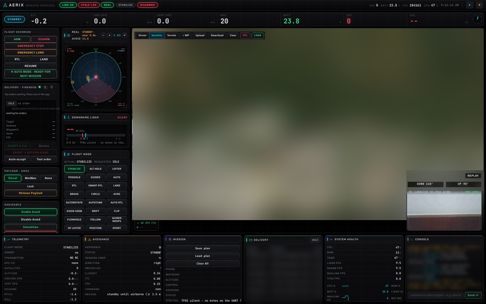
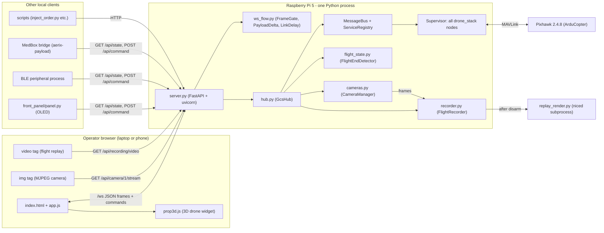
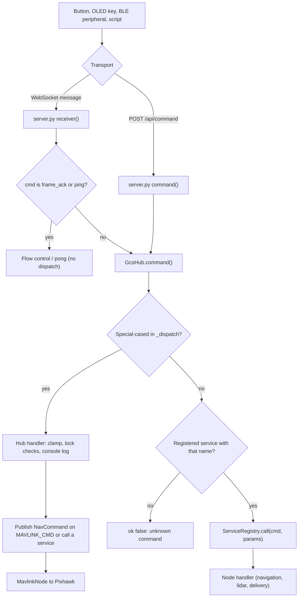
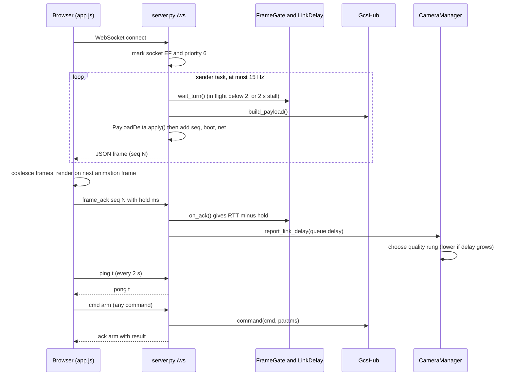
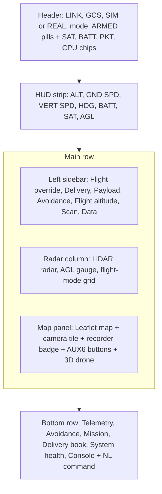
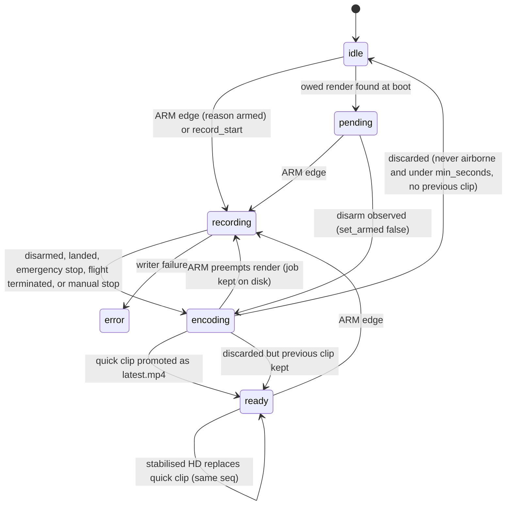
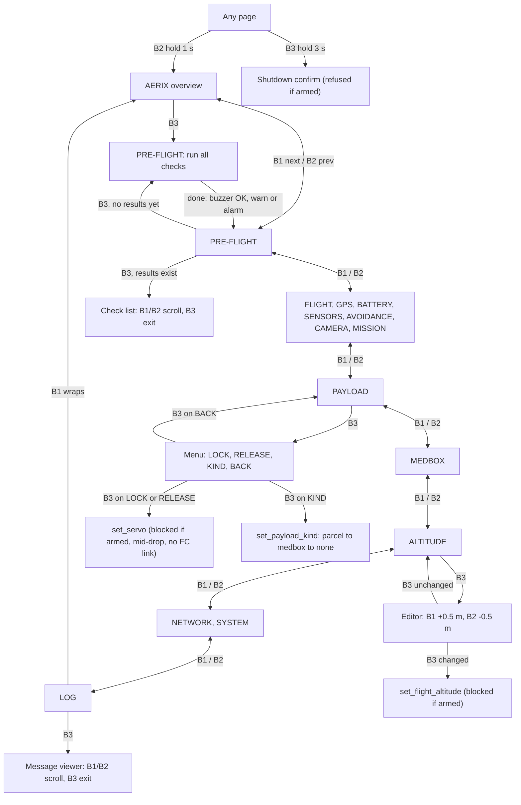

# 7. Ground Control Station and Operator Interfaces

> **In one sentence:** the Ground Control Station (GCS) is a small web server that runs *on the drone's own Raspberry Pi 5*. It serves a live dashboard to any laptop or phone on the same network, plus a tiny OLED screen with three buttons on the airframe itself. Both are windows onto the same live state, and both send commands through the same single entry point.

## Contents

1. [What and why](#1-what-and-why)
2. [Component map](#2-component-map)
3. [HTTP and WebSocket routes](#3-http-and-websocket-routes)
4. [The state payload (`/api/state`)](#4-the-state-payload-apistate)
5. [Commands (`/api/command` and `/ws`)](#5-commands-apicommand-and-ws)
6. [WebSocket flow control](#6-websocket-flow-control)
7. [Live camera stream](#7-live-camera-stream)
8. [The web dashboard, panel by panel](#8-the-web-dashboard-panel-by-panel)
9. [Flight video recorder and replay](#9-flight-video-recorder-and-replay)
10. [Telemetry logs and mission plans](#10-telemetry-logs-and-mission-plans)
11. [The OLED front panel](#11-the-oled-front-panel)
12. [Running it, testing it, and its limits](#12-running-it-testing-it-and-its-limits)

---

## 1. What and why

Most hobby drones use a separate laptop application (QGroundControl or Mission Planner) that talks MAVLink to the flight controller over a telemetry radio. AERIX does it differently:

- **The GCS lives on the aircraft.** [`drone_stack/gcs/server.py`](../../drone_stack/gcs/server.py) is a FastAPI application that starts the entire flight stack (every node on the message bus) *inside the same process*, then serves the operator's dashboard over Wi-Fi. The operator only needs a browser.
- **One source of truth.** The browser keeps no flight state of its own. Every number on screen comes from one dictionary that the hub builds, `GcsHub.build_payload()` in [`hub.py`](../../drone_stack/gcs/hub.py). That includes servo positions, altitude limits and recorder status. A page reload, or a second operator on another laptop, sees exactly the same thing.
- **One way in for commands.** The web buttons, the OLED panel, the BLE handshake peripheral, the MedBox bridge and helper scripts all send `{cmd, params}` to the same dispatcher, `GcsHub.command()`. Safety clamps and console logging are applied in one place, whoever pressed the button.
- **Built for a thin, unreliable link.** The dashboard is used over a 2.4 GHz Wi-Fi extender in the field. A large part of the server code exists so that telemetry and button presses stay responsive while live video shares the same radio (see [section 6](#6-websocket-flow-control)).



The GCS sits in the overall architecture as the top layer over the message bus:


---

## 2. Component map



| File | Role |
|---|---|
| [`gcs/server.py`](../../drone_stack/gcs/server.py) | FastAPI app, all routes, the `/ws` sender and receiver tasks, cache headers, a send-buffer-capped listening socket |
| [`gcs/hub.py`](../../drone_stack/gcs/hub.py) | `GcsHub`: builds the supervisor, subscribes to the bus, builds the state payload, dispatches commands, records and replays telemetry logs, imports and exports `.plan` files, switches between SIM and REAL |
| [`gcs/ws_flow.py`](../../drone_stack/gcs/ws_flow.py) | Per-connection flow control: credit window, delta thinning, link-delay measurement, DSCP/priority socket marking |
| [`gcs/cameras.py`](../../drone_stack/gcs/cameras.py) | Pi camera capture, adaptive JPEG quality ladder, stabiliser, Hailo person-lock overlay |
| [`gcs/recorder.py`](../../drone_stack/gcs/recorder.py) | Flight video recorder that starts on ARM and keeps one clip |
| [`gcs/flight_state.py`](../../drone_stack/gcs/flight_state.py) | Decides when an aircraft that is still armed has actually stopped flying |
| [`gcs/replay_render.py`](../../drone_stack/gcs/replay_render.py) | Post-flight stabilised 1080p render (separate process) |
| [`gcs/static/index.html`](../../drone_stack/gcs/static/index.html), [`app.js`](../../drone_stack/gcs/static/app.js), [`prop3d.js`](../../drone_stack/gcs/static/prop3d.js), [`style.css`](../../drone_stack/gcs/static/style.css) | The dashboard (plain JavaScript, Leaflet map, three.js widget, no build step) |
| [`front_panel/panel.py`](../../front_panel/panel.py) | OLED front panel: a read-mostly viewer of the GCS |

> An older Flask/SSE visualiser still exists in [`drone_stack/web/dashboard.py`](../../drone_stack/web/dashboard.py). The GCS builds the supervisor with `include_web=False`, so that visualiser is **not** started when the GCS runs.

---

## 3. HTTP and WebSocket routes

All routes are defined in [`server.py`](../../drone_stack/gcs/server.py) (`create_app`).

| Method | Route | Returns / does |
|---|---|---|
| `GET` | `/` | The dashboard (`static/index.html`) |
| `GET` | `/static/...` | Dashboard assets (JS, CSS, fonts) |
| `GET` | `/api/state` | One-shot JSON snapshot: exactly what the WebSocket streams (`hub.build_payload()`). Read-only and safe for health checks and scripts |
| `POST` | `/api/command` | Body `{"cmd": "...", "params": {...}}` → `hub.command()` → `{"ok", "message", ...}` |
| `WS` | `/ws` | Live state stream (up to 15 frames/s) plus commands, acks and pings in the other direction |
| `GET` | `/api/logs` | `{"logs": [...]}`: the `*.jsonl` telemetry logs in `logs/` |
| `GET` | `/api/mission/plan` | Current mission exported as a QGroundControl `.plan` (JSON) |
| `POST` | `/api/mission/plan` | Import a `.plan`: every `command == 16` (NAV_WAYPOINT) item becomes a waypoint |
| `GET` | `/api/camera/{cam_id}` | Camera info (`connected`, `res`, `fps`, `latency_ms`, adaptive rung, filter, stabiliser stats) |
| `GET` | `/api/camera/{cam_id}/stream` | MJPEG stream (`multipart/x-mixed-replace; boundary=frame`) |
| `GET` | `/api/recording` | Recorder status: the same dict as the `recording` key of every frame |
| `GET` | `/api/recording/video` | The one kept flight clip (`video/mp4`, supports Range requests for seeking, `Cache-Control: no-store`) |
| `GET` | `/api/recording/poster.jpg` | First frame of the kept clip, used as the replay thumbnail |

Two details matter in practice:

- **Cache control is deliberate.** An HTTP middleware adds `Cache-Control: no-cache` (meaning "always revalidate", not "never store") to `/` and `/static/*` only. Before this, browsers used heuristic caching and showed a stale `app.js` after a deploy. The clip and poster use `no-store` because their URL is fixed while their content changes after every flight.
- **Bounded send buffers.** `main()` opens the listening socket itself (`_bounded_listener`) with `TCP_NOTSENT_LOWAT = 16 KB`. Accepted connections inherit it, so the kernel cannot queue seconds of unsent JPEG behind a slow link.

The port comes from `--port` or the `GCS_PORT` environment variable (default 8000 in `server.py`). The deployment script [`scripts/start_gcs.sh`](../../scripts/start_gcs.sh) and the `web.port` key in [`config/real.yaml`](../../config/real.yaml) use **8090**, which is also the port the OLED panel polls. `MAVLINK_PORT` and `LIDAR_PORT` environment variables override `mavlink.connection` and `lidar.port`.

---

## 4. The state payload (`/api/state`)

`GcsHub._live_payload()` assembles one JSON-safe dictionary (non-finite floats become `null`). It is sent on every WebSocket frame and returned by `/api/state`.

| Key | Contents |
|---|---|
| `ts`, `sim`, `source` | Server wall time, whether the profile is simulation, `"SIM"` or `"REAL"` |
| `link` | `connected`, `string` (MAVLink connection) |
| `telemetry` | `flight_mode`, `armed`, `gps_fix`, `satellites`, `altitude`, `altitude_amsl`, `ground_speed`, `vert_speed`, `heading`, `pitch`, `roll`, `battery_v`, `battery_pct`, `packets`, `cpu_ap` |
| `position` | `lat`, `lon` (null without a fix), `fix`, `alt`, `heading`, `home_lat`, `home_lon` |
| `rc` | Receiver: `connected` (fresh within 3 s and non-zero channels), `channels`, `count`, `rssi`, `age_s` |
| `trail` | GPS breadcrumb trail, up to 800 points, one every 0.7 m with a 3D fix |
| `scan` | Latest LiDAR scan: `angle_min`, `angle_increment`, `ranges`, `state` |
| `lidar_fov` | Scanned arc and blind rear wedge, plus `front_offset_deg`, so the radar can draw them even with the sensor down |
| `payload` | Payload servo envelope from config: `channel` (default 12 = AUX4), `lock_us` (1100), `release_us` (1410), `min_us`, `max_us`, `deg_span` |
| `aux2_servo` | Camera-tilt MG90S on channel 14 (AUX6): envelope plus `down_deg` (148) and `up_deg` (90) |
| `payload_kind` | `parcel`, `medbox` or `none` (persisted in the git-ignored `var/payload_kind.json`) |
| `medbox` | Last MedBox report from the bridge (`link`, `status`, `rssi`, `key_ok`, `age_s`) and the pending operator `reset` request. Becomes `bridge_down` when older than `payload.medbox.stale_s` (10 s) |
| `ble` | `geofence_m` (`delivery.ble_geofence_m`, 12 m), read by the BLE peripheral process so the radius lives in config |
| `obstacles` | Tracked LiDAR obstacles: `id`, `cls`, `distance`, `bearing`, `x`, `y`, `danger`, `confidence`, `track_id`, `hits`, `closing_ms`, `speed_ms`, `dynamic` |
| `avoidance` | Avoidance node status (`null` if not running) |
| `mission` | Navigator state: `phase`, `current_wp`, `total_wp`, `message`, `avoiding`, `pilot_override`, `alt_ceiling_m`, `flight_alt_m`, `arm_refusal`, person-scan fields (`scan_stage`, `scan_left_s`, `handshake_open`, `phone_lat/lon/std_m`), precision-drop fields (`drop_stage`, `drop_order_id`, `drop_agl_m`, `drop_note`), `waypoints` |
| `rangefinder` | Downward TF02-Pro: `enabled`, `agl_m`, `strength`, `valid`, `age_s`, plus `target_agl_m` and `abort_agl_m` from `delivery.*` |
| `delivery` | Firebase delivery node: `phase`, `order_id`, target, distances, hover timing, `auto_accept`, `link`, `orders`, `recent`, `selected_order_id`, `active` |
| `health` | Pi `cpu`, `ram`, `temp`, `uptime`, and measured publish rates `lidar_fps`, `radar_fps`, `mavlink_fps`, `rangefinder_fps` |
| `cameras` | `info()` for each camera (only the Pi camera, id 1, since the USB webcam was removed) |
| `recording` | Recorder status (see [section 9](#9-flight-video-recorder-and-replay)) |
| `console` | Last 60 log lines (`id`, `t`, `level`, `src`, `msg`) |
| `replay` | `{"active": false}` live, or `{"active": true, "idx", "total"}` while a telemetry log is being replayed |

Over `/ws` only, each frame also carries `seq` (for the ack), `boot` (changes on every GCS start, so the page resets its console high-water mark) and `net` (`rtt_ms` and `qdelay_ms` measured for *that* connection).

> **Who reads `/api/state` besides the browser?** The OLED panel (every 0.5 s), the BLE handshake peripheral (geofence radius, `mission.handshake_open`, `mission.drop_stage`), the MedBox bridge (`payload_kind` and pending reset), and [`scripts/inject_order.py`](../../scripts/inject_order.py).

---

## 5. Commands (`/api/command` and `/ws`)

A command is `{"cmd": "<name>", "params": {...}}`, sent either as a `POST /api/command` body or as a WebSocket text message. `GcsHub.command()` wraps `_dispatch()` so an exception becomes `{"ok": false, "message": "<Type>: <msg>"}` and never kills the connection.



### 5.1 Commands handled by the hub itself

| Command | Params | What it does |
|---|---|---|
| `set_mode` | `mode` | Publishes a `set_mode` NavCommand (the dashboard's mode grid) |
| `emergency_stop` | none | Publishes `disarm` **and** calls the navigator's `emergency_stop` service. Motors are cut immediately |
| `emergency_land` | none | Calls the `land` service |
| `nl` | `text` | Natural-language command box → `nl_command` service |
| `add_waypoint` | `lat`, `lon`, `alt` | Appends a waypoint (converted to local east/north from home) and reloads the mission |
| `upload_mission` | `waypoints` | Replaces the mission with a list of `{lat, lon, alt}` |
| `clear_mission` | none | Loads an empty mission |
| `set_servo` | `channel`, `pwm` | Moves a Pixhawk AUX servo. The PWM is **clamped to that channel's configured envelope**, and an unknown channel falls back to the payload envelope |
| `set_flight_altitude` | `alt_m` | Navigator applies it (clamped to the ceiling), then the delivery node adopts the same height |
| `person_lock` | `action` (`toggle`, `on`, `off`) | Enables or disables the Hailo person lock on camera 1 and tilts the AUX6 camera servo down or up |
| `set_payload_kind` | `kind` | `parcel`, `medbox` or `none`. **Refused while armed or during a drop stage** (`approach`, `descend`, `settle`, `release`, `climb`) |
| `medbox_reset` | none | Asks the bridge to reset the box's latched state. Refused unless the kind is `medbox`, the aircraft is on the ground and not mid-drop, the box is connected, the bridge holds a command key, and no reset is already pending |
| `record` | `action` (`start`, `stop`, `toggle`) | Starts or stops a JSONL telemetry log in `logs/` |
| `replay` | `file` | Replays a telemetry log through the stream (the file name is reduced to its base name to stop path traversal) |
| `record_start` / `record_stop` | none | Manual video recording. `record_stop` is **refused for a recording started by arming**: only disarming ends a flight recording |
| `set_source` | `mode` (`sim` or `real`) | Stops the supervisor, loads the whole `config/sim.yaml` or `config/real.yaml` profile, and restarts it |
| `ble_auth_event` | `authenticated`, `rssi_dbm`, `phone_gps` | Bridge for the BLE peripheral onto the **design-stage** novelty layer's topic (inert while `novelty.enabled` is false) |
| `ble_delivery_result` | `order_id`, `success` | Published on `DELIVERY_BLE_RESULT`, read by the navigation node's delivery profile |
| `ble_phone_signal` | `order_id`, `samples` | Up to 64 `[t, rssi_dbm]` samples, each published with its own timestamp |
| `ble_phone_fix` | `lat`, `lon`, `order_id`, `t` | Phone GPS fix (rejects out-of-range or 0,0 fixes) |
| `medbox_status` | bridge report | Caches the MedBox status. Only *transitions* (link change, COMPROMISED, DELIVERED, opened at destination, new ack) reach the console |

### 5.2 Service passthrough

Anything else is forwarded by name to the service registry. The services registered by the nodes are:

| Owner | Services |
|---|---|
| [`navigation_node.py`](../../drone_stack/nodes/navigation_node.py) | `arm`, `disarm`, `start_mission`, `hold`, `resume`, `rtl`, `land`, `emergency_stop`, `clear_emergency`, `load_mission`, `mission_status`, `nl_command`, `avoid_enable`, `avoid_disable`, `set_stop_distance`, `set_flight_altitude`, `set_delivery_target`, `abort_delivery`, `goto_gps`, `precision_drop` |
| [`lidar_node.py`](../../drone_stack/nodes/lidar_node.py) | `scan_start`, `scan_stop`, `scan_pause`, `scan_resume` |
| [`firebase_delivery_node.py`](../../drone_stack/nodes/firebase_delivery_node.py) | `delivery_accept`, `delivery_reject`, `delivery_abort`, `delivery_set_auto`, `delivery_set_altitude`, `delivery_status`, `delivery_inject`, `delivery_select`, `delivery_refresh`, `delivery_reset` |

Example, read-only and safe at any time:

```bash
curl -s http://<pi-host>:8090/api/state | python3 -m json.tool | less
```

Commands move real hardware on the REAL profile. Do not send them to a powered aircraft unless the [safety checklist](08-safety.md) has been followed.

---

## 6. WebSocket flow control

**The problem.** Field reports said the dashboard got laggier the longer it stayed open, and that a page refresh fixed it. Measurements on the Pi found two queues that only ever grew for the life of a connection. One was the WebSocket: uvicorn never pauses a sender, so 15 frames/s piled up in the Pi's buffer for a slow tab. The other was the camera socket's kernel send buffer. Later, with video open on the bench extender, button round trips went from about 20 ms to 176–190 ms. The MJPEG stream was keeping the router queue full.

**The fix** in [`ws_flow.py`](../../drone_stack/gcs/ws_flow.py) has four parts:

| Mechanism | What it does |
|---|---|
| `FrameGate` (credit window) | At most **2** unacknowledged frames per connection. The page acks each `seq` *after* rendering it, inside a `requestAnimationFrame` callback. A slow page gets fewer but always-fresh frames. If no ack arrives for **2 s** (for example a hidden tab), one frame is sent anyway, so a connection can never wedge. A page that has never acked (an old cached `app.js`) runs free as before |
| `PayloadDelta` | Sends each console line only once (it was 7.3 KB of a 17 KB frame), and drops `trail` unless its length or endpoints changed. The page merges console lines across frames it skipped and keeps the last trail |
| `LinkDelay` | Turns send-to-ack round trips into **queueing delay**: the standing RTT (minimum over the last 1 s) minus a base RTT (minimum over 60 s, capped at 80 ms). The page reports how long it *held* the frame before acking, and that is subtracted, so a slow laptop does not look like a congested link. The camera's adaptive controller uses this delay to lower video quality *before* telemetry suffers |
| `mark_interactive` | Marks the WebSocket's TCP socket DSCP EF (`IP_TOS 0xB8`, the Wi-Fi WMM voice class) and `SO_PRIORITY 6`, so telemetry and button replies are queued ahead of video. Fails open on platforms that do not support it |



**Browser side.** In [`app.js`](../../drone_stack/gcs/static/app.js), `connect()` only queues the newest frame and renders it once per animation frame (`flushFrame`). A watchdog shows a `STALE n.ns` pill after 1.5 s without any message. After 5 s it drops the socket, dials a new one and reopens the camera stream. This catches Wi-Fi dropouts in flight that never close the socket. The `GCS` header pill shows the page's own link round trip from the ping and pong.

---

## 7. Live camera stream

`GET /api/camera/1/stream` serves MJPEG from the Pi camera, managed by [`cameras.py`](../../drone_stack/gcs/cameras.py):

- **Event-driven and newest-frame-wins.** The generator waits for the camera's publish event instead of polling, sends the newest JPEG, and skips stale frames instead of queueing them. Headers turn off browser and proxy buffering (`no-store`, `X-Accel-Buffering: no`).
- **Adaptive quality ladder.** Each viewer's delivered frame rate is measured where the frame is yielded and fed back to the camera. Together with the WebSocket queueing delay, it picks a rung (scale and JPEG quality, plus a per-viewer frame-rate cap on the lowest rungs). The rung is shown in `cameras[0].adapt`, so a soft picture can be explained at a glance.
- **Hidden tabs stop streaming.** The page removes the `img` source when the tab is hidden. A forgotten background tab would otherwise drag the shared quality down, because the controller steers by the worst viewer.
- **NPU chip.** The tile's top-right chip shows the Hailo person-lock state from `cameras[0].vision`: `NPU OFF`, `LOCK 87% · 10Hz`, `HOLD`, and so on. The lock box itself is burned into the video. See [Perception and avoidance](05-perception-and-avoidance.md) for the detector and its offline-only accuracy figures.

---

## 8. The web dashboard, panel by panel

The page is plain HTML and JavaScript with no build step. Leaflet 1.9.4 (map) and three.js 0.160.0 (3D widget) load from the unpkg CDN, so the map tiles and the 3D widget need internet access on the operator's device. The telemetry, controls and camera do not.



### 8.1 Header and HUD
- **Pills:** `LINK` (MAVLink up or lost), `GCS` (this browser's own round trip, or `STALE`), `SIM`/`REAL`, current flight mode, `ARMED`/`DISARMED`.
- **Chips:** satellites, battery voltage, MAVLink packets, autopilot CPU, clock. There are also a light/dark theme toggle and a density toggle.
- **HUD strip:** altitude, ground speed, vertical speed, heading, battery, satellites, and **AGL** from the downward TF02-Pro.
- **Mode toast:** a translucent centred banner announces every flight-mode change and any FC STATUSTEXT about aux switches (for example a motor emergency stop switch). That way, transmitter actions are visible on the ground station.

### 8.2 Left sidebar

| Section | Controls | Sends |
|---|---|---|
| **Flight override** | ARM (with a confirm dialog), DISARM, EMERGENCY STOP, EMERGENCY LAND, RTL, LAND, **RESUME · TAKE BACK CONTROL**, **AUTO MODE · READY FOR NEXT MISSION** | `arm`, `disarm`, `emergency_stop`, `emergency_land`, `rtl`, `land`, `resume`; AUTO MODE sends `resume` + `delivery_reset` (the latter refused server-side unless disarmed) |
| **Delivery · Firebase** | Order inbox with a refresh button, order card (phase badge, six-step track ORDER → LAUNCH → EN ROUTE → HOVER → RETURN → HOME, target, distance, waypoints, hover, ETA, progress bar, outcome summary), ACCEPT & FLY, Decline, ABORT → RETURN HOME, Auto-accept toggle, Test order | `delivery_refresh`, `delivery_select`, `delivery_accept`, `delivery_reject`, `delivery_abort`, `delivery_set_auto`, `delivery_inject` |
| **Payload · AUXn** | Payload kind selector (Parcel / MedBox / None), **MedBox card**, Lock, Release Payload (with a confirm dialog) | `set_payload_kind`, `medbox_reset`, `set_servo` |
| **Avoidance** | Enable / Disable Avoid, Simulation / Real Mode (Real asks for confirmation), emergency-brake distance (0.3–8 m, number + slider) | `avoid_enable`, `avoid_disable`, `set_source`, `set_stop_distance` |
| **Flight altitude** | "Fly at" 2–10 m in 0.5 m steps. Sent **only on release**, asks first while armed, shows the ceiling and the height actually in use | `set_flight_altitude` |
| **Scan** | Start, Stop, Pause, Resume | `scan_start`, `scan_stop`, `scan_pause`, `scan_resume` |
| **Data** | Save Scan (download), Record Log, Replay `.jsonl` + log selector | `record`, `replay` |

Details worth knowing:
- **Confirm dialogs guard the dangerous actions:** ARM, Release Payload, Real Mode, ACCEPT & FLY (it states the distance and hover time), ABORT, enabling Auto-accept ("every new order will be flown without asking"), and MedBox reset.
- **Servo numbers come from the server.** Lock/Release use `payload.lock_us` and `payload.release_us` from each frame. The constants in `app.js` are only a fallback until the first frame arrives. This was done after the UI, the YAML and the notes ended up disagreeing about the values.
- **Test order** drops an order at the map cursor without touching Firebase, so the whole order → flight chain can be demonstrated with no phone app and no credentials. Delivered orders in the book offer a *repeat* button that re-injects the same drop point.
- **The MedBox card** is shown only when the payload kind is `medbox`. It shows box state and link, temperature/RH, lid, motion, drop window, battery and "sealed for", plus a **Reset box** button. It is advisory: nothing on it gates a release. A hand release with a MedBox attached warns that no drop window is opened, so the box will log the landing as an impact. Full details are in the [MedBox add-on](../../addons/medbox/README.md).

### 8.3 Radar column
- **LiDAR radar** (canvas): the scan with the 0° front line and the blanked rear wedge from `lidar_fov`, tracked obstacles coloured by danger, zoom and expand buttons, and an **EMERGENCY BRAKING** overlay.
- **AGL gauge**: TF02-Pro height on a bar marked with the drop-release height (`target_agl_m`) and the abort floor (`abort_agl_m`).
- **Flight mode grid**: one button per ArduCopter mode (STABILIZE, ALT HOLD, LOITER, GUIDED, AUTO, RTL, LAND, BRAKE and the rest), each sending `set_mode`. It also shows *actual* vs *requested* mode.

### 8.4 Map panel
- **Leaflet map** with Street, Satellite and Terrain layers. It draws the aircraft, home, the GPS trail, mission waypoints and the active delivery target. It shows drone and cursor coordinates.
- **Toolbar:** `+ WP`, Upload, Download (saves `mission.plan` from `GET /api/mission/plan`), Clear, RTL, LAND.
- **Camera tile** (P1) with resolution, fps, `STAB` and the NPU chip.
- **Recorder badge + REPLAY button** (see below) and the **AUX6 camera-tilt buttons** (`DOWN 148°` / `UP 90°`). The labels and PWM values are computed from the `aux2_servo` block on the first frame.
- **3D drone widget** ([`prop3d.js`](../../drone_stack/gcs/static/prop3d.js)): a transparent three.js viewport that mirrors the aircraft. Propeller speed is 0 when disarmed, 16 rad/s idle when armed, plus 6 rad/s per m/s of ground speed (capped at 60). Body roll, pitch and heading follow telemetry with damping. The GLB model (`static/models/motorpropsjoinednew.glb`, about 36 MB) is not committed to this repository. Without it, the widget simply has nothing to draw.

### 8.5 Bottom row
Key-value tables for **Telemetry**, **Avoidance**, **Mission** (with Save `.plan`, Load `.plan`, Clear All), a **Delivery** order book, **System health** (with sparklines), and the **Console**. The console has a natural-language command box (`nl`) with up/down history kept in the browser's `localStorage`.

---

## 9. Flight video recorder and replay

**What and why.** The aircraft films every flight by itself, whether or not anyone has the dashboard open. Recording follows the **ARM edge on the message bus**, not the WebSocket. Otherwise it would fire once per open browser tab, or never with no tab open. Exactly **one clip is kept: the latest flight's**. The design comes from field failures that are documented in the source: the replay showing a previous day's flight because a render never finished, and a short real hop being discarded by a minimum-length rule.

### 9.1 In flight: store only what is cheap
The Pi 5 has no hardware video encoder, so nothing H.264 runs in the air. With a record stream configured, the camera hands the recorder the full-resolution 2304×1296 frame plus the camera motion and the person-lock box. The writer JPEG-encodes it straight from YUV and appends one JSON line per frame to an index. Without one, it stores the already-encoded live JPEG bytes. Capture is never blocked: frames go onto a bounded queue (15 raw / 90 encoded) and are dropped if the SD card falls behind. The frame file is `fdatasync`'d every `flush_s` (2 s), so a battery pull loses at most a couple of seconds.

### 9.2 When does a recording end?
[`flight_state.py`](../../drone_stack/gcs/flight_state.py) answers *"is it still flying?"*, because arming is a permission, not a flight. The hub checks it once per heartbeat:

| Reason | Signal | Speed |
|---|---|---|
| `disarmed` | Arm bit cleared | Immediate |
| `flight terminated` | `HEARTBEAT.system_status` is EMERGENCY, POWEROFF or FLIGHT_TERMINATION | Immediate |
| `emergency stop` | FC STATUSTEXT announcing a motor cut (an RC emergency stop changes neither the arm bit nor the status) | Immediate |
| `landed` | Was airborne, now looks landed by altitude and speed | Only after `land_dwell_s` (15 s) of continuous agreement |

When the aircraft came down and stayed down, the clip is trimmed to touchdown + 2 s. The detector latches: one arm cycle gives one clip.

### 9.3 Keep rule and two-stage render
A recording in which the aircraft rose to `airborne_alt_m` (1 m) above home is **always kept**. One that never left the ground is discarded if shorter than `min_seconds` (15 s), and the previous clip survives. After stop:

1. **Quick clip:** an unstabilised 1152×648 clip, promoted as `latest.mp4` straight away. Measured at about 0.77× real time on a 20 s bench clip.
2. **Stabilised HD:** [`replay_render.py`](../../drone_stack/gcs/replay_render.py) runs as a niced subprocess paced to `render_cpu_cores`. It re-measures motion from the frames, applies zero-phase Gaussian smoothing and a rolling-shutter correction, burns in the lock box, and writes 1920×1080. It then replaces the quick clip of the *same* flight. Recordings carry a persisted sequence number `seq` (the Pi has no RTC), so an older flight's render can never replace a newer one's clip.



An arming aircraft always wins: a running render is killed and resumes from its on-disk job after the next disarm ("footage always outranks pixels"). A render is also never started until the FC has actually reported a disarmed state, so it cannot start during boot on a guess.

### 9.4 What the operator sees
The `recording` block (also at `GET /api/recording`) carries `enabled`, `state`, `active`, `reason`, `message`, `progress`, `pending`, `upgrading`, `seq`, `airborne`, `elapsed_s`, `frames`, `dropped`, `bytes`, `min_seconds`, `free_mb` and `clip` (duration, size, resolution, fps, `stabilized`, `ended`, `seq`). The badge on the camera tile reads one of:

| Badge | Meaning |
|---|---|
| `REC 01:23` | Recording this flight |
| `RENDER 40%` / `ENCODING` | Producing the clip |
| `REPLAY OWED` | A newer flight is recorded but not yet playable, so no older clip is presented as current |
| `CLIP 00:42 · HD 35%` | This flight is playable; the stabilised version is still rendering |
| `CLIP 00:42` | Ready |
| `REC IDLE` / `REC OFF` / `REC ERR` | Nothing yet / disabled by config / writer error |

**REPLAY** opens a modal `video` player with a download link. The source is keyed by `seq` + quality + end time, so the browser can never serve the previous flight from cache. If the HD version arrives while the operator is watching, the player waits for pause or end before swapping. Files live in the git-ignored `recordings/` directory as `latest.mp4`, `latest.jpg` and `latest.json`.

---

## 10. Telemetry logs and mission plans

- **Telemetry logs (JSONL).** On every ARM edge the hub also starts writing every built payload to `logs/flight_YYYYMMDD_HHMMSS.jsonl`, and stops on disarm. **Record Log** does the same by hand. **Replay `.jsonl`** feeds a file back through the stream frame by frame, so every panel redraws the flight; `replay.active`, `idx` and `total` show the progress. `logs/` is git-ignored.
- **Mission plans.** `GET /api/mission/plan` exports a QGroundControl-compatible `.plan` (`fileType: "Plan"`, NAV_WAYPOINT `command: 16` items, cruise speed from `navigation.cruise_speed_ms`). `POST` imports one. Waypoints are converted to local east/north metres from home before `load_mission`.

---

## 11. The OLED front panel

**What and why.** A 1.3" SH1106 128×64 OLED, three buttons and a passive buzzer on the airframe let someone *standing at the drone* see whether it is ready, without a laptop. [`front_panel/panel.py`](../../front_panel/panel.py) runs as its own service. It is a **client of the GCS** (`GET /api/state` on `127.0.0.1:8090`) and never opens the MAVLink or rangefinder ports, so a crash in the panel cannot touch flight. It can do only a few things: payload LOCK/RELEASE, cycle payload kind, set flight altitude (all through `POST /api/command`, so the GCS clamps and console logs still apply), and a guarded Pi shutdown.

### 11.1 Wiring

| Part | Header pin | GPIO |
|---|---|---|
| OLED SDA / SCK (I2C address `0x3C`) | 3 / 5 | GPIO2 / GPIO3 |
| B1 UP | 15 | GPIO22 |
| B2 DOWN | 13 | GPIO27 |
| B3 SELECT | 11 | GPIO17 |
| Buzzer (passive) | 12 | GPIO18 |

The buzzer uses the two resonances found in a sweep (2.0 kHz and 3.5 kHz) for distinct click, OK, warn, alarm, armed and goodbye sounds.

### 11.2 Pages and buttons
There are 15 pages, in order: **AERIX** (overview), **PRE-FLIGHT**, FLIGHT, GPS, BATTERY, SENSORS, AVOIDANCE, CAMERA, MISSION, **PAYLOAD**, MEDBOX, **ALTITUDE**, NETWORK, SYSTEM, **LOG**.

| Input | Action |
|---|---|
| B1 short / B2 short | Next / previous page (wraps around) |
| B3 short | Page action (below) |
| B1 hold 1 s | Mute / unmute alerts |
| B2 hold 1 s | Jump to AERIX overview |
| B3 hold 3 s | Shutdown menu: B3 confirms within 6 s, B1/B2 cancel. **Refused while armed** |
| Any press while asleep | Only wakes the screen |

The screen sleeps (fully off) after 15 s idle. It never sleeps while armed or during a pre-flight run, and any alert wakes it.



**Local guards.** Before sending, the panel takes a fresh snapshot and refuses on its own:
- **Servo:** if the GCS is down, there is no FC link, the aircraft is armed (or its state is unknown), a drop stage is active (`approach`, `descend`, `settle`, `release`, `climb`, `abort`), or no payload channel is configured. The person at the panel is standing next to the propellers.
- **Altitude:** 2 m up to the lower of 10 m and the ceiling. Refused if the GCS is down or the aircraft is armed.

The hub applies its own checks on top of these.

### 11.3 Pre-flight checks
SELECT on PRE-FLIGHT (or on the overview) refreshes system and GCS state and runs **23 checks**, ordered by what to fix first. Each check gives PASS, WARN or FAIL with a short detail. The buzzer then plays OK, warn or alarm. Battery and ceiling limits are read from `safety.*` in `config/real.yaml`, never copied into the panel.

| # | Check | PASS when |
|---|---|---|
| 1 | GCS | `/api/state` answers |
| 2 | FC link | MAVLink connected, heartbeat rate ≥ 5/s (WARN below) |
| 3 | Disarmed | Reported disarmed |
| 4 | Mode | Flight mode known |
| 5 | Pre-arm | `mission.arm_refusal` empty |
| 6 | GPS | 3D/RTK fix with ≥ 8 satellites (WARN at 6–7) |
| 7 | Home | Home position set (WARN otherwise) |
| 8 | Battery | ≥ 3.95 V per cell (WARN down to `battery_low_voltage` + 0.6 V) |
| 9 | RC rx | Receiver connected |
| 10 | LiDAR | Scan rate ≥ 5 fps |
| 11 | TF02 | Rangefinder valid and reading below the drop abort height on the ground |
| 12 | Camera | Connected, ≥ 20 fps (WARN below) |
| 13 | NPU | Hailo person lock ready |
| 14 | Avoidance | Enabled |
| 15 | Ceiling | `0 < alt_ceiling_m ≤ safety.max_altitude_m` |
| 16 | Payload | Payload channel configured, and not channel 9 (AUX1, recorded as dead) |
| 17 | MedBox | Not a MedBox flight, or box connected and ARMED (sealed). FAIL if COMPROMISED |
| 18 | BLE svc | `aerix-ble` service active |
| 19 | Recorder | Enabled with > 2 GB free |
| 20 | Pi temp | Below 70 °C (WARN below 80 °C) |
| 21 | Throttle | No under-voltage/throttle flags (FAIL if throttled now) |
| 22 | Disk | > 2 GB free |
| 23 | WiFi | Connected with ≥ 50 % signal |

The panel's checks are a quick aid at the aircraft. The full procedure is in [`docs/PREFLIGHT_CHECKLIST.md`](../PREFLIGHT_CHECKLIST.md) and [Safety](08-safety.md).

### 11.4 Alerts
Alerts are edge-triggered, so they do not nag. The panel sounds when the aircraft arms or disarms, the GCS stops answering, the FC link drops, a MedBox turns COMPROMISED or its link is lost, the battery falls below `battery_low_voltage` while armed (every 30 s), or the Pi goes above 80 °C (every 60 s). Mute silences everything except the arm/disarm sounds.

---

## 12. Running it, testing it, and its limits

**Run locally against the simulator** (no hardware needed):

```bash
python -m drone_stack.gcs.server --config config/sim.yaml --port 8000
# then open http://localhost:8000
```

[`scripts/run_gcs.sh`](../../scripts/run_gcs.sh) does the same in the foreground. On the aircraft, the GCS is installed as the `aerix-gcs` systemd service on port 8090 with the REAL profile. [`scripts/start_gcs.sh`](../../scripts/start_gcs.sh) is a manual detached launcher and must not be run while the service is up. Static files are read from disk on each request, so a front-end change needs only a browser reload. A Python change needs a service restart. See [Setup, deployment and testing](09-setup-deployment-testing.md).

**Tests** covering this layer:

| Test file | Covers |
|---|---|
| [`tests/test_gcs.py`](../../tests/test_gcs.py) | Hub payload and command dispatch |
| [`tests/test_ws_flow.py`](../../tests/test_ws_flow.py) | Credit window, stall release, delta thinning, link-delay estimate |
| [`tests/test_flight_end.py`](../../tests/test_flight_end.py) | Flight-end detection (disarm, termination, e-stop, landed dwell) |
| [`tests/test_replay_latest_flight.py`](../../tests/test_replay_latest_flight.py), [`tests/test_replay_durability.py`](../../tests/test_replay_durability.py), [`tests/test_recordings_isolated.py`](../../tests/test_recordings_isolated.py) | Keep rule, sequence ordering, preemption, crash recovery |

**Honest limits.**
- **No authentication.** The GCS has no login. Anyone who can reach the port on the local network can read state and send commands. Confirmation dialogs exist only in the browser UI, not on the API. It is meant for a closed field network. Delivery *release* authorisation is a separate, cryptographically protected path: see [BLE handshake security](06-ble-handshake-security.md).
- **CDN dependencies.** The map tiles, Leaflet and three.js need internet access on the operator's device.
- **Design-stage hooks.** `ble_auth_event` feeds the novelty layer, which is **design-tier and disabled** by default. With `novelty.enabled` false, the publish is inert.
- **Evidence.** The GCS, recorder and OLED panel are the deployed operator tools on the aircraft. The *features they display*, such as the person scan and precision drop, keep their own evidence tiers in [`evidence/EVIDENCE_TIERS.md`](../../evidence/EVIDENCE_TIERS.md). A panel on the dashboard does not mean the feature has flown.

---

<p align="center">
<a href="06-ble-handshake-security.md">← Previous: BLE handshake security</a> | <a href="../../README.md">Index</a> | <a href="08-safety.md">Next: Safety →</a>
</p>
