# 08 · Safety design and lessons learned

> **Status, stated plainly:** AERIX is **not declared flight-ready.** The real-hardware
> config ships with GCS-side failsafes switched **off** for bench work
> (`safety.failsafes_enabled: false` in [`config/real.yaml`](../../config/real.yaml)), and
> [`scripts/preflight_check.py`](../../scripts/preflight_check.py) reports **NO-GO** until that
> changes. That is deliberate, and this page explains why.

## What this page is, and why it exists

A delivery drone that flies itself is a spinning set of blades above people. Most of the
safety rules in AERIX were not designed up front. **They were written after something
went wrong**: a hard landing, a servo that stopped moving, a hover that would not hand
control back to the pilot. Each time, the team found the root cause in the logs, fixed it
in code, pinned it with a regression test, and wrote the reason into the config file next
to the setting, so nobody "tidies it up" later and brings the fault back.

This page gathers those rules in one place. For each one you get:

- **The rule:** what the software enforces.
- **Why:** the incident (with its date) or the measurement behind it.
- **Where:** the code, config and tests that hold the rule in place.

The full engineering notebook these come from is [`docs/PROJECT_NOTES.md`](../PROJECT_NOTES.md).

## Contents

1. [Safety in layers](#1-safety-in-layers)
2. [Incident timeline](#2-incident-timeline)
3. [Rule 1: never hover in a stick-altitude mode](#3-rule-1-never-hover-in-a-stick-altitude-mode)
4. [Rule 2: the altitude ceiling and the hardlock](#4-rule-2-the-altitude-ceiling-and-the-hardlock)
5. [Rule 3: the transmitter always wins](#5-rule-3-the-transmitter-always-wins)
6. [Rule 4: command topics are never latched](#6-rule-4-command-topics-are-never-latched)
7. [Rule 5: servo channels come only from config, inside envelopes](#7-rule-5-servo-channels-come-only-from-config-inside-envelopes)
8. [Rule 6: failsafes are off for bench work, so preflight says NO-GO](#8-rule-6-failsafes-are-off-for-bench-work-so-preflight-says-no-go)
9. [Rule 7: LiDAR filters live upstream, once](#9-rule-7-lidar-filters-live-upstream-once)
10. [Rule 8: a service name cannot be overwritten by its payload](#10-rule-8-a-service-name-cannot-be-overwritten-by-its-payload)
11. [Other guards worth knowing](#11-other-guards-worth-knowing)
12. [Preflight: the GO / NO-GO process](#12-preflight-the-go--no-go-process)
13. [Evidence tiers: what has actually been proven](#13-evidence-tiers-what-has-actually-been-proven)
14. [Lessons learned](#14-lessons-learned)
15. [Open items before any real flight](#15-open-items-before-any-real-flight)

---

## 1. Safety in layers

No single check is trusted on its own. A command passes through several independent
guards between the operator and the motors, and the human pilot on the RC transmitter
sits above all of them.

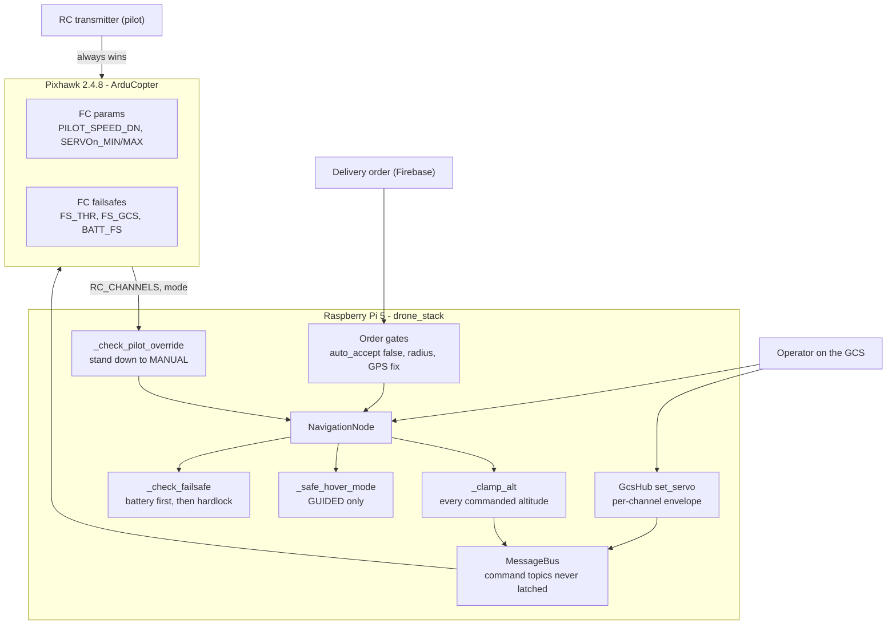

| Layer | Lives in | Survives a Pi crash? |
|---|---|---|
| RC transmitter: LAND switch (ch 6), motor E-stop (ch 8) | Pixhawk (`RC6_OPTION=18`, `RC8_OPTION=31`) | Yes |
| FC failsafes and parameter limits | Pixhawk parameters | Yes |
| Altitude clamp, hover-mode guard, pilot-override arbitration, hardlock | [`navigation_node.py`](../../drone_stack/nodes/navigation_node.py) | No |
| Servo envelopes | [`gcs/hub.py`](../../drone_stack/gcs/hub.py) and FC `SERVOn_MIN/MAX` | Partly (FC clamp stays) |
| Order gates | [`firebase_delivery_node.py`](../../drone_stack/nodes/firebase_delivery_node.py) | No |
| Preflight GO / NO-GO | [`scripts/preflight_check.py`](../../scripts/preflight_check.py) + [checklist](../PREFLIGHT_CHECKLIST.md) | Before flight only |

The right-hand column is the reason the FC-side failsafes matter: everything on the Pi
disappears if the Pi or its link dies. In the preflight script's words, with the GCS-loss
failsafe off "a Pi/link death mid-flight is unrecoverable".

---

## 2. Incident timeline

Every rule below traces to a date. Dates are from `docs/PROJECT_NOTES.md`, config
comments and regression-test docstrings.

```mermaid
flowchart LR
    A["2026-08-10<br/>Full servo sweep<br/>breaks mechanism"] --> B["2026-08-22<br/>Hardlock BRAKE loop<br/>locks pilot out, falls"]
    B --> C["2026-08-23<br/>FC refuses GUIDED,<br/>read as takeover"]
    C --> D["2026-08-25<br/>POSHOLD hover,<br/>2.5 m/s hard landings"]
    D --> E["2026-08-27<br/>Root cause found,<br/>hover forced to GUIDED"]
    E --> F["2026-08-29<br/>Noisy LiDAR flight,<br/>FC branch filtered"]
    F --> G["2026-09-06<br/>AUX1/AUX2 pins dead,<br/>servos moved"]
    G --> H["2026-09-11<br/>Payload moved again<br/>to AUX4"]
    H --> I["2026-09-21<br/>LiDAR filter moved<br/>upstream"]
    I --> J["2026-10-04<br/>Yaw flick aborts<br/>missions, sticks debounced"]
    J --> K["2026-10-08<br/>Evidence review,<br/>preflight_check NO-GO"]
```

| Date | What happened | What broke | Rule it produced |
|---|---|---|---|
| 2026-08-10 | Payload servo driven over its full travel | Horn bottomed on its stop, **mechanism broken** | [Rule 5](#7-rule-5-servo-channels-come-only-from-config-inside-envelopes): envelopes |
| 2026-08-22 | Altitude hardlock held the aircraft in BRAKE, re-sending it every tick | Pilot locked out; battery ran flat; **aircraft fell** | [Rule 2](#4-rule-2-the-altitude-ceiling-and-the-hardlock), [Rule 3](#5-rule-3-the-transmitter-always-wins) |
| 2026-08-23 | 15:39 abort: FC refused GUIDED on a thin fix | Mission aborted and blamed a pilot who never touched the sticks | [Rule 3](#5-rule-3-the-transmitter-always-wins): refusal is not takeover |
| 2026-08-25 | Drop-point hover entered POSHOLD (dataflash logs 453, 454) | ~2.5 m/s impact, **landing gear broken, twice** | [Rule 1](#3-rule-1-never-hover-in-a-stick-altitude-mode) |
| 2026-08-27 | Root cause found in the dataflash logs and fixed | | [Rule 1](#3-rule-1-never-hover-in-a-stick-altitude-mode) |
| 2026-08-29 | "Awful" manual flight with noisy LiDAR | FC proximity branch filtered, steering branch left raw | [Rule 7](#9-rule-7-lidar-filters-live-upstream-once) |
| 2026-09-06 | AUX1 and AUX2 stopped driving servos while every FC reading looked perfect | Both servos dead | [Rule 5](#7-rule-5-servo-channels-come-only-from-config-inside-envelopes): channel from config only |
| 2026-09-11 | MG995 also dead on AUX5 for five days | Payload moved to AUX4 / SERVO12 | [Rule 5](#7-rule-5-servo-channels-come-only-from-config-inside-envelopes) |
| 2026-09-21 | Measured LiDAR noise; filter moved into driver and `LidarNode` | | [Rule 7](#9-rule-7-lidar-filters-live-upstream-once) |
| 2026-10-04 | Two missions aborted at 1 m AGL on a yaw-stick flick under 0.35 s | Aircraft left hovering in GUIDED, where sticks do nothing | [Rule 3](#5-rule-3-the-transmitter-always-wins): stick debounce |
| 2026-10-08 | Evidence review follow-up | `preflight_check.py` added; NO-GO with failsafes off | [Rule 6](#8-rule-6-failsafes-are-off-for-bench-work-so-preflight-says-no-go) |

Two further faults were found in review rather than in flight, and have no flight date:
the stale-command replay ([Rule 4](#6-rule-4-command-topics-are-never-latched)) and the
service-name collision ([Rule 8](#10-rule-8-a-service-name-cannot-be-overwritten-by-its-payload)).

---

## 3. Rule 1: never hover in a stick-altitude mode

**The rule.** The drop-point hold is flown in **GUIDED**. `POSHOLD`, `LOITER`,
`ALT_HOLD` and every other mode that takes altitude from the throttle stick are refused
in code, whatever the config says.

### Why: the hard landings of 2026-08-25

In ArduCopter, POSHOLD, LOITER and ALT_HOLD hold altitude **only for a pilot holding the
throttle stick at centre**. During an autonomous delivery nobody touches the transmitter,
so the throttle rests at `RC3_MIN` (999 µs on this airframe), which the autopilot reads as
"descend at the full pilot rate".

From the flight controller's own dataflash logs (453 and 454, both flights identical):

| t (s) | Event |
|---|---|
| before | Holding 3.4 to 3.7 m in GUIDED, climb rate about 0 |
| 622.35 | `MODE POSHOLD (GCS_COMMAND)`: the navigator entering the hover |
| 622.70 | Descent begins; the *desired* altitude is driven down, so it is commanded, not a failure |
| 623.9 | −233 cm/s |
| 624.7 | Passes altitude 0 at **−251 cm/s, about 2.5 m/s impact**: landing gear broken |
| 624.8 | Pilot reacts on ch 6, 1.3 s after touchdown |
| 627.2 | `RC8: MotorEStop HIGH`: pilot cutting motors after the crash |

`PILOT_SPEED_DN` was `0`, which ArduPilot treats as "use `PILOT_SPEED_UP`" (250 cm/s),
exactly the measured rate. The notebook is explicit: the E-stop and LAND switch in the
logs are the pilot's *reaction*, not the cause.

**Why simulation never caught it:** [`SimWorld.set_mode`](../../drone_stack/sim/world.py)
parks the simulated aircraft in POSHOLD/LOITER because it has no throttle stick to model.
A stick-driven hover passes in sim and destroys the real aircraft. A green sim run is
never evidence that a hold mode is safe.

### The fix, in three layers

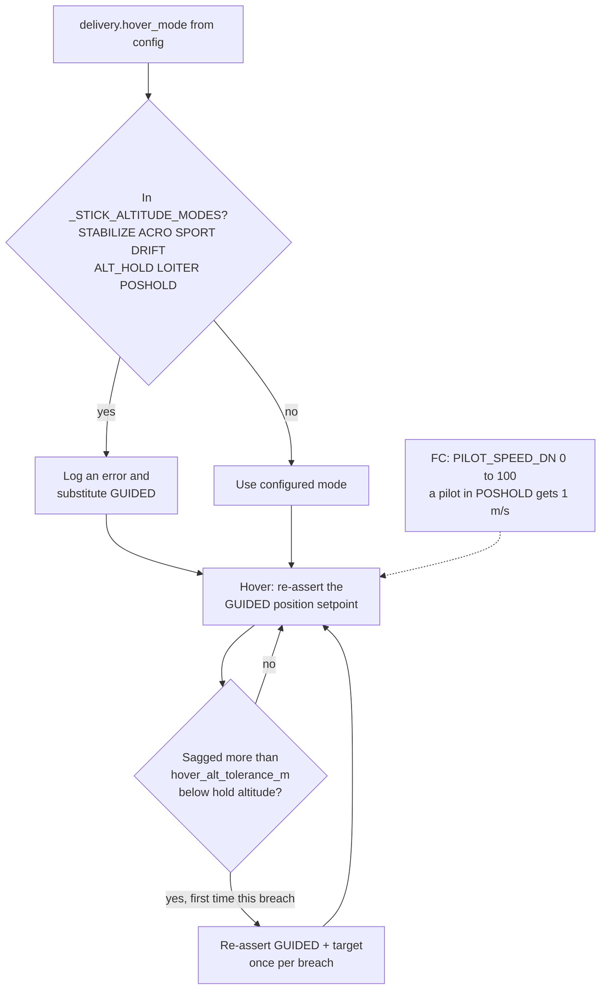

1. **Config:** `delivery.hover_mode: GUIDED` in both
   [`default.yaml`](../../config/default.yaml) and [`real.yaml`](../../config/real.yaml).
   The hold is entered by re-sending the position setpoint, not a mode change, and issues
   no further commands while it lasts.
2. **Code:** `NavigationNode._STICK_ALTITUDE_MODES` and `_safe_hover_mode` reject any
   stick-driven mode at construction and substitute GUIDED, so a config edit cannot bring
   the crash back. `_guard_hover_altitude` is the backstop: sag more than
   `hover_alt_tolerance_m` (1 m) below the hold altitude and it re-asserts GUIDED and the
   target, once per breach, so it can never become a 10 Hz setpoint spray.
3. **Flight controller:** `PILOT_SPEED_DN` set `0 → 100` with
   [`scripts/set_pilot_descent_limit.py`](../../scripts/set_pilot_descent_limit.py), so a
   *pilot* who selects POSHOLD with the throttle down gets 1 m/s, not 2.5. Autonomous
   descents are unaffected.

**Also enforced by preflight:** a stick-driven `delivery.hover_mode` is a NO-GO blocker,
and `PILOT_SPEED_DN` of 0 is a warning ("the 27 Aug hard-landing rate").

---

## 4. Rule 2: the altitude ceiling and the hardlock

**The rule.** `safety.max_altitude_m` is an absolute ceiling above the launch point. In
`real.yaml` it is **5.0 m** (operator decision, 2026-09-24; it was 4.0 earlier that day,
2.0 before that, and 3.0 before 2026-08-30). `default.yaml` keeps a 2.0 m ceiling.

Two separate mechanisms enforce it:

| Mechanism | Catches | Response |
|---|---|---|
| `NavigationNode._clamp_alt` | Any *commanded* altitude: mission, delivery order, service call, natural-language command | Clamps to `[0.5 m, ceiling]` and says on the status line which limit bit |
| `RealMavlink._clamp_mission_alt` in [`mavlink_interface.py`](../../drone_stack/interfaces/mavlink_interface.py) | Altitudes in a mission uploaded to the FC | Clamps to the ceiling and logs a warning |
| Altitude hardlock in `_check_failsafe` | An *uncommanded* climb (baro drift, EKF jump, stale FC mission) past ceiling + `altitude_margin_m` (0.7 m) | **BRAKE**, then the operator takes manual control |

The hardlock answers with BRAKE rather than an automatic descent on purpose: if the
altitude *estimate* is what went wrong, commanding "descend to the ceiling" against a bad
estimate flies the aircraft into the ground. Arresting the climb and handing over does not.

The hardlock is checked **before** the `failsafes_enabled` master switch, so it stays armed
even on the bench configuration. It is gated on the aircraft being armed: on the bench a
disarmed aircraft's barometer drifted to read 5.08 m against a 2.0 m ceiling and tripped
it 1637 times in three minutes, burying every other error in the journal.

### Why: the fall of 2026-08-22

From the docstring of [`tests/test_transmitter_authority.py`](../../tests/test_transmitter_authority.py):
the aircraft auto-took-off, the hardlock put it into BRAKE, and it held there, ignoring the
transmitter, until the pack went flat and it fell. Three defects combined:

1. `_send("brake")` never recorded the commanded mode, so the pilot-override detector
   believed "we have not commanded anything yet" and could never fire.
2. The hardlock re-sent BRAKE at about 10 Hz, dragging the aircraft out of whatever mode
   the pilot selected within 100 ms and resetting the override grace timer each time.
3. The hardlock returned before the battery checks, so `battery_critical → LAND` was
   unreachable while the hardlock was active.

The fixes, all now in [`navigation_node.py`](../../drone_stack/nodes/navigation_node.py):
battery-critical is checked **first** and is also ungated; mode re-sends are paced by
`safety.mode_resend_interval_s` (1.0 s); and the RC-channel takeover detector (next
section) no longer depends on command bookkeeping at all.

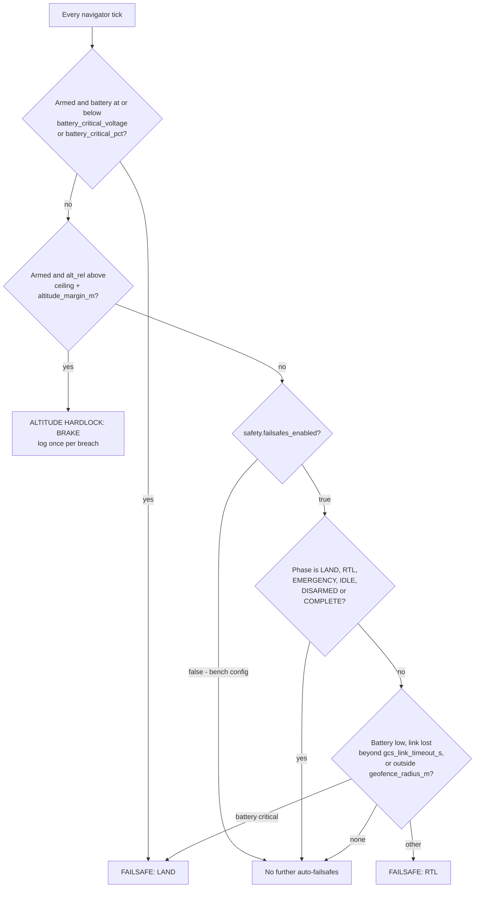

Note what this diagram shows about the current bench state: with
`failsafes_enabled: false`, only the battery-critical LAND and the altitude hardlock remain
active on the Pi. Low battery, link loss and the geofence do **not** trigger RTL.

---

## 5. Rule 3: the transmitter always wins

**The rule.** Nothing in the stack disables the RC LAND switch or motor cutoff. When the
pilot touches the transmitter, the navigator **stands down into MANUAL and stops issuing
commands**. Only an operator action on the GCS (`resume` or `start_mission`) hands control
back; it is never taken back automatically.

### Two independent detectors

`_check_pilot_override` and `_rc_takeover` in
[`navigation_node.py`](../../drone_stack/nodes/navigation_node.py):

1. **RC channels directly.** The first live frame is only a baseline. After that:
   - a **switch** channel (index `rc_stick_channels` = 4 and above) moving more than
     `rc_override_deadband_us` (60 µs) hands over on the next frame;
   - a **stick** (the first four channels: roll, pitch, throttle, yaw) counts only if held
     more than `rc_stick_deadband_us` (150 µs) off baseline for `rc_stick_hold_s` (0.5 s),
     or pushed past `rc_stick_slam_us` (400 µs), which is immediate;
   - frames older than `rc_stale_s` (3.0 s) mean "no link", not a live transmitter.
2. **Uncommanded mode change.** The FC reporting a pilot-selectable mode the navigator did
   not command, persisting longer than `pilot_override_grace_s` (1.5 s), so command lag is
   not mistaken for a takeover.

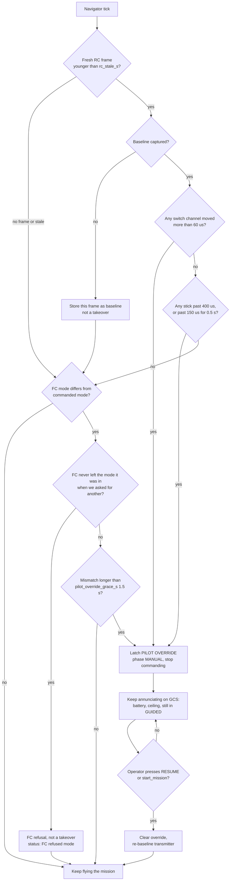

### Why each branch exists

| Branch | Incident behind it |
|---|---|
| RC detector independent of mode bookkeeping and grace timers | 2026-08-22: the BRAKE loop kept resetting the grace timer and the pilot could never take over |
| FC refusal is not a takeover | 2026-08-23, 15:39: ArduPilot rejected GUIDED on a thin fix or complaining EKF; reading it as a takeover aborted the mission and blamed a pilot who never touched it |
| Sticks debounced, switches not | 2026-10-04: two missions aborted at 1 m AGL on a yaw flick under 0.35 s (to 1168 µs, back within 0.3 s), then hovered in GUIDED where the sticks do nothing. The mode switch is the real takeover and still hands over on the next frame |
| Re-baseline on resume | Without it the next tick saw the old stick deltas and re-latched at once, so the operator could never resume (pinned in `test_transmitter_authority.py`) |
| Annunciate while MANUAL | The 2026-08-22 crash was a silent hold that ran the pack flat; standing down must not mean going quiet |

### Transmitter switches on the FC

Set and read back with [`scripts/set_rc_aux.py`](../../scripts/set_rc_aux.py):

| TX channel | Parameter | Value | Function |
|---|---|---|---|
| 6 | `RC6_OPTION` | 18 | Land (works on the ground) |
| 7 (3-position) | `RC7_OPTION` | 17 | AutoTune (only initialises when armed and flying) |
| 8 | `RC8_OPTION` | 31 | Motor emergency stop |

The motor E-stop **cuts the motors**: in the air, that is a fall. The preflight checklist
asks the team to decide its use and brief everyone present before each flight.

**Evidence tier:** the 5 m ceiling and stand-down are SIM-TESTED; a pilot takeover was seen
ON HARDWARE on 27 Sep ([evidence tiers](../../evidence/EVIDENCE_TIERS.md)).

---

## 6. Rule 4: command topics are never latched

**The rule.** The [`MessageBus`](../../drone_stack/bus/message_bus.py) is *latched*: the last
message on each topic is kept and handed to any new subscriber, so a late-joining node
immediately knows the current state. That is right for state and wrong for instructions.
Topics in `Topics.EVENT_TOPICS` ([`topics.py`](../../drone_stack/bus/topics.py)) are
**never latched**, whatever the publisher asks:

| Event topic | Carries |
|---|---|
| `MISSION_CMD` | Mission instructions |
| `MAVLINK_CMD` | `NavCommand`s to the autopilot |
| `DELIVERY_BLE_RESULT` (`/delivery/ble_result`) | Handshake outcome from the BLE peripheral |
| `BLE_PHONE` (`/delivery/ble_phone`) | Recipient RSSI and phone GPS samples |

### Why

The `Supervisor` recreates a dead node by calling its constructor again, which
re-subscribes. With latching on, a recreated `MavlinkNode` was handed the last command it
had ever seen and queued it straight to the autopilot, potentially an `arm` or `takeoff`,
spinning the props back up with nobody asking. For the delivery topics, the risk was a
recreated node replaying a previous order's "delivered" signal into a new hold, or being
handed the previous order's phone.

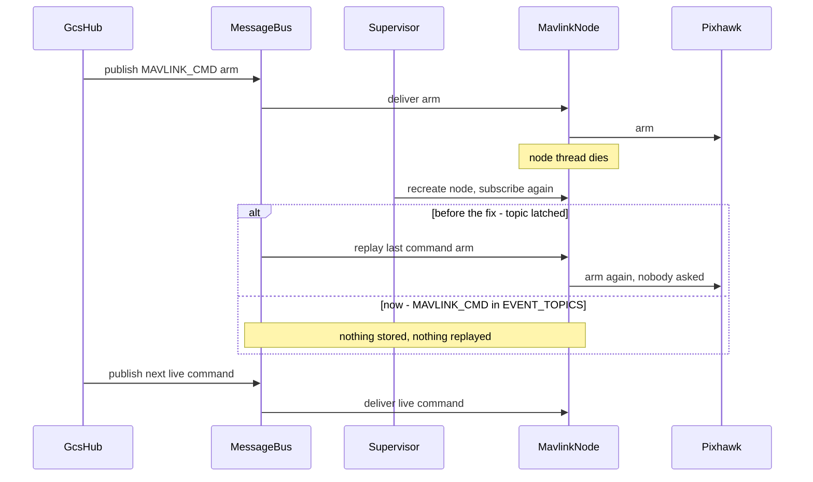

The guard is in two places, so one forgotten flag cannot reintroduce the fault:
`MessageBus.publish` refuses to latch any topic in `EVENT_TOPICS`, and `MavlinkNode`
subscribes with `deliver_latched=False`. Pinned by
`test_a_recreated_mavlink_node_does_not_replay_the_last_command` in
[`tests/test_delivery.py`](../../tests/test_delivery.py). **Any new topic carrying an
instruction belongs in `EVENT_TOPICS`.**

---

## 7. Rule 5: servo channels come only from config, inside envelopes

**The rule.** No code hardcodes a servo output. The payload release servo's channel is
`payload.out_channel`; the auxiliary (camera-tilt) servo's is `aux2_servo.out_channel`.
Every `set_servo` command is clamped to the **configured envelope for that channel**.

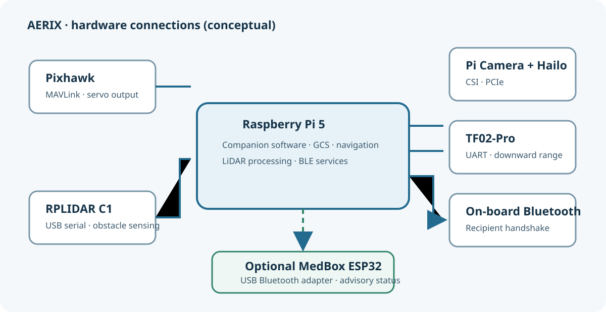

| Servo | Config block | FC output now | Envelope (`min_us`..`max_us`) | Pin history |
|---|---|---|---|---|
| MG995 payload release | `payload:` | `out_channel: 12` = AUX4 / SERVO12 | 500..2500 µs (commissioning-wide) | AUX1/SERVO9 → AUX5/SERVO13 (2026-09-06) → AUX4/SERVO12 (2026-09-11) |
| MG90S camera tilt | `aux2_servo:` | `out_channel: 14` = AUX6 / SERVO14 | 500..2500 µs (code default) | AUX2 (2026-09-05) → AUX6 (2026-09-06) |

On ArduPilot, AUX *n* is SERVO *n+8*. The block is still named `aux2_servo` for history;
its port is `out_channel` and nothing else.

### Why: three separate incidents

**2026-08-10, a broken mechanism.** Running the payload servo over its full travel bottomed
the horn on its mechanical stop and broke the release mechanism. The range was then cut to
1170..1830 µs. It is open again at 500..2500 only so the replacement MG995 (fitted
2026-08-31) can be characterised. The config says the wide range is "a commissioning tool,
not a setting to fly with"; the preflight script warns about it, and `lock_us: 1100` /
`release_us: 1410` are flagged **"re-measure for the MG995"**.

**2026-09-06, dead pins that measured perfect.** Both servos stopped at once, while every
software layer reported success: `SERVOn_FUNCTION = 0`, no GPIO or relay claiming the pins,
no digital protocol, `SERVO_RATE` 50 Hz, outputs live, `servoN_raw` tracking every command,
servo rail at 4934 mV, every `DO_SET_SERVO` ACKed. The lesson recorded in the notebook:
**`servoN_raw` tracking is not proof that a pin emits PWM.** The move to new pins was
config-only, apart from one hardcoded literal in
[`drone_ble_peripheral.py`](../../drone_stack/ble_handshake/drone_ble_peripheral.py), which
would have kept commanding the dead pin, written a delivery receipt and spent the single-use
token while the parcel never released. It now reads channel and pulse widths from the hub's
`/api/state` payload block.

**2026-09-05, one servo clamping the other.** `GcsHub._dispatch` used to clamp *every*
`set_servo` to the payload envelope. With two servos, that would have silently truncated
the second to the first's range. `GcsHub` now builds `_servo_envelopes`, a channel → envelope
map; the payload entry is inserted last so it wins on a misconfigured collision, and an
unknown channel falls back to the payload envelope (the conservative choice).

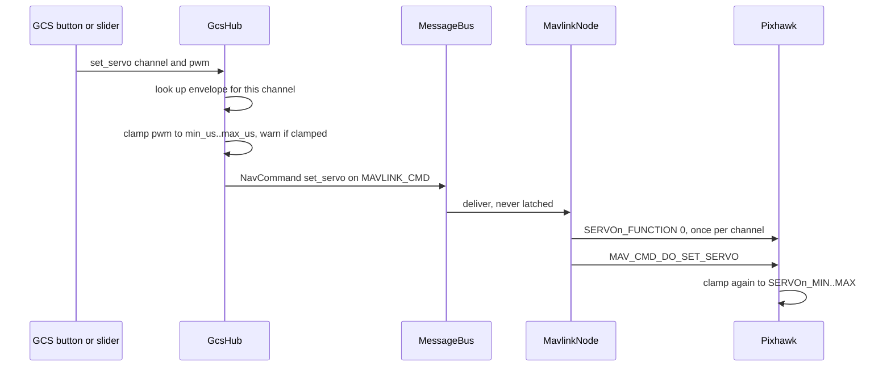

Note the last step: **ArduPilot clamps `DO_SET_SERVO` to its own `SERVOn_MIN/MAX`
regardless of what the Pi asks**, so the narrower of the two envelopes always wins silently.
For AUX4 the factory 1100..1900 µs is already wider than lock..release, so no FC-side
widening was needed there.

Diagnostic tools, in the order that actually narrowed the 2026-09-06 fault:
[`servo_diagnose.py`](../../scripts/servo_diagnose.py) → [`aux_pin_check.py`](../../scripts/aux_pin_check.py)
→ check `POWER_STATUS.Vservo`. A unit trap that cost time: an analog servo's "20" is a 20 ms
frame, i.e. 50 Hz; `SERVO_RATE = 50` is correct.

---

## 8. Rule 6: failsafes are off for bench work, so preflight says NO-GO

**The rule.** The bench state is allowed, but it must be impossible to miss on flight day.

The current settings, as found in the repository:

| Setting | Where | Value | Meaning |
|---|---|---|---|
| `safety.failsafes_enabled` | [`config/real.yaml`](../../config/real.yaml) | `false` | Pi-side low-battery, link-loss and geofence RTL are off |
| `safety.failsafes_enabled` | [`config/default.yaml`](../../config/default.yaml) | `true` | Default and sim configs keep them on |
| FC `ARMING_CHECK` | Pixhawk | historically set to 0 to get it to arm | Must be 1 before flight |
| FC `FS_GCS_ENABLE` | Pixhawk | disabled for bench work | A Pi or link death mid-flight is unrecoverable |

### Why they were turned off

On the bench, with no position estimate, the GCS kept commanding an RTL the FC refused. The
config comment records that with a 3D fix and home latched this does not happen, and says
"Set false ONLY for bench runs". The operator has kept them off on purpose; the preflight
script **does not override that decision**. It reports it. In its docstring, the point is
that "a live demo with these off invites the question you least want".

What still runs with failsafes off: the battery-critical LAND and the altitude hardlock
(both ungated, see [Rule 2](#4-rule-2-the-altitude-ceiling-and-the-hardlock)), and the
pilot-override arbitration.

> The `failsafes_enabled` comment in `real.yaml` still describes the failsafes as "ON for
> real flight" and mentions a "3 m altitude hardlock". Both describe an earlier state.
> **Trust the values** (`false`, `5.0`), not the comment text.

---

## 9. Rule 7: LiDAR filters live upstream, once

**The rule.** LiDAR noise rejection happens **once**, in the driver and `LidarNode`, so
every consumer of `/scan` sees the same filtered view. Never add a filter inside a consumer.

### Why: a fan-out asymmetry

After the noisy manual flight of 2026-08-29, a sector filter was added to
[`proximity_node.py`](../../drone_stack/nodes/proximity_node.py), but only on the branch that
feeds the flight controller. Once the Pi took over avoidance in the cruise band and on the
return leg, **the unfiltered branch became the one that steers the aircraft**.

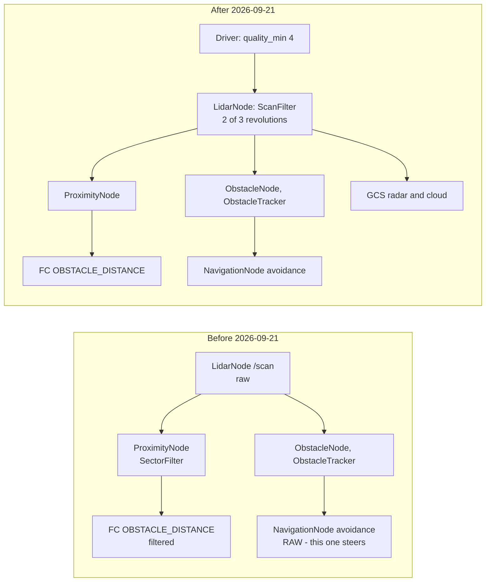

Settings (identical in `default.yaml` and `real.yaml`), each backed by a bench measurement:

| Key | Value | Why this value |
|---|---|---|
| `quality_min` | 4 | Measured knee: solid bins median quality 25, flicker bins 2. **Raising it is not safer**: at 10 the flickering-bin count climbs back to 33 because weak real returns get deleted |
| `filter_depth` / `filter_min_support` | 3 / 2 | A return survives if 2 of the last 3 revolutions corroborate it |
| `filter_angular_tol_bins` | 3 | **Load-bearing.** A turning airframe smears a 0.3 m pole at 8 m (about 2 bins wide) across 3 bins; a strict per-bin check erases the pole exactly while turning to avoid it |
| `filter_range_tol_m` | 0.30 | Stops a wall 5 m behind a speckle vouching for it |
| `filter_fast_approach` | true | A return **closer** than last revolution passes immediately; closing obstacles never wait for a vote |

The filter can only suppress, never invent or move a return nearer. Measured A/B on
identical captured samples: 0 of 165 solid bins lost, 25 of 34 flickering bins removed, at a
cost of 2.0% of returns. Pinned by 22 tests in
[`tests/test_scan_filter.py`](../../tests/test_scan_filter.py). See
[05 · Perception and avoidance](05-perception-and-avoidance.md) for the full avoidance design.

**Evidence tier:** LiDAR avoidance around the handover is SIM-TESTED plus the bench noise
A/B (21 Sep). It has not been flight-validated (experiment 7 is pending).

---

## 10. Rule 8: a service name cannot be overwritten by its payload

**The rule.** [`ServiceRegistry.call(name, /, **data)`](../../drone_stack/srv/services.py)
makes `name` **positional-only**.

### Why

The dashboard forwards arbitrary command payloads straight into `ServiceRegistry.call`. A
payload with its own `name` key (a mission name, an order name) used to collide with the
service-name argument, so the call could not be dispatched. With `name` positional-only, a
payload key called `name` simply lands in `data`. Callers are still asked to send
`mission_name`; `set_delivery_target` reads `mission_name` first and still accepts `name`
for direct callers. `call()` also never raises: a failing handler is returned as a
`ServiceResponse(False, ...)` instead of crashing the caller.

It is a small rule, but it sits on the path every operator command takes, which is why it is
on this list.

---

## 11. Other guards worth knowing

| Guard | Setting / code | Why |
|---|---|---|
| No auto-launch from a database row | `delivery.auto_accept: false` in `real.yaml`; orders already `DISPATCHED` at node start are never auto-accepted | A stale row must not launch an aircraft on boot. Preflight treats `auto_accept: true` as NO-GO |
| Order target limits | Refused beyond `max_delivery_radius_m`, at null island, or without a GPS fix | Geofence `geofence_radius_m` is 75 m in `default.yaml`; preflight warns if it is not larger than the delivery radius |
| Home latches once | First 3D fix, on the ground, disarmed | A mid-flight GPS jump cannot relocate home |
| SMART_RTL falls back to RTL | `_do_rtl` waits 3 s for the mode to take | ArduPilot refuses SMART_RTL silently with an empty path buffer |
| Handshake hold timeout | `delivery.hover_seconds: 20.0` in `real.yaml` | Hovering over a customer longer buys nothing but battery; the timeout path flies the same return as success |
| 6S battery thresholds | `battery_low_voltage: 21.6`, `battery_critical_voltage: 20.4` in `real.yaml` | Defaults were 4S (14.0 / 13.2 V); preflight warns on a 4S-looking threshold |
| Confirm dialogs | `arm` and `Release Payload` in the GCS | Never triggered casually |
| Defaults to SIM | The stack runs real hardware only when launched with `real` | Sim is the safety net |

The BLE handshake's own fail-closed gates (AUTH_FAIL, SIGNATURE_FAIL, GEOFENCE_FAIL,
NOT_READY, PILOT_OVERRIDE) are covered in
[06 · BLE handshake and security](06-ble-handshake-security.md) and
[`docs/security/THREAT_MODEL.md`](../security/THREAT_MODEL.md).

---

## 12. Preflight: the GO / NO-GO process

Preflight has two halves: a **script** for what software can read, and a **checklist** for
what it cannot (the transmitter, the site, the people).

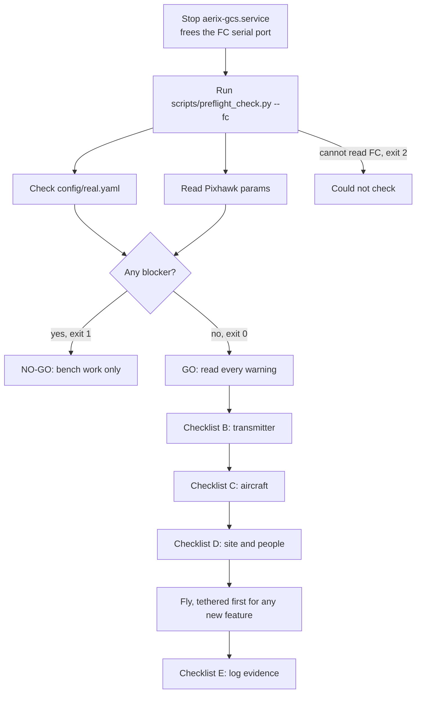

### What the script checks (read-only, changes nothing)

From [`scripts/preflight_check.py`](../../scripts/preflight_check.py), tested in
[`tests/test_preflight_check.py`](../../tests/test_preflight_check.py):

| Blocker (NO-GO) | Warning |
|---|---|
| `safety.failsafes_enabled: false` | Servo travel still at full 500..2500 µs (payload and aux), in config or on the FC |
| `delivery.hover_mode` is a stick-driven mode | Any configured altitude above the ceiling (silently clamped) |
| `delivery.auto_accept: true` | 4S-looking battery thresholds on a 6S airframe |
| FC `ARMING_CHECK` ≠ 1 | No FC-side fence (`FENCE_ENABLE` 0): only the Pi's, gone if the Pi dies |
| FC `FS_THR_ENABLE` or `FS_GCS_ENABLE` = 0 | `PILOT_SPEED_DN` 0 (the 2.5 m/s rate) or above 150 |
| FC `BATT_FS_LOW_ACT` or `BATT_FS_CRT_ACT` = 0 | STABILIZE or ACRO on any `FLTMODE1..6` |
| | `RTL_ALT` above 6 m |
| | `geofence_radius_m` not larger than `max_delivery_radius_m` |

Servo channels for the FC check come from config (`servo_channels()`), never hardcoded,
consistent with [Rule 5](#7-rule-5-servo-channels-come-only-from-config-inside-envelopes).

Exit codes: **0** GO, **1** NO-GO, **2** could not check.

### What the checklist adds

Summarised from [`docs/PREFLIGHT_CHECKLIST.md`](../PREFLIGHT_CHECKLIST.md):

| Section | Highlights |
|---|---|
| A. Software | The script above must end in GO |
| B. Transmitter | No STABILIZE/ACRO on the mode switch; throttle stick at **mid** before autonomy; RC8 E-stop and RC6 LAND tested on the ground that day; E-stop behaviour in the air decided and briefed (it is a fall) |
| C. Aircraft | 6S pack above `battery_low_voltage` + 1 V; props and rotation; LiDAR and TF02-Pro unobstructed; payload locks at `payload.lock_us` with a hand pull test; 3D fix with at least `min_satellites`, home latched at the launch point |
| D. Site and people | Open area; nobody under the path except a briefed recipient; **first flights of any new feature tethered**; recorder shows ARMED → recording |
| E. Evidence | `scripts/trial_log.py add`, copy BLE / RSSI / dataflash logs and the recording off the Pi, `scripts/verify_receipts.py` |

**Current result:** NO-GO, because `safety.failsafes_enabled` is `false` in `real.yaml`. The
checklist says so in its first paragraph: "That is intended."

---

## 13. Evidence tiers: what has actually been proven

The project's rule since the 2026-10-08 evidence review: **nothing moves from SIM-TESTED to
ON HARDWARE until a log says so.** Every claim in these docs is tagged with one of these
tiers, defined in [`evidence/EVIDENCE_TIERS.md`](../../evidence/EVIDENCE_TIERS.md).

| Tier | Means |
|---|---|
| **ON HARDWARE** | Ran on the Pi + Pixhawk (+ phone); a log or receipt on the aircraft records it |
| **BENCH-SW** | The real code driven end to end by tests, with only hardware edges stubbed |
| **SIM-TESTED** | Simulation through the real code; a model, not a flight |
| **OFFLINE** | Measured on recorded data, not live |
| **DESIGN** | Written and unit-tested at most; kept out of claims as a finished feature |

Safety-relevant claims and their tiers:

| Claim | Tier |
|---|---|
| 5 m ceiling and stand-down on pilot takeover | SIM-TESTED; a takeover seen ON HARDWARE (27 Sep) |
| LiDAR avoidance around the handover | SIM-TESTED + bench noise A/B (21 Sep) |
| Person scan + precision drop at 1 m | SIM-TESTED; deployed but unflown as of 26 Sep |
| Handshake fails closed with a named reason | ON HARDWARE (codes seen in logs) + BENCH-SW attack table |
| Phone handshake → release → receipt chain | ON HARDWARE, but the 19 receipts include bench and ground releases: it proves the chain, **not 19 deliveries** |
| Novelty layer (markerless landing zone, dual-factor auth, motion abort) | **DESIGN**: off by default, never deployed, thresholds marked `# GUESSED` |

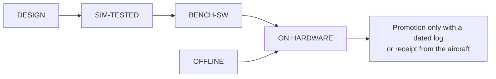

Why this matters for safety specifically: the 2026-08-25 hard landings passed in simulation.
A SIM-TESTED safety feature has shown that the logic is right against a model; it has not
shown that the aircraft behaves.

---

## 14. Lessons learned

1. **Read the flight controller's own logs before blaming anyone.** The 2026-08-25 E-stop
   looked like pilot error; the dataflash logs showed a commanded descent that had begun
   about 2 s before the pilot's first reaction.
2. **A simulator only tests what it models.** The sim had no throttle stick, so the most
   dangerous mode choice in the project passed every sim run.
3. **"Acknowledged" is not "done".** The FC ACKed every servo command and reported the
   right output values from pins that drove nothing.
4. **One source of truth per number.** By August the servo pulse widths lived in the YAML,
   the web app and the notebook, and all three disagreed. A fourth copy in the BLE
   peripheral nearly spent a delivery token without releasing a parcel.
5. **Safety loops must not starve the human.** A protective BRAKE re-sent at 10 Hz is
   indistinguishable, to the pilot, from a hijack.
6. **Order the checks by urgency.** The battery check now runs before everything else.
7. **Measure before choosing a filter, and before tuning it.** The LiDAR noise was
   occupancy flicker, not range jitter, and a stricter threshold made it worse.
8. **Write the reason next to the setting.** Every rule on this page has a comment in the
   config or code that names its incident, so the next person does not undo it.

---

## 15. Open items before any real flight

These are recorded in the notebook, the checklist or the preflight script, and are not done
as of the last recorded state of the repository:

| Item | Source |
|---|---|
| Set `safety.failsafes_enabled: true` in `real.yaml` and re-enable FC failsafes and `ARMING_CHECK = 1` | `PROJECT_NOTES.md` §7, preflight blockers |
| Replace STABILIZE on the transmitter's mode-switch positions (`FLTMODE_CH=6`) with LOITER / RTL / LAND: STABILIZE maps throttle directly to motors, so a grab with the throttle down is a free fall | `PROJECT_NOTES.md` §11, "still outstanding" |
| Re-measure `payload.lock_us` / `release_us` for the MG995, then narrow both servo envelopes (Pi and FC) around the real positions | `config/default.yaml` payload comments |
| Tethered first flights for person scan, precision drop and avoidance; pre-registered experiments 4 to 7 | `evidence/EVIDENCE_TIERS.md`, `evidence/FLIGHT_DAY_RUNSHEET.md` |
| Keep the novelty layer disabled and out of claims until flown | `evidence/EVIDENCE_TIERS.md` |

Until the preflight script reports **GO** and the checklist is complete, AERIX is a bench and
simulation system with selected hardware-verified subsystems, **not a flight-ready aircraft**.

---

<a href="07-ground-control-station.md">← Previous: Ground control station</a> |
<a href="../../README.md">Index</a> |
<a href="09-setup-deployment-testing.md">Next: Setup, deployment and testing →</a>

