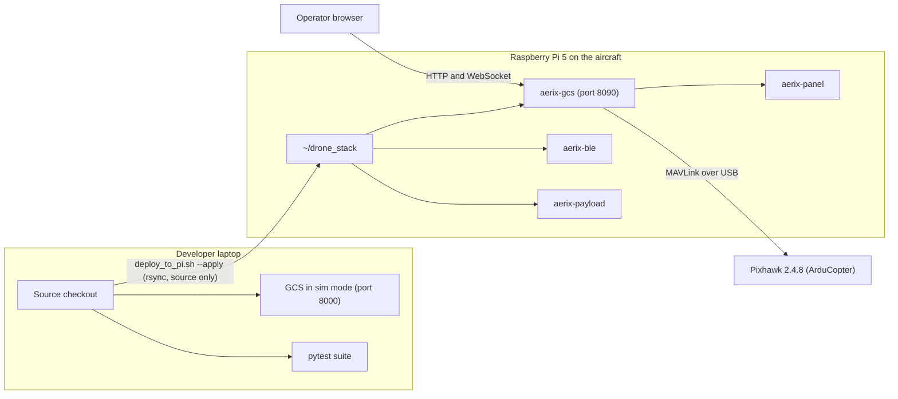
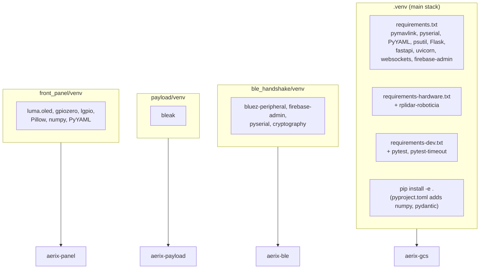
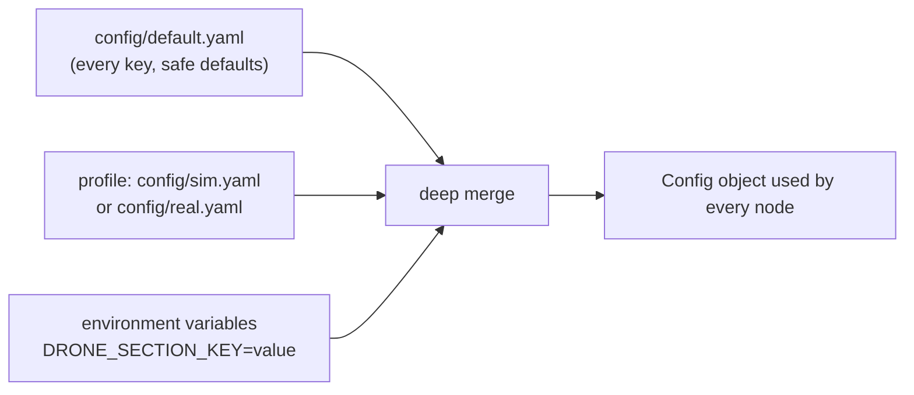
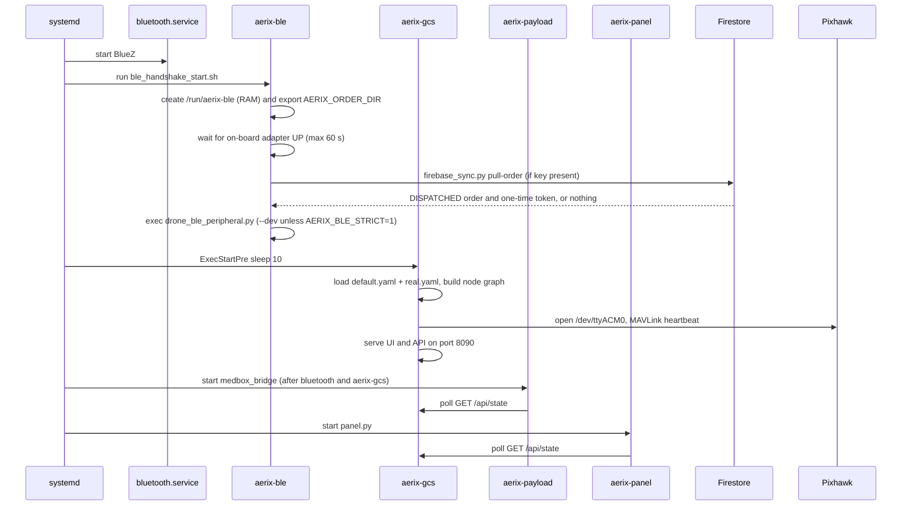
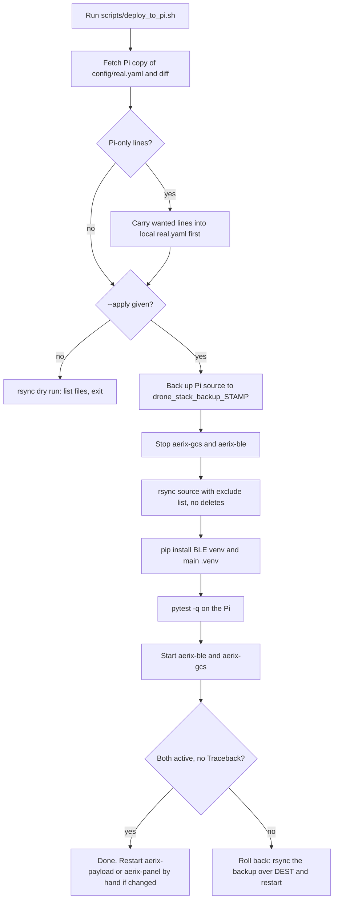
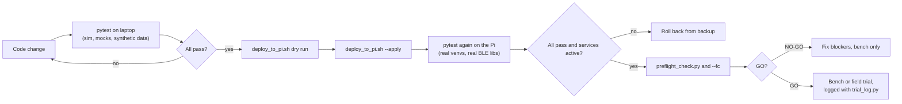
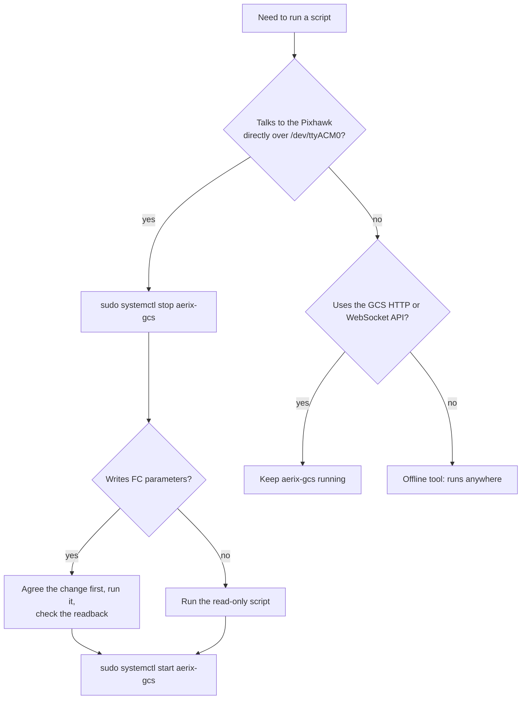

# 09 - Setup, Deployment and Testing

> How to install AERIX, run it in simulation on a laptop, run it on the
> Raspberry Pi 5 with real hardware, deploy changes safely, and run the test
> suite. Also covers the systemd services, the helper scripts, and a
> troubleshooting FAQ.

---

## Contents

1. [What and why, in plain language](#1-what-and-why-in-plain-language)
2. [Three ways to run AERIX](#2-three-ways-to-run-aerix)
3. [Prerequisites](#3-prerequisites)
4. [Installation](#4-installation)
5. [Run in simulation on a laptop](#5-run-in-simulation-on-a-laptop)
6. [Configuration layering](#6-configuration-layering)
7. [Run on the Pi with real hardware](#7-run-on-the-pi-with-real-hardware)
8. [systemd services and the boot sequence](#8-systemd-services-and-the-boot-sequence)
9. [Firebase setup](#9-firebase-setup)
10. [MedBox key setup](#10-medbox-key-setup)
11. [Deploying from a laptop to the Pi](#11-deploying-from-a-laptop-to-the-pi)
12. [The test suite](#12-the-test-suite)
13. [Scripts catalogue](#13-scripts-catalogue)
14. [Before any flight](#14-before-any-flight)
15. [Troubleshooting FAQ](#15-troubleshooting-faq)

---

## 1. What and why, in plain language

AERIX is one Python code base that runs in two places:

- **On a laptop**, in simulation. A mock Pixhawk, mock LiDAR and mock
  rangefinder stand in for the real hardware, so anyone can open the ground
  control station (GCS) in a browser, inject a delivery order and watch the
  simulated drone fly it. No drone, no Pi, no Firebase account needed.
- **On the Raspberry Pi 5 carried by the aircraft**, against real hardware.
  Here four systemd services start at boot: the GCS (which also runs the whole
  flight stack), the BLE recipient handshake, the MedBox bridge and the OLED
  front panel.

The same configuration files select which world the code lives in:
[`config/sim.yaml`](../../config/sim.yaml) or
[`config/real.yaml`](../../config/real.yaml), both layered on top of
[`config/default.yaml`](../../config/default.yaml).

Two habits matter more than any command on this page:

1. **Only one process may own the Pixhawk serial port.** Any script that talks
   to the flight controller directly needs the GCS service stopped first.
2. **Never replace the Pi's project folder wholesale.** It holds state that
   exists nowhere else (the drone's receipt-signing key, the delivery ledger,
   the Firebase key, model files). Deploy with
   [`scripts/deploy_to_pi.sh`](../../scripts/deploy_to_pi.sh), which copies
   source only.


---

## 2. Three ways to run AERIX

| Mode | Where | Command | Hardware needed | Port |
|---|---|---|---|---|
| Simulation GCS (recommended for development) | Laptop or Pi | `python -m drone_stack.gcs.server --config config/sim.yaml --port 8000` | None | 8000 |
| Headless simulation stack | Laptop or Pi | `scripts/run_sim.sh` | None | legacy dashboard on `web.port` (8090) |
| Real aircraft | Pi 5 only | `aerix-gcs.service` (or `scripts/start_gcs.sh real`) | Pixhawk, RPLIDAR C1, TF02-Pro, camera | 8090 |

The **GCS server** ([`drone_stack/gcs/server.py`](../../drone_stack/gcs/server.py))
is the main entry point in every mode. It builds the full node graph through
[`launch/bringup.py`](../../drone_stack/launch/bringup.py) with the legacy web
node switched off, and serves the FastAPI + WebSocket operator UI on top.
`scripts/run_sim.sh` and `scripts/run_real.sh` start the node graph through
`bringup` directly, with the older Flask dashboard instead of the GCS.



---

## 3. Prerequisites

| Item | Laptop (simulation) | Raspberry Pi 5 (aircraft) |
|---|---|---|
| OS | Linux or macOS | Raspberry Pi OS 64-bit (Debian 12 "bookworm") |
| Python | 3.11 or newer (`requires-python = ">=3.11"` in [`pyproject.toml`](../../pyproject.toml)) | 3.11 (ships with the OS) |
| System packages | `python3-venv` | `python3-venv`, `python3-pip`, BlueZ (`bluetooth.service`), `fonts-quicksand` for the panel |
| Serial access | not needed | user in the `dialout` group |
| Optional | `rsync` + SSH access to the Pi for deploying | Hailo-8 runtime and Picamera2 for the camera / person lock |
| MedBox firmware | PlatformIO (to build and flash the ESP32) | not needed |

```bash
# On the Pi
sudo apt update
sudo apt install -y python3-venv python3-pip
sudo usermod -aG dialout "$USER"     # log out and in again afterwards
```

The camera (Picamera2), OpenCV and the Hailo runtime (`hailo_platform`) are
imported lazily inside
[`gcs/cameras.py`](../../drone_stack/gcs/cameras.py) and
[`gcs/hailo_infer.py`](../../drone_stack/gcs/hailo_infer.py). On a laptop they
are simply absent: the GCS logs a warning and runs without camera features.

---

## 4. Installation

AERIX uses **four separate virtual environments on the Pi**, on purpose. Each
service has its own dependencies, and a broken upgrade in one cannot take down
another.

| Venv | Path (relative to `~/drone_stack` unless noted) | Installed from | Used by |
|---|---|---|---|
| Main stack | `.venv/` | [`requirements.txt`](../../requirements.txt), [`requirements-hardware.txt`](../../requirements-hardware.txt), [`requirements-dev.txt`](../../requirements-dev.txt), `pip install -e .` | GCS, flight stack, tests, scripts |
| BLE handshake | `drone_stack/ble_handshake/venv/` | [`drone_stack/ble_handshake/requirements.txt`](../../drone_stack/ble_handshake/requirements.txt) | `aerix-ble` |
| MedBox bridge | `drone_stack/payload/venv/` | `pip install bleak` (see the header of [`scripts/aerix-payload.service`](../../scripts/aerix-payload.service)) | `aerix-payload` |
| Front panel | `~/front_panel/venv/` (outside the repo checkout) | the imports at the top of [`front_panel/panel.py`](../../front_panel/panel.py) | `aerix-panel` |



### 4.1 Main stack (laptop and Pi)

```bash
git clone <this-repo> drone_stack
cd drone_stack
python3 -m venv .venv
source .venv/bin/activate

# Laptop / simulation / development
pip install -r requirements-dev.txt
pip install -e .

# Pi with real hardware (adds the RPLIDAR driver)
pip install -r requirements-hardware.txt
pip install -e .
```

`pip install -e .` installs the `drone_stack` package and two console
commands defined in [`pyproject.toml`](../../pyproject.toml):

| Command | Equivalent |
|---|---|
| `drone-stack` | `python -m drone_stack.launch.bringup` |
| `drone-gcs` | `python -m drone_stack.gcs.server` |

[`setup.py`](../../setup.py) and [`setup.cfg`](../../setup.cfg) are thin
compatibility shims; `pyproject.toml` is the source of truth.

`firebase-admin` is in `requirements.txt` but optional at runtime: without a
service-account key the delivery node reports its link as `no-credentials` and
the file and inject order sources keep working.

### 4.2 BLE handshake venv (Pi only)

```bash
cd ~/drone_stack/drone_stack/ble_handshake
python3 -m venv venv
venv/bin/pip install -r requirements.txt
```

This venv is the one [`scripts/ble_handshake_start.sh`](../../scripts/ble_handshake_start.sh)
uses (`BLE_DIR/venv/bin/python`). `cryptography>=42` provides the Ed25519
signed delivery ledger ([`receipt_ledger.py`](../../drone_stack/ble_handshake/receipt_ledger.py)).

### 4.3 MedBox bridge venv (Pi only)

```bash
cd ~/drone_stack
python3 -m venv drone_stack/payload/venv
drone_stack/payload/venv/bin/pip install bleak
```

### 4.4 Front panel venv (Pi only)

The panel runs from `~/front_panel/` on the Pi, with its own `venv/`. Its
dependencies are exactly the third-party imports in `panel.py`: `lgpio`,
`gpiozero`, `luma.oled`, `Pillow`, `numpy` and `PyYAML`. The Quicksand font
comes from `apt install fonts-quicksand`.

### 4.5 MedBox firmware (laptop)

The ESP32 firmware in [`addons/medbox/firmware/`](../../addons/medbox/firmware/)
is a PlatformIO project (`[env:esp32dev]` in
[`platformio.ini`](../../addons/medbox/firmware/platformio.ini)). Build, key
and flashing steps are in the [MedBox add-on guide](../../addons/medbox/README.md).

---

## 5. Run in simulation on a laptop

### 5.1 Start the simulation GCS

```bash
source .venv/bin/activate
python -m drone_stack.gcs.server --config config/sim.yaml --port 8000
# or, equivalently (sim.yaml and port 8000 are the defaults):
scripts/run_gcs.sh
```

Open **http://localhost:8000**. [`scripts/run_gcs.sh`](../../scripts/run_gcs.sh)
takes an optional profile path as its first argument and honours `GCS_PORT`.

`server.py` picks its port from `--port`, else the `GCS_PORT` environment
variable, else **8000**. It also honours `MAVLINK_PORT` and `LIDAR_PORT` to
override the serial devices without editing a file.

What `config/sim.yaml` switches on:

| Setting | Value | Effect |
|---|---|---|
| `mode` | `sim` | mock Pixhawk, mock LiDAR, simulated world ([`drone_stack/sim/`](../../drone_stack/sim/)) |
| `delivery.source` | `file` | orders come from `config/pending_order.json`, not Firestore |
| `delivery.auto_accept` | `true` | injected orders are accepted and flown without an operator |
| `delivery.upload_to_fc`, `write_back` | `false` | nothing is written to an FC or to Firebase |
| `delivery.max_delivery_radius_m` | `500.0` | wider than on the aircraft |
| `rangefinder.enabled` | `true` | mock TF02-Pro, so the AGL readout works (the precision drop itself stays off) |

### 5.2 Inject a test order

[`scripts/inject_order.py`](../../scripts/inject_order.py) calls the same
`delivery_inject` service the GCS "Test order" button uses. Its default URL is
`http://127.0.0.1:8090`, so on a laptop GCS point it at port 8000:

```bash
# 40 m north of the simulated drone, hold, then come home
scripts/inject_order.py --url http://127.0.0.1:8000 --north 40

# accept and fly immediately (simulation only)
scripts/inject_order.py --url http://127.0.0.1:8000 --north 40 --auto

# or write config/pending_order.json for the file-backed source
scripts/inject_order.py --north 40 --to-file
```

Without `--auto` the order shows as PENDING in the GCS and waits for the
operator to accept it.

### 5.3 Headless stack

```bash
scripts/run_sim.sh        # python -m drone_stack.launch.bringup --config config/sim.yaml
```

This starts every node plus the older Flask dashboard on `web.port` (8090 in
`sim.yaml`), and stops cleanly on `Ctrl-C` (SIGINT and SIGTERM are handled in
`bringup.main`). [`scripts/dronectl.py`](../../scripts/dronectl.py) is a
standard-library CLI for it (`start_mission`, `hold`, `rtl`,
`emergency_stop`, `--list`).

---

## 6. Configuration layering

[`drone_stack/utils/config.py`](../../drone_stack/utils/config.py) builds the
configuration in three layers. Later layers win.



Useful environment overrides:

| Variable | Overrides | Read by |
|---|---|---|
| `DRONE_<SECTION>_<KEY>` | any config key | `Config.load()` |
| `GCS_PORT` | HTTP port | `gcs/server.py`, `start_gcs.sh`, `run_gcs.sh` |
| `MAVLINK_PORT` | `mavlink.connection` | `gcs/server.py` |
| `LIDAR_PORT` | `lidar.port` | `gcs/server.py` |

Full key reference: [docs/CONFIGURATION.md](../CONFIGURATION.md).

---

## 7. Run on the Pi with real hardware

### 7.1 Serial devices

`config/real.yaml` pins the devices:

| Device | Key | Value in `real.yaml` |
|---|---|---|
| Pixhawk 2.4.8 (USB) | `mavlink.connection` | `/dev/ttyACM0` |
| RPLIDAR C1 (USB, CP2102N bridge) | `lidar.port` | a `/dev/serial/by-id/usb-Silicon_Labs_CP2102N_...` path |
| TF02-Pro rangefinder (Pi UART) | `rangefinder.port` | `/dev/ttyAMA0` |
| GCS web UI | `web.port` | `8090` |

Prefer `/dev/serial/by-id/...` names: they survive re-plugging in a different
order. To find them:

```bash
ls -l /dev/serial/by-id/
dmesg | grep -Ei 'ttyACM|ttyUSB'
```

### 7.2 Starting the GCS by hand

On the aircraft the GCS normally runs as `aerix-gcs.service` (next section).
For bench work there are two manual launchers:

| Script | Behaviour |
|---|---|
| [`scripts/start_gcs.sh`](../../scripts/start_gcs.sh) `[sim\|real]` | Detached. Kills any previous `gcs.server`, waits for the port to free, then starts `.venv/bin/python -m drone_stack.gcs.server --config config/<mode>.yaml` with `GCS_PORT` defaulting to **8090**. Output goes to `logs/gcs.out`. |
| [`scripts/run_gcs.sh`](../../scripts/run_gcs.sh) `[profile]` | Foreground, port 8000 unless `GCS_PORT` is set. |
| [`scripts/run_real.sh`](../../scripts/run_real.sh) | Headless node graph with `config/real.yaml` (no GCS UI). |

> **Never run a manual launcher while `aerix-gcs` is active.** Two processes
> would fight over `/dev/ttyACM0`, the LiDAR, the camera and port 8090. Stop
> the service first: `sudo systemctl stop aerix-gcs`.

Python changes need a restart of the GCS
(`sudo systemctl restart aerix-gcs`). Files under `gcs/static/` are served from
disk on every request, so front-end edits show without a restart.

---

## 8. systemd services and the boot sequence

Four units live in `/etc/systemd/system/` on the Pi. Only
[`scripts/aerix-payload.service`](../../scripts/aerix-payload.service) is kept
in this repository; the other three are described from the project notes
([docs/PROJECT_NOTES.md](../PROJECT_NOTES.md), section 4).

| Unit | Starts | Runs as | Owns | Restart |
|---|---|---|---|---|
| `aerix-gcs` | `.venv/bin/python -m drone_stack.gcs.server --config config/real.yaml`, `GCS_PORT=8090`, after `ExecStartPre=/bin/sleep 10` | `pi` | Pixhawk `/dev/ttyACM0`, LiDAR, TF02 UART, camera, Hailo NPU, port 8090 | `on-failure` |
| `aerix-ble` | [`scripts/ble_handshake_start.sh`](../../scripts/ble_handshake_start.sh) then `drone_ble_peripheral.py` from the BLE venv | `root` | on-board Bluetooth controller, `/run/aerix-ble` | `always` |
| `aerix-payload` | `drone_stack/payload/venv/bin/python -m drone_stack.payload.medbox_bridge`, `Nice=5` | `pi` | USB Bluetooth dongle only | `always`, `RestartSec=5` |
| `aerix-panel` | `~/front_panel/venv` running `panel.py` | `pi` | OLED (I2C), three buttons, buzzer | (on-Pi unit) |

Why the waits:

- `aerix-gcs` sleeps 10 s so the Pixhawk and RPLIDAR USB devices finish
  enumerating before the server opens them.
- `aerix-ble` waits up to 60 s (30 checks, 2 s apart) for the **on-board**
  Bluetooth controller specifically. The USB dongle belongs to the MedBox
  bridge, and adapter numbers (`hci0`, `hci1`) can swap between boots, so the
  script identifies adapters by their sysfs bus path, not by number.
- `aerix-payload` is ordered `After=bluetooth.service aerix-gcs.service`
  because it polls the GCS `/api/state` to learn whether the payload kind is
  `medbox`. It stays off the air otherwise.

### 8.1 Boot sequence



On `--dev`: it is a fallback, not an override. The peripheral uses the pulled
order whenever a fresh one exists and only falls back to a bench token when
there is none. Setting `AERIX_BLE_STRICT=1` in the unit removes the fallback,
so the peripheral refuses to advertise without a genuine order. Details in
[06 - BLE handshake security](06-ble-handshake-security.md).

### 8.2 Day-to-day commands

```bash
systemctl status aerix-gcs aerix-ble aerix-payload aerix-panel --no-pager
sudo systemctl restart aerix-gcs
journalctl -u aerix-gcs -f            # live log, includes FC STATUSTEXT
journalctl -u aerix-ble -n 40
```

| Log | Where |
|---|---|
| Service output | `journalctl -u aerix-<name>` (needs `sudo` for user `pi`) |
| Manual GCS launch | `logs/gcs.out` |
| BLE peripheral | `logs/ble/ble-YYYYMMDD.log` |
| Phone RSSI samples | `logs/rssi/` |

All of `logs/` and `recordings/` are git-ignored.

### 8.3 Installing the MedBox unit

```bash
sudo cp scripts/aerix-payload.service /etc/systemd/system/
sudo systemctl daemon-reload
sudo systemctl enable --now aerix-payload
```

`WorkingDirectory=/home/pi/drone_stack` is required: the bridge's `--key`
default is the relative path `config/medbox_key.txt`.

---

## 9. Firebase setup

Live orders from the phone app arrive through Firebase Firestore. The Pi needs
a **service-account key** to read them, and that key can only be generated in
the Firebase console.

1. Firebase console, your project, Project settings, Service accounts,
   "Generate new private key". A JSON file downloads.
2. Copy it to the Pi and install it:

   ```bash
   scripts/firebase_setup.py ~/path/to/downloaded-key.json
   ```

   [`scripts/firebase_setup.py`](../../scripts/firebase_setup.py) checks the
   file really is a service-account key (fields `type`, `project_id`,
   `private_key`, `client_email`; a `google-services.json` app config is the
   usual mistake), checks the project ID, installs it at
   `config/firebase-service-account.json` with `0600` permissions, and does a
   live read of the orders collection.
3. Check the link at any time:

   ```bash
   scripts/firebase_setup.py --check
   ```

No restart is needed: the delivery node retries every poll and the GCS
delivery panel turns green on its own.

> **Secret handling.** `config/firebase-service-account.json` (and any
> `config/*service-account*.json`) is git-ignored and excluded by the deploy
> script. Never commit it. The BLE service reads the same file to pull
> per-order tokens.

---

## 10. MedBox key setup

The drone and the MedBox share a 32-byte HMAC key for signed commands.

| Side | Secret file (git-ignored) | Template in the repo |
|---|---|---|
| ESP32 firmware | `addons/medbox/firmware/include/medbox_secret.h` | [`medbox_secret.h.example`](../../addons/medbox/firmware/include/medbox_secret.h.example) |
| Pi bridge | `config/medbox_key.txt` | [`config/medbox_key.txt.example`](../../config/medbox_key.txt.example) |

Generate one key (`openssl rand -hex 32`), put the same 64 hex characters in
both files, and keep them out of version control. Without the key the bridge
still runs in telemetry-only mode and reports `no_key`. Full procedure:
[MedBox add-on](../../addons/medbox/README.md).

---

## 11. Deploying from a laptop to the Pi

[`scripts/deploy_to_pi.sh`](../../scripts/deploy_to_pi.sh) copies the laptop
checkout onto `~/drone_stack` on the Pi. It is built around one rule: **copy
source, never delete on the Pi, back up what gets overwritten.**

| Variable | Default | Meaning |
|---|---|---|
| `PI` | `pi@pi.local` | SSH target |
| `DEST` | `/home/pi/drone_stack` | project folder on the Pi |

### 11.1 Dry run vs `--apply`

| Step | Dry run (`scripts/deploy_to_pi.sh`) | `--apply` |
|---|---|---|
| Diff the Pi's `config/real.yaml` against yours and report Pi-only lines | yes | yes |
| List files that would be copied (`rsync -avn --checksum`) | yes | no |
| Back up the Pi's source to `~/drone_stack_backup_<timestamp>` | no | yes |
| Stop `aerix-gcs` and `aerix-ble` | no | yes |
| Copy with `rsync -av --checksum` (no `--delete`) | no | yes |
| `pip install` into the BLE venv and the main `.venv` | no | yes |
| Run `pytest -q` on the Pi | no | yes |
| Start `aerix-ble` and `aerix-gcs`, wait 15 s, show status and BLE log lines | no | yes |



### 11.2 What is never sent and never deleted

| Category | Excluded paths |
|---|---|
| Version control and caches | `.git/`, `__pycache__/`, `*.pyc`, `.pytest_cache/` |
| Virtual environments | `.venv/`, `venv/`, `drone_stack/ble_handshake/venv/` |
| Model weights | `models/*.hef`, `person_detect/*.hef` |
| Firebase secrets and state | `config/firebase-service-account.json`, `config/pending_order.json` |
| Delivery identity and ledger | `drone_stack/ble_handshake/keys/`, `drone_stack/ble_handshake/receipts/`, `drone_stack/ble_handshake/active_order*.json` |
| Runtime output | `logs/`, `recordings/`, `hailort.log` |
| Local scratch and backups | editor snapshot patterns (`*.predeploy_*`, `*.preyaw_*`, `*.bw_*` and similar), `err.txt`, local tooling folders |

Losing `ble_handshake/keys/` (the drone's Ed25519 receipt-signing key) or
`receipts/` (the hash-chained ledger) is unrecoverable, which is why the
script never uses `rsync --delete`.

### 11.3 After a deploy

- The script restarts only `aerix-gcs` and `aerix-ble`. If you changed
  `drone_stack/payload/` or the panel, restart those by hand:
  `sudo systemctl restart aerix-payload aerix-panel`.
- Rollback, as printed by the script:
  `ssh <pi> 'rsync -a ~/drone_stack_backup_<stamp>/ /home/pi/drone_stack/'`,
  then restart the services.
- Ledger housekeeping after a security-relevant deploy is listed in
  [docs/DEPLOY_2026-10-08.md](../DEPLOY_2026-10-08.md), section 2
  (`verify_receipts.py reconcile`, `scrub_receipt_tokens.py`).

---

## 12. The test suite

The suite is plain **pytest** (`pytest>=8.0`, `pytest-timeout>=2.2`).
[`pyproject.toml`](../../pyproject.toml) sets `testpaths = ["tests"]`, a
**60 s per-test timeout** and `-ra` (summary of skips and failures). Everything
is hardware-free: the simulator, fake detectors and synthetic frames stand in
for the Pixhawk, LiDAR, camera and NPU.

```bash
source .venv/bin/activate
pytest                                   # whole suite
pytest -q tests/test_precision_drop.py   # one file
pytest -q -k avoidance                   # by keyword
pytest -q tests/novelty                  # design-tier novelty layer only
```

On the Pi, run it from the main venv: `.venv/bin/python -m pytest -q`. The
last recorded full run in the project notes is **1147 passed** (Python 3.11,
2026-10-08, inside a stand-in deployed copy;
[docs/DEPLOY_2026-10-08.md](../DEPLOY_2026-10-08.md)). Quote a pass count only
together with its date.

### 12.1 Test flow



### 12.2 Test files by subsystem

59 top-level `tests/test_*.py` files plus 9 in `tests/novelty/`.
`tests/hitl/` is an empty placeholder package for future hardware-in-the-loop
tests.

| Subsystem | Files | Test files |
|---|---|---|
| Message bus, config, bring-up, simulator | 6 | `test_bus`, `test_messages_config_geometry`, `test_bringup`, `test_integration_sim`, `test_sim_world`, `test_sim_yaw_frame` |
| Navigation, RTL and flight-mode logic | 9 | `test_navigation`, `test_altitude_relative`, `test_transmitter_authority`, `test_yaw_gate`, `test_rtl_about_face`, `test_rtl_landing`, `test_rtl_pi_return`, `test_rtl_yaw`, `test_nl` |
| LiDAR perception, fusion and avoidance | 14 | `test_lidar_fov`, `test_lidar_handedness`, `test_scan_filter`, `test_obstacles`, `test_proximity`, `test_fusion`, `test_sector_avoidance`, `test_vfh_avoidance`, `test_smooth_avoidance`, `test_dynamic_avoidance`, `test_long_range_avoidance`, `test_waypoint_avoidance`, `test_avoidance_every_phase`, `test_avoidance_recovery` |
| Delivery mission, person scan, precision drop | 9 | `test_delivery`, `test_delivery_outcome`, `test_precision_drop`, `test_rangefinder`, `test_person_scan`, `test_person_lock_stab`, `test_probe_planner`, `test_phone_pick_config`, `test_fit_radio_model` |
| BLE handshake, ledger and security | 7 | `test_ble_session`, `test_ble_ground_release`, `test_ble_release_ledger`, `test_attack_table`, `test_order_store`, `test_receipt_ledger`, `test_protocol_vectors` |
| MedBox payload | 1 | `test_medbox` |
| GCS, WebSocket, camera, video and recording | 11 | `test_gcs`, `test_ws_flow`, `test_link_delay`, `test_adaptive_bitrate`, `test_camera_filter`, `test_camera_tilt`, `test_rs_stabilizer`, `test_flight_end`, `test_replay_durability`, `test_replay_latest_flight`, `test_recordings_isolated` |
| Operations tooling and evidence | 2 | `test_preflight_check`, `test_trial_log` |
| Novelty layer (design tier, disabled) | 9 | `tests/novelty/`: `test_adapters`, `test_config`, `test_delivery_node_integration`, `test_evidence_logger`, `test_landing_zone`, `test_mission_fsm`, `test_model_registry`, `test_motion_monitor`, `test_recipient_auth` |

Many files are **regression tests named after a real incident**. For example
[`test_transmitter_authority.py`](../../tests/test_transmitter_authority.py)
pins the fix for the 2026-08-22 flight in which the aircraft ignored the
transmitter, and [`test_attack_table.py`](../../tests/test_attack_table.py)
holds one test per row of the
[threat model](../security/THREAT_MODEL.md). See
[08 - Safety](08-safety.md) for the incidents themselves.

Passing tests show the logic is right in simulation. They are not flight
evidence; what has actually flown is graded in
[evidence/EVIDENCE_TIERS.md](../../evidence/EVIDENCE_TIERS.md).

### 12.3 Optional dependencies and skips

Some tests call `pytest.importorskip` and are **skipped, not failed**, when a
library is missing:

| Library | Tests that need it | Where it is installed |
|---|---|---|
| `bluez_peripheral` | `test_attack_table`, `test_ble_session`, `test_ble_ground_release`, `test_ble_release_ledger`, part of `test_order_store` | BLE venv / Linux with BlueZ |
| `cryptography` | `test_attack_table`, `test_ble_release_ledger`, `test_order_store` | BLE venv |
| `cv2` (OpenCV) | parts of `test_flight_end`, `test_person_lock_stab` | Pi image |

On a laptop, check the `-ra` summary at the end of the run to see which were
skipped.

### 12.4 Tests never touch the aircraft's live data

[`tests/conftest.py`](../../tests/conftest.py) has autouse fixtures that
redirect the recordings directory and the delivery ledger and key to temporary
folders through `DRONE_<SECTION>_<KEY>` overrides. This exists because a test
run on the Pi once interfered with a live recording render. It is enforced by
[`test_recordings_isolated.py`](../../tests/test_recordings_isolated.py), so
running `pytest` on the aircraft is safe.

### 12.5 Formal protocol models

[`scripts/verify_protocol.sh`](../../scripts/verify_protocol.sh) re-runs the
Verifpal models of the BLE handshake in `docs/security/` and saves dated
results in `docs/security/verifpal_results/`. `PROVERIF=1` also runs the
ProVerif model. These are design-level checks of the protocol, not of the
running code.

---

## 13. Scripts catalogue

All scripts live in [`scripts/`](../../scripts/). The key question for each
one is **who owns the serial port while it runs**.



### 13.1 FC parameter writers (GCS must be stopped)

Each one reads back what it wrote.

| Script | What it sets |
|---|---|
| [`set_rc_aux.py`](../../scripts/set_rc_aux.py) | RC aux switch functions `RC6_OPTION`, `RC7_OPTION`, `RC8_OPTION` |
| [`clear_rc7_autotune.py`](../../scripts/clear_rc7_autotune.py) | `RC7_OPTION=0`, freeing transmitter channel 7 for the payload toggle |
| [`set_mode_switch_ch9.py`](../../scripts/set_mode_switch_ch9.py) | `FLTMODE_CH=9` with Stabilize / PosHold / SmartRTL on the 3-position switch |
| [`set_pilot_descent_limit.py`](../../scripts/set_pilot_descent_limit.py) | caps stick-commanded descent speed (backstop for the 2026-08-25 hard landings) |
| [`set_rtl_alt.py`](../../scripts/set_rtl_alt.py) | brings `RTL_ALT` under the project altitude ceiling |
| [`set_servo_travel.py`](../../scripts/set_servo_travel.py) `--ch N` | widens `SERVO<n>_MIN/MAX` for a servo channel |
| [`set_wp_yaw_behavior.py`](../../scripts/set_wp_yaw_behavior.py) | `WP_YAW_BEHAVIOR=1` (face next waypoint, RTL included) |
| [`set_avoidance_params.py`](../../scripts/set_avoidance_params.py) | ArduPilot path-planning avoidance (`OA_*`, `AVOID_*`) for AUTO, GUIDED and RTL |
| [`pidtune.py`](../../scripts/pidtune.py) / [`pid_restore.py`](../../scripts/pid_restore.py) | PID tune, with a `logs/pid_backup_<ts>.param` backup and a one-command restore |

### 13.2 Read-only FC diagnostics (GCS must be stopped)

| Script | Purpose |
|---|---|
| [`preflight_check.py`](../../scripts/preflight_check.py) `--fc` | GO / NO-GO including the Pixhawk's own parameters |
| [`read_safety_params.py`](../../scripts/read_safety_params.py) | audit of FC-side safety parameters (RTL climb, fence, battery failsafes) |
| [`read_mode_params.py`](../../scripts/read_mode_params.py) | flight-mode selection parameters |
| [`read_rtl_land_params.py`](../../scripts/read_rtl_land_params.py) | avoidance, yaw, RTL and land parameters |
| [`aux_pin_check.py`](../../scripts/aux_pin_check.py) | is a relay or other function claiming an AUX pin |
| [`servo_diagnose.py`](../../scripts/servo_diagnose.py) `<ch>` | why a servo ignores commands (read-only except test pulses) |
| [`rc_monitor.py`](../../scripts/rc_monitor.py) | live RC channel 7 and 9 values with min/max |
| [`test_tf02_pro.py`](../../scripts/test_tf02_pro.py) | raw TF02-Pro frame reader (the GCS owns that UART too) |

### 13.3 Tools that use the running GCS (keep it running)

| Script | Purpose |
|---|---|
| [`dronectl.py`](../../scripts/dronectl.py) | tiny CLI over the HTTP API (default `http://127.0.0.1:8090`) |
| [`inject_order.py`](../../scripts/inject_order.py) | inject a test delivery order through `delivery_inject` |
| [`servo_calibrate.py`](../../scripts/servo_calibrate.py) | interactive, step-by-step servo limit finding through the GCS API |
| [`lidar_orientation_check.py`](../../scripts/lidar_orientation_check.py) | physical left/right check of the LiDAR from the `/ws` feed |
| [`camera_latency.py`](../../scripts/camera_latency.py) | where camera lag comes from, stage by stage |
| [`link_probe.py`](../../scripts/link_probe.py) | telemetry cadence and button latency, run from the operator laptop |
| [`watch_mode_ws.py`](../../scripts/watch_mode_ws.py) | prints flight-mode changes from `/ws` |

### 13.4 Offline, setup and evidence tools

| Script | Purpose |
|---|---|
| [`preflight_check.py`](../../scripts/preflight_check.py) | config-only GO / NO-GO; exit 0 = GO, 1 = NO-GO, 2 = could not check |
| [`firebase_setup.py`](../../scripts/firebase_setup.py) | install and verify the Firestore service-account key |
| [`verify_receipts.py`](../../scripts/verify_receipts.py) | read-only audit of the signed delivery ledger (`reconcile` mode) |
| [`scrub_receipt_tokens.py`](../../scripts/scrub_receipt_tokens.py) | replace raw tokens in pre-ledger files with a one-way commitment (dry run, then `--apply`) |
| [`token_capture_check.py`](../../scripts/token_capture_check.py) | search an SD-card image or folder for a token (evidence experiment 2) |
| [`trial_log.py`](../../scripts/trial_log.py) | log trials against pre-registered pass lines in `evidence/protocol.yaml` |
| [`sim_phone_pick.py`](../../scripts/sim_phone_pick.py) | Monte Carlo of phone-holder picking through the real locator code |
| [`fit_radio_model.py`](../../scripts/fit_radio_model.py) | fit the phone RSSI radio model to logged flights |
| [`apply_camera_filter.py`](../../scripts/apply_camera_filter.py) | idempotent in-place patch of the camera filter (`--check` first) |
| [`verify_protocol.sh`](../../scripts/verify_protocol.sh) | Verifpal / ProVerif models of the BLE handshake |
| [`deploy_to_pi.sh`](../../scripts/deploy_to_pi.sh) | safe laptop-to-Pi deploy (section 11) |
| [`run_sim.sh`](../../scripts/run_sim.sh), [`run_real.sh`](../../scripts/run_real.sh), [`run_gcs.sh`](../../scripts/run_gcs.sh), [`start_gcs.sh`](../../scripts/start_gcs.sh) | launchers (sections 5 and 7) |
| [`ble_handshake_start.sh`](../../scripts/ble_handshake_start.sh), [`aerix-payload.service`](../../scripts/aerix-payload.service) | service entry point and unit file (section 8) |

---

## 14. Before any flight

```bash
scripts/preflight_check.py               # config only, runs anywhere
sudo systemctl stop aerix-gcs
scripts/preflight_check.py --fc          # + the Pixhawk's parameters
sudo systemctl start aerix-gcs
```

`config/real.yaml` currently has `safety.failsafes_enabled: false` for bench
work, so the preflight check reports **NO-GO** until they are turned back on.
That is intended: the script never overrides the operator's choice, it makes
the bench state impossible to miss. Work through
[docs/PREFLIGHT_CHECKLIST.md](../PREFLIGHT_CHECKLIST.md) and the rules in
[08 - Safety](08-safety.md) before arming.

---

## 15. Troubleshooting FAQ

**The GCS will not start: "address already in use".**
Another instance holds the port. On the Pi this is usually `aerix-gcs` plus a
manual `start_gcs.sh`. Check with `ss -ltn | grep 8090`, then stop one of
them.

**MAVLink never connects, or the GCS shows no heartbeat.**
Something else holds `/dev/ttyACM0` (often an FC parameter script left
running). Only one process can own it. Also check that your user is in
`dialout` and that the device exists (`ls -l /dev/serial/by-id/`).

**An FC script hangs at "waiting for heartbeat".**
The GCS service is still running and owns the port. `sudo systemctl stop
aerix-gcs`, run the script, then start the service again.

**The LiDAR is not found after re-plugging USB.**
Use the `/dev/serial/by-id/...` path in `lidar.port`, not `/dev/ttyUSB0`, and
check `dmesg | grep ttyUSB`. Remember the 10 s boot delay is there because USB
enumeration is slow.

**The delivery panel stays empty / link shows `no-credentials`.**
No Firebase key. Run `scripts/firebase_setup.py <key.json>`, then
`scripts/firebase_setup.py --check`. A `google-services.json` is the app
config, not a service-account key, and is rejected.

**`inject_order.py` says connection refused on a laptop.**
Its default URL is port 8090. Pass `--url http://127.0.0.1:8000` for the
laptop GCS.

**The BLE peripheral is not advertising.**
`journalctl -u aerix-ble -n 40`. Look for the adapter wait messages and the
"order token directory" line (it should say `/run/aerix-ble (RAM)`). With
`AERIX_BLE_STRICT=1` it will not advertise without a current order, by
design.

**The MedBox card says `off` or `no_key`.**
`off` means the payload kind is not `medbox` (the bridge stays silent on
purpose). `no_key` means `config/medbox_key.txt` is missing; see section 10.
The bridge uses the USB dongle only, so check that the dongle is plugged in.

**I deployed, but the MedBox or panel still runs old code.**
`deploy_to_pi.sh` restarts only `aerix-gcs` and `aerix-ble`. Run
`sudo systemctl restart aerix-payload aerix-panel`.

**I edited `app.js` or `style.css` and nothing changed.**
Static files are served from disk per request with no-cache headers; reload
the page. Python edits, however, need `sudo systemctl restart aerix-gcs`.

**Tests are skipped on my laptop.**
BLE and OpenCV tests use `importorskip`. Install the BLE requirements into a
venv on Linux with BlueZ, or run the suite on the Pi, to execute them.

**A test hangs.**
The per-test timeout is 60 s (`pytest-timeout`). A hit usually means a thread
or a socket was not shut down; run that file alone with `-x -vv`.

**`preflight_check.py` says NO-GO.**
Expected while failsafes are off in `real.yaml`. Read each blocker line; do
not fly until it says GO.

**Can I just copy my folder over the Pi's?**
No. You would delete the receipt-signing key and the delivery ledger, which
cannot be recovered. Always use `scripts/deploy_to_pi.sh`.

---

<p align="center">
  &larr; Previous: <a href="08-safety.md">08 - Safety</a> |
  <a href="../../README.md">Index</a> |
  Next: <a href="../../addons/medbox/README.md">MedBox add-on</a> &rarr;
</p>
